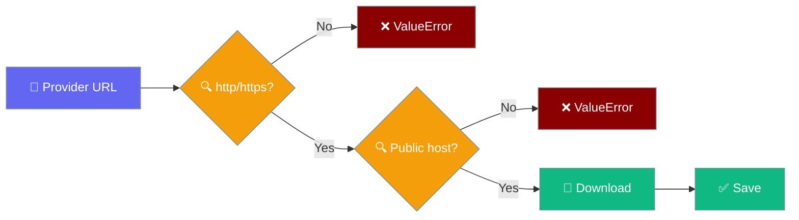

## Overview

Generate images from text prompts using DALL-E and other image generation models.

## Python Usage

### Basic Image Generation

```python
from praisonai.capabilities import image_generate

result = image_generate(
    prompt="A sunset over mountains",
    model="dall-e-3",
    size="1024x1024"
)

print(f"URL: {result[0].url}")
print(f"Revised prompt: {result[0].revised_prompt}")
```

### DALL-E 2 (Faster, Lower Cost)

```python
from praisonai.capabilities import image_generate

result = image_generate(
    prompt="A blue circle on white background",
    model="dall-e-2",
    size="256x256",
    n=1
)

print(f"URL: {result[0].url}")
```

### Save Image to File

```python
from praisonai.capabilities import image_generate

result = image_generate(
    prompt="A beautiful landscape",
    model="dall-e-3"
)

# Save to file
result[0].save("landscape.png")
```

`save()` writes base64 images locally and downloads URL images through a guarded fetch.



<Warning>
Image URLs are treated as untrusted. `save()` raises an error instead of downloading when a rule below is broken.
</Warning>

| Rule | Behaviour |
|---|---|
| Scheme | Only `http://` and `https://` — `file://`, `ftp://` and others raise `ValueError` |
| Host | `localhost`, loopback, private, link-local, multicast, reserved and cloud-metadata (`169.254.169.254`) addresses raise `ValueError` |
| Redirects | Refused — a 3xx response raises an HTTP error |
| Timeout | 30 seconds |
| Size cap | 50 MB — larger downloads raise `ValueError` |
| `b64_json` images | Decoded locally; no network request |

### Async Usage

```python
import asyncio
from praisonai.capabilities import aimage_generate

async def main():
    result = await aimage_generate(
        prompt="A futuristic city",
        model="dall-e-3"
    )
    print(f"URL: {result[0].url}")

asyncio.run(main())
```

### GPT-Image Models

```python
from praisonai.capabilities import image_generate

# Works out of the box — response_format is auto-dropped for gpt-image-*.
result = image_generate(
    prompt="A green pixel art landscape",
    model="gpt-image-1",
)

print(result[0].b64_json[:40], "…")
```

### Opt Out of Auto-Dropping

```python
from praisonai.capabilities import image_generate

# Pass drop_params=False to raise if any kwarg is unsupported by the model.
result = image_generate(
    prompt="A sunset over mountains",
    model="dall-e-3",
    drop_params=False,
)

print(result[0].url)
```

## Parameters

| Parameter | Type | Default | Description |
|-----------|------|---------|-------------|
| `prompt` | str | Required | Image description |
| `model` | str | "dall-e-3" | Model to use |
| `n` | int | 1 | Number of images |
| `size` | str | "1024x1024" | Image size |
| `quality` | str | "standard" | "standard" or "hd" (DALL-E 3 only) |
| `style` | str | None | "vivid" or "natural" (DALL-E 3 only) |
| `response_format` | str | "url" | "url" or "b64_json". Honoured only for `dall-e-2` and non-OpenAI providers. Silently dropped for `dall-e-3` and `gpt-image-*` because those APIs reject it. |
| `drop_params` | bool | True | When `True`, LiteLLM strips any params the target model does not support. Set to `False` to raise on unsupported params instead. |
| `timeout` | float | 600.0 | Request timeout |

### Model-specific parameter handling

The capability wrapper drops parameters a model rejects before calling LiteLLM, so calls succeed without special-casing.

| Model family | `response_format` | Notes |
|---|---|---|
| `dall-e-3` | Dropped by wrapper (OpenAI rejects it) | Always returns URL |
| `gpt-image-*` (e.g. `gpt-image-1`) | Dropped by wrapper (OpenAI rejects it) | Always returns base64 |
| `dall-e-2` | Honoured | `"url"` or `"b64_json"` |
| Non-OpenAI providers (e.g. `stability/...`) | Honoured where supported | `drop_params=True` strips anything unsupported |

<Note>
`drop_params=True` is injected per call — the global `litellm.drop_params` is left untouched. The same handling applies to `aimage_generate`, `image_edit`, and `aimage_edit`.
</Note>

## Result Object

The `ImageResult` object contains:

- `url`: Image URL
- `b64_json`: Base64 encoded image (if requested)
- `revised_prompt`: DALL-E 3's revised prompt
- `model`: Model used
- `save(path)`: Method to save image to file
