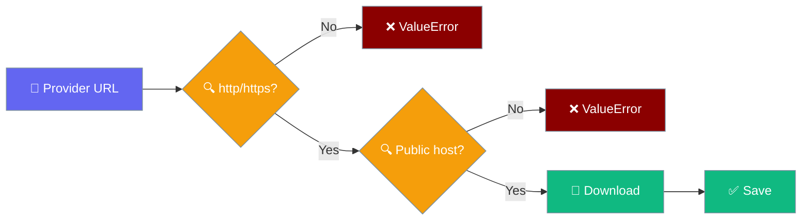

## Overview

Generate images from text prompts using OpenAI GPT image models (default `gpt-image-2.5-flare`) and other LiteLLM image models.

## Python Usage

### Basic Image Generation

```python
from praisonai.capabilities import image_generate

# Defaults to gpt-image-2.5-flare
result = image_generate(prompt="A sunset over mountains", size="1024x1024")

print(result[0].b64_json[:40], "…")
```

### Variations (dall-e-2)

OpenAI retired `dall-e-2`/`dall-e-3` on 2026-05-12 and `gpt-image-1` on 2026-10-23. `dall-e-2` is kept only as the `variation()` default, because it is the only model with a variations endpoint. Use [`ImageAgent.variation()`](/image/overview#image-variations) for that.

### Save Image to File

```python
from praisonai.capabilities import image_generate

result = image_generate(prompt="A beautiful landscape")

# Save to file
result[0].save("landscape.png")
```

`save()` writes base64 images locally and downloads URL images through a guarded fetch.



<Warning>
Image URLs are treated as untrusted. `save()` raises an error instead of downloading when a rule below is broken.
</Warning>

| Rule | Behaviour |
|---|---|
| Scheme | Only `http://` and `https://` — `file://`, `ftp://` and others raise `ValueError` |
| Host | `localhost`, loopback, private, link-local, multicast, reserved and cloud-metadata (`169.254.169.254`) addresses raise `ValueError` |
| Redirects | Refused — a 3xx response raises an HTTP error |
| Timeout | 30 seconds |
| Size cap | 50 MB — larger downloads raise `ValueError` |
| `b64_json` images | Decoded locally; no network request |

### Async Usage

```python
import asyncio
from praisonai.capabilities import aimage_generate

async def main():
    result = await aimage_generate(prompt="A futuristic city", quality="low")
    print(result[0].b64_json[:40], "…")

asyncio.run(main())
```

### GPT Image Models

```python
from praisonai.capabilities import image_generate

# response_format is auto-dropped for gpt-image-*; quality is sent as given.
result = image_generate(
    prompt="A green pixel art landscape",
    model="gpt-image-2.5-flare",
    quality="low",
)

print(result[0].b64_json[:40], "…")
```

Images 2.5/2.6 params — `frame_count`, `frame_duration_ms`, `complexity`, `output_format` (e.g. `"gif"`) — pass through `**kwargs` unchanged:

```python
image_generate("A bouncing ball", model="gpt-image-2.6-flare",
               frame_count=4, frame_duration_ms=100, output_format="gif")
```

### Editing with `markup=`

`image_edit` and `aimage_edit` accept `mask=` but reject `markup=` with a `ValueError` — LiteLLM does not upload `markup` as a file, so it would be silently ignored.

```python
from praisonai.capabilities import image_edit

image_edit("photo.png", "Make the cup blue", markup="markup.png")
# ValueError: 'markup' is not supported through LiteLLM's image_edit yet ...

image_edit("photo.png", "Make the cup blue", mask="mask.png")  # works
```

Need `markup`? Call the OpenAI SDK's `images.edit` directly.

Reference: [PR #6262](https://github.com/MervinPraison/PraisonAI/pull/6262), fixes [#6259](https://github.com/MervinPraison/PraisonAI/issues/6259).

### Opt Out of Auto-Dropping

```python
from praisonai.capabilities import image_generate

# Pass drop_params=False to raise if any kwarg is unsupported by the model.
result = image_generate(
    prompt="A sunset over mountains",
    model="gpt-image-2.5-flare",
    drop_params=False,
)

print(result[0].b64_json[:40], "…")
```

## Parameters

| Parameter | Type | Default | Description |
|-----------|------|---------|-------------|
| `prompt` | str | Required | Image description |
| `model` | str | `"gpt-image-2.5-flare"` | Model to use; sent as-is to LiteLLM. `image_edit` uses the same default. |
| `n` | int | 1 | Number of images |
| `size` | str | "1024x1024" | Image size |
| `quality` | `Optional[str]` | `None` | Sent whenever set, for any model. GPT image: `"low"`, `"medium"`, `"high"`, `"xhigh"`, `"max"`, `"auto"`. |
| `style` | `Optional[str]` | `None` | `"vivid"` or `"natural"` — sent only for `dall-e-3` (retired); ignored otherwise. |
| `response_format` | str | "url" | "url" or "b64_json". Honoured only for `dall-e-2` and non-OpenAI providers. Silently dropped for `gpt-image-*` and `dall-e-3` because those APIs reject it. |
| `drop_params` | bool | True | When `True`, LiteLLM strips any params the target model does not support. Set to `False` to raise on unsupported params instead. |
| `timeout` | float | 600.0 | Request timeout |
| `**kwargs` | | | Passed through, e.g. `frame_count`, `frame_duration_ms`, `complexity`, `output_format` |

### Model-specific parameter handling

The capability wrapper drops parameters a model rejects before calling LiteLLM, so calls succeed without special-casing.

| Model family | `response_format` | `quality` | Notes |
|---|---|---|---|
| `gpt-image-*` (e.g. `gpt-image-2.5-flare`) | Dropped by wrapper (OpenAI rejects it) | Sent when set | Always returns base64 |
| `dall-e-2` (variations only) | Honoured | — | `"url"` or `"b64_json"` |
| Non-OpenAI providers (e.g. `stability/...`) | Honoured where supported | Sent when set | `drop_params=True` strips anything unsupported |

<Note>
`drop_params=True` is injected per call — the global `litellm.drop_params` is left untouched. The same handling applies to `aimage_generate`, `image_edit`, and `aimage_edit`.
</Note>

## Result Object

The `ImageResult` object contains:

- `url`: Image URL
- `b64_json`: Base64 encoded image (always for GPT image models)
- `revised_prompt`: Revised prompt, if the provider returns one
- `model`: Model used
- `save(path)`: Method to save image to file
