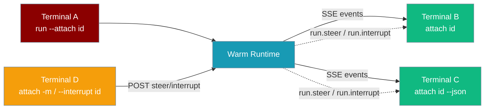
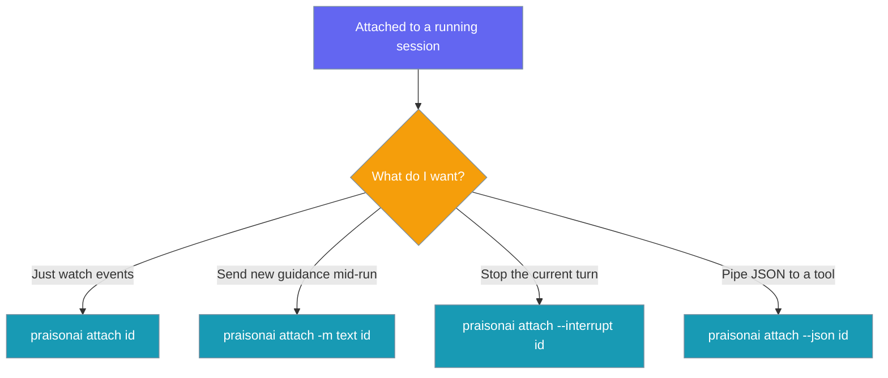
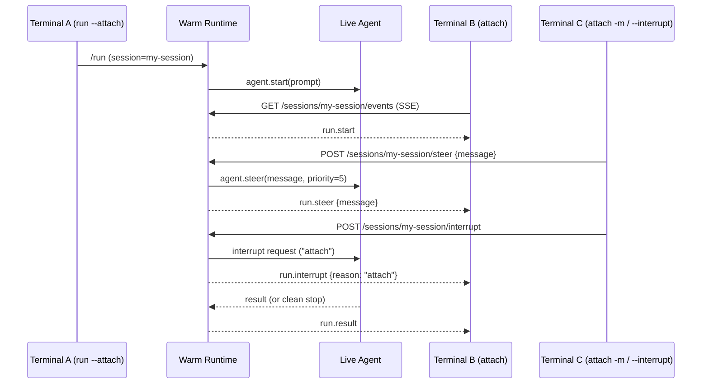

`praisonai attach` connects a second terminal to a live agent session on the warm runtime. By default it streams events read-only; with `--message` it steers the live turn, and with `--interrupt` it cancels it — both as one-shot sends that exit without streaming.



<Note>
Live-turn **steering** (`-m / --message`) and **interrupt** (`--interrupt`) landed in [PR #5847](https://github.com/MervinPraison/PraisonAI/pull/5847) (release after 2026-10-15). Earlier releases supported read-only observation only. If `attach -m` or `attach --interrupt` prints `runtime does not support …`, the warm daemon is older than your CLI — restart it with `praisonai daemon stop && praisonai daemon start`.
</Note>

## Quick Start

<Steps>
<Step title="Start the warm runtime">
```bash
praisonai daemon start --background
```
</Step>

<Step title="Run an agent with a session id (terminal A)">
```bash
praisonai run "Research topic X" --attach my-session
```
</Step>

<Step title="Attach from another terminal (terminal B)">
```bash
praisonai attach my-session
```
</Step>

<Step title="Steer the live turn from another terminal">
```bash
praisonai attach -m "also update the tests" my-session
```
Sends the steering message and exits. The running agent picks it up on its next tool-loop iteration.
</Step>

<Step title="Interrupt the live turn from another terminal">
```bash
praisonai attach --interrupt my-session
```
Requests a cooperative cancel and exits. The run stops at the next safe boundary.
</Step>
</Steps>

<Note>
**What `--attach <id>` really tags.** `--attach <id>` is an **event-stream label**, not a session identity. Two things happen independently:

1. **Persistence / continuity** is driven by `--session <id>` or `--continue` (a `--no-save` run has no session identity, so no history is loaded or saved).
2. **Live event fan-out** to `praisonai attach <id>` clients is driven by `--attach <id>` (falls back to the session id when `--attach` is omitted).

So `praisonai run "..." --no-save --attach obs-1` streams events to observers under `obs-1` but persists nothing; `praisonai run "..." --session s1` (no `--attach`) is observable under `s1` and its history is retained across turns; `praisonai run "..." --session s1 --attach obs-1` runs the stateful `s1` conversation but publishes its events under `obs-1`.
</Note>

---

## Usage

```bash
praisonai attach [--json] [--message TEXT] [--interrupt] <session-id>
```

<Warning>
Options must come **before** the session id. `praisonai attach <id> --json` and `praisonai attach <id> -m "..."` do **not** parse due to a Typer group-callback limitation. Always write `praisonai attach -m "..." <id>`.
</Warning>

| Argument / Option | Type | Default | Description |
|---|---|---|---|
| `session_id` | positional | required | Session id to attach to |
| `--json` | flag | `false` | Emit raw NDJSON events instead of human-readable output |
| `--message`, `-m` | string | `None` | Steer the live turn with this message, then exit (no streaming) |
| `--interrupt` | flag | `false` | Request a cooperative cancel of the live turn, then exit (no streaming) |

---

## Steering a live turn

Send mid-run guidance to a session that is already executing on the warm runtime; it lands on the agent's next tool-loop iteration without restarting the run.

```bash
# Terminal A — start a long-running agent on the warm runtime
praisonai run "Research solar market trends and write a 500-word summary" --attach my-session

# Terminal B — steer it mid-run
praisonai attach -m "Focus on the EU market only" my-session

# Terminal B (optional) — stop it early
praisonai attach --interrupt my-session
```

```
User (Term A):  praisonai run "research solar market trends..." --attach my-session
Agent:          (searching → reading → summarising …)
User (Term B):  praisonai attach -m "focus on the EU market only" my-session
Agent:          (next iteration picks up guidance, re-scopes the next search)
User (Term B):  praisonai attach --interrupt my-session
Agent:          ■ run.interrupt requested — stops at next safe boundary
```

<Tip>
The CLI always sends priority `5` (NORMAL). For `URGENT` (20) or `INTERRUPT` (30) priorities, call `agent.steer(message, priority=…)` from Python. See [Message Steering](/features/message-steering).
</Tip>

---

## Interrupting a live turn

`--interrupt` requests a cooperative cancel; the agent stops at the next safe boundary, so partial progress and conversation history stay intact.

```bash
praisonai attach --interrupt my-session
```

<Note>
`--interrupt` only cancels the **currently running turn**. The session stays warm — the next `praisonai run --session my-session "..."` continues from where the interrupted turn left off.
</Note>

---

## Which flag do I want?



Both flags can be combined (`-m "focus" --interrupt <id>`): the message is sent first, then the interrupt.

---

## How It Works



Attaching never starts execution; plain `attach` only observes, while `-m` and `--interrupt` act on a turn already in flight (not gated by the run lock). Detaching (Ctrl-C) does not stop the run on terminal A.

<Tip>
Events arrive over Server-Sent Events at `GET /sessions/{session_id}/events` with Bearer auth from the runtime lockfile. Session ids are percent-encoded on the wire. A `: keep-alive` comment is sent every ~15s and ignored.
</Tip>

---

## Event Reference

| Type | Fields | Human render |
|---|---|---|
| `run.start` | `session_id`, `prompt` | `▶ run.start: <prompt>` |
| `run.result` | `session_id`, `ok`, `result` | `✓ run.result` then result text |
| `run.error` | `session_id`, `error` | `✗ run.error: <error>` |
| `run.steer` | `session_id`, `message` | `↪ run.steer: <message>` |
| `run.interrupt` | `session_id`, `reason` | `■ run.interrupt requested` |

<Tabs>
<Tab title="Human output">
```
Attached to session 'my-session'. Ctrl-C to detach.
▶ run.start: Research topic X
✓ run.result
Here is the summary...
```
</Tab>
<Tab title="--json (NDJSON)">
```bash
praisonai attach my-session --json | jq 'select(.type=="run.result")'
```
```json
{"type": "run.start", "session_id": "my-session", "prompt": "Research topic X"}
{"type": "run.steer", "session_id": "my-session", "message": "Focus on the EU market only"}
{"type": "run.interrupt", "session_id": "my-session", "reason": "attach"}
{"type": "run.result", "session_id": "my-session", "ok": true, "result": "..."}
```
</Tab>
</Tabs>

---

## Exit Codes

| Code | Meaning |
|---|---|
| `0` | Clean detach (Ctrl-C), or steer/interrupt sent |
| `1` | No compatible warm runtime, runtime lacks steer/interrupt support, or stream lost mid-attach |
| `4` | Runtime module not importable |

---

## Common Patterns

**Watch a long-running agent from a second terminal** — start with `--attach`, observe progress without blocking terminal A.

**Pipe JSON into jq** — `praisonai attach my-session --json | jq 'select(.type=="run.result")'`.

**Multiple observers** — several terminals can attach to the same session concurrently; all receive the same events.

**Observe without persisting** — `praisonai run "..." --no-save --attach obs-1` streams events under `obs-1` for observers while keeping the run on the anonymous, non-persisted path.

**Steer a long multi-tool run from a second terminal** — `praisonai attach -m "focus on the EU market only" my-session` lands on the next tool-loop iteration without restarting the run.

**Stop a stuck turn without losing the session** — `praisonai attach --interrupt my-session` cancels the current turn only; the next `run --session my-session` continues from where it left off.

---

## Best Practices

<AccordionGroup>
<Accordion title="Start the daemon first">
Run `praisonai daemon start` before `run --attach`. Without a warm runtime, attach exits with code 1.
</Accordion>

<Accordion title="Use direct prompt runs only">
`--attach` on `praisonai run` works for direct prompts only — not YAML files, `--agent`, or `--command`.
</Accordion>

<Accordion title="Detaching is safe">
Ctrl-C in an attach terminal never cancels the underlying agent run.
</Accordion>

<Accordion title="One-shot steer and interrupt, not an interactive loop">
`-m` and `--interrupt` send one request and exit. Run them again from a second terminal as needed; there is no persistent input loop inside `attach`.
</Accordion>

<Accordion title="Older daemon? Restart it after upgrading">
If `attach -m` or `attach --interrupt` prints `runtime does not support …`, the warm daemon pre-dates PR #5847. Run `praisonai daemon stop && praisonai daemon start` to pick up the new routes.
</Accordion>

<Accordion title="Version mismatch after upgrade">
If CLI and daemon major versions differ, attach refuses to connect. Run `praisonai daemon stop && praisonai daemon start` after upgrading.
</Accordion>
</AccordionGroup>

---

## Related

<CardGroup cols={2}>
<Card title="Run" icon="play" href="/cli/run">
  `--attach` flag for tagging warm-runtime sessions
</Card>
<Card title="Daemon" icon="bolt" href="/cli/daemon">
  Warm runtime lifecycle and version handshake
</Card>
<Card title="Message Steering" icon="compass" href="/features/message-steering">
  Send guidance from Python with priority levels (URGENT / INTERRUPT)
</Card>
</CardGroup>
