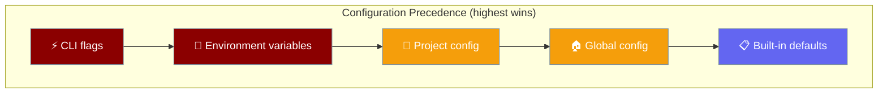
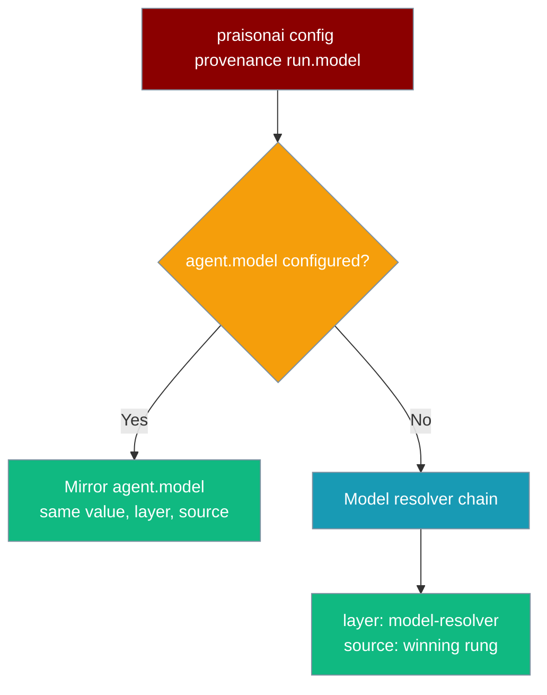
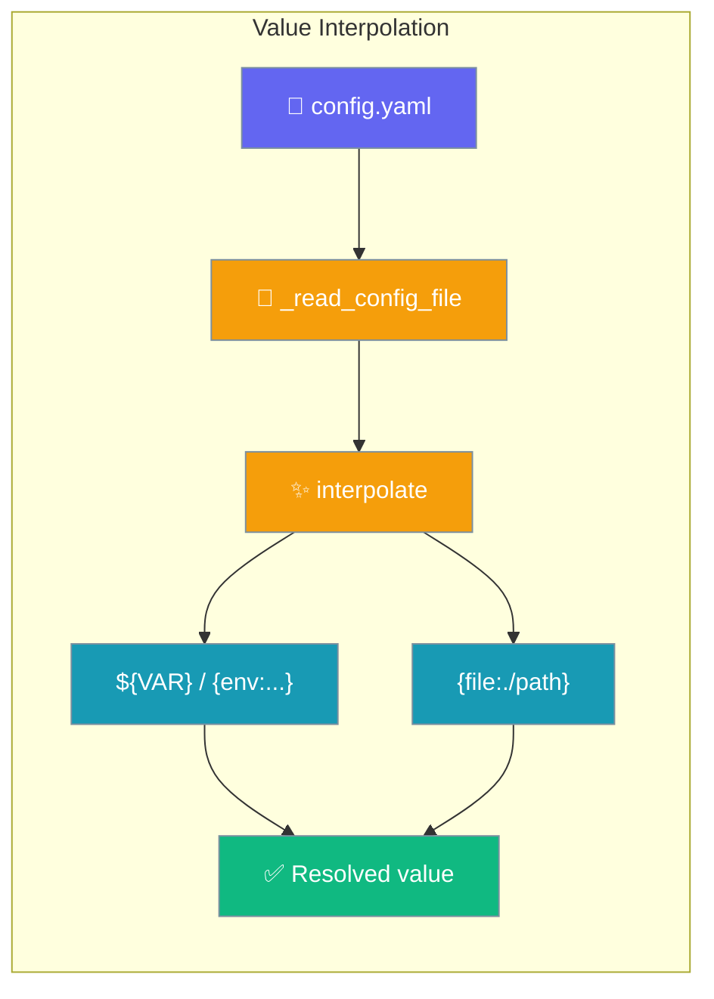

The `config` command manages layered CLI defaults — global, project, environment, and runtime flags merged into one resolved config.



## Quick Start

<Steps>
<Step title="Set a default model">

```bash
praisonai config set agent.model gpt-4o-mini
```

</Step>

<Step title="Verify resolution">

```bash
praisonai config show
```

</Step>
</Steps>

## Usage

```bash
praisonai config [OPTIONS] COMMAND [ARGS]...
```

## Commands

| Command | Description |
|---------|-------------|
| `show` | Show fully resolved configuration |
| `sources` | List configuration layers in precedence order |
| `provenance [KEY]` | Show the resolved value of each key **and** which layer/file supplied it, including a synthetic `run.model` key that reports the model a bare `run`/`chat`/`code` will actually dispatch |
| `validate [FILE]` | Validate YAML syntax and schema |
| `list` | List configuration values (`--scope all\|user\|project`) |
| `get KEY` | Get a value by dotted path (e.g. `agent.model`) |
| `set KEY VALUE` | Set a value (`--scope user\|project`) |
| `reset` | Reset config to defaults (`--scope user\|project`) |
| `path` | Show config file path |
| `env` | Show registered environment variables |
| `doctor` | Run configuration diagnostics |

### `show`

```bash
praisonai config show                          # YAML (default)
praisonai config show --format json            # JSON output
praisonai config show --format table           # Flat key=value table
praisonai config show --sources                # Include contributing layers
```

<Note>
When `mcp` or `permissions` are set in any config layer, `praisonai config show` includes those sections in the output.
</Note>

### `validate`

Validates discovered config files against the schema, catching typos with `difflib`-based suggestions.

```bash
praisonai config validate                          # Validate discovered configs (warn-by-default)
praisonai config validate .praisonai/config.yaml   # Validate a specific file
praisonai config validate --strict-config          # Treat warnings as errors (exit 1)
praisonai config validate --json                   # Machine-readable output
```

Example output for a typo:

```
⚠ Unknown config key 'temprature' in .praisonai/config.yaml (section: agent). Did you mean 'temperature'?
⚠ Configuration loaded with 1 warning(s).
ℹ Use --strict-config (or PRAISONAI_STRICT_CONFIG=1) to fail on these.
```

| Flag | Type | Default | Behaviour |
|------|------|---------|-----------|
| `--strict-config` / `--strict` | `bool` | `False` | Treat unknown/typo keys as errors (exit `1`) |
| `--json` | `bool` | `False` | Emit `{valid, warnings, sources, hint}` JSON |

### `sources`

```bash
praisonai config sources
```

Prints the five-layer hierarchy and which global/project/env sources are currently active.

### `provenance`

```bash
praisonai config provenance                     # all keys, text output
praisonai config provenance agent.model         # one key
praisonai config provenance agent.model --json  # machine-readable
praisonai config provenance run.model           # the model a bare run will use
```

Prints the reconciled resolved view: every key that survived the deep-merge, its winning value, its layer (`defaults` / `global` / `project` / `environment` / `cli`), and the absolute path of the file that supplied it (`(runtime)` for env / CLI / built-in defaults). It also adds a synthetic `run.model` key (below) which may report the extra `model-resolver` layer.

Reach for this when `praisonai config show` returns a value you did not expect and you need to find *which* file set it.

Single key, text output:

```
$ praisonai config provenance agent.model
agent.model = gpt-4o-mini
  layer: project  source: /home/alice/proj/.praisonai/config.yaml
```

All keys, text output:

```
$ praisonai config provenance
Resolved configuration (per-key provenance):

  agent.model = gpt-4o-mini
      project · /home/alice/proj/.praisonai/config.yaml
  agent.temperature = 0.7
      defaults · (defaults)
  telemetry = true
      global · /home/alice/.praisonai/config.yaml
```

JSON output (via the global `--json` flag):

```json
{
  "agent.model": {
    "value": "gpt-4o-mini",
    "layer": "project",
    "source": "/home/alice/proj/.praisonai/config.yaml"
  },
  "agent.temperature": {
    "value": 0.7,
    "layer": "defaults",
    "source": null
  }
}
```

A missing key exits `1` with `Key not found: <key>`.

#### The `run.model` key

`run.model` reports the model that a bare `praisonai run`, `praisonai chat`, or `praisonai code` would actually dispatch — accounting for both the config layers above and the separate model-resolution chain used when no `agent.model` is set.



When the `model-resolver` layer wins, `source` tells you which rung of the [default model ladder](/docs/features/local-first-run#detection-order) picked the model:

| `source` | Meaning |
|----------|---------|
| `explicit` | Model passed explicitly — only from `explain_default_model(explicit=...)` in Python; `config provenance` never reports it |
| `state:<path>` | Recent user-chosen model persisted at `<state_dir>/model.json` |
| `env:MODEL_NAME` | `MODEL_NAME` env var is set |
| `env:OPENAI_MODEL_NAME` | `OPENAI_MODEL_NAME` env var is set |
| `local` | No cloud credential; a reachable local OpenAI-compatible server (e.g. Ollama) was detected |
| `provider:<ENV_VAR>` | A provider credential (e.g. `provider:ANTHROPIC_API_KEY`) is present; its default model was picked |
| `fallback` | None of the above; the terminal fallback (`gpt-4o-mini`) was picked |

Configured in a project file:

```
$ praisonai config provenance run.model
run.model = gpt-4o-mini
  layer: project  source: /home/alice/proj/.praisonai/config.yaml
```

Set via `MODEL_NAME` (the environment layer feeds `agent.model`, exactly as `run` sees it):

```
$ MODEL_NAME=gpt-env praisonai config provenance run.model
run.model = gpt-env
  layer: environment  source: (runtime)
```

Nothing configured, Ollama running locally:

```
$ praisonai config provenance run.model
run.model = ollama/llama3.2
  layer: model-resolver  source: local
```

JSON output:

```json
{
  "key": "run.model",
  "value": "anthropic/claude-3-5-sonnet-latest",
  "layer": "model-resolver",
  "source": "provider:ANTHROPIC_API_KEY"
}
```

<Note>
**Why this exists ([PraisonAI #5906](https://github.com/MervinPraison/PraisonAI/issues/5906)).** The config layers alone do not reveal which model `praisonai run` picks, because the default model resolver has its own precedence chain. `run.model` makes that chain visible.
</Note>

### `list`

```bash
praisonai config list                     # resolved, merged config (default: --scope all)
praisonai config list --scope user        # only what ~/.praisonai/config contributes
praisonai config list --scope project     # only what ./.praisonai/config contributes
```

<Note>
**Fixed in PraisonAI PR #4946.** `--scope` (`-s`) now selects a single layer. Previously `--scope user` and `--scope project` produced **byte-identical** output because the body always printed the fully merged config. Valid scopes are `all` (default), `user`, and `project`; an unknown scope exits `2`.
</Note>

| Scope | Shows |
|-------|-------|
| `all` (default) | The resolved, deep-merged configuration across all layers |
| `user` | Only the global user config file's contribution |
| `project` | Only this project's config file contribution |

### `set` / `get` / `reset` / `path`

```bash
praisonai config set agent.model gpt-4o-mini
praisonai config set agent.temperature 0.3 --scope project
praisonai config get agent.model
praisonai config reset --scope project -y
praisonai config path --scope user
```

| Scope | File | Permissions |
|-------|------|-------------|
| `user` (default) | `~/.praisonai/config.yaml` | `0600` |
| `user` (default) | `~/.praisonai/config.toml` | `0644` |
| `project` | `./.praisonai/config.yaml` | `0644` |

`praisonai config set` / `praisonai config reset` write TOML to the canonical `~/.praisonai/config.toml`. Both the canonical home and the `config.yaml` written by `setup` / `init` honour `PRAISONAI_HOME` — see [CLI Home Root](/docs/features/cli-configuration#cli-home-root).

---

## Strict Validation

Unknown or mistyped keys are reported with the closest valid match. By default they are **warnings** — your valid keys still apply. Opt into **strict** mode to fail-fast.

| Mode | Trigger | Behaviour |
|------|---------|-----------|
| Warn (default) | — | Logs `UserWarning` per unknown key, run continues |
| Strict (per-call) | `--strict-config` on `config validate` or `ConfigResolver(strict=True)` | Raises `ValueError` on first unknown key |
| Strict (global) | `PRAISONAI_STRICT_CONFIG=1` env var | All resolver calls run in strict mode |

```bash
# Catch typos in CI:
PRAISONAI_STRICT_CONFIG=1 praisonai config validate

# Or per-call:
praisonai config validate --strict-config
```

The validator inspects the **raw** discovered config (before normalisation through `ResolvedConfig`), so nested mistakes like `agent.temprature` surface instead of being silently dropped.

---

## Configuration File

Primary format is **YAML** at `~/.praisonai/config.yaml` (global) or `./.praisonai/config.yaml` (project):

```yaml
agent:
  model: gpt-4o-mini
  temperature: 0.7
  max_tokens: 16000
  stream: true

mcp:
  servers:
    playwright:
      command: ["npx", "-y", "@playwright/mcp"]

permissions:
  default: ask
  rules:
    - { pattern: "bash:git *", action: allow }
    - { pattern: "bash:rm *",  action: deny }

output:
  verbose: false
  color: true

telemetry: true
```

<Note>
Model lives under `agent.model`, not at the top level. See [CLI Configuration](/features/cli-configuration) for the full schema.
</Note>

### Project discovery

From `cwd`, the resolver walks up to the git root or `$HOME` (whichever comes first) searching:

1. `.praisonai/config.yaml`
2. `.praisonai/config.yml`
3. `praisonai.yaml` / `praisonai.yml` (canonical project-root config, added in PR #3422)
4. `praison.yaml` / `praison.yml` (legacy fallback, discovered for backward compat)
5. `.praison/config.toml` (legacy global; loaded exclusively as `global:` when at `$HOME`)

At `$HOME` the legacy `.praison/config.toml` name is skipped — it is loaded exactly once as `global:` by the global loader (see [Walk-up Boundaries](/docs/features/cli-configuration#walk-up-boundaries)).

---

## Value Interpolation

Every value in every discovered config file is interpolated at load time, so secrets and reused prompt bodies can live outside your tracked config.



| Directive | Meaning | If the value is missing |
|-----------|---------|-------------------------|
| `${VAR}` | Legacy environment variable substitution | Directive kept literally when unset |
| `{env:VAR}` | Environment variable, no default | Directive kept literally when unset |
| `{env:VAR:-default}` | Environment variable with shell-style fallback (`:-`) | Returns `default` (may be empty) |
| `{file:./path}` | Read the referenced file's contents into the value (trailing newline stripped); path resolves **relative to the directory of the config file** | Directive kept literally on read failure or security refusal |

All four in one file:

```yaml
agent:
  model: ${PRAISONAI_MODEL}                  # legacy shell form
  provider: "{env:PRAISONAI_PROVIDER:-openai}"  # with default
  system_prompt: "{file:./prompts/system.md}"   # file include

telemetry: "{env:PRAISONAI_TELEMETRY:-true}"
```

<Warning>
`{file:}` reads are confined to the directory of the config file being loaded. Absolute paths, home-relative (`~/…`) paths, and `../` traversals that escape that directory are all refused — the literal directive stays in the value and no file is read. Interpolation runs in a **single pass**, so an expanded `${VAR}` that itself contains `{file:…}` is never re-scanned (no chained-directive injection). A `{file:}` directive with no base directory (e.g. an ad-hoc string) is refused entirely.
</Warning>

<Note>
`${VAR}` and `{env:VAR}` with no default are preserved as-is when the variable is unset — the directive stays visible in `praisonai config show` so a typo doesn't silently become an empty string.
</Note>

### From Python

```python
from praisonai_code.cli.configuration.resolver import ConfigResolver

provenance = ConfigResolver().resolve_with_provenance()
print(provenance["agent.model"])
# {'value': 'gpt-4o-mini', 'layer': 'project',
#  'source': '/home/alice/proj/.praisonai/config.yaml'}
```

To see which model a bare run would pick (and why) when `agent.model` is unset:

```python
from praisonai_code.cli.configuration.model_resolver import explain_default_model

model, source = explain_default_model()
print(model, source)
# e.g. "anthropic/claude-3-5-sonnet-latest provider:ANTHROPIC_API_KEY"
```

`explain_default_model()` is side-effect free — it never persists a model or prints a notice.

---

## `agent.*` Schema

| Key | Type | Default | Description |
|-----|------|---------|-------------|
| `agent.model` | `str` | — | Default model; if unset, resolved via the [provider-aware ladder](/docs/cli/setup#what-happens-if-you-skip---model) rather than a hardcoded OpenAI default |
| `agent.provider` | `str` | — | Provider name |
| `agent.base_url` | `str` | — | Custom API base URL |
| `agent.tools` | `list[str]` | `[]` | Default tool names |
| `agent.toolset` | `str` | — | Named toolset |
| `agent.default_agent` | `str` | — | Default agent slug |
| `agent.memory` | `bool`/`dict` | — | Memory config |
| `agent.stream` | `bool` | `true` | Stream responses |
| `agent.temperature` | `float` | `0.7` | Sampling temperature |
| `agent.max_tokens` | `int` | `16000` | Max output tokens |

Store API keys via env vars or [`praisonai auth`](/cli/auth) — `api_key` is never written to YAML.

<Note>
Editor autocomplete: `praisonai init` writes a `# yaml-language-server: $schema=...` pointer to [`config.schema.json`](https://raw.githubusercontent.com/MervinPraison/PraisonAI/main/src/praisonai/praisonai/cli/configuration/config.schema.json). VS Code (YAML extension) and other LSP editors validate against the published schema.
</Note>

---

## `mcp.servers.<name>` Schema

| Key | Type | Default | Description |
|-----|------|---------|-------------|
| `command` | `list[str]` or `str` | — | Local (stdio) server launch command. List form preferred. |
| `args` | `list[str]` | `[]` | Extra args appended to `command`. |
| `env` | `dict[str, str]` | `{}` | Env vars for the server process. |
| `enabled` | `bool` | `true` | Set `false` to declare-but-not-wire a server. |
| `type` | `"remote"` | — | Marks a remote server; skipped by the run command-string path. |
| `url` | `str` | — | Remote endpoint; presence implies remote. |

---

## `permissions.*` Schema

| Key | Type | Default | Description |
|-----|------|---------|-------------|
| `default` | `"allow"` \| `"deny"` \| `"ask"` | — | Fallback action when no rule matches. |
| `rules` | `list[{pattern, action}]` | `[]` | Structured rule list. `action` must be `allow`, `deny`, or `ask`. |
| `<pattern>` | `"allow"` \| `"deny"` \| `"ask"` | — | Flat shorthand — same shape as `--allow`/`--deny` produces. |

---

## Environment Variables

| Variable | Maps to |
|----------|---------|
| `MODEL_NAME` / `OPENAI_MODEL_NAME` / `PRAISONAI_MODEL` | `agent.model` |
| `PRAISONAI_PROVIDER` | `agent.provider` |
| `OPENAI_BASE_URL` / `OPENAI_API_BASE` / `PRAISONAI_BASE_URL` | `agent.base_url` |
| `PRAISONAI_OUTPUT_FORMAT` | `output.format` |
| `PRAISONAI_COLOR` | `output.color` |
| `PRAISONAI_VERBOSE` | `output.verbose` |
| `PRAISONAI_QUIET` | `output.quiet` |
| `PRAISONAI_TELEMETRY` | `telemetry` |
| `OPENAI_API_KEY` / `ANTHROPIC_API_KEY` | Secrets (env only) |

---

## Legacy Formats

Legacy paths still work and are migrated on read:

| Path | Status |
|------|--------|
| `~/.praison/config.toml` | **Read-only** legacy fallback — migrated to `agent.*` / `rag.*`; resolved only if the canonical `~/.praisonai/config.yaml` is absent |
| `~/.praisonai/.env` | Merged for model/provider when no YAML |
| `.praison/config.toml` (project) | Found via walk-up discovery |

TOML `[rules]`, `[output]`, `[mcp]`, `[traces]`, and `[session]` sections remain valid in legacy files. New projects should use YAML.

<Note>
The CLI wrapper now roots sessions, traces, logs, cache, and state under the canonical `~/.praisonai/` home (override with `PRAISONAI_HOME`). The legacy `~/.praison/config.toml` is read-only: writers (`config set`, `reset`) always land on the canonical path, so an update never mutates the legacy file — migration is one-way.
</Note>

---

## See Also

- [Single-Source Config](/features/single-source-config) — Model + MCP + permissions in one file
- [CLI Configuration](/features/cli-configuration) — feature guide with diagrams and best practices
- [Declarative Permissions](/features/declarative-permissions) — all permission surfaces
- [Profile](/cli/profile) — Performance profiling
- [Environment](/cli/env) — Environment diagnostics
