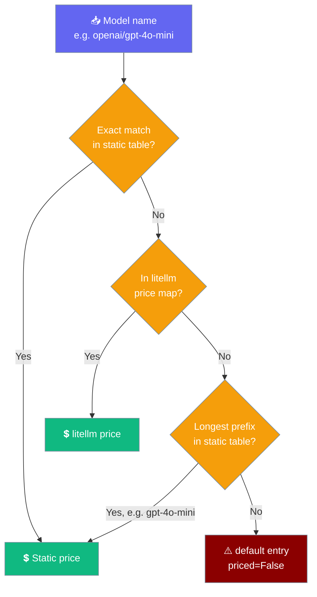

# Cost Tracking

PraisonAI CLI provides comprehensive cost tracking to help you monitor token usage and expenses across your AI coding sessions. Know exactly what you're spending in real-time.

See [Usage](/cli/usage) for cross-session aggregate reporting.

## Overview

The cost tracking system monitors:
- **Token usage** - Input, output, and cached tokens
- **Cost calculation** - Real-time cost based on model pricing
- **Session statistics** - Aggregated stats across requests
- **Model breakdown** - Usage per model

## Per-session totals

After every `praisonai run` with an active session, a compact footer prints to stdout:

```bash
praisonai run "Refactor auth.py" --session refactor
# → 1,240 in / 3,980 out · $0.0140

praisonai session list
# → Tokens/Cost columns now populated

praisonai run "and add tests" --continue --session refactor
# → totals accumulate, not reset
```

Totals persist in session metadata and survive resume. Multi-model runs are priced per-model — each call is priced against its own model via `get_pricing(model)`, then summed. The footer is silenced under `--output json`.

To aggregate these persisted totals across many sessions — by day, model, or project — see [Usage](/cli/usage).

---

## Quick Start

```bash
# View costs during interactive session
>>> /cost

# Or use the Python API
from praisonai.cli.features import CostTrackerHandler

tracker = CostTrackerHandler()
tracker.initialize()
tracker.track_request("gpt-4o", input_tokens=1000, output_tokens=500)
print(f"Total cost: ${tracker.get_cost():.4f}")
```


## How a model name is matched

PraisonAI picks a price in this order: an exact match in the small built-in table below (a leading `provider/` is ignored, so `openai/gpt-4o-mini` matches `gpt-4o-mini`), then litellm's bundled catalogue (1000+ models — no setup needed), then the longest matching family prefix (so `gpt-4o-mini-2024-07-18` prices as `gpt-4o-mini`, but `gpt-4.1-mini` never prices as `gpt-4`). If none match, the cost is reported as **unknown** rather than guessed.



```python
from praisonai_code.cli.features.cost_tracker import get_pricing

print(get_pricing("openai/gpt-4o-mini").model_name)      # gpt-4o-mini
print(get_pricing("my-local-model").priced)              # False
```

## Supported Models

This is the built-in static table — the fast shortcut for common models. Anything not listed here is looked up in litellm's bundled price map next (see [How a model name is matched](#how-a-model-name-is-matched)).

### OpenAI Models

| Model | Input (per 1M) | Output (per 1M) |
|-------|----------------|-----------------|
| gpt-4o | $2.50 | $10.00 |
| gpt-4o-mini | $0.15 | $0.60 |
| gpt-4-turbo | $10.00 | $30.00 |
| o1 | $15.00 | $60.00 |
| o1-mini | $3.00 | $12.00 |
| o3-mini | $1.10 | $4.40 |

### Anthropic Models

| Model | Input (per 1M) | Output (per 1M) |
|-------|----------------|-----------------|
| claude-3-5-sonnet | $3.00 | $15.00 |
| claude-3-opus | $15.00 | $75.00 |
| claude-3-haiku | $0.25 | $1.25 |

### Google Models

| Model | Input (per 1M) | Output (per 1M) |
|-------|----------------|-----------------|
| gemini-2.0-flash | $0.10 | $0.40 |
| gemini-1.5-pro | $1.25 | $5.00 |
| gemini-1.5-flash | $0.075 | $0.30 |

## Python API

### Basic Tracking

```python
from praisonai.cli.features import CostTrackerHandler

# Initialize tracker
handler = CostTrackerHandler()
tracker = handler.initialize(session_id="my-session")

# Track a request
stats = handler.track_request(
    model="gpt-4o",
    input_tokens=1000,
    output_tokens=500,
    cached_tokens=200,
    duration_ms=1500.0
)

# Get totals
print(f"Total tokens: {handler.get_tokens()}")
print(f"Total cost: ${handler.get_cost():.4f}")
```

### Session Statistics

```python
# Get detailed summary
summary = handler.get_summary()

print(f"Session ID: {summary['session_id']}")
print(f"Total requests: {summary['total_requests']}")
print(f"Input tokens: {summary['total_input_tokens']}")
print(f"Output tokens: {summary['total_output_tokens']}")
print(f"Cached tokens: {summary['total_cached_tokens']}")
print(f"Total cost: ${summary['total_cost']:.4f}")
print(f"Avg cost/request: ${summary['avg_cost_per_request']:.4f}")
```

### Tracking from LLM Responses

```python
from praisonai.cli.features.cost_tracker import CostTracker

tracker = CostTracker()

# Track from OpenAI-style response
response = openai_client.chat.completions.create(...)
tracker.track_from_response("gpt-4o", response)

# Track from dict response
response_dict = {
    "usage": {
        "prompt_tokens": 500,
        "completion_tokens": 200
    }
}
tracker.track_from_response("gpt-4o", response_dict)
```

### Export Session Data

```python
import json

# Export to JSON
json_str = tracker.export_json()
data = json.loads(json_str)

# Structure:
# {
#   "session": {
#     "session_id": "abc123",
#     "start_time": "2024-01-01T12:00:00",
#     "total_requests": 10,
#     "total_cost": 0.0425,
#     ...
#   },
#   "requests": [
#     {"model": "gpt-4o", "input_tokens": 1000, ...},
#     ...
#   ]
# }

# Save to file
with open("session_costs.json", "w") as f:
    f.write(json_str)
```

### Collected Usage Helpers

The interactive `/cost` command and the headless `code -p --output json` envelope both read the global token collector through these helpers, so the two always agree. Use them to build your own surface:

```python
from praisonai_code.cli.features.cost_tracker import (
    price_collected_usage,
    reset_collected_usage,
    collected_usage_line,
)

usage = price_collected_usage("gpt-4o-mini")
# {"in": 1000, "out": 100, "cost": 0.00021}  — cost is None for unknown models

reset_collected_usage()   # start the next conversation at 0

tokens, cost_text = collected_usage_line("my-local-model")
# tokens=15, cost_text="unknown (no price for this model)"
```

<Note>
Each model in the collector is priced separately. If **any** of them has no known price, `cost` is `None` instead of a partial or made-up figure.
</Note>

## CLI Integration

### Interactive Mode

```bash
praisonai chat

>>> Help me refactor this code
[AI responds...]

>>> /cost
Model:          gpt-4o-mini
Total tokens:   1100
Estimated cost: $0.0002
```

When the model has no known price:

```text
Model:          my-local-model
Total tokens:   15
Estimated cost: unknown (no price for this model)
```

`/cost` (and its alias `/stats` in the async TUI) reads real totals from the global token collector via `price_collected_usage()` on every surface — the async TUI, the legacy REPL, and `tui_app`. The layout differs slightly per surface (the legacy REPL omits the `Model:` line; `tui_app` prints `Tokens: 1100 | Cost: $0.0002`), but the numbers are the same. `/new` and `/clear` in the async TUI, and `/clear` in the legacy REPL, reset the totals to zero (`tui_app`'s `/clear` only clears the screen).

### Token Breakdown

```bash
>>> /tokens
╭─────────────────────────────────────╮
│          Token Breakdown            │
├─────────────────────────────────────┤
│ Input tokens:  2,500 (75.8%)        │
│ Output tokens: 800 (24.2%)          │
│ Cached tokens: 500 (saved)          │
│                                     │
│ Context window: 128,000             │
│ Used: 2.6%                          │
╰─────────────────────────────────────╯
```

## Cost Calculation

### How Costs Are Calculated

```python
from praisonai.cli.features.cost_tracker import ModelPricing

# Get pricing for a model
pricing = ModelPricing(
    model_name="gpt-4o",
    input_price_per_1m=2.50,
    output_price_per_1m=10.00
)

# Calculate cost
input_tokens = 1000
output_tokens = 500

cost = pricing.calculate_cost(input_tokens, output_tokens)
# (1000 / 1,000,000 * 2.50) + (500 / 1,000,000 * 10.00)
# = 0.0025 + 0.005
# = $0.0075
```

### Custom Pricing

Add pricing for custom or new models:

```python
from praisonai_code.cli.features.cost_tracker import ModelPricing, DEFAULT_PRICING, CostTracker

# Add custom model pricing
DEFAULT_PRICING["my-custom-model"] = ModelPricing(
    model_name="my-custom-model",
    input_price_per_1m=1.00,
    output_price_per_1m=2.00,
    context_window=32000,
    # priced=True by default — set False only for placeholder entries
)

# Now tracking will use this pricing
tracker = CostTracker()
tracker.track_request("my-custom-model", 1000, 500)
```

`priced=False` means `/cost` and the headless envelope report `unknown` / `null` for this model instead of multiplying by the placeholder rate.

## Per-session persistence

Usage is now accumulated into the session metadata at `~/.praisonai/sessions/<id>.json` under a `usage` blob, so costs persist across terminal sessions and are visible in `praisonai session list`.

```mermaid
sequenceDiagram
    participant User
    participant CLI as praisonai CLI
    participant Agent
    participant Store as Session store

    User->>CLI: praisonai run "task" (session active)
    CLI->>Agent: agent.start(...)
    Agent-->>CLI: response + per-call usage
    CLI->>Store: accumulate_session_usage(session_id, model)
    Store-->>CLI: merged cumulative usage
    CLI-->>User: response + "1,240 in / 3,980 out · $0.0140"
    Note over User: later...
    User->>CLI: praisonai run --continue
    CLI->>Store: read_session_usage(session_id)
    Store-->>CLI: cumulative totals
    CLI-->>User: resume panel with "Usage:" line

    classDef user fill:#6366F1,stroke:#7C90A0,color:#fff
    classDef cli fill:#8B0000,stroke:#7C90A0,color:#fff
    classDef agent fill:#F59E0B,stroke:#7C90A0,color:#fff
    classDef store fill:#189AB4,stroke:#7C90A0,color:#fff
```

**How it works:**

- After each run, `accumulate_session_usage` merges the new per-call usage from `praisonaiagents.telemetry.token_collector` into the session file.
- The `token_collector` is then **reset** to avoid double-counting on the next run.
- Pricing comes from `cli/features/cost_tracker.get_pricing(model)` — the same model price table used by `/cost`.
- Resuming with `praisonai run --continue` or `praisonai run --session <id>` rehydrates `RehydratedSession.usage` so the cumulative totals continue accumulating.

**Sessions stored in the global store** (created via the gateway or TUI) are handled transparently — `_resolve_usage_store` prefers whichever record already carries `usage`, so resuming a globally-stored session keeps accumulating into the original record.

**Persisted `usage` blob keys:**

| Key | Type | Notes |
|---|---|---|
| `input_tokens` | `int` | Cumulative prompt tokens |
| `output_tokens` | `int` | Cumulative completion tokens |
| `cached_tokens` | `int` | Cumulative cached / prefix-hit tokens (when the provider reports them) |
| `total_tokens` | `int` | `input + output` (cached not double-counted); mirrored to flat `total_tokens` on session metadata |
| `cost` | `float` | USD; mirrored to flat `cost` on session metadata |
| `requests` | `int` | Count of `agent.start()` runs that produced usage |

```bash
# View current session costs
praisonai session list

ID         Name            Status   Events  Tokens   Cost     Updated
abc12345   research-bot    active   12      12,345   $0.0140  2026-06-29 23:48 UTC
```

Cross-link: see [Session](/cli/session) for the full `session list` column reference and [Run](/cli/run) for the per-run usage footer.

## Scheduler Integration

`AgentScheduler` and `AsyncAgentScheduler` price every run through `ModelPricing` (since [PR #2171](https://github.com/MervinPraison/PraisonAI/pull/2171)). Any model you register here becomes spendable from the scheduler's `max_cost` brake:

```python
from praisonai.cli.features.cost_tracker import ModelPricing, DEFAULT_PRICING
from praisonai.scheduler import AsyncAgentScheduler

DEFAULT_PRICING["my-org/custom-llm"] = ModelPricing(
    model_name="my-org/custom-llm",
    input_price_per_1m=0.80,
    output_price_per_1m=2.40,
    context_window=32000,
)

scheduler = AsyncAgentScheduler(agent, task="Hourly digest", max_cost=5.00)
```

Unknown models fall back to the `default` entry (currently $1 input / $3 output per 1M tokens) with its `priced` flag set to `False`. The scheduler's `max_cost` brake still uses this conservative figure, so budgets stay enforced — but surfaces like `/cost` and the headless `code -p --output json` envelope report **unknown** / `null` for the cost instead of a made-up number. See [Async Agent Scheduler](/features/async-agent-scheduler) for the full budget pattern.

## Real-Time Monitoring

### Display During Operations

```python
from praisonai.cli.features.cost_tracker import CostTracker

tracker = CostTracker()

# After each request, show running total
def on_request_complete(model, input_tokens, output_tokens):
    stats = tracker.track_request(model, input_tokens, output_tokens)
    print(f"Request cost: ${stats.cost:.4f}")
    print(f"Session total: ${tracker.get_total_cost():.4f}")
```

### Budget Alerts

```python
BUDGET_LIMIT = 1.00  # $1.00

def check_budget():
    current_cost = tracker.get_total_cost()
    if current_cost > BUDGET_LIMIT:
        print(f"⚠️ Budget exceeded! Current: ${current_cost:.2f}")
        return False
    elif current_cost > BUDGET_LIMIT * 0.8:
        print(f"⚠️ 80% of budget used: ${current_cost:.2f}")
    return True
```

## Session Management

### Multiple Sessions

```python
# Create separate trackers for different tasks
refactor_tracker = CostTracker(session_id="refactor-task")
test_tracker = CostTracker(session_id="test-generation")

# Track separately
refactor_tracker.track_request("gpt-4o", 2000, 1000)
test_tracker.track_request("gpt-4o-mini", 500, 200)

# Compare costs
print(f"Refactoring: ${refactor_tracker.get_total_cost():.4f}")
print(f"Testing: ${test_tracker.get_total_cost():.4f}")
```

### End Session

```python
# End session and get final stats
final_stats = tracker.end_session()

print(f"Session ended at: {final_stats.end_time}")
print(f"Total duration: {final_stats.duration_seconds:.1f}s")
print(f"Final cost: ${final_stats.total_cost:.4f}")
```

## Best Practices

### Cost Optimization

1. **Use appropriate models** - gpt-4o-mini for simple tasks
2. **Monitor token usage** - Check `/tokens` regularly
3. **Enable caching** - Reduces input token costs
4. **Batch operations** - Fewer requests = lower overhead

### Tracking Tips

1. **Name sessions** - Use descriptive session IDs
2. **Export regularly** - Save session data for analysis
3. **Set budgets** - Implement budget alerts
4. **Review by model** - Identify expensive operations

## Environment Variables

```bash
# Set default budget limit
export PRAISONAI_BUDGET_LIMIT=10.00

# Enable cost display after each request
export PRAISONAI_SHOW_COSTS=true

# Custom pricing file
export PRAISONAI_PRICING_FILE=/path/to/pricing.json
```

## Aggregate reporting: `praisonai usage`

The per-session totals persisted here feed the `praisonai usage` report, which aggregates spend across sessions by day, model, or project.

```bash
# Last 30 days, grouped by day
praisonai usage

# This week, by model
praisonai usage --days 7 --by model
```

See [Usage](/cli/usage) for the full command reference, grouping options, and JSON output shape.

## Related Features

- [Usage](/cli/usage) - Aggregate spend/token reporting across sessions
- [Slash Commands](/cli/slash-commands) - Use `/cost` command
- [Metrics](/cli/metrics) - Detailed performance metrics
- [Telemetry](/cli/telemetry) - Usage analytics
- [Session](/cli/session) - Per-session token and cost columns in `session list`
- [Run](/cli/run) - Per-run usage footer after each prompt
- [Usage](/cli/usage) - Cross-session aggregate token and cost reporting
