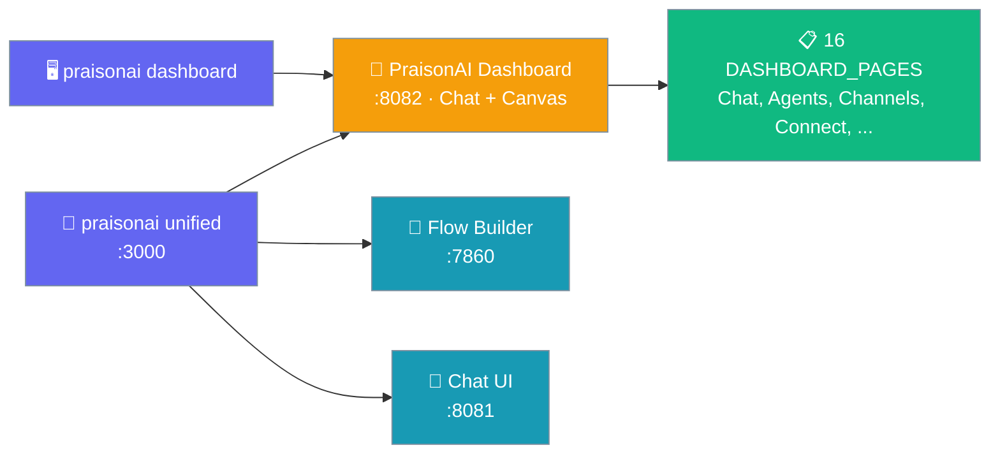
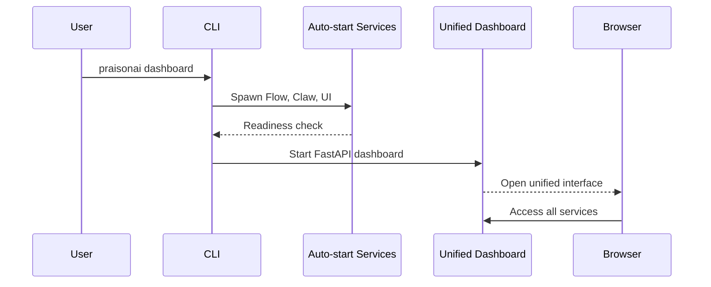
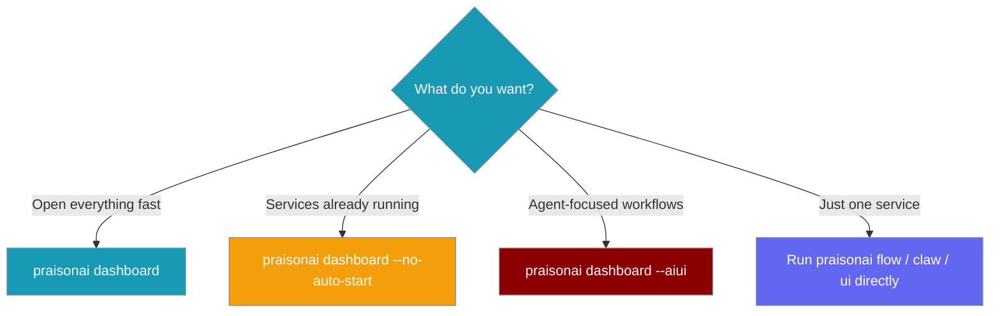

`praisonai dashboard` launches the **PraisonAI 🦅 Dashboard** on port **8082** — the same Chat + Canvas app as `praisonai claw` (kept as an alias). Use `praisonai unified` when you want the multi-service launcher on port 3000 that auto-starts Flow, Dashboard, and UI together.



## Quick Start

<Steps>
<Step title="Install and launch the PraisonAI Dashboard">
Install the dashboard extra (`praisonai[claw]` is kept as an alias) and launch:

```bash
pip install "praisonai[dashboard]"
praisonai dashboard
```

Opens **http://localhost:8082** with **Chat + Canvas**, the 🦅 welcome greeting, and all 16 `DASHBOARD_PAGES` (including **Connect** for MCP setup). `praisonai claw` opens the exact same app.
</Step>

<Step title="Auto-refresh and graceful shutdown">
- **Running Python environment:** `praisonai dashboard` launches `aiui` via `sys.executable -m praisonaiui.cli run`, so it always uses the active virtualenv.
- **Auto-refreshed default app:** `~/.praisonai/claw/app.py` is stamped with `# praisonai-default-app sha256=...`. Untouched copies auto-update on launch when you upgrade; any copy you edited is preserved untouched.
- **Graceful `SIGTERM` shutdown:** Sending `SIGTERM` (service manager, `kill`, or closing a terminal) cleanly terminates the spawned `aiui` server (with a 10 s `SIGKILL` fallback) so no orphan holds the port.
</Step>

<Step title="Unified multi-service launcher (Flow + Dashboard + UI)">
To start Flow Builder (:7860), Dashboard (:8082), and Chat UI (:8081) together behind a single port 3000 hub:

```bash
praisonai unified
# Or attach without auto-starting services:
praisonai unified --no-auto-start
```

Set `PRAISONAI_DASHBOARD_TOKEN` when binding the unified launcher to a non-loopback host (`--host 0.0.0.0`).
</Step>
</Steps>

---

## How It Works



The dashboard follows this process:

| Phase | Description |
|-------|-------------|
| **Spawn** | Launches Flow (7860), Claw (8082), and UI (8081) services |
| **Readiness** | Polls each service for up to 15 seconds until ports accept connections |
| **Dashboard** | Starts unified FastAPI interface linking to all services |
| **Cleanup** | Gracefully terminates child services on exit |

---

## Security

<Warning>
The dashboard binds to `127.0.0.1` (localhost only) with **no URL-level authentication** by default. 

Anyone with local machine access can reach the dashboard. Exposing with `--host 0.0.0.0` without a reverse proxy or auth layer is **not recommended**.
</Warning>

For production deployments:
- Use a reverse proxy (nginx, Apache) with authentication
- Consider VPN access for remote management
- Review the [Bot Security Guide](/best-practices/bot-security) for additional measures

---

## Configuration Options

| Option | Type | Default | Description |
|--------|------|---------|-------------|
| `--port`, `-p` | `int` | `3000` | Port to run the unified dashboard on |
| `--host` | `str` | `127.0.0.1` | Host to bind to (use `0.0.0.0` to expose remotely) |
| `--auto-start / --no-auto-start` | `bool` | `True` | Auto-start Flow, Claw, and UI services before opening dashboard |
| `--aiui` | `bool` | `False` | Use integrated agent host (Pattern B) with unified dashboard pages |

### Ports Used

| Service | Default Port | Started by |
|---------|--------------|------------|
| Unified Dashboard | **3000** | `praisonai dashboard` |
| Flow Builder | **7860** | Auto-started (`praisonai flow --no-open`) |
| Claw Dashboard | **8082** | Auto-started (`praisonai claw`) |
| Chat UI | **8081** | Auto-started (`praisonai ui`) |

### Log Files

Per-service logs are written to:

```
~/.praisonai/unified/logs/flow.log
~/.praisonai/unified/logs/claw.log
~/.praisonai/unified/logs/ui.log
```

---

## Common Patterns

### Expose dashboard on LAN

```bash
praisonai dashboard --host 0.0.0.0 --port 9000
```

### Attach to existing services

```bash
praisonai dashboard --no-auto-start
```

Use when Flow, Claw, and UI are already running and you only want the unified interface.

### Use integrated agent host

```bash
# Install UI dependencies
pip install "praisonai[ui]"

# Launch with integrated dashboard
praisonai dashboard --aiui
```

This uses Pattern B host integration with unified agent pages. See [Host Integration](/features/host-integration) for details.

### Troubleshoot failed auto-start

Check service logs if a service fails to start:

```bash
# Check individual service logs
tail -f ~/.praisonai/unified/logs/flow.log
tail -f ~/.praisonai/unified/logs/claw.log
tail -f ~/.praisonai/unified/logs/ui.log
```

---

## Which Option Should I Use?



---

## Best Practices

<AccordionGroup>
<Accordion title="Default to unified launch for local development">
Use `praisonai dashboard` as your standard command for local development. It's designed to feel like launching a single application while giving you access to all PraisonAI interfaces.
</Accordion>

<Accordion title="Use --no-auto-start in containerized environments">
In CI, Docker, or other managed environments where services are started separately, use `--no-auto-start` to launch only the dashboard interface.
</Accordion>

<Accordion title="Use --aiui for integrated agent workflows">
The `--aiui` flag launches the new Pattern B host integration with unified agent pages (chat, agents, memory, knowledge, skills, sessions, usage, config, logs). This is now the recommended approach for agent-centric workflows.
</Accordion>

<Accordion title="Check logs before assuming port conflicts">
Before concluding there's a port conflict, check the per-service logs in `~/.praisonai/unified/logs/` to see the actual error messages from failed services.
</Accordion>
</AccordionGroup>

---

## Related

<CardGroup cols={2}>
  <Card title="Claw Dashboard" icon="claw" href="/ui/claw">
    Full administrative dashboard for managing agents, tools, and channels
  </Card>
  <Card title="Flow Builder" icon="workflow" href="/ui/flow">
    Visual workflow designer with drag-and-drop interface
  </Card>
  <Card title="Chat UI" icon="message-circle" href="/ui/ui">
    Clean, distraction-free chat interface
  </Card>
  <Card title="Unified Server" icon="server" href="/deploy/servers/unified">
    Different feature: HTTP API server (not the desktop launcher)
  </Card>
</CardGroup>