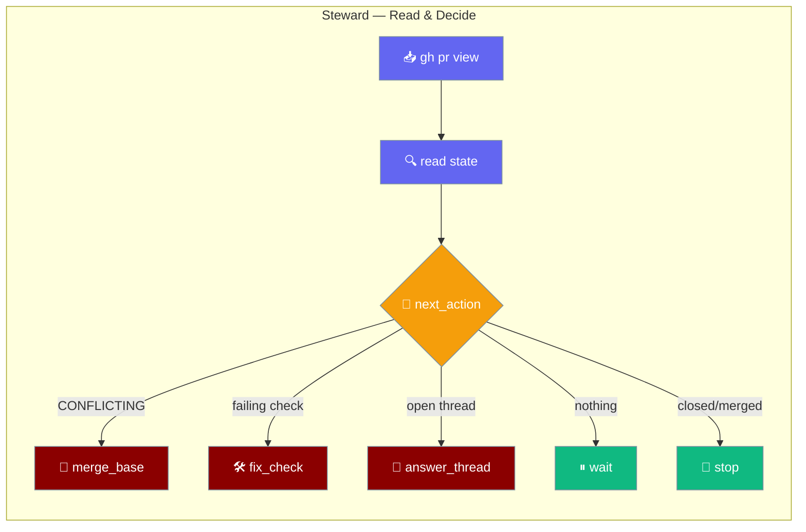
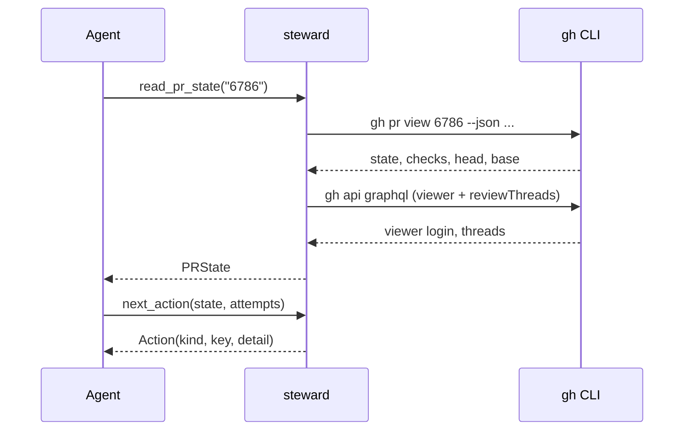
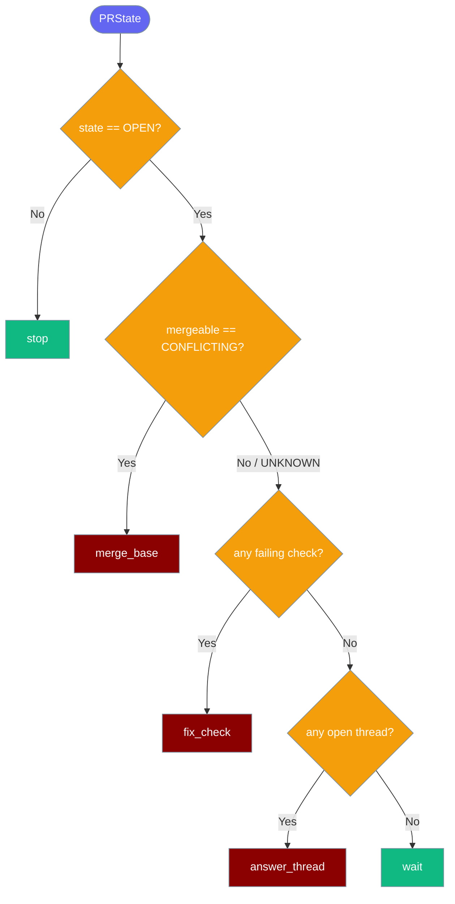

`steward` reads a pull request and tells the agent what to do next — **merge a conflict, fix a check, answer a thread, or wait** — without ever writing to GitHub.



<Info>
**Python API only.** This page covers the read-and-decide half of steward (`read_pr_state` and `next_action`, [PR #6786](https://github.com/MervinPraison/PraisonAI/pull/6786)). There is no `praisonai steward` CLI loop yet. Requires `pip install praisonai-code` and an authenticated `gh` (`gh auth login`).
</Info>

## Quick Start

<Steps>
<Step title="Read a PR and see what to do">

```python
from praisonai_code.ship.steward import read_pr_state, next_action

state = read_pr_state("6786")           # or read_pr_state() for the current branch's PR
action = next_action(state, attempts={})

print(action.kind, action.key, action.detail)
# e.g. "fix_check check:unit unit"
```

</Step>
<Step title="Loop with an attempt cap">

```python
from praisonai_code.ship.steward import read_pr_state, next_action

attempts = {}
while True:
    state = read_pr_state("6786")
    action = next_action(state, attempts, max_attempts=3)
    if action.kind in ("stop", "wait"):
        print(action.kind, "-", action.detail)
        break
    # Hand `action` to your agent to actually fix it, then:
    attempts[action.key] = attempts.get(action.key, 0) + 1
```

</Step>
</Steps>

---

## How It Works



1. `read_pr_state` runs `gh pr view [pr] --json number,url,state,mergeable,headRefName,baseRefName,statusCheckRollup`.
2. Failing checks are those whose CheckRun `conclusion` or StatusContext `state` is in `{"FAILURE", "TIMED_OUT", "CANCELLED", "ACTION_REQUIRED", "STARTUP_FAILURE", "ERROR"}`. Duplicates are collapsed, order is kept.
3. One GraphQL query fetches the viewer and the PR's review threads.
4. `next_action` picks the first item to work on.

<Warning>
**`read_pr_state` and `next_action` never mutate.** They only call `gh pr view` and `gh api graphql` (a query, not a mutation). Acting on an `Action` — merging the base in, pushing a fix, replying to a thread — is up to your agent, not this module.
</Warning>

---

## Which Action Comes Next?

| Order | Condition | Returned action |
|-------|-----------|-----------------|
| 0 | `state.state != "OPEN"` (MERGED or CLOSED) | `Action("stop", detail="pull request is merged")` / `"... closed"` |
| 1 | `state.mergeable == "CONFLICTING"` | `Action("merge_base", key="conflict", detail=f"merge {state.base} in")` |
| 2 | Each name in `state.failing` (in order) | `Action("fix_check", key=f"check:{name}", detail=name)` |
| 3 | Each thread in `state.threads` | `Action("answer_thread", key=f"thread:{t.id}", detail=t.body)` |
| 4 | Nothing to do, or every item skipped by the cap | `Action("wait", detail="nothing to do")` or `detail="gave up on: ..."` |



`UNKNOWN` mergeability counts as neither mergeable nor conflicting — with no failing checks or threads, you get `wait`.

---

## What Threads Does steward Surface?

| Thread shape | Surfaced? |
|--------------|-----------|
| Resolved | ❌ skipped |
| Outdated (comment on a line no longer in the diff) | ❌ skipped |
| Last comment is by the viewer (you already replied) | ❌ skipped |
| Empty (no comments) | ❌ skipped |
| Unresolved, non-outdated, last comment by someone else | ✅ returned |

---

## Reference

<AccordionGroup>
<Accordion title="Attempt cap (max_attempts)">
`attempts` is a `dict[str, int]` mapping `action.key` to tries. Each item (`conflict`, `check:<name>`, `thread:<id>`) gets at most `max_attempts=3` tries. When every remaining item has been tried that many times, `next_action` returns `wait` with a detail like `gave up on: check:unit, thread:T1`. The cap stops endless retry loops on a failure the agent can't fix.
</Accordion>

<Accordion title="PR in another repo">
`read_pr_state` takes `owner` / `name` from the PR's own `url`, not from `gh`'s `{owner}/{repo}` placeholders (which resolve to the current directory's repo). So you can pass a PR URL from a different repo than your working directory.
</Accordion>

<Accordion title="PRState fields">

| Field | Type | Meaning |
|-------|------|---------|
| `number` | `int` | PR number |
| `url` | `str` | PR URL |
| `state` | `str` | `OPEN`, `MERGED`, or `CLOSED` |
| `mergeable` | `str` | `MERGEABLE`, `CONFLICTING`, or `UNKNOWN` |
| `head` | `str` | Head branch |
| `base` | `str` | Base branch |
| `failing` | `list[str]` | Names of failing checks |
| `threads` | `list[Thread]` | Open review threads waiting on you |

</Accordion>

<Accordion title="Thread and Action fields">

**`Thread`**: `id` (GraphQL thread id), `path`, `line` (`int | None`), `author` (last commenter), `body` (last comment).

**`Action`**: `kind` (`stop`, `merge_base`, `fix_check`, `answer_thread`, `wait`), `key` (attempt-counter key, default `""`), `detail` (human-readable detail, default `""`).

</Accordion>

<Accordion title="GraphQL query used">

```graphql
query($owner:String!,$name:String!,$number:Int!){
  viewer{login}
  repository(owner:$owner,name:$name){
    pullRequest(number:$number){
      reviewThreads(first:100){
        nodes{id isResolved isOutdated path line
          comments(last:1){ nodes{ author{login} body } } } } } } }
```

</Accordion>
</AccordionGroup>

---

## Related

<CardGroup cols={2}>
  <Card title="AI Commit" icon="code-commit" href="/cli/commit">
    Generate commit messages with security scanning
  </Card>
  <Card title="Git Integration" icon="code-branch" href="/cli/git-integration">
    Git operations from the CLI
  </Card>
</CardGroup>
