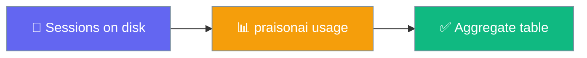
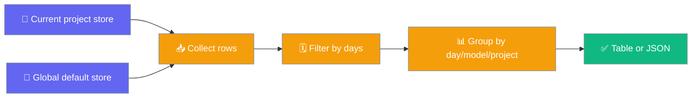
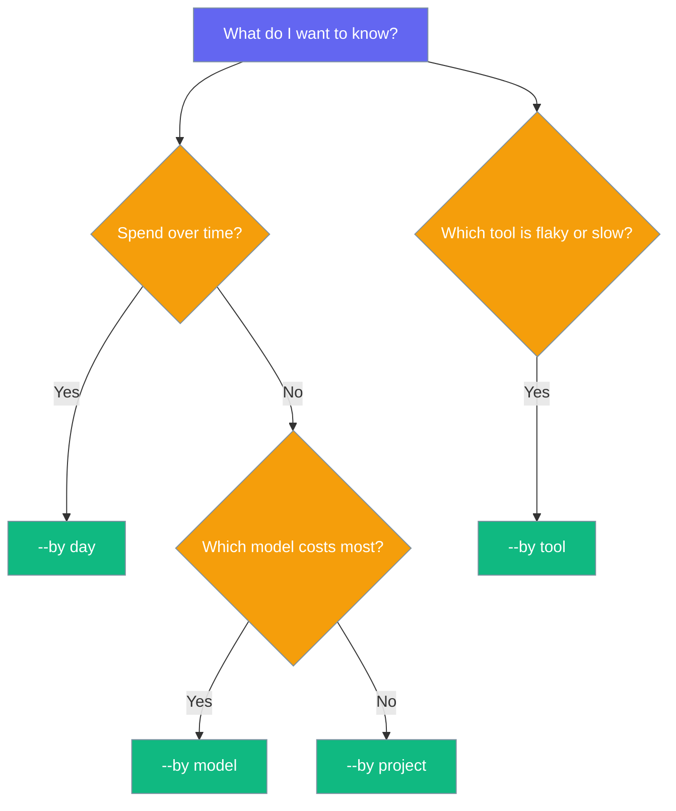
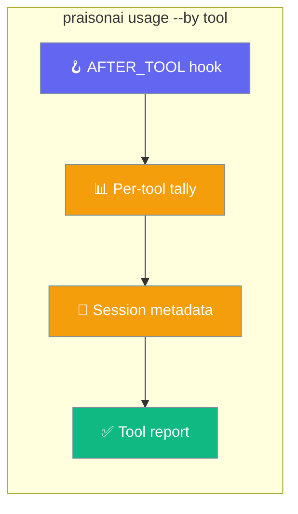

Every time your agent runs with a session store, it records `total_tokens` and `cost` per session. `praisonai usage` reports those totals — no config, no network.

```bash
praisonai usage
```



## Quick Start

<Steps>
<Step title="Run the report">
Print the last 30 days, grouped by day.

```bash
praisonai usage
```
</Step>

<Step title="Group by model or project">
Switch the grouping dimension with `--by`.

```bash
praisonai usage --by model
praisonai usage --by project
```
</Step>

<Step title="Window the results">
Limit the report to a time window with `--days` (`0` = all history).

```bash
praisonai usage --days 7
praisonai usage --days 0
```
</Step>

<Step title="Emit JSON">
Produce machine-readable output for scripts.

```bash
praisonai usage --json
```
</Step>

<Step title="See per-tool reliability">
```bash
praisonai usage --by tool
```
Reports calls, success rate, average latency, and the last error for each tool used.
</Step>
</Steps>

---

## How It Works

The command reads the current-project and global default session stores, filters by time window, groups the rows, then renders a table or JSON.



| Behaviour | Detail |
|-----------|--------|
| Project buckets | Without `--project`, rows keep their origin — `current` and `global` show as separate buckets under `--by project`. |
| De-duplication | Sessions with the same `session_id` in both stores are counted once. |
| Scan limit | Each store is scanned up to 100,000 sessions. |
| Sort order | `--by day` is chronological; `--by model` and `--by project` are highest-spend-first. |
| Empty state | Prints `No usage recorded yet` when no rows and no errors. |
| Errors | A missing or damaged store prints `Usage may be incomplete: …` (table) or fills the `errors` array (JSON) — nothing is swallowed. |
| Cost source | Reads the pre-persisted `cost` field — no re-pricing. |

---

## Options

| Option | Short | Type | Default | Description |
|--------|-------|------|---------|-------------|
| `--days` | `-d` | `int` | `30` | Only include sessions updated in the last N days (`0` = all) |
| `--by` | `-b` | `str` | `"day"` | Group by: `day`, `model`, `project`, or `tool` |
| `--project` | `-p` | `str` | `None` | Restrict to a specific project ID |
| `--json` | — | `bool` | `False` | Emit machine-readable JSON |

An invalid `--by` value prints `--by must be one of: day, model, project, tool` and exits with code `1`.

---

## Which `--by` should I pick?

Pick the grouping that answers your question.



`tool` sorts by most-called first, so your busiest (or busiest-failing) tool rises to the top.

---

## Per-Tool Reliability

`praisonai usage --by tool` reports per-tool call counts, success rate, average and last latency, and the last error — read from the local session store, same as every other grouping.



```
                                 Tool usage
┏━━━━━━━━━━━━┳━━━━━━━┳━━━━━━━━━┳━━━━━━━━┳━━━━━━━━━┳━━━━━━━━━━━━┓
┃ Tool       ┃ Calls ┃ Success ┃ Avg ms ┃ Last ms ┃ Last error ┃
┡━━━━━━━━━━━━╇━━━━━━━╇━━━━━━━━━╇━━━━━━━━╇━━━━━━━━━╇━━━━━━━━━━━━┩
│ search     │     3 │  66.7%  │   200  │   200   │ timeout    │
│ write_file │     1 │ 100.0%  │     5  │     5   │ -          │
└────────────┴───────┴─────────┴────────┴─────────┴────────────┘
```

| Column | Meaning |
|---|---|
| `Tool` | Tool name as the runtime saw it |
| `Calls` | How many times the tool was invoked |
| `Success` | Percentage of calls that returned without an error |
| `Avg ms` | Average execution time across all calls |
| `Last ms` | Latency of the most recent call |
| `Last error` | Last error message (truncated to 60 chars in the table, 500 in JSON) |

`Last ms` and `Last error` are picked by when the tool itself last ran, not by when the session was last updated. If no tool calls are recorded, the command prints `No tool usage recorded yet`.

<Note>
The tally counts tool outcomes that reach the `AFTER_TOOL` hook — which covers normalised tool failures (the common case). A raw exception that escapes the tool retry loop does not fire `AFTER_TOOL` and is not counted.
</Note>

---

## JSON Output

`--json` prints a stable shape for dashboards and pipelines.

```json
{
  "by": "day",
  "days": 30,
  "project": null,
  "rows": [ { "key": "2026-07-19", "total_tokens": 1200, "cost": 0.0034 } ],
  "total_tokens": 1200,
  "cost": 0.0034,
  "errors": []
}
```

Table output shows cost to 4 decimal places (`$0.0034`); JSON rounds to 6.

With `--by tool`, each row describes a tool instead of a spend bucket:

```json
{
  "by": "tool",
  "days": 30,
  "project": null,
  "rows": [
    {
      "tool": "search",
      "calls": 3,
      "successes": 2,
      "errors": 1,
      "success_rate": 0.6667,
      "avg_ms": 200.0,
      "last_ms": 200.0,
      "last_error": "timeout"
    }
  ],
  "errors": []
}
```

Tool mode omits the top-level `total_tokens` / `cost` fields — it reports outcomes, not spend.

---

## Common Patterns

Run a quick weekly review of spend by day.

```bash
praisonai usage --days 7
```

Audit which model costs the most across all history.

```bash
praisonai usage --by model --days 0
```

Feed a JSON report into a spreadsheet or dashboard.

```bash
praisonai usage --json > usage.json
```

Spot flaky or slow tools.

```bash
# Spot flaky tools over the last week
praisonai usage --by tool --days 7

# Find the slowest tool across all history
praisonai usage --by tool --days 0 --json | jq '.rows | sort_by(-.avg_ms) | .[0]'

# Alert on tool failure rate in CI
praisonai usage --by tool --json | jq '.rows[] | select(.success_rate < 0.9)'
```

---

## Best Practices

<AccordionGroup>

<Accordion title="Enable a session store first">
Rows only exist once agents run with a session store. Enable one with `memory="history"` or a `session_id` so `praisonai usage` has data to report.
</Accordion>

<Accordion title="Keep --days small for fast iteration">
A short window (`--days 7`) scans fewer sessions and returns quicker during active development.
</Accordion>

<Accordion title="Use --json for scripting">
Pipe `--json` into `jq` or a spreadsheet instead of parsing the table.
</Accordion>

<Accordion title="Remember --project scopes the read">
Passing `--project <id>` reads only that project's store — the `global` bucket is skipped.
</Accordion>

<Accordion title="Spot flaky or slow tools before users notice">
Run `praisonai usage --by tool --days 7` as part of your weekly review. Rows are sorted by call count first, so the busiest tool is on top — and the `Success` column immediately shows which ones are quietly failing. Pipe `--json` into `jq` in CI to fail a build when any tool drops below your target success rate.
</Accordion>

</AccordionGroup>

---

## Related

<CardGroup cols={2}>
  <Card title="CLI Reference" icon="terminal" href="/cli/cli-reference">
    Full command tree, including session commands
  </Card>
  <Card title="Session Resume" icon="rotate" href="/memory/session-resume">
    The session store these totals come from
  </Card>
</CardGroup>
