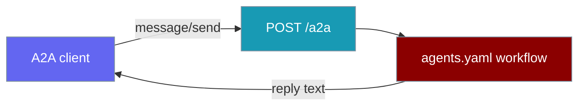
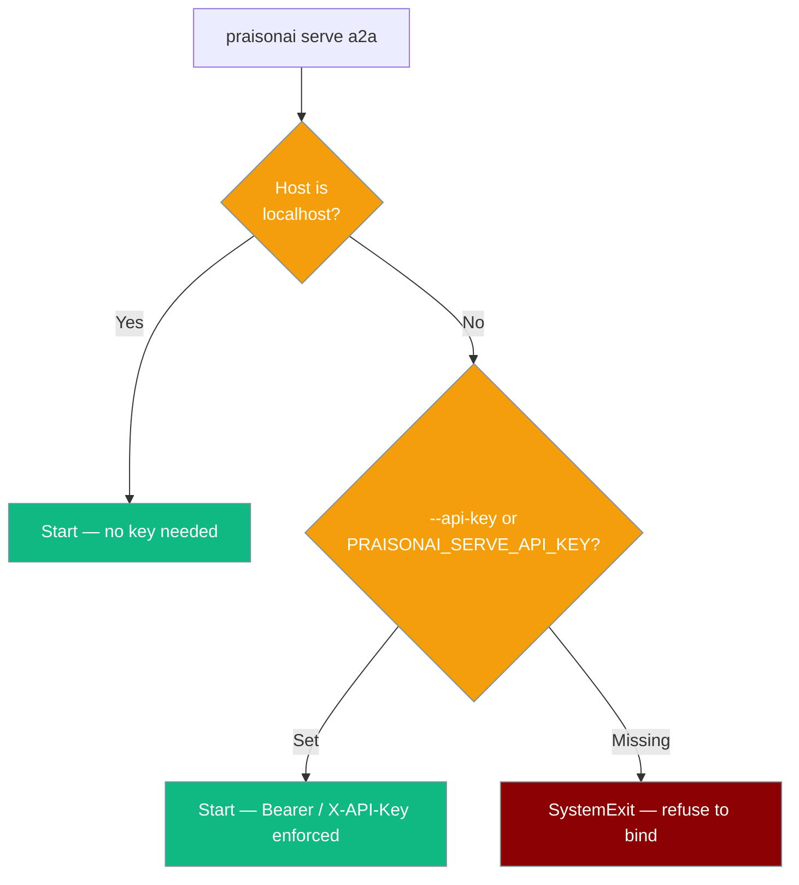

Deploy agents as A2A servers for agent-to-agent communication.

## CLI

```bash
pip install "praisonai[serve]"
export OPENAI_API_KEY="your-key"

# Start A2A server — runs the workflow in agents.yaml
praisonai serve a2a --file agents.yaml
```

`praisonai serve a2a` runs the agents YAML workflow in `--file` for every `message/send` request (the same YAML path `praisonai serve agents` uses). The message text becomes the workflow `topic`.

| Option | Default | Description |
|--------|---------|-------------|
| `--host` | `127.0.0.1` | Host to bind to |
| `--port` | `8082` | Server port |
| `--file` | `agents.yaml` | Agents YAML file to run |
| `--api-key` | - | API key. **Required when `--host` is not `127.0.0.1` / `localhost` / `::1`.** Can also be set via `PRAISONAI_SERVE_API_KEY`. Enforces `Authorization: Bearer` / `X-API-Key` on every route except `/`, `/status`, `/.well-known/agent.json`. |

<Note>
A missing `--file` is rejected at startup with exit code `EXIT_VALIDATION_ERROR` and the error `Agents file not found: <path>`. The server no longer starts a stub that only echoed `Received: <text>`.
</Note>

**Expected Output:**
```
✓ Starting A2A server on 127.0.0.1:8082
  Agents file: agents.yaml
  Agent Card: /.well-known/agent.json
  Discovery: /__praisonai__/discovery
```



## Security

`praisonai serve a2a` runs your agents (and their tools) for every request, so binding it to a non-localhost interface without authentication is refused.

<Warning>
Binding to any host other than `127.0.0.1` / `localhost` / `::1` **requires** an API key. The server exits immediately (`SystemExit`) if neither `--api-key` nor `PRAISONAI_SERVE_API_KEY` is set:

`praisonai serve a2a: --api-key (or PRAISONAI_SERVE_API_KEY) is required when binding to a non-localhost host; it exposes tool-driving routes.`
</Warning>

```bash
# Localhost — no key required
praisonai serve a2a

# Remote — key required (via env var)
export PRAISONAI_SERVE_API_KEY="your-secret"
praisonai serve a2a --host 0.0.0.0

# Or via flag
praisonai serve a2a --host 0.0.0.0 --api-key "your-secret"
```

Clients send the key in `Authorization: Bearer …` or `X-API-Key: …`. Only `/`, `/status` and `/.well-known/agent.json` are public; `POST /a2a` always needs the key when one is set.



## Python

```python
from praisonaiagents import Agent, A2A

agent = Agent(
    name="Assistant",
    role="Helpful AI Assistant",
    goal="Help users with their questions",
    llm="gpt-4o-mini"
)

a2a = A2A(agent=agent)
a2a.serve(host="0.0.0.0", port=8000)
```

<Tip>
`serve()` creates a FastAPI app and starts uvicorn for you. For custom FastAPI apps, use `a2a.get_router()` instead.
</Tip>

**Expected Output:**
```
INFO:     Started server process
INFO:     Waiting for application startup.
INFO:     Application startup complete.
INFO:     Uvicorn running on http://0.0.0.0:8000
```

**Verify:**
```bash
curl http://localhost:8000/.well-known/agent.json
```

**Response:**
```json
{
  "name": "Assistant",
  "description": "Helpful AI Assistant",
  "url": "http://localhost:8000/a2a",
  "version": "1.0.0",
  "capabilities": {
    "streaming": true,
    "pushNotifications": false,
    "stateTransitionHistory": false
  }
}
```

## agents.yaml

The CLI command `praisonai serve a2a --file agents.yaml` runs the YAML workflow via `praisonai.arun(...)` for each `message/send` request. The Python `A2A(agent=...)` path above serves a single in-process `Agent` and does not read YAML.

## A2A Endpoints

| Endpoint | Method | Description |
|----------|--------|-------------|
| `/.well-known/agent.json` | GET | Agent Card for discovery |
| `/a2a` | POST | JSON-RPC messages |
| `/status` | GET | Server status |

## A2A Parameters

| Parameter | Type | Default | Description |
|-----------|------|---------|-------------|
| `agent` | Agent | — | PraisonAI Agent instance |
| `agents` | AgentTeam | — | Multi-agent team (`agents.start()` is called) |
| `name` | str | agent.name | A2A endpoint name |
| `description` | str | agent.role | Agent description |
| `url` | str | `http://localhost:8000/a2a` | A2A endpoint URL |
| `version` | str | `1.0.0` | Version string |
| `prefix` | str | `""` | URL prefix |
| `auth_token` | str | `None` | Bearer token for `POST /a2a` auth |

## Authentication

```python
a2a = A2A(agent=agent, auth_token="sk-my-secret-key")
a2a.serve(port=8000)
```

Clients must send `Authorization: Bearer sk-my-secret-key`. Discovery (`/.well-known/agent.json`) stays public per A2A spec.

## Send A2A Message

```bash
curl -X POST http://localhost:8000/a2a \
  -H "Content-Type: application/json" \
  -d '{
    "jsonrpc": "2.0",
    "method": "message/send",
    "id": "1",
    "params": {
      "message": {
        "role": "user",
        "parts": [{"type": "text", "text": "Hello!"}]
      }
    }
  }'
```

**Response:**
```json
{
  "jsonrpc": "2.0",
  "id": "1",
  "result": {
    "message": {
      "role": "agent",
      "parts": [{"type": "text", "text": "Hello! How can I help you?"}]
    }
  }
}
```

### JSON-RPC Errors

| Code | Meaning | When |
|------|---------|------|
| `-32601` | Method not found | Any method other than `message/send` |
| `-32602` | Invalid params | `message/send` without a usable text part |
| `-32603` | Internal error | Agent execution raised; the exception message is included |

```json
{
  "jsonrpc": "2.0",
  "id": "1",
  "error": {"code": -32602, "message": "message/send requires a text part"}
}
```

## Python Client

```python
import requests

# Get Agent Card
response = requests.get("http://localhost:8000/.well-known/agent.json")
agent_card = response.json()
print(f"Agent: {agent_card['name']}")

# Send Message
message = {
    "jsonrpc": "2.0",
    "method": "message/send",
    "id": "1",
    "params": {
        "message": {
            "role": "user",
            "parts": [{"type": "text", "text": "Hello!"}]
        }
    }
}
response = requests.post("http://localhost:8000/a2a", json=message)
print(response.json())
```

## Troubleshooting

| Issue | Fix |
|-------|-----|
| Port in use | `lsof -i :8000` |
| Missing deps | `pip install "praisonai[serve]"` (CLI) or `pip install "praisonaiagents[os]"` (Python) |
| No API key | `export OPENAI_API_KEY="your-key"` |
| Agent Card 404 | Check router is included in app |
| `Agents file not found: <path>` at startup | Pass an existing YAML with `--file`, or create `agents.yaml` in the working directory. |
| `--api-key ... is required when binding to a non-localhost host` at startup | Set `PRAISONAI_SERVE_API_KEY=...` (or `--api-key ...`), or bind to `127.0.0.1` / `localhost` for a private-only server. |
| `401` on `POST /a2a` | Send `Authorization: Bearer <key>` or `X-API-Key: <key>`. |

## Related

- [A2A API Reference](../api/a2a-api) - Full A2A endpoint documentation
- [AGUI Server](./agui) - Deploy as AGUI server
- [Agents Server](./agents) - Deploy as HTTP server
