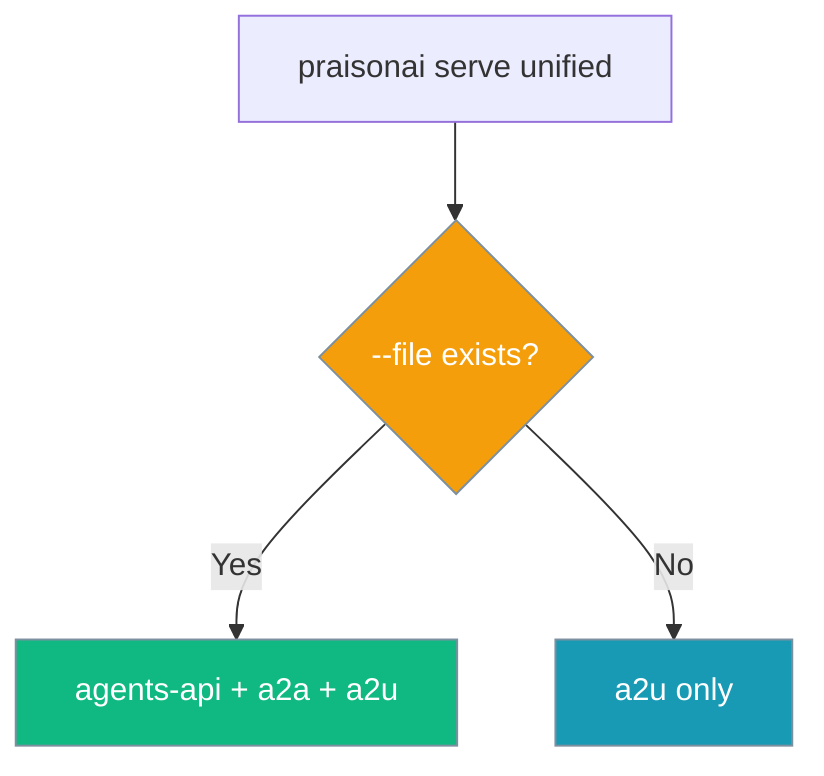
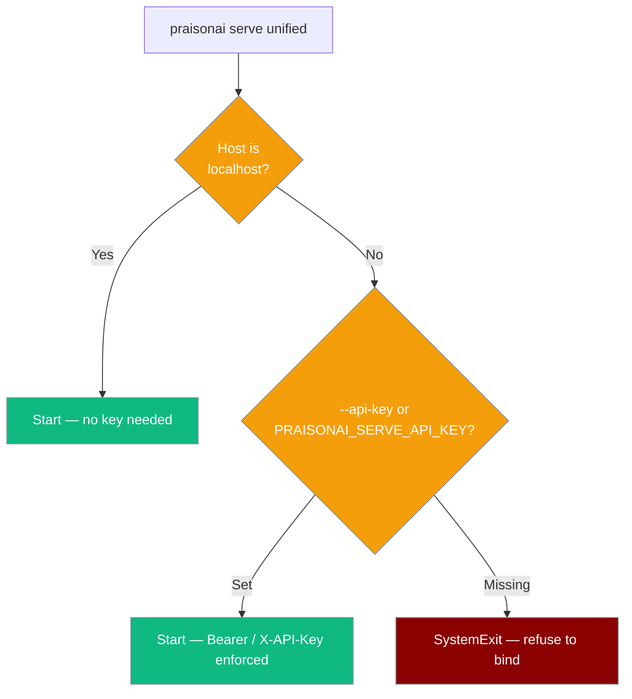

---
title: "Server: Unified"
sidebarTitle: "Unified"
description: "Deploy a unified server that combines the agents API, A2A and A2U providers in a single endpoint.

## CLI

```bash
pip install "praisonai[serve]"
export OPENAI_API_KEY="your-key"

# Start unified server — mounts agents-api + a2a from agents.yaml, plus a2u
praisonai serve unified --file agents.yaml --port 8765
```

**Expected Output:**
```
✓ Starting unified server on 127.0.0.1:8765
  Providers: agents-api, a2a, a2u
  Discovery: /__praisonai__/discovery
```

The server only advertises providers it actually mounts. `agents-api` and `a2a` run the workflow in `--file`, so they are mounted only when that file exists:

| `--file` | Providers |
|----------|-----------|
| Exists | `agents-api`, `a2a`, `a2u` |
| Missing | `a2u` |



<Note>
`recipe` and `mcp` are not part of the unified server. Run them with their own commands: [`praisonai serve recipe`](/cli/serve) and [`praisonai mcp serve`](./tools-mcp).
</Note>

## Agent

Define the agents the unified server runs in `agents.yaml`:

```yaml
framework: praisonai
topic: "Answer user questions"
roles:
  assistant:
    role: Helpful AI Assistant
    goal: Help users with their questions
    backstory: You are a friendly assistant.
    tasks:
      answer:
        description: "Answer: {topic}"
        expected_output: A clear answer
```

```bash
curl -X POST http://localhost:8765/agents \
  -H "Content-Type: application/json" \
  -d '{"query": "What is PraisonAI?"}'
```

**Response:**
```json
{"response": "PraisonAI is ..."}
```

`POST /agents` accepts `query` (or `message`). A body that is not a JSON object returns `400`; an agent failure returns `500`.

## Security

`praisonai serve unified` mounts agent-driving routes (`POST /agents`, `POST /a2a`), so binding it to a non-localhost interface without authentication is refused.

<Warning>
Binding to any host other than `127.0.0.1` / `localhost` / `::1` **requires** an API key. The server exits immediately (`SystemExit`) if neither `--api-key` nor `PRAISONAI_SERVE_API_KEY` is set.
</Warning>

```bash
# Localhost — no key required
praisonai serve unified --port 8765

# Remote — key required (via env var)
export PRAISONAI_SERVE_API_KEY="your-secret"
praisonai serve unified --port 8765 --host 0.0.0.0

# Or via flag
praisonai serve unified --port 8765 --host 0.0.0.0 --api-key "your-secret"
```

Clients send the key in `Authorization: Bearer …` or `X-API-Key: …`. Only `/health`, `/` and `/.well-known/agent.json` are public.



## Unified Endpoints

| Endpoint | Method | Provider | Needs `--file`? | Description |
|----------|--------|----------|-----------------|-------------|
| `/agents` | POST | agents-api | Yes | Run the agents YAML workflow |
| `/a2a` | POST | a2a | Yes | A2A JSON-RPC `message/send` ([error codes](./a2a#json-rpc-errors)) |
| `/.well-known/agent.json` | GET | - | No | Agent card; includes `url` only when `a2a` is mounted |
| `/a2u/info` | GET | a2u | No | A2U info |
| `/a2u/events/<stream>` | GET | a2u | No | A2U event stream |
| `/__praisonai__/discovery` | GET | - | No | Discovery document |
| `/health` | GET | - | No | Health check |
| `/` | GET | - | No | Landing JSON with the mounted `providers` list |

## Agent Card

```bash
curl http://localhost:8765/.well-known/agent.json
```

**Response (with `--file`):**
```json
{
  "name": "PraisonAI Unified",
  "description": "PraisonAI Unified Server",
  "version": "1.0.0",
  "url": "http://127.0.0.1:8765/a2a"
}
```

Without `--file`, the `url` key is omitted because `/a2a` is not mounted.

## Discovery Document

```bash
curl http://localhost:8765/__praisonai__/discovery
```

**Response (with `--file`):**
```json
{
  "schema_version": "1.0.0",
  "server_name": "praisonai-unified",
  "providers": [
    {"type": "agents-api", "name": "Agents API", "capabilities": ["invoke"]},
    {"type": "a2a", "name": "A2A Protocol", "capabilities": ["agent-card", "message-send"]},
    {"type": "a2u", "name": "A2U Event Stream", "capabilities": ["subscribe", "stream"]}
  ],
  "endpoints": [...]
}
```

Without `--file`, `providers` contains only `a2u`.

## Client Usage

Use the unified endpoints CLI to interact with any provider:

```bash
# List all endpoints
praisonai endpoints list --url http://localhost:8765

# Filter by provider type
praisonai endpoints list --url http://localhost:8765 --type agents-api

# Get discovery document
praisonai endpoints discovery --url http://localhost:8765

# Health check
praisonai endpoints health --url http://localhost:8765
```

## CLI Options

| Option | Default | Description |
|--------|---------|-------------|
| `--port` | 8765 | Server port |
| `--host` | 127.0.0.1 | Server host |
| `--api-key` | - | API key. **Required when `--host` is not `127.0.0.1` / `localhost` / `::1`.** Can also be set via `PRAISONAI_SERVE_API_KEY`. Enforces `Authorization: Bearer` / `X-API-Key` on every route except `/health`, `/`, `/.well-known/agent.json`. |
| `--file` | agents.yaml | Agents YAML file. `agents-api` and `a2a` are mounted only when it exists |

## Environment Variables

| Variable | Default | Description |
|----------|---------|-------------|
| `PRAISONAI_SERVE_API_KEY` | - | API key required to bind `praisonai serve unified` on a non-localhost host. The server exits with `SystemExit` if this is unset and no `--api-key` is passed when `--host` is not localhost. Also drives the `_api_auth` middleware when the server is running. |

## Provider Types

| Type | Description |
|------|-------------|
| `agents-api` | Runs the agents YAML workflow (`POST /agents`) |
| `a2a` | Agent-to-agent protocol (`POST /a2a`) |
| `a2u` | Agent-to-user event stream (always mounted) |

## Troubleshooting

| Issue | Fix |
|-------|-----|
| Port in use | `lsof -i :8765` |
| Missing deps | `pip install "praisonai[serve]"` |
| No API key | `export OPENAI_API_KEY="your-key"` |
| Provider not found | Check discovery document. `agents-api` / `a2a` need an existing `--file` |
| `POST /agents` returns `404` / `405` | `--file` is missing, so only `a2u` is mounted |
| `--api-key ... is required when binding to a non-localhost host` at startup | Set `PRAISONAI_SERVE_API_KEY=...` (or `--api-key ...`), or bind to `127.0.0.1` / `localhost` for a private-only server. |

## Related

- [Endpoints CLI](/cli/endpoints) - Client for all server types
- [Serve CLI](/cli/serve) - All serve commands
- [A2A Server](./a2a) - Agent-to-agent protocol
- [A2U Server](./a2u) - Agent-to-user events
- [Agents Server](./agents) - HTTP API server
- [Tools MCP Server](./tools-mcp) - MCP is served by its own command, not `serve unified`
- [Serve CLI: recipe](/cli/serve) - Recipes are served by `praisonai serve recipe`, not `serve unified`
