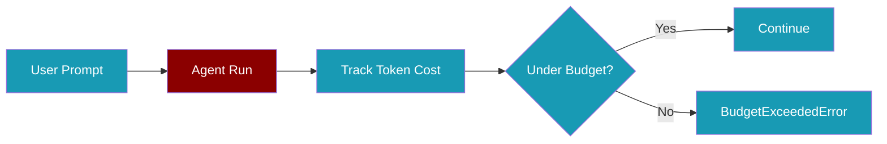
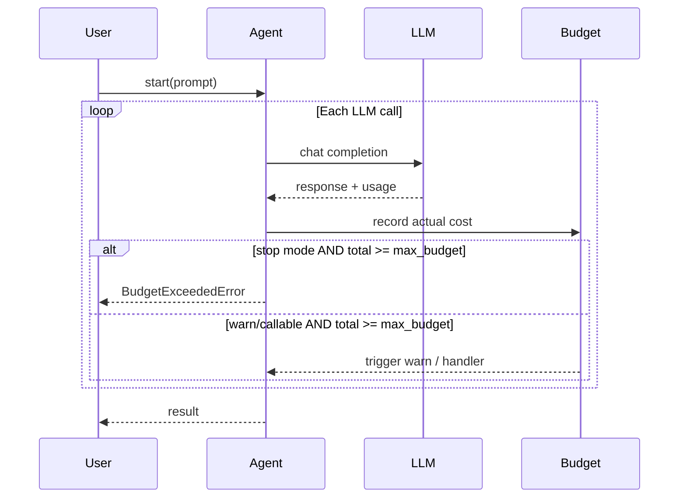

Cap how much an agent can spend per run with `ExecutionConfig(max_budget=...)` — when the limit is hit, PraisonAI stops the run and raises `BudgetExceededError`.

<Note>
**Async enforcement.** `max_budget` is now enforced on async paths (`astart()` / `achat()`) as well as sync paths. Gateway bots using async agents will receive `BudgetExceededError` when their configured ceiling is reached. Previously only sync dispatch enforced the limit.
</Note>

<Note>
**PR [#5841](https://github.com/MervinPraison/PraisonAI/pull/5841):** the `max_budget` pre-call guard now uses the canonical CJK-aware [token estimator](/features/context-token-estimation). Agents that process Chinese, Japanese or Korean text will see the pre-call cost estimate rise toward the real token count; raise `max_budget` if a previously-passing agent starts hitting the guard.
</Note>

<Note>
**Provider/model agents are now capped too** ([PR #6062](https://github.com/MervinPraison/PraisonAI/pull/6062)). Agents built from a `provider/model` string (`anthropic/...`, `mistral/...`, `ollama/...`, `openrouter/...`), an `llm={...}` dict, a `base_url`, or a model object used to skip `max_budget` and report `total_cost == 0`. They now share the same accounting as OpenAI-style models, and the cap is checked on **every** LLM call — so it can stop a single turn partway through its tool loop.
</Note>

<Note>
**Prompt-cache aware budget tracking** ([PR #5996](https://github.com/MervinPraison/PraisonAI/pull/5996)). Models with prompt caching (OpenAI, Anthropic, Gemini, DeepSeek) now have their cached-input tokens priced at the provider's cache-read multiplier before the budget guard runs. A long context that was fully cached will spend far less of your `max_budget` than the same context on the first (uncached) call. The guard also prefers a **provider-reported** cost over the local estimate when the reported figure is higher — so running against OpenRouter or a litellm proxy records real spend, not an undercount.
</Note>

```python
from praisonaiagents import Agent, ExecutionConfig

agent = Agent(
    name="Researcher",
    instructions="You research topics thoroughly",
    execution=ExecutionConfig(max_budget=0.50),
)
agent.start("Summarise today's AI news")
```

The user sets a spend cap; the agent stops the run and raises `BudgetExceededError` once estimated cost exceeds the limit.



<Warning>
The top-level `Agent(max_budget=...)` shortcut was **removed** (PraisonAI PR #1642). Use `execution=ExecutionConfig(max_budget=...)` — see [CLI budget handling](/features/cli-budget-handling).
</Warning>

## Quick Start

<Steps>
<Step title="Set a simple USD cap">

```python
from praisonaiagents import Agent, ExecutionConfig

agent = Agent(
    name="Researcher",
    instructions="You research topics thoroughly",
    execution=ExecutionConfig(max_budget=0.50),
)

agent.start("Research the history of AI")
```

When spend reaches $0.50, the run stops with `BudgetExceededError` including agent name and totals.

</Step>

<Step title="Async run with budget cap">

```python
import asyncio
from praisonaiagents import Agent, ExecutionConfig

agent = Agent(
    name="AsyncResearcher",
    instructions="Research topics asynchronously",
    execution=ExecutionConfig(max_budget=0.50),
)

async def main():
    try:
        await agent.astart("Research the history of AI")
    except Exception as e:
        if "BudgetExceeded" in type(e).__name__:
            print(f"Budget exceeded: {e}")

asyncio.run(main())
```

`astart()` raises `BudgetExceededError` the same way `start()` does — the async path now has identical pre-call guards and post-call cost accounting.

</Step>

<Step title="Warn instead of stopping">

```python
from praisonaiagents import Agent, ExecutionConfig

agent = Agent(
    name="Analyst",
    instructions="Analyse data carefully",
    execution=ExecutionConfig(
        max_budget=1.00,
        on_budget_exceeded="warn",
    ),
)

agent.start("Summarise this quarterly report")
```

With `on_budget_exceeded="warn"`, the agent logs a warning but continues. Default is `"stop"`.

</Step>
</Steps>

<Note>
`max_budget` is enforced on both sync (`start()`) and async (`astart()`) paths as of **1.6.88+**. Gateway bots that call `astart()` internally now honour the budget cap and raise `BudgetExceededError` identically to sync runs.
</Note>

## How It Works



Every way of building the agent's LLM is covered:

| How the agent's LLM is set | `max_budget` enforced | `total_cost` / `cost_summary` populated |
|---|---|---|
| `llm="gpt-4o"` and other OpenAI-style names | ✅ | ✅ |
| `llm="anthropic/..."`, `mistral/...`, `ollama/...`, `openrouter/...` | ✅ | ✅ |
| `llm={"model": "...", "base_url": "..."}` | ✅ | ✅ |
| `llm=LLM(...)` model object | ✅ | ✅ |
| A turn answered by a `fallback_models` entry | ✅ priced as the model that answered | ✅ |

The cap is checked after each LLM call, including calls inside a tool loop:

```python
from praisonaiagents import Agent, ExecutionConfig

def fetch_price(ticker: str) -> str:
    """Fetch the latest price for a ticker."""
    return f"{ticker}: 123.45"

agent = Agent(
    name="Analyst",
    instructions="Look up prices for the symbols the user names.",
    llm="anthropic/claude-3-5-sonnet-20240620",
    tools=[fetch_price],
    execution=ExecutionConfig(max_budget=0.10),
)

try:
    agent.start("Price AAPL, MSFT, and GOOG.")
except Exception as e:
    print(type(e).__name__, e)  # BudgetExceededError Agent 'Analyst' exceeded budget: ...
```

Budget tracking adds zero overhead when `max_budget` is `None` (the default).

Schedulers use the same brake — see [Async Scheduler → Budget-aware Scheduling](/docs/features/async-agent-scheduler#budget-aware-scheduling). Setting `max_cost=0` on `AsyncAgentScheduler` is a real (zero) budget and short-circuits `start()` (returns `False`, no background task) when combined with `run_immediately=True`. As of [PraisonAI PR #5766](https://github.com/MervinPraison/PraisonAI/pull/5766) the sync `AgentScheduler` matches this behavior on every entry point, including `execute_once()` (returns `None`) and `start(run_immediately=True)`.

## Configuration Options

| Option | Type | Default | Description |
|--------|------|---------|-------------|
| `max_budget` | `float \| None` | `None` | Hard USD limit per agent run. `None` disables tracking. |
| `on_budget_exceeded` | `"stop" \| "warn" \| callable` | `"stop"` | Action when the cap is reached |

<CardGroup cols={2}>
  <Card title="ExecutionConfig" icon="code" href="/sdk/reference/praisonaiagents/classes/ExecutionConfig">
    Full execution configuration reference
  </Card>
  <Card title="CLI Budget Handling" icon="terminal" href="/features/cli-budget-handling">
    Budget limits from the CLI
  </Card>
</CardGroup>

## Best Practices

<AccordionGroup>
<Accordion title="Start with a conservative cap in production">
Set `max_budget` on any agent that runs unattended or loops over tools. $0.25–$1.00 is a sensible starting range for research agents.
</Accordion>

<Accordion title="Use warn mode during development">
`on_budget_exceeded="warn"` lets you see full output while still logging when you'd have been stopped in production.
</Accordion>

<Accordion title="Retrying after the cap sends no request">
For a provider/model agent with `on_budget_exceeded="stop"`, once it has crossed `max_budget`, every later `chat()` / `achat()` raises `BudgetExceededError` again before contacting the provider. Catching the error and retrying cannot spend more — create a new agent (or one with a higher cap) to continue.
</Accordion>

<Accordion title="Combine with rate limiting">
Budget caps control spend; rate limiters control request frequency. Use both for cost-sensitive deployments.
</Accordion>
</AccordionGroup>

## See also: Autonomous run budget

`ExecutionConfig.max_budget` is one of **two** budget mechanisms. `run_autonomous` / `run_autonomous_async` have their own independent cap via `AutonomyConfig` — pick the one that matches your run type.

| Mechanism | Where | On limit hit | Resumable? |
|---|---|---|---|
| `ExecutionConfig.max_budget` | Any run | Raises `BudgetExceededError` | No |
| `AutonomyConfig.max_budget_usd` / `max_tokens` | `run_autonomous` / `run_autonomous_async` only | Returns `AutonomyResult(completion_reason="budget_exhausted")` | Yes when `budget_action="pause"` |

For autonomous runs, prefer the `AutonomyConfig` cap — it pauses recoverably instead of raising. See [Autonomy Budget](/features/autonomy-budget).

## Related

<CardGroup cols={2}>
  <Card title="Autonomy Budget" icon="wallet" href="/features/autonomy-budget">
    Spend/token kill-switch for autonomous runs
  </Card>
  <Card title="CLI Budget Handling" icon="terminal" href="/features/cli-budget-handling">
    Set budgets from the command line
  </Card>
  <Card title="Execution Config" icon="settings" href="/features/agent-centric-api">
    All execution options in one place
  </Card>
  <Card title="Gateway Spend Budget" icon="dollar-sign" href="/features/gateway-spend-budget">
    Cap cumulative per-identity spend across runs on a shared-Agent gateway
  </Card>
</CardGroup>
