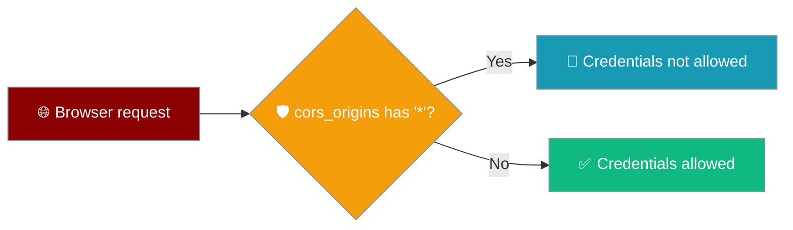
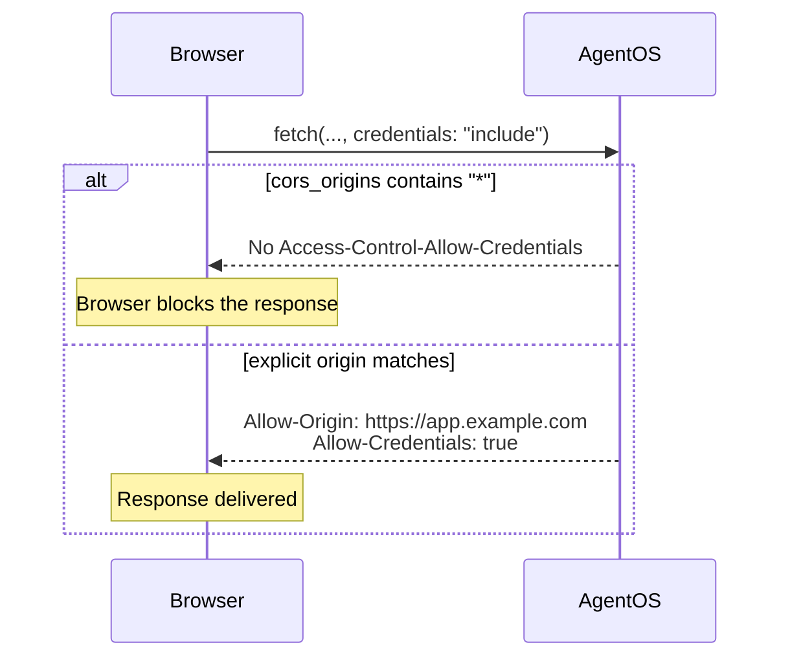

AgentOS turns off credentialed CORS when you allow every origin, so other websites can't use your users' cookies to call your agents.



## Quick Start

<Steps>
<Step title="Public endpoint, no cookies">

```python
from praisonai import AgentOS
from praisonaiagents import Agent

agent = Agent(instructions="Be helpful")

AgentOS(
    agents=[agent],
    cors_origins=["*"],  # Any site can call it. Credentials are dropped.
).serve()
```

</Step>
<Step title="Browser app with cookies">

```python
from praisonai import AgentOS
from praisonaiagents import Agent

agent = Agent(instructions="Be helpful")

AgentOS(
    agents=[agent],
    cors_origins=["https://app.example.com"],  # Credentialed CORS works.
).serve()
```

</Step>
</Steps>

---

## How It Works



| `cors_origins` | Credentials (cookies, credentialed `fetch`) |
|---|---|
| `[]` (default) | No cross-origin access |
| `["*"]` | Not allowed |
| `["https://app.example.com"]` | Allowed for that origin |
| `["https://app.example.com", "*"]` | Not allowed — any `"*"` turns credentials off |

The same rule applies to the async jobs server when you pass `cors_origins` to `praisonai.jobs.server.create_app`.

<Note>
The `Authorization` header still works with `["*"]` when your client sends it without `credentials: "include"` — for example, a bearer token from your API key.
</Note>

---

## Why

With a `"*"` origin and credentials both enabled, Starlette's CORS middleware echoes the caller's `Origin` header back when a cookie is present. Any website could then make logged-in requests to your deployment. Browsers forbid `*` with credentials for this reason, and AgentOS enforces the same rule on the server.

---

## Best Practices

<AccordionGroup>
  <Accordion title="List exact frontend origins in production">
    Use `cors_origins=["https://app.example.com"]` instead of `["*"]` for any deployed frontend.
  </Accordion>
  <Accordion title="Never mix &quot;*&quot; with other origins">
    One `"*"` entry turns credentials off for the whole list.
  </Accordion>
  <Accordion title="Check browser clients after upgrading">
    If cookie-based browser calls stopped working after an upgrade, you were relying on `["*"]` with credentials. Switch to an explicit origin list.
  </Accordion>
</AccordionGroup>

---

## Related

<CardGroup cols={2}>
  <Card title="AgentOS" icon="server" href="/concepts/agentos">
    AgentOS configuration and lifecycle
  </Card>
  <Card title="Async Jobs" icon="rocket" href="/features/async-jobs">
    Jobs server that follows the same CORS rule
  </Card>
</CardGroup>
