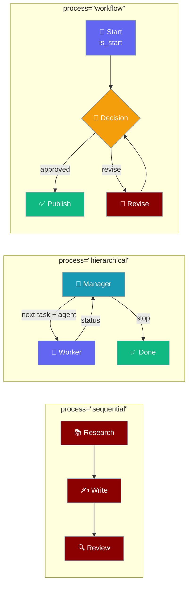
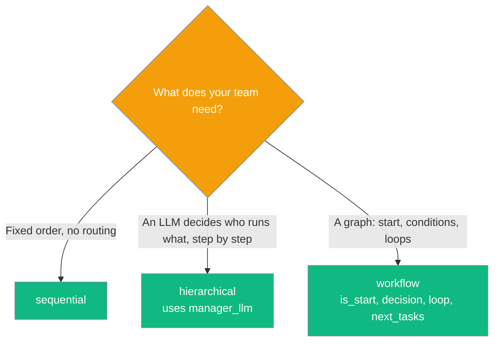
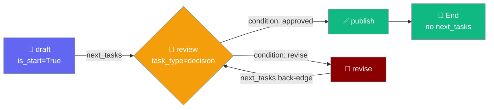
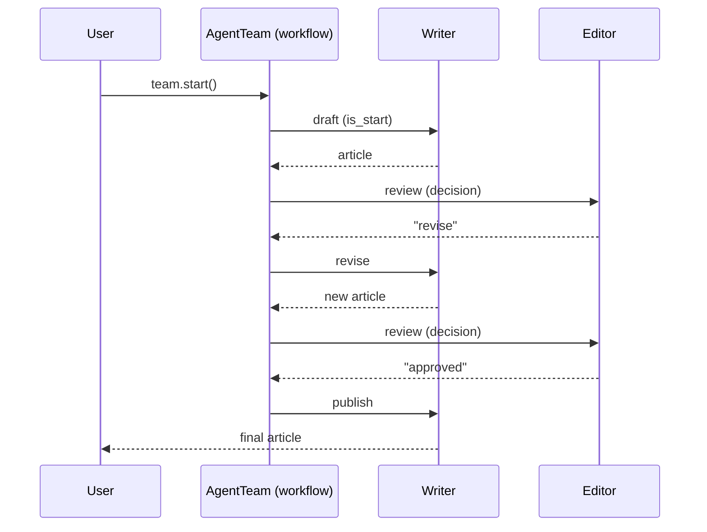

One `AgentTeam`, three ways to run the same tasks: in order, under a manager agent, or as a workflow.

```python
from praisonaiagents import Agent, Task, AgentTeam

writer = Agent(name="Writer", instructions="Write short, clear articles")
task = Task(description="Write a paragraph about solar power", agent=writer)

team = AgentTeam(agents=[writer], tasks=[task], process="sequential")  # or "hierarchical", "workflow"
team.start()
```



| Process | What happens |
|---|---|
| `sequential` | Tasks run one after another, in the order you list them. |
| `hierarchical` | A manager agent reads every task's status, then picks the next task and agent, or stops. |
| `workflow` | Starts at `is_start`. Decision tasks route on a condition; loop tasks repeat per row. |

---

## Which process should I pick?



---

## Quick Start

<Steps>
<Step title="Sequential (default)">
Tasks run in list order; each task sees the previous task's output.

```python
from praisonaiagents import Agent, Task, AgentTeam

researcher = Agent(name="Researcher", instructions="Find key facts")
writer = Agent(name="Writer", instructions="Write clear, short articles")
reviewer = Agent(name="Reviewer", instructions="Check articles for accuracy")

research = Task(description="Research the benefits of solar power", agent=researcher)
write = Task(description="Write a 150-word article from the research", agent=writer)
review = Task(description="Review the article and list any fixes", agent=reviewer)

team = AgentTeam(
    agents=[researcher, writer, reviewer],
    tasks=[research, write, review],
    process="sequential",
)
team.start()
```
</Step>

<Step title="Hierarchical">
Same tasks, plus a manager agent that picks the next task and agent each turn.

```python
from praisonaiagents import Agent, Task, AgentTeam

researcher = Agent(name="Researcher", instructions="Find key facts")
writer = Agent(name="Writer", instructions="Write clear, short articles")
reviewer = Agent(name="Reviewer", instructions="Check articles for accuracy")

research = Task(description="Research the benefits of solar power", agent=researcher)
write = Task(description="Write a 150-word article from the research", agent=writer)
review = Task(description="Review the article and list any fixes", agent=reviewer)

team = AgentTeam(
    agents=[researcher, writer, reviewer],
    tasks=[research, write, review],
    process="hierarchical",
    manager_llm="gpt-4o",
)
team.start()
```
</Step>

<Step title="Workflow">
Start at the `is_start` task, route on a decision, and loop back until approved.

```python
from praisonaiagents import Agent, Task, AgentTeam

writer = Agent(name="Writer", instructions="Write clear, short articles")
editor = Agent(name="Editor", instructions="Judge articles strictly")

draft = Task(
    name="draft",
    description="Write a 150-word article about solar power",
    agent=writer,
    is_start=True,
    next_tasks=["review"],
)
review = Task(
    name="review",
    description="Review the article. Reply with exactly one word: approved or revise",
    agent=editor,
    task_type="decision",
    condition={"approved": ["publish"], "revise": ["revise"]},
)
revise = Task(
    name="revise",
    description="Rewrite the article to fix the editor's concerns",
    agent=writer,
    next_tasks=["review"],
)
publish = Task(
    name="publish",
    description="Format the approved article as Markdown with a title",
    agent=writer,
)

team = AgentTeam(
    agents=[writer, editor],
    tasks=[draft, review, revise, publish],
    process="workflow",
)
team.start()
```
</Step>
</Steps>

---

## How Workflow Mode Routes

The workflow process follows `is_start`, then `next_tasks` and `condition` from task to task.



| Rule | Behaviour |
|---|---|
| Entry | The task with `is_start=True` runs first |
| `next_tasks` | Names the task to run after this one |
| `task_type="decision"` | The agent picks one of the `condition` keys; the matching task runs next |
| No match / `"exit"` | A decision with no matching route ends the workflow |
| `task_type="loop"` | Runs once per row of `input_file` (CSV or text) |
| End | A task with no `next_tasks` and no `condition` finishes the run |

---

## Three Processes at a Glance

| Process | What it does | When to pick it | Required params |
|---|---|---|---|
| `sequential` | Runs tasks in list order | Fixed pipeline, no routing | None (default) |
| `hierarchical` | Manager agent assigns tasks | Let an LLM plan the order | `manager_llm` (defaults to `OPENAI_MODEL_NAME` or `gpt-4o-mini`) |
| `workflow` | Follows a task graph | Branches, retries, per-row loops | `is_start=True` on one task; `next_tasks` / `condition` |

<Note>
Any other `process` value raises `ValueError`. There is no `process="parallel"` — set `async_execution=True` on individual tasks inside a `sequential` or `workflow` team instead.
</Note>

---

## User Interaction Flow



---

## Common Patterns

### Approve-or-revise loop

The Workflow Quick Start above: a `decision` task routes to `publish` or `revise`, and `revise` points back with `next_tasks=["review"]`.

### Batch over a CSV

A `loop` start task runs once per row of `input_file`.

```python
from praisonaiagents import Agent, Task, AgentTeam

with open("topics.csv", "w") as f:
    f.write("Solar power\nWind energy\nHydropower\n")

writer = Agent(name="Writer", instructions="Write one short paragraph per topic")

per_topic = Task(
    name="write_topic",
    description="Write a paragraph about this topic",
    agent=writer,
    is_start=True,
    task_type="loop",
    input_file="topics.csv",
)

team = AgentTeam(agents=[writer], tasks=[per_topic], process="workflow")
team.start()
```

### Let a manager pick the order

Keep the tasks unordered and add `process="hierarchical"` — the manager reads each task's status and chooses what runs next. See [Hierarchical Process](/features/hierarchical-process).

---

## Best Practices

<AccordionGroup>
<Accordion title="Use sequential until you need routing">
`sequential` is the default and the cheapest: no manager calls, no graph. Switch only when the order must change at run time.
</Accordion>

<Accordion title="hierarchical needs manager_llm">
Pass `manager_llm="gpt-4o"` explicitly, or set `OPENAI_MODEL_NAME`. Without either, the manager uses `gpt-4o-mini`.
</Accordion>

<Accordion title="workflow needs exactly one is_start task">
Mark one entry task with `is_start=True`, and give every other task a way in through `next_tasks` or `condition`.
</Accordion>

<Accordion title="Make decision replies match condition keys">
A `decision` task gets an output schema whose `decision` field is limited to your `condition` keys, so pick short, clear keys like `approved` / `revise`. Pass your own `output_pydantic` with a `decision` field to customise it.
</Accordion>

<Accordion title="Loops read one row per iteration">
`task_type="loop"` reads `input_file` (defaults to `tasks.csv`) and runs one subtask per row. If the file cannot be read, the loop task is marked `failed`.
</Accordion>
</AccordionGroup>

---

## Related

<CardGroup cols={2}>
<Card title="AgentTeam" icon="users" href="/concepts/agentteam">
  Build multi-agent teams
</Card>
<Card title="Process" icon="diagram-project" href="/concepts/process">
  Process concepts overview
</Card>
<Card title="Hierarchical Process" icon="sitemap" href="/features/hierarchical-process">
  Manager-driven delegation in detail
</Card>
<Card title="Workflow Diagram" icon="chart-diagram" href="/features/workflow-diagram">
  Visualise your task graph
</Card>
</CardGroup>
