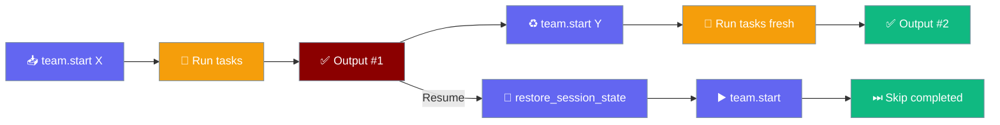

Build an `AgentTeam` once and call `start()` as many times as you like — each call is a fresh run.



## Quick Start

<Steps>
<Step title="Run the same team twice">

```python
from praisonaiagents import Agent, AgentTeam, Task

writer = Agent(name="Writer", instructions="Summarise the ticket")
task = Task(description="Summarise the ticket", agent=writer)
team = AgentTeam(agents=[writer], tasks=[task])

team.start("Ticket A")   # runs the task against Ticket A
team.start("Ticket B")   # runs it again against Ticket B — no stale output
```

The second call re-executes every task, and `task.context` only holds the latest input (`["Ticket B"]`). Previously the second call returned the first run's output.

</Step>

<Step title="Keep your own task variables">

```python
task.description = "Summarise {{ticket}}"
task.variables = {"ticket": "T-1"}

team.start()
team.start()  # task.variables is still {"ticket": "T-1"}
```

</Step>

<Step title="Change team variables between runs">

```python
task.variables = {}  # let the team's variables flow into the task

team.variables = {"ticket": "T-1"}
team.start()                         # tasks receive {"ticket": "T-1"}
team.variables = {"ticket": "T-2"}
team.start()                         # tasks receive {"ticket": "T-2"} on this run
```

The next `start()` after a `start_for_each(...)` batch also picks up the current `team.variables`.

</Step>
</Steps>

---

## How It Works

A `start()` after a finished run resets task state first; a `start()` after `restore_session_state()` resumes instead.

```python
team.start("Ticket A")
team.save_session_state("ticket-run")

# ... later, in a new process, with the same team rebuilt ...
team.restore_session_state("ticket-run")
team.start()             # resume — nothing re-runs, task.status is still "completed"
team.start("Ticket B")   # the next fresh start reruns
```

| State | On a rerun | On a resume (`restore_session_state()` + `start()`) |
|-------|-----------|------------------------------------------------------|
| `task.status` | Reset to `"not started"` | Kept (`"completed"` tasks are skipped) |
| `task.result` | Cleared | Kept |
| `task.retry_count` | Reset to `0` | Kept |
| Caller-defined `Task.variables` | **Kept** | Kept |
| Variables propagated from `team.variables` | Cleared; current `team.variables` re-propagate | Kept |
| `content` appended to `task.context` by a previous `start(content=...)` | Removed | Kept until the next fresh rerun |

`astart()` follows the same rules.

Building a new `AgentTeam` over the same `Task` objects is also safe — the inferred chain is idempotent and never duplicates `context` entries. See [Task Graph](/features/agentteam-task-graph-preservation).

---

## Best Practices

<AccordionGroup>
<Accordion title="Reuse a team across requests">
Build the `AgentTeam` once, then call `team.start(request)` per request. Each call is isolated — no stale output, no stale context.
</Accordion>

<Accordion title="Mutate team.variables between runs">
Change `team.variables` and the next `start()` picks up the new values automatically; copies propagated to tasks on the previous run are dropped first. Tasks with their own `variables` keep them.
</Accordion>

<Accordion title="Use restore_session_state() only for resume">
It continues an interrupted run, not a re-execution. The next *fresh* `start()` after a resume still reruns and clears the previous inputs.
</Accordion>
</AccordionGroup>

---

## Related

<CardGroup cols={2}>
<Card title="Batch Runs" icon="layer-group" href="/features/agentteam-batch">
  Run the same team once per input with `start_for_each`
</Card>
<Card title="Team Checkpoint & Resume" icon="floppy-disk" href="/features/team-checkpoint-resume">
  Save and restore team progress across processes
</Card>
</CardGroup>
