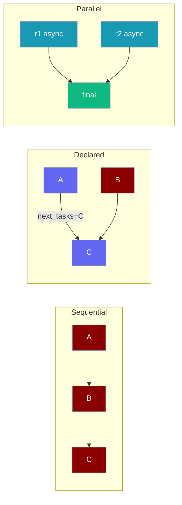
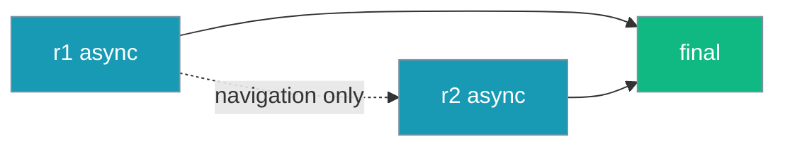

`AgentTeam` chains your tasks in order only where you left the routing blank — anything you declare stays exactly as written.



## Quick Start

<Steps>
<Step title="Let AgentTeam chain your tasks">

```python
from praisonaiagents import Agent, AgentTeam, Task

writer = Agent(name="Writer", instructions="Write clearly")

outline = Task(name="outline", description="Outline a post on AI agents", agent=writer)
draft = Task(name="draft", description="Write the post from the outline", agent=writer)

team = AgentTeam(agents=[writer], tasks=[outline, draft])
team.start()
```

`outline` routes to `draft`, and `draft` receives `outline` as context — no wiring needed.

</Step>

<Step title="Fan out in parallel, then join">

```python
import asyncio
from praisonaiagents import Agent, AgentTeam, Task

a = Agent(name="worker", instructions="Do the thing")

r1 = Task(name="r1", description="First search", agent=a, async_execution=True)
r2 = Task(name="r2", description="Second search", agent=a, async_execution=True)
final = Task(name="final", description="Combine the results", agent=a, context=[r1, r2])

team = AgentTeam(agents=[a], tasks=[r1, r2, final])
asyncio.run(team.astart())
```

`r1` and `r2` run concurrently, and `final` keeps exactly `[r1, r2]` as its context.

</Step>
</Steps>

---

## How It Works

For each adjacent pair of tasks, `AgentTeam` only fills in what you left empty.

| You declared | What AgentTeam does |
|--------------|---------------------|
| Nothing on `prev.next_tasks` | Adds `prev.next_tasks = [nxt.name]` |
| `prev.next_tasks` pointing elsewhere | Leaves it alone — no implicit edge to `nxt` |
| Nothing on `nxt.context` | Adds `nxt.context = [prev]` |
| Your own `nxt.context` | Keeps it as-is — nothing is appended |
| `async_execution=True` on both `prev` and `nxt` | No context edge — both stay independent and run in parallel |

Building another team over the same `Task` objects is idempotent: edges are never duplicated.

```python
from praisonaiagents import Agent, AgentTeam, Task

a = Agent(name="worker", instructions="Do the thing")

A = Task(name="A", description="Start", agent=a, next_tasks=["C"])
B = Task(name="B", description="Side step", agent=a)
C = Task(name="C", description="Finish", agent=a)

AgentTeam(agents=[a], tasks=[A, B, C])
print(A.next_tasks)   # ["C"] — your routing is kept
```

---

## `process="workflow"` and Async Fan-out



The workflow process follows `next_tasks`, so `AgentTeam` still links adjacent async tasks to keep them reachable. That inferred link is navigation-only: it does not make `r2` wait for `r1`, and a failure in `r1` does not skip `r2`.

A `next_tasks` link you declare yourself still creates a real dependency.

---

## Best Practices

<AccordionGroup>
<Accordion title="Declare routing when order matters">
If one task must wait for another, set `next_tasks` or `context` explicitly. AgentTeam will never overwrite it.
</Accordion>

<Accordion title="Use async_execution for independent work">
Mark independent tasks `async_execution=True` and give the joining task `context=[...]`. They run concurrently with `astart()`.
</Accordion>

<Accordion title="Reuse Task objects freely">
Passing the same tasks to a new `AgentTeam` produces the same graph — no duplicate context entries.
</Accordion>
</AccordionGroup>

---

## Related

<CardGroup cols={2}>
<Card title="AgentTeam Re-runs" icon="rotate-right" href="/features/agentteam-rerun">
  Call `start()` again on the same team
</Card>
<Card title="Task Validation" icon="check" href="/features/agentteam-task-validation">
  What AgentTeam accepts as `tasks`
</Card>
</CardGroup>
