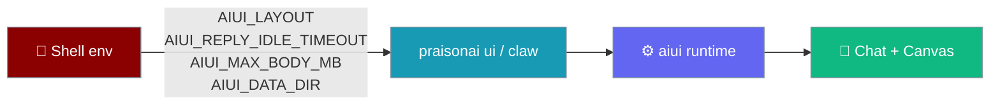

Set these variables in your shell before `praisonai ui` or `praisonai claw` to change the layout, timeouts, upload limits and where data is stored.



## Quick Start

<Steps>
<Step title="Install">

```bash
pip install "praisonai[ui]"
```
</Step>

<Step title="Launch with a variable">

```bash
AIUI_LAYOUT=chat praisonai ui
```

The UI opens as a plain chat, without the canvas.
</Step>
</Steps>

## Variables

| Variable | Default | Effect | When to set |
|---|---|---|---|
| `AIUI_LAYOUT` | (unset) | Overrides the app's chosen layout. One of `chat-canvas`, `chat`, `workbench`, `command`, `guided`, `mission`. | One-run overrides (e.g. a demo without the canvas). |
| `AIUI_REPLY_IDLE_TIMEOUT` | `600` | Seconds a reply may send nothing before it's cancelled. `0` turns it off. | Long-running tools, batch jobs. |
| `AIUI_MAX_BODY_MB` | `25` | Cap on request body size, in MiB. `0` turns it off. | Large file uploads. |
| `AIUI_DATA_DIR` | `~/.praisonaiui` | Where aiui stores its own settings. | Docker volumes, shared dev machines. |
| `PRAISONAI_HOME` | `~/.praisonai` | Where PraisonAI stores its data, including chat history (`sessions`). | Docker volumes, CI isolation. |

### AIUI_LAYOUT

The bundled UIs open in `chat-canvas`. Pick another layout for one run, or switch at runtime with ⌘K.

```bash
AIUI_LAYOUT=chat praisonai ui          # No canvas, just chat
```

### AIUI_REPLY_IDLE_TIMEOUT

A reply that sends nothing for this many seconds is cancelled, just like pressing Stop.

```bash
AIUI_REPLY_IDLE_TIMEOUT=0 praisonai ui # Never time out replies
```

### AIUI_MAX_BODY_MB

Request bodies (including uploads) larger than this are rejected.

```bash
AIUI_MAX_BODY_MB=500 praisonai claw    # Allow 500 MiB uploads
```

### AIUI_DATA_DIR and PRAISONAI_HOME

Chat history lives under `~/.praisonai/sessions`; UI settings live in `~/.praisonaiui`. Set both to keep everything on a mounted volume.

```bash
AIUI_DATA_DIR=/data/aiui PRAISONAI_HOME=/data/praisonai praisonai ui
```

## Best Practices

<AccordionGroup>
<Accordion title="Persist data in Docker">
Set both `AIUI_DATA_DIR` and `PRAISONAI_HOME` to paths on a mounted volume, otherwise history or settings are lost when the container restarts.
</Accordion>
<Accordion title="Raise the idle timeout instead of disabling it">
For slow tools, a larger `AIUI_REPLY_IDLE_TIMEOUT` (e.g. `1800`) still protects you from stuck replies.
</Accordion>
</AccordionGroup>

## Related

<CardGroup cols={3}>
<Card title="PraisonAI UI" icon="message-bot" href="/ui/ui">
  Chat + Canvas for your agents
</Card>
<Card title="PraisonAI Claw" icon="lobster" href="/ui/claw">
  Dashboard with channels and admin pages
</Card>
<Card title="Realtime Voice" icon="microphone" href="/ui/realtime">
  Realtime voice interface
</Card>
</CardGroup>
