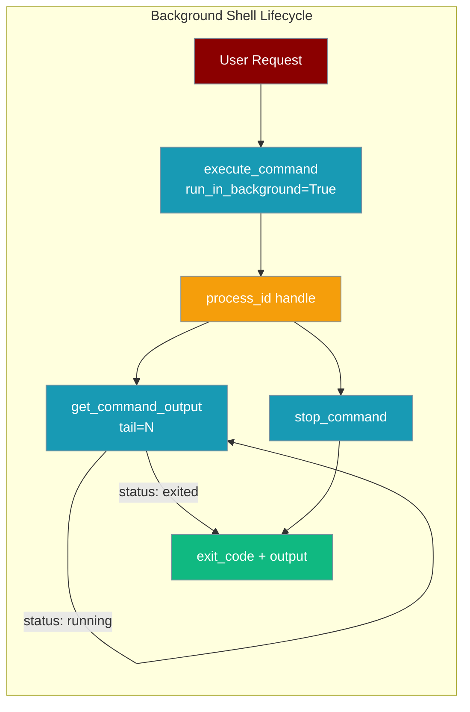
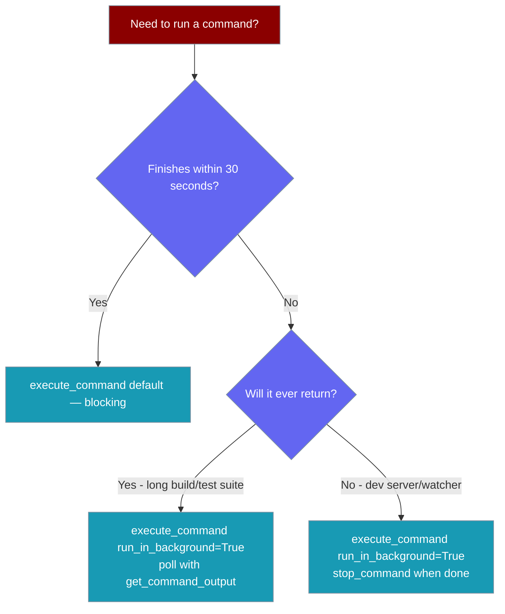
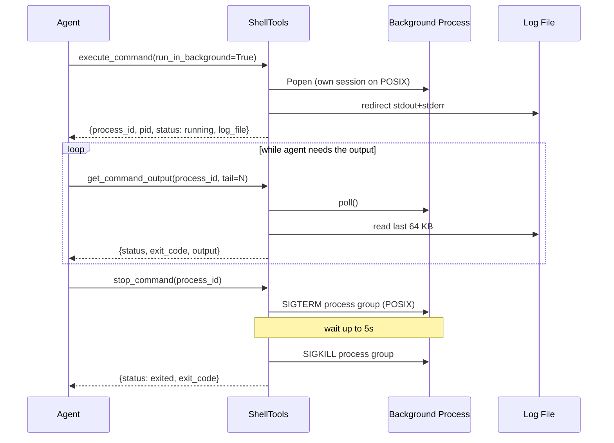

`execute_command(..., run_in_background=True)` starts a shell command and returns a handle immediately, so dev servers, watchers, and long test suites don't block the turn or get killed by the 30-second timeout.

```python
from praisonaiagents import Agent
from praisonaiagents import execute_command, get_command_output, stop_command

agent = Agent(
    name="Dev Runner",
    instructions=(
        "Start the dev server with execute_command(run_in_background=True). "
        "Tail its output with get_command_output until it reports ready. "
        "Run a smoke test with a short foreground execute_command. "
        "Finish by calling stop_command on the server's process_id."
    ),
    tools=[execute_command, get_command_output, stop_command],
)
agent.start("Launch `npm run dev`, confirm it serves on :3000, then shut it down.")
```



## Quick Start

<Steps>
<Step title="Start">
```python
from praisonaiagents import execute_command

h = execute_command("npm run dev", run_in_background=True)
# {"success": True, "process_id": "3f9a1c2b", "pid": 4821, "status": "running",
#  "log_file": "/tmp/praisonai-bg-xxxxxx.log"}
```
</Step>

<Step title="Poll Output">
```python
from praisonaiagents import get_command_output

print(get_command_output(h["process_id"], tail=20))
# {"status": "running", "exit_code": None, "output": "...last lines..."}
```
</Step>

<Step title="Stop">
```python
from praisonaiagents import stop_command

stop_command(h["process_id"])
# {"success": True, "status": "exited", "exit_code": -15}
```
</Step>
</Steps>

---

## Which Mode Should I Use?



---

## How It Works

The agent starts the process, polls a log file, and stops the process tree when done.



The same safety checks apply as for foreground commands:

| Check | With `run_in_background=True` |
|-------|-------------------------------|
| `shell=False` (command split with `shlex`) | Still applies |
| Shell-syntax refusal (redirects, pipes, chains, substitutions, newlines) | Still fires **before** the process starts; no `process_id` is issued |
| `DANGEROUS_COMMANDS` + `allow_dangerous` | Still applies |
| `critical`-risk approval | Still gates the start |
| `timeout` | **Ignored** — call `stop_command` or let the exit hook reap it |

---

## Configuration Options

### `execute_command` (new parameter)

| Parameter | Type | Default | Description |
|-----------|------|---------|-------------|
| `run_in_background` | `bool` | `False` | Start the command and return a `process_id` immediately. `timeout` is ignored. |

### `get_command_output(process_id, tail=200)`

| Parameter | Type | Default | Description |
|-----------|------|---------|-------------|
| `process_id` | `str` | — | The `process_id` returned by `execute_command`. |
| `tail` | `int` | `200` | Number of most-recent output lines to return. Reads at most the last **64 KB** of the log. |

```python
{
    "success": True,        # True while running or on clean exit (exit_code in (None, 0))
    "process_id": "3f9a1c2b",
    "pid": 4821,
    "status": "running",    # or "exited"
    "exit_code": None,      # int once exited
    "output": "last N lines...",
    "log_file": "/tmp/praisonai-bg-xxxxxx.log",
}
```

### `stop_command(process_id)`

| Parameter | Type | Default | Description |
|-----------|------|---------|-------------|
| `process_id` | `str` | — | The `process_id` returned by `execute_command`. |

```python
{"success": True, "process_id": "3f9a1c2b", "status": "exited", "exit_code": -15}
```

An unknown id returns `{"success": False, "error": "No background command with process_id '...'"}` from both functions.

---

## Common Patterns

### Start a server, then test it

```python
from praisonaiagents import execute_command, get_command_output, stop_command

server = execute_command("python -m http.server 8000", run_in_background=True)
print(get_command_output(server["process_id"], tail=5)["output"])
print(execute_command("curl -s -o /dev/null -w %{http_code} http://localhost:8000")["stdout"])
stop_command(server["process_id"])
```

### Long test suite with periodic tailing

```python
from praisonaiagents import execute_command, get_command_output

run = execute_command("pytest -q", run_in_background=True)
status = get_command_output(run["process_id"], tail=10)
while status["status"] == "running":
    status = get_command_output(run["process_id"], tail=10)
print(status["exit_code"], status["output"])
```

### Watcher that outlives several turns

```python
from praisonaiagents import Agent
from praisonaiagents import execute_command, get_command_output, stop_command

agent = Agent(
    name="Watcher",
    instructions="Keep the watcher running between turns. Stop it only when asked.",
    tools=[execute_command, get_command_output, stop_command],
)
agent.start("Start `npm run watch` in the background.")
agent.start("Show me the latest watcher output.")
agent.start("Stop the watcher.")
```

---

## Platform Behaviour

| Platform | How `stop_command` ends the process |
|----------|-------------------------------------|
| POSIX | The command runs in its own session. `SIGTERM` goes to the whole process group, waits up to 5 seconds, then `SIGKILL` hits anything left. |
| Windows | Walks the tree with `psutil` when available, otherwise `taskkill /F /T /PID`. A missing or hung `taskkill` still falls through to `process.kill()`. |

An `atexit` hook stops any still-running background commands when the interpreter exits, so dev servers are not orphaned.

---

## Deliberate Limits

<Warning>
Background commands are tracked only in-process on the `ShellTools()` instance.
</Warning>

- A restart loses the process handle. The log file stays on disk, but the process is not re-adopted.
- There is no `shell_list` tool to list running background commands.
- There is no push notification on completion — the agent polls `get_command_output`.
- Background commands are not surfaced in the jobs CLI.

<Info>
Background commands get the same [credential env scrubbing](/tools/shell_tools#credential-environment-variables) as foreground ones — `*_KEY`, `*_TOKEN`, `*_SECRET` and similar names are stripped from the child env and its log file.
</Info>

---

## Best Practices

<AccordionGroup>
  <Accordion title="Stop what you start">
    The exit hook reaps leftovers, but relying on it is bad hygiene. Write the matching `stop_command(process_id)` into the agent's instructions for every background start.
  </Accordion>

  <Accordion title="Poll with tail, don't scrape the full log">
    Use `get_command_output(process_id, tail=20)`. The read is bounded to 64 KB, and a small `tail` keeps the agent's context small.
  </Accordion>

  <Accordion title="Trust exit_code, not stdout contents">
    Once `status` is `"exited"`, `exit_code` is the authoritative result. Output text can look healthy while the process failed.
  </Accordion>
</AccordionGroup>

---

## Related

<CardGroup cols={2}>
  <Card title="Shell Tools" icon="terminal" href="/tools/shell_tools">
    All shell functions for agents
  </Card>
  <Card title="Tool Approval" icon="shield-check" href="/features/approval">
    Approval gates for critical commands
  </Card>
  <Card title="Tool Output Spill" icon="file-arrow-down" href="/features/tool-output-spill">
    Large foreground output saved to artifacts
  </Card>
  <Card title="Concurrency" icon="layer-group" href="/features/concurrency">
    Run work in parallel safely
  </Card>
</CardGroup>
