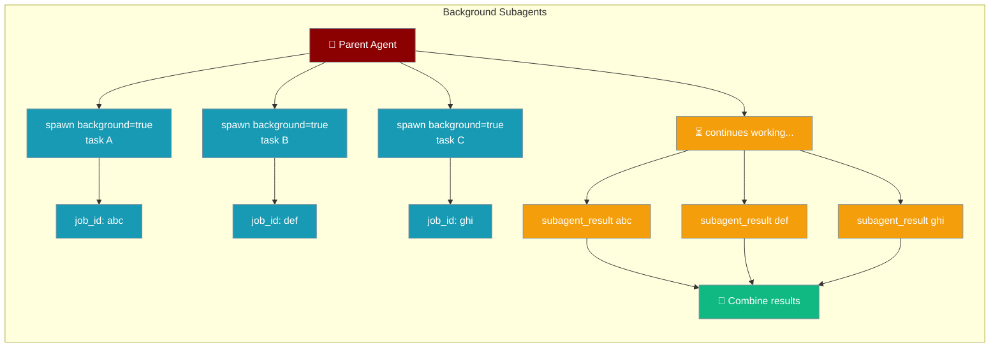
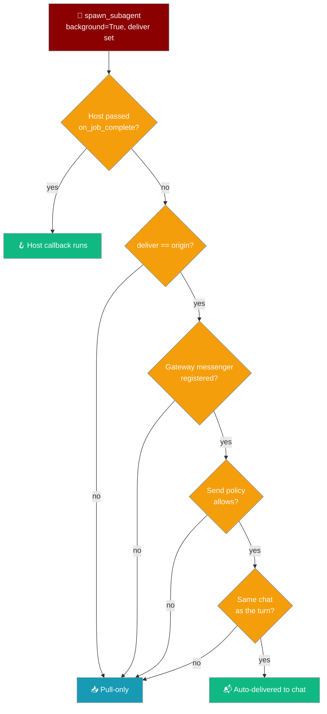
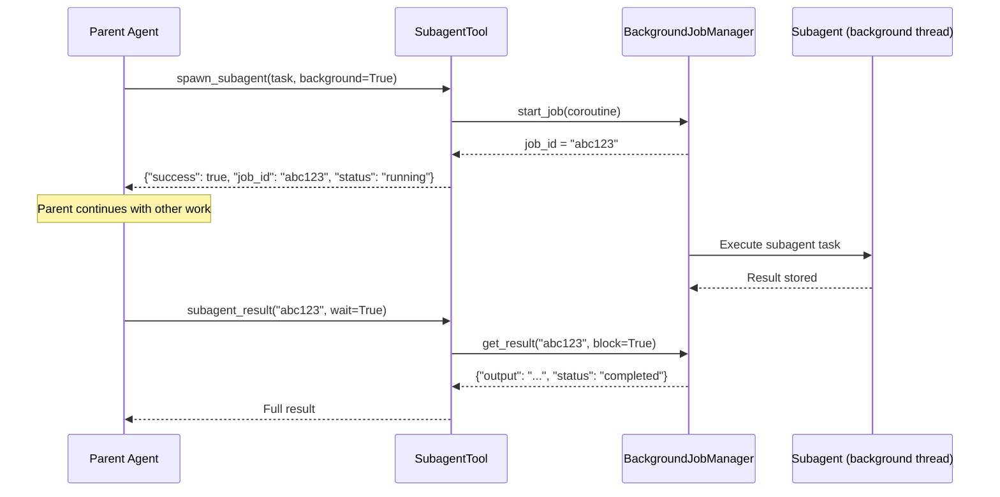
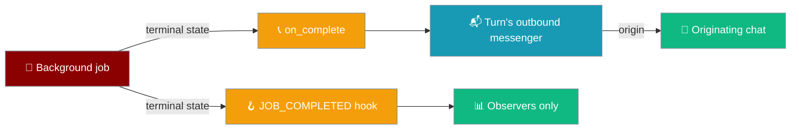

A parent agent can fire off one or more subagents and continue working. Each background subagent returns a `job_id` immediately — results can be pulled on demand or delivered automatically back to the originating chat.

<Note>
Every background subagent still emits `HookEvent.SUBAGENT_STOP` on completion (success or failure) — same as a synchronous spawn. See [Observability](#observability) below.
</Note>

```python
from praisonaiagents import Agent
from praisonaiagents.tools.subagent_tool import create_subagent_tool

subagent = create_subagent_tool()  # spawn_subagent + subagent_result

agent = Agent(
    name="Researcher",
    instructions=(
        "When the user asks for research, spawn a background subagent with "
        "background=True and deliver='origin'. Tell the user you'll ping them "
        "when it's ready, then end your turn."
    ),
    tools=[subagent["function"], subagent["result_tool"]["function"]],
)

agent.start("Research the latest Python 3.13 features and let me know when done")
```

How a user experiences it in a bot chat:

1. The user types a long task.
2. The agent spawns the subagent, replies "Started; I'll ping you when done", and ends the turn.
3. The user does other things in the chat (or walks away).
4. When the subagent finishes, the gateway posts the result as a new message in the same chat — no new prompt needed.




## Quick Start

<Steps>
<Step title="Spawn a background subagent">

Call `spawn_subagent` with `background=True`. The parent gets a `job_id` and keeps running:

```python
from praisonaiagents import Agent
from praisonaiagents.tools.subagent_tool import create_subagent_tool

subagent = create_subagent_tool()
tools = [subagent["function"], subagent["result_tool"]["function"]]

agent = Agent(
    name="Boss",
    instructions=(
        "Use spawn_subagent with background=true to start the research task. "
        "Then do other work. Finally call subagent_result with the job_id to get the answer."
    ),
    tools=tools,
)

agent.start("Research the latest Python 3.13 features in the background, "
            "then write a haiku while waiting, then fetch the research result.")
```
</Step>

<Step title="Deliver result back to chat automatically">

Ask for `deliver="origin"` when the agent runs behind a gateway (`BotOS`) — the finished result is sent back to the same chat without polling:

```python
from praisonaiagents import Agent
from praisonaiagents.tools.subagent_tool import create_subagent_tool

subagent = create_subagent_tool()  # spawn_subagent + subagent_result

agent = Agent(
    name="Researcher",
    instructions=(
        "When the user asks for research, spawn a background subagent with "
        "deliver='origin' so the finished result is delivered back to this chat "
        "automatically. Tell the user you'll ping them when it's ready."
    ),
    tools=[subagent["function"], subagent["result_tool"]["function"]],
)
```

<Note>Auto-delivery needs a running gateway: the origin chat is filled from the turn's session context. In a bare `Agent` (no gateway) the job stays pull-only — collect it with `subagent_result`. See [When auto-delivery kicks in](#when-auto-delivery-kicks-in).</Note>
</Step>

<Step title="Fan out and collect all results">

Spawn multiple subagents in parallel and wait for all of them:

```python
from praisonaiagents import Agent
from praisonaiagents.tools.subagent_tool import create_subagent_tool

subagent = create_subagent_tool()
tools = [subagent["function"], subagent["result_tool"]["function"]]

orchestrator = Agent(
    name="Orchestrator",
    instructions=(
        "1. Spawn three background subagents — one for Python news, one for Rust news, "
        "one for Go news. 2. Record all three job IDs. "
        "3. Call subagent_result(job_id, wait=true) for each to collect results. "
        "4. Write a short comparative summary."
    ),
    tools=tools,
)

orchestrator.start("Compare the latest language news for Python, Rust, and Go")
```
</Step>

<Step title="Check status without blocking">

Poll a job without waiting — useful when you want to check periodically:

```python
from praisonaiagents import Agent
from praisonaiagents.tools.subagent_tool import create_subagent_tool

subagent = create_subagent_tool()  # spawn_subagent + subagent_result

agent = Agent(
    name="Checker",
    instructions=(
        "Spawn a slow background task. Then check its status with "
        "subagent_result(job_id, wait=false) every few steps until it's done."
    ),
    tools=[subagent["function"], subagent["result_tool"]["function"]],
)
agent.start("Run a background analysis and poll for its completion")
```
</Step>

</Steps>

---

## Chat-Back Delivery Flow

When running inside a gateway (`BotOS`), a background job delivers itself back to the originating chat when it finishes — no polling required.

```mermaid
sequenceDiagram
    participant U as User (chat)
    participant G as Gateway (BotOS)
    participant A as Agent (turn)
    participant BG as BackgroundJobManager
    participant M as Outbound Messenger
    U->>G: "research X in the background"
    G->>A: turn starts
    Note over A: register_gateway_loop(loop)<br/>register_outbound_messenger(M)
    A->>BG: spawn_subagent(background=True, deliver="origin")
    Note over BG: origin filled from<br/>get_session_context()
    BG-->>A: job_id
    A-->>G: "Started; I'll ping you when done"
    G-->>U: reply (turn ends)
    Note over BG: job runs on worker thread...
    BG->>M: on_complete → messenger.send("origin", text)
    M-->>U: 📬 Result delivered (no active turn)
    Note over BG: on send OK → info.delivered = True<br/>on send fail → stays delivered = False
```

The result goes through the same outbound messenger and `DeliveryRouter` path that `send_message` uses — no extra configuration beyond `deliver="origin"`.

The model never picks the chat. At spawn time the origin (`platform`, `chat_id`, `thread_id`, `user_id`) is filled from the turn's session context. The captured `user_id` is also what scopes [`/tasks`](/features/bot-commands#tasks) to the caller's own jobs.

### When auto-delivery kicks in

The result is sent back automatically only when **all** of these hold:

1. The host did **not** pass its own `on_job_complete` to `create_subagent_tool(...)` (an explicit callback always wins).
2. `deliver="origin"` — any other token (e.g. `"telegram:123"`, `"all"`) stays pull-only unless the host passes `on_job_complete`.
3. The spawning turn has an outbound messenger registered (a running gateway / `BotOS`).
4. The active send policy does not deny `"origin"` (the same check `send_message` uses).
5. The target is the turn's **own** chat — any explicit `chat_id` / `platform` / `thread_id` is empty or equal to the current turn's.



Without a gateway the job is pull-only: `info.delivered` stays `False` and `info.origin["chat_id"]` is `""`.

<Warning>**Not restart-safe yet.** Jobs are persisted, but the gateway does not call `reconcile_on_start()` for background-subagent jobs, so a job that finishes while the gateway is down is **not** re-delivered when it comes back. See [Durable Background Jobs](/features/durable-background-jobs).</Warning>

<Note>Cancelling a background job after it has started does not deliver a late result or fire `JOB_COMPLETED` — the job ends in `CANCELLED` and the chat stays quiet.</Note>

---

## How It Works (Pull Mode)



Background subagents run on a shared thread pool managed by `BackgroundJobManager`. Job IDs are 8-character random strings. Results are kept in memory until retrieved.

---

## How Delivery is Wired



**Core layer (`praisonaiagents`)**:
- `BackgroundJobManager.start_job(..., on_complete=None, origin=None)` — accepts an optional completion callback.
- `spawn_subagent` captures the origin into the job. When the [auto-delivery conditions](#when-auto-delivery-kicks-in) hold, it installs a per-turn callback that sends the result through the turn's outbound messenger. A host that passes `on_job_complete` to `create_subagent_tool(...)` replaces this.
- `HookEvent.JOB_COMPLETED` fires when a job reaches a terminal state. It is observational — it is **not** the chat delivery path.

**Wrapper layer (`praisonai_bot`)**:
- Each gateway turn registers its outbound messenger and its event loop (`register_gateway_loop`), so the background worker can send after the turn has ended.

---

## Delivery Tokens

| Token | Meaning |
|-------|---------|
| `""` (empty) | Pull-only via `subagent_result` (unchanged legacy behaviour) |
| `"origin"` | Deliver back to the turn's own chat — the only token auto-sent by the gateway |
| `"all"` | Recorded on the job; delivered only by a host `on_job_complete` |
| `"platform:chat_id"` | Recorded on the job (e.g. `"telegram:12345"`); delivered only by a host `on_job_complete` |
| `"platform:chat_id:thread_id"` | Same, for a specific thread or reply context |

<Warning>**Failure delivery:** On failure, the chat receives `Background task failed: <error>` instead of the result; an empty result is sent as `Background task finished with no output.` If the messenger rejects the send, the job stays `delivered=False` — it is never marked delivered for a message that didn't go out. Hook handlers are best-effort — a raised exception is swallowed and logged at DEBUG so the worker never crashes.</Warning>

### Subscribe to `JOB_COMPLETED`

For observability or custom side effects when a background job finishes, register on `HookEvent.JOB_COMPLETED` (see [Hook Events](/features/hook-events)):

```python
from praisonaiagents.hooks import HookEvent, register_hook

@register_hook(HookEvent.JOB_COMPLETED)
def log_completion(input):
    print(f"job {input.job_info.job_id} → {input.job_info.status.value}")
```

---

## Tool Parameters

### `spawn_subagent`

The model cannot set origin fields. The model-visible schema has only `task`, `agent_name`, `context`, `tools`, `llm`, `permission_mode`, `background` and `deliver`; `platform`, `chat_id`, `thread_id` and `session_id` are Python-only parameters, injected from the turn's session context at spawn time. Explicit callers (Python code) can still override them.

| Parameter | Type | Default | Description |
|-----------|------|---------|-------------|
| `task` | `str` | required | The task or prompt for the subagent |
| `agent_name` | `str` | `"subagent"` | Name for the spawned agent |
| `context` | `str` | `None` | Optional extra context for the task |
| `llm` | `str` | `None` | LLM model override |
| `permission_mode` | `str` | `None` | Permission mode for the subagent |
| `tools` | `list` | `[]` | Tools to give the subagent |
| `background` | `bool` | `False` | When `True`, return immediately with a `job_id` |
| `deliver` | `str` | `""` | Delivery token: `"origin"`, `"all"`, `"platform:chat_id[:thread_id]"`, or `""` (pull-only) |
| `platform` | `str` | `""` | Python-only. Origin platform; defaults to the turn's platform. |
| `chat_id` | `str` | `""` | Python-only. Origin chat id; defaults to the turn's chat. A different chat opts out of auto-delivery. |
| `thread_id` | `str` | `""` | Python-only. Origin thread id; defaults to the turn's thread. |
| `session_id` | `str` | `""` | Python-only. Origin session id to preserve context. |

**Returns (foreground):** Full result dict with `output`, `success`, `error`.

**Returns (background):** `{"success": True, "job_id": "...", "status": "running"}`.

### `subagent_result`

| Parameter | Type | Default | Description |
|-----------|------|---------|-------------|
| `job_id` | `str` | required | The `job_id` returned by `spawn_subagent(background=True)` |
| `wait` | `bool` | `False` | When `True`, block until the job completes |

**Returns:**
- Job still running (`wait=False`): `{"success": True, "job_id": "...", "status": "running"}`
- Job done: `{"success": True, "job_id": "...", "status": "completed", "result": {...}}`
- Job failed: `{"success": False, "job_id": "...", "error": "..."}`

---

<Note>
**Backward compatibility:** With no `deliver` target, behaviour is byte-for-byte as before — pull-only via `subagent_result`. The delivery path is purely additive.
</Note>

## Observability

The `SUBAGENT_STOP` hook fires from the same completion chokepoint for background jobs as for synchronous spawns, so you do **not** need to poll `subagent_result` just to observe completion. Register a hook and let the runtime call you.

```python
from praisonaiagents.hooks import HookRegistry, HookEvent, HookResult, SubagentStopInput

registry = HookRegistry()

@registry.on(HookEvent.SUBAGENT_STOP)
def on_bg_subagent_stop(event_data: SubagentStopInput):
    # event_data.task, event_data.success, event_data.output, event_data.duration_ms
    print(f"{event_data.agent_name}: success={event_data.success} in {event_data.duration_ms:.0f} ms")
    return HookResult.allow()
```

See [Hook Events → Subagent Events](/features/hook-events#subagent-events) for the payload reference.

---

## Best Practices

<AccordionGroup>
<Accordion title="Don't background trivially fast tasks">

Background subagents have overhead (thread scheduling, job management). For tasks that complete in under a second, use foreground subagents (`background=False`, the default) — they're simpler and return results immediately.
</Accordion>

<Accordion title="Always capture job IDs">

The parent agent should record job IDs in its working memory or output immediately after spawning. If a job ID is lost, there is no way to retrieve the result.
</Accordion>

<Accordion title="Set a concurrency budget">

The `BackgroundJobManager` runs on a thread pool. Avoid spawning hundreds of concurrent subagents without throttling — each subagent holds a connection and context window while running.
</Accordion>

<Accordion title="Use wait=True for final collection">

When you need a result to proceed, always use `subagent_result(job_id, wait=True)` rather than polling in a loop. The `wait=True` mode blocks the calling thread efficiently without spinning.
</Accordion>

<Accordion title="Use deliver='origin' instead of polling for chat bots">

In a bot context, `deliver='origin'` is simpler than polling: the parent can close its turn immediately and the result arrives as a new message when ready — no held connections.
</Accordion>

<Accordion title="Failure delivery behaviour">

On failure, `Background task failed: <error>` is delivered to the same chat instead of the result. If the messenger rejects the send, the job stays `delivered=False`. The `JOB_COMPLETED` hook fires for both terminal states (`COMPLETED` and `FAILED`), and handler errors never crash the worker.
</Accordion>
</AccordionGroup>

---

## Related

<CardGroup cols={2}>
<Card title="Named Subagents" icon="users" href="/features/named-subagents">
  Delegate to your own named agents by name mid-run — no Python
</Card>
<Card title="Hook Events" icon="webhook" href="/features/hook-events">
  Subscribe to JOB_COMPLETED and other lifecycle events
</Card>
<Card title="Background Tasks" icon="clock" href="/features/background-tasks">
  Other background task patterns for long-running work
</Card>
<Card title="Proactive Delivery" icon="bell" href="/features/proactive-delivery">
  Push messages to users outside of a turn
</Card>
<Card title="Channels Gateway" icon="tower-broadcast" href="/features/channels-gateway">
  Configure BotOS for multi-platform bot deployments
</Card>
<Card title="Gateway Reliability" icon="shield-check" href="/features/gateway-reliability">
  Production reliability presets for the gateway
</Card>
</CardGroup>
