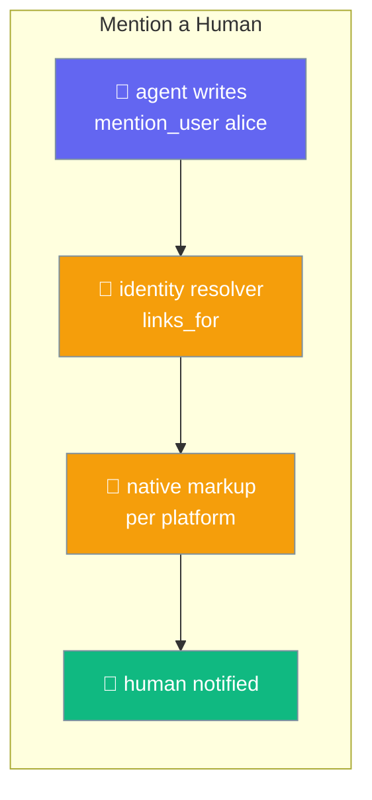
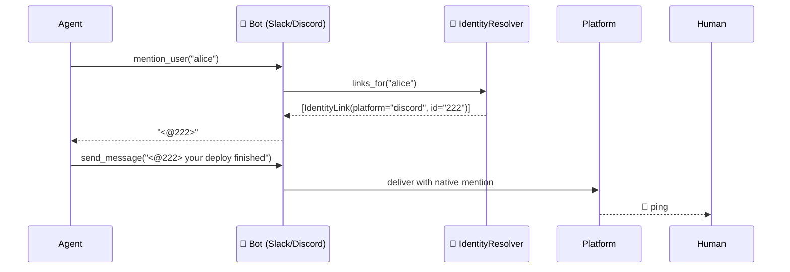
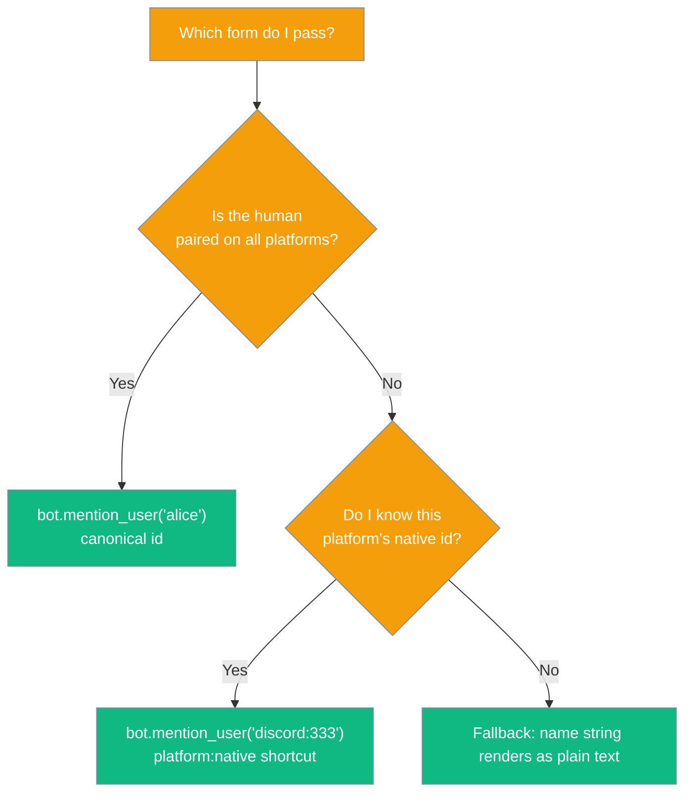

`mention_user()` turns a canonical human identity into the platform's native @mention, so the right person gets a real ping in a shared channel.



Here's a real example: a deploy agent posts in `#deploys` (Slack), where Alice, Bob and the bot are all members. Bob is on call:

```
Agent in #deploys (Slack, Alice + Bob + bot):
  (agent runs the pipeline, Bob is the on-call)
  bot.send_message("#deploys",
      f"{bot.mention_user('bob')} prod deploy finished — please verify")

Slack renders:
  "@Bob prod deploy finished — please verify"
Bob gets a real notification; Alice sees the message without a ping.
```

## Quick Start

<Steps>
<Step title="Mention someone by canonical id">
Link the human once in an identity resolver, then pass the same resolver to `Bot`. Once the bot starts, `bot.adapter.mention_user("alice")` returns the native markup.

```python
from praisonaiagents import Agent
from praisonaiagents.session import InMemoryIdentityResolver
from praisonai_bot.bots import Bot

resolver = InMemoryIdentityResolver()
resolver.link("discord", "222", "alice")

agent = Agent(name="deployer", instructions="Report deploy results")
bot = Bot("discord", agent=agent, identity_resolver=resolver)

# Once the bot is running:
text = f"{bot.adapter.mention_user('alice')} your deploy finished"
await bot.adapter.send_message(channel_id, text)   # -> "<@222> your deploy finished"
```
</Step>

<Step title="Fallback when the person isn't linked here">
If the person has no link on this platform, you get the id back as plain text. Your message still goes out; it just doesn't ping anyone.

```python
resolver.link("telegram", "111", "carol")       # carol is only paired on Telegram

bot.adapter.mention_user("carol")               # -> "carol" (plain text on Discord)
```
</Step>

<Step title="Use the unlinked platform:id shortcut">
If you already know this platform's native id, pass `"{platform}:{native_id}"`. The bot skips the resolver.

```python
from praisonai_bot.bots import DiscordBot

bot = DiscordBot(token="...")
bot.mention_user("discord:333")                 # -> "<@333>"
bot.mention_user("slack:U1")                    # -> "slack:U1" (wrong platform, plain text)
```
</Step>
</Steps>

---

## How It Works



1. If the platform has no mention template, it can't ping by id, so the id comes back as plain text.
2. A `"{platform}:{native_id}"` id whose prefix matches this adapter is rendered directly. The resolver isn't called.
3. Otherwise the adapter calls `links_for()` on its identity resolver. `Bot`, `BotOS` and the gateway attach the resolver automatically.
4. The adapter uses the link for its own platform to render the mention, for example `<@222>`.
5. If there's no link for this platform, or the lookup raises, the id comes back as plain text. A lookup error is logged as a warning and the reply is never lost.

| Platform | Native mention | Falls back to text? |
|----------|:--------------:|:-------------------:|
| Slack    | ✅ `<@U123>`  | — |
| Discord  | ✅ `<@222>`   | — |
| Telegram | ❌ (no template) | ✅ plain id |
| WhatsApp | ❌ (no template) | ✅ plain id |

### Which form do I pass?



---

## Configuration Options

There is nothing to configure: `mention_user(unified_user_id)` takes a single argument and returns a string. Full API: [Bots SDK reference](/sdk/reference/praisonaiagents/modules/bots).

---

## Common Patterns

**Handoff ping**

```python
await bot.adapter.send_message(channel_id, f"{bot.adapter.mention_user(assignee)} please review PR #42")
```

**Approval request**

```python
await bot.adapter.send_message(channel_id, f"{bot.adapter.mention_user(owner)} approve or reject this deploy")
```

**Multi-recipient alert**

```python
on_call = ["alice", "bob"]
pings = " ".join(bot.adapter.mention_user(uid) for uid in on_call)
await bot.adapter.send_message(channel_id, f"{pings} error rate above 5%")
```

---

## Best Practices

<AccordionGroup>
<Accordion title="Prefer canonical ids over raw native ids">
Pass `"alice"`, not `"222"`. The same agent code then works unchanged on Slack, Discord, or any other channel.
</Accordion>

<Accordion title="The plain-text fallback is a feature">
If someone isn't paired on this platform, they're named in plain text. The message is still delivered and nothing crashes.
</Accordion>

<Accordion title="Pair the human first">
A canonical id only becomes a native mention after it's linked. See [Bot Pairing](/features/bot-pairing) to set up the links.
</Accordion>

<Accordion title="Don't write raw <@id> markup yourself">
Let `mention_user()` produce the markup. Each adapter owns its template, so you can swap platforms without changing your code.
</Accordion>
</AccordionGroup>

---

## Related

<CardGroup cols={2}>
<Card title="Bot Pairing" icon="link" href="/features/bot-pairing">
How a human becomes a canonical identity
</Card>
<Card title="Identity Canonicalization" icon="fingerprint" href="/features/gateway-identity-canonicalization">
The identity map the resolver reads
</Card>
<Card title="Implicit Mentions" icon="reply" href="/features/bot-implicit-mentions">
The inbound counterpart
</Card>
<Card title="Bot Gateway" icon="tower-broadcast" href="/features/bot-gateway">
Where channel adapters are wired
</Card>
</CardGroup>
