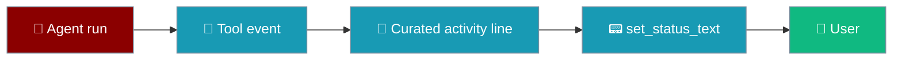
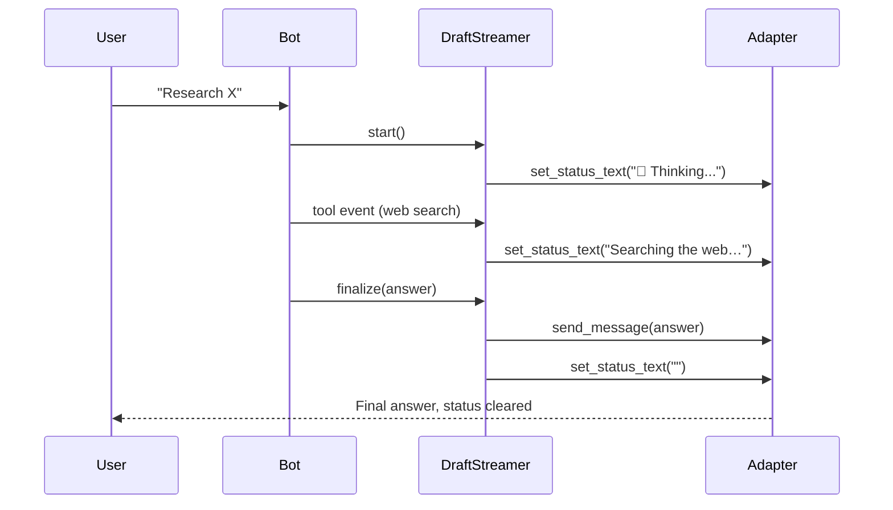
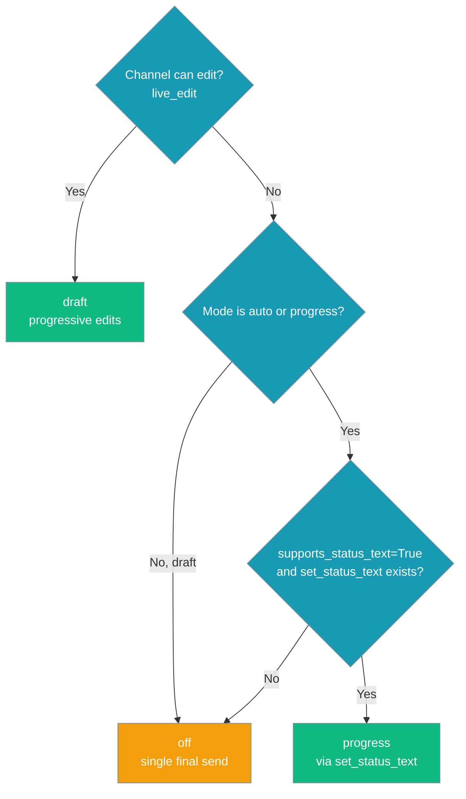

Channels that can neither edit messages nor add reactions (email, SMS, IRC, many webhook transports) can show a short, replaceable status line such as `🔍 Searching the web…` while the agent works. Without it, the user sees nothing until the final answer.

```python
from praisonaiagents import Agent

agent = Agent(name="assistant", instructions="Help the user research the web.")
agent.start("Find the latest release notes for Python.")
```

On a channel that opts in, the user sees `🤔 Thinking...`, then an activity line such as `Searching the web…`, then the final answer. The status line clears when the turn ends.



<Note>
No built-in adapter (Telegram, Discord, Slack, WhatsApp, Email, …) turns this on yet. It is for **custom adapters** that have somewhere to put a short status line, such as a subject line, a header, or an IRC topic.
</Note>

## Quick Start

<Steps>
<Step title="Use auto or progress streaming">

You don't need to change the agent. Set streaming to `auto` (or `progress`) on the channel, the same way as for any other bot.

```yaml
channels:
  my_sms:
    streaming:
      mode: auto
      activity_status:
        enabled: true
        phrases:
          web:     "Searching the web…"
          default: "Working on it…"
```

`activity_status` is optional. Without it the line reads `🤔 Running <tool>...`, which shows the raw tool name.

</Step>

<Step title="Opt in from your adapter">

Your adapter needs three things: it reports that it can't edit, it sets `supports_status_text=True`, and it has an `async set_status_text(channel_id, text)` method.

```python
import asyncio
from praisonaiagents.bots import PlatformCapabilities
from praisonai_bot.bots import DraftStreamer, StreamingConfig, StreamingMode


class SmsAdapter:
    """A channel that can't edit messages or add reactions."""

    capabilities = {"live_edit": False, "reactions": False}
    platform_capabilities = PlatformCapabilities(supports_status_text=True)

    async def set_status_text(self, channel_id: str, text: str) -> None:
        # Empty text means the turn is over: clear the line.
        print(f"[status] {text or '(cleared)'}")

    async def send_message(self, channel_id, content, reply_to=None, thread_id=None):
        print(f"[message] {content}")


async def main():
    streamer = DraftStreamer(
        adapter=SmsAdapter(),
        channel_id="+15551234567",
        config=StreamingConfig(mode=StreamingMode.AUTO),
    )
    await streamer.start()                           # status: 🤔 Thinking...
    await streamer.finalize("Here is your answer.")  # message, then status cleared

asyncio.run(main())
```

Output:

```text
[status] 🤔 Thinking...
[message] Here is your answer.
[status] (cleared)
```

</Step>
</Steps>

---

## How It Works



| Step | What happens |
|------|--------------|
| `start()` | No placeholder message is sent. `placeholder_text` becomes the first status line. |
| Tool events | The curated activity line is pushed with `set_status_text`. |
| `finalize()` | The full answer goes out with `send_message`, split into chunks as usual. Then the status line is cleared with an empty string. |

The streamer logs `Channel <id> can't edit; routing streaming mode '<mode>' to status text` at **INFO** when this mode is active.

---

## Choosing a surface

Each channel uses the best surface it supports:



`draft` is never switched to a status line. Choosing `draft` means you want in-place edits, so on a channel that can't edit it still falls back to `off`.

### When to enable

| Channel type | Where the status line can go |
|--------------|------------------------------|
| Email | A draft subject or header |
| SMS | A short interim notice or carrier status field |
| IRC | Channel topic or a status bar |
| Custom / webhook | Any replaceable field your transport exposes |

---

## Configuration Options

| Option | Type | Default | Description |
|--------|------|---------|-------------|
| `supports_status_text` | `bool` | `False` | Turns on the status-text surface for the adapter (a field on `PlatformCapabilities`). |

There is no new `StreamingConfig` field. The behaviour comes only from the capability flag and the method being present.

### Required method

```python
async def set_status_text(self, channel_id: str, text: str) -> None: ...
```

- An empty `text` clears the line when the turn ends.
- The method is **not** part of `BotProtocol`. It is optional and checked at runtime with `callable(...)`. Adding it to the `@runtime_checkable` protocol would make `isinstance(adapter, BotProtocol)` fail for every existing adapter.
- If the flag is `True` but the method is missing, the channel falls back to `off`, the same as before.

### Behaviour details

- Only `auto` and `progress` use the status line. `draft` falls back to `off` on channels that can't edit.
- If a status line hasn't changed, it isn't sent again, so there are no extra API calls.
- The multi-line `progress_style: feed` is not used here. You get a single line.
- Status updates share the edit rate limiter and flood backoff (`disable_progressive_edits_after`, `flood_backoff_factor`, `max_interval`).
- If `set_status_text` fails, the turn carries on and the final answer is still delivered.
- With the default `supports_status_text=False`, nothing changes: channels that can't edit stay silent until the answer arrives.

---

## Privacy

The status line uses the same activity line as `progress` mode. Set [`activity_phrases`](/features/bot-streaming-replies#privacy-safe-activity-surface) and tool names, arguments, URLs and file paths never reach the user. Outbound redaction (`redact_outbound_text`) runs before every push.

---

## Best Practices

<AccordionGroup>
<Accordion title="Prefer a status line over nothing">
If an email, SMS, or IRC channel can carry a short header or subject-like field, opt in. Several minutes of silence makes users think the bot is broken.
</Accordion>

<Accordion title="Don't deduplicate in the adapter">
The streamer already skips unchanged lines, so your adapter can forward every call straight to the provider.
</Accordion>

<Accordion title="Treat empty text as end of turn">
The streamer sends `""` after the final answer. Remove the line instead of showing a blank status.
</Accordion>

<Accordion title="Fail quietly">
Raise or log inside `set_status_text` if the provider rejects an update. The streamer catches the error, logs it at debug level, and still delivers the final answer.
</Accordion>
</AccordionGroup>

---

## Related

<CardGroup cols={2}>
  <Card title="Streaming Replies" icon="message-pen" href="/features/bot-streaming-replies">
    Draft, progress, and auto streaming modes
  </Card>
  <Card title="Platform Capabilities" icon="sliders" href="/features/bot-platform-capabilities">
    Capability flags adapters declare
  </Card>
  <Card title="Status Reactions" icon="face-smile" href="/features/bot-status-reactions">
    Emoji progress on channels with reactions
  </Card>
  <Card title="Typing Indicators" icon="keyboard" href="/features/bot-typing-indicators">
    Typing signals while the agent works
  </Card>
</CardGroup>
