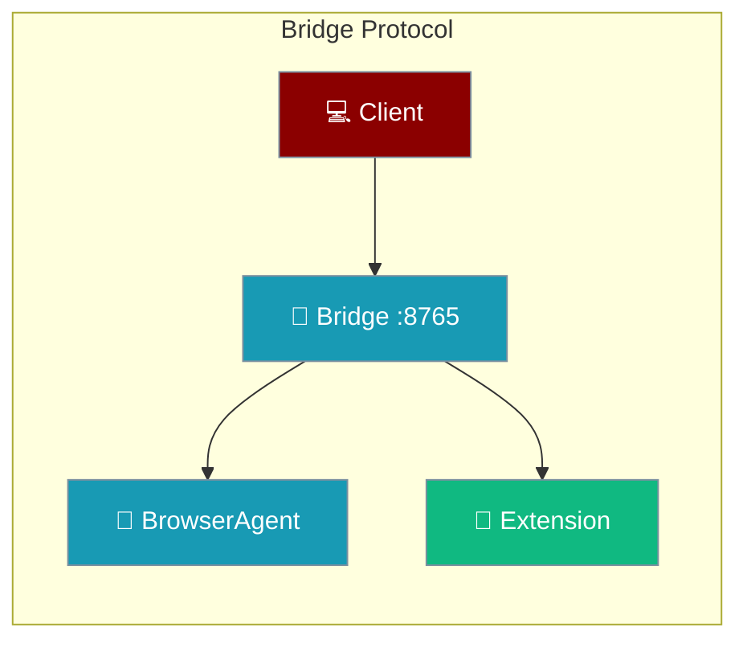

The bridge at `ws://127.0.0.1:8765/ws` routes messages between CLI clients, the bridge's BrowserAgent and the Chrome extension.



## Quick Start

<Steps>
<Step title="Register as the extension (JavaScript)">

```js
const ws = new WebSocket("ws://127.0.0.1:8765/ws");
ws.addEventListener("open", () => {
  ws.send(JSON.stringify({ type: "register", client: "extension" }));
});
ws.addEventListener("message", (e) => console.log(JSON.parse(e.data)));
```

</Step>
<Step title="Start a session as a CLI client (Python)">

```python
import asyncio, json, websockets

async def main():
    async with websockets.connect("ws://127.0.0.1:8765/ws") as ws:
        print(await ws.recv())  # "connected" welcome
        await ws.send(json.dumps({"type": "start_session", "goal": "open example.com"}))
        print(await ws.recv())

asyncio.run(main())
```

</Step>
</Steps>

---

## Message Catalog

| Type | Direction | Reply |
|------|-----------|-------|
| `register` | Client → Server | `status: registered` or `INVALID_ROLE` |
| `start_session` | CLI → Server | `status` or `MISSING_GOAL`, `NO_EXTENSION`, `EXTENSION_IN_USE` |
| `observation` | Extension → Server | `action` or `NO_SESSION` |
| `stop_session` / `cancel_session` | Any → Server | Session status |
| `ping` | Any → Server | `{"type": "pong"}` |
| `heartbeat` | Extension → Server | `{"type": "heartbeat_ack", "status": "ok"}` |

---

## Roles

Each socket is an extension, a CLI, or neither, decided at connect time.

| Connection | Role |
|------------|------|
| `chrome-extension://` origin | Extension |
| No `Origin` header | CLI by default; may `register` as `extension` or `cli` |
| Web origin | Cannot register — `INVALID_ROLE` |

See [Role Registration](/docs/features/browser/extension-architecture#role-registration) for the handshake.

---

## Error Codes

| Code | Meaning |
|------|---------|
| `NO_EXTENSION` | No registered extension socket to run the session |
| `INVALID_ROLE` | `register` rejected for this socket or role |
| `UNKNOWN_TYPE` | Message `type` not recognised |
| `MISSING_GOAL` | `start_session` without a `goal` |
| `NO_SESSION` | `observation` for an unknown session |
| `EXTENSION_IN_USE` | Extension already owns a session |
| `PARSE_ERROR` | Message was not valid JSON |
| `PROCESSING_ERROR` | Unexpected server error |
| `START_AUTOMATION_FAILED` | Could not deliver `start_automation` to the extension |

---

## Best Practices

<AccordionGroup>
<Accordion title="Register before start_session">
Wait for the `registered` status before sending `start_session` on the same socket.
</Accordion>
<Accordion title="Keep the socket alive">
Send `heartbeat` about every 20 seconds from the extension.
</Accordion>
<Accordion title="Handle error replies">
Branch on the `code` field, not the `error` text.
</Accordion>
</AccordionGroup>

---

## Related

<CardGroup cols={2}>
<Card title="Extension Architecture" icon="puzzle-piece" href="/docs/features/browser/extension-architecture">
  How the CLI, bridge and extension fit together
</Card>
<Card title="Browser Agent Deep Dive" icon="globe" href="/docs/features/browser-agent-deep-dive">
  Engines, modes and troubleshooting
</Card>
</CardGroup>
