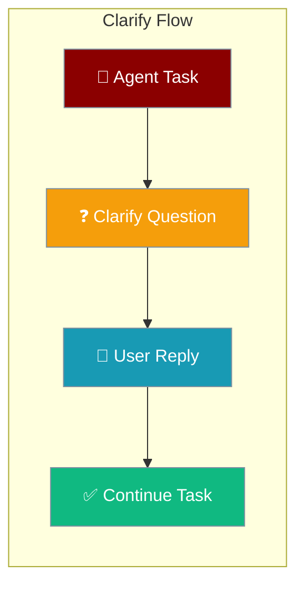
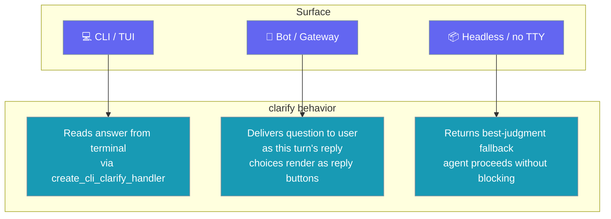
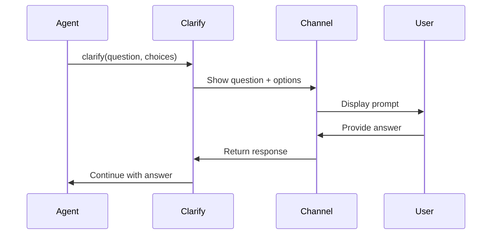
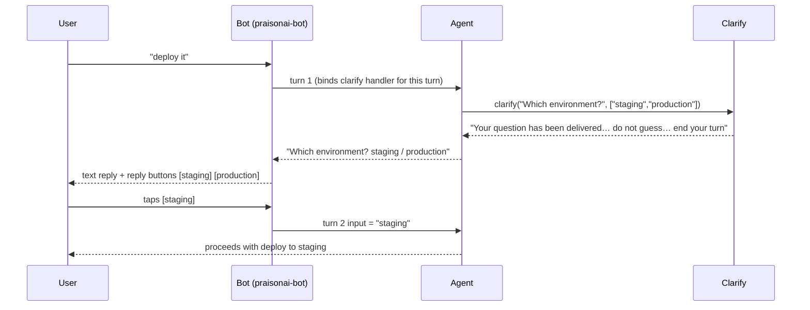

Clarify enables agents to pause mid-task and ask focused questions instead of guessing, improving decision accuracy and user control.

```python
from praisonaiagents import Agent

agent = Agent(
    name="assistant",
    instructions="Ask clarifying questions when the request is ambiguous",
)

agent.start("Help me set up monitoring")
```

The user gives a vague request; the agent uses clarify before acting.



<Note>
**Interactive CLI users get this automatically.** Running `praison "prompt"` or `praisonai tui launch` now includes `clarify` in the default toolset (the new `clarify` group in [Interactive Tools](/cli/interactive-tools)). No manual `tools=[clarify]` needed. The tool is auto-gated on a live interactive TTY, and withheld in headless / non-TTY / CI / JSON runs so scripted runs never block — the core best-judgment fallback then handles ambiguity. Set `PRAISON_TOOLS_DISABLE=clarify`, `PRAISON_NO_CLARIFY=1`, or `ToolConfig(enable_clarify=False)` to opt out.
</Note>

## Behavior by Surface

`clarify` behaves differently on each surface.



| Surface | How the user sees it | Who wires it |
|---|---|---|
| **CLI / TUI** (`praison "..."`, `praisonai tui launch`) | Numbered menu or free-text prompt in the terminal; `Ctrl+C` / EOF returns `"skip"` | Auto-wired by the CLI interactive toolset (see [Interactive Tools](/cli/interactive-tools)) |
| **Bot / Gateway** (Telegram, Discord, Slack, etc.) | The agent ends its turn by restating the question; `choices` render as tappable reply buttons; the tap or typed reply arrives as the next turn's input | Auto-wired by `BotSessionManager` on every turn |
| **Headless** (no TTY, no bound handler, batch/CI) | Returns `"No interactive channel available. Please proceed with your best judgment for: <question>"` so scripted runs never block | Fallback, nothing to wire |

---

## Quick Start

<Steps>
<Step title="Enable Clarify">

```python
from praisonaiagents import Agent
from praisonaiagents.tools.clarify import clarify

agent = Agent(
    name="Writer",
    instructions="Write code. If requirements are ambiguous, ask clarifying questions.",
    tools=[clarify],
)

agent.start("Build me a web scraper")
# Agent may call: clarify(question="Which language?", choices=["python", "rust"])
```

</Step>

<Step title="With Custom Handler">

```python
from praisonaiagents import Agent
from praisonaiagents.tools.clarify import clarify, create_cli_clarify_handler

# Setup CLI handler for interactive questions
handler = create_cli_clarify_handler()

agent = Agent(
    name="Researcher",
    instructions="Research topics. Ask for clarification when needed.",
    tools=[clarify],
    ctx={"clarify_handler": handler}
)
```

</Step>
</Steps>

---

## How It Works



| Component | Purpose | Behavior |
|-----------|---------|----------|
| **ClarifyTool** | Core tool implementation | Pauses execution for user input |
| **ClarifyHandler** | Channel-specific behavior | Routes questions to CLI/bot/UI |
| **Context Integration** | Runtime handler resolution | Uses ctx['clarify_handler'] if available |

---

## Channel Integration

### CLI Usage

```python
from praisonaiagents.tools.clarify import create_cli_clarify_handler

handler = create_cli_clarify_handler()
# Shows: 🤔 Which language?
# Choices:
#   1. python
#   2. rust
# Your choice (number or text): 1
# Returns: "python"
```

### Bot Usage

On a bot turn `clarify` is already wired. The bot session binds a turn-scoped handler automatically, so no handler setup is needed.

When the agent calls `clarify(...)`:

1. The question and choices are recorded for this turn's reply.
2. The agent is told to **end its turn by restating the question** instead of guessing.
3. If the agent did not emit its own `MessagePresentation`, the choices are attached as `MessagePresentation.question(question, choices)` and render as native **reply buttons**.
4. The user's tap or typed reply arrives as the next turn's input.

```python
from praisonaiagents import Agent
from praisonaiagents.tools.clarify import clarify

agent = Agent(
    name="Deployer",
    instructions="If the user doesn't say which environment, ask with clarify before deploying.",
    tools=[clarify],
)
# On a bot session, a call like
#   clarify(question="Which environment?", choices=["staging", "production"])
# ends this turn restating the question. The two choices render as tappable
# buttons; the tap becomes the next turn's input.
```



<Warning>
`create_bot_clarify_handler(send_message_fn, wait_for_reply_fn)` is **not** what bot sessions use. `BotSessionManager.chat` holds the per-user turn lock for the whole turn, and the user's reply arrives as another `chat()` for the same user, so a blocking "send and wait" deadlocks. Keep the factory for callers that have their own lock-free send-and-wait mechanism.
</Warning>

### Custom Surfaces: `set_clarify_handler`

Bind a handler for one turn on any surface you own, such as a web UI or a custom chat adapter.

```python
from praisonaiagents.tools.clarify import (
    ClarifyHandler,
    set_clarify_handler,
    reset_clarify_handler,
)

async def my_turn(user_input):
    def ask(question, choices=None):
        # Deliver the question through your UI; return the answer as a string.
        return deliver_to_my_ui(question, choices)

    token = set_clarify_handler(ClarifyHandler(ask_callback=ask))
    try:
        return await run_agent(user_input)
    finally:
        reset_clarify_handler(token)
```

| Function | Signature | Purpose |
|---|---|---|
| `set_clarify_handler` | `(handler: Optional[ClarifyHandler]) -> contextvars.Token` | Bind a handler for the current context |
| `reset_clarify_handler` | `(token: contextvars.Token) -> None` | Restore the previous binding |

- The binding is **turn-scoped** (a `ContextVar`), so concurrent `asyncio` tasks never see each other's handlers.
- An explicitly configured handler (`ClarifyTool(handler=...)` or `ctx["clarify_handler"]`) **still wins**. The bound handler is used only by the shared default `clarify` instance.
- Always call `reset_clarify_handler(token)` in a `finally` block.

### Custom Context Handler

```python
from praisonaiagents import Agent
from praisonaiagents.tools.clarify import clarify

async def my_clarify_handler(question, choices):
    # Custom UI/web interface
    return await show_dialog(question, choices)

agent = Agent(
    name="Assistant",
    tools=[clarify],
    ctx={"clarify_handler": my_clarify_handler}
)
```

---

## Handler Resolution

The tool resolves the handler in this order:

```mermaid
graph TD
    A[clarify called] --> B{ctx['clarify_handler']?}
    B -->|yes| USE[Use that handler]
    B -->|no| C{Explicit handler on ClarifyTool?}
    C -->|yes| USE
    C -->|no| D{set_clarify_handler bound<br/>in this ContextVar?}
    D -->|yes| USE
    D -->|no| F[Default ClarifyHandler<br/>best-judgment fallback string]
    USE --> R[Return user's answer]

    classDef process fill:#189AB4,stroke:#7C90A0,color:#fff
    classDef result fill:#10B981,stroke:#7C90A0,color:#fff
    classDef fallback fill:#F59E0B,stroke:#7C90A0,color:#fff

    class A,B,C,D process
    class USE,R result
    class F fallback
```

1. **Context handler**: `kwargs["ctx"]["clarify_handler"]` (highest priority)
2. **Explicit tool handler**: `ClarifyTool(handler=...)`
3. **Bound handler**: set with `set_clarify_handler(...)`, used only when the tool has no explicit handler
4. **Default**: `ClarifyHandler()` returns the best-judgment fallback string

---

## Configuration Options

### Tool Schema

```python
# LLM sees this tool signature:
{
    "name": "clarify",
    "description": "Ask the user a focused clarifying question when genuinely ambiguous. Use sparingly - only when you cannot proceed without their input.",
    "parameters": {
        "type": "object",
        "properties": {
            "question": {
                "type": "string",
                "description": "The clarifying question to ask"
            },
            "choices": {
                "type": "array", 
                "items": {"type": "string"},
                "description": "Optional list of predefined answer choices"
            }
        },
        "required": ["question"]
    }
}
```

### Bot Auto-Approval

```python
from praisonaiagents import BotConfig

config = BotConfig(
    default_tools=["clarify"],  # Included by default
    auto_approve_tools=True     # No approval prompt for clarify
)
```

The `clarify` tool is included in the bot's default auto-approve list, so it won't require manual approval in bot environments.

---

## Common Patterns

### Progressive Clarification

```python
from praisonaiagents import Agent
from praisonaiagents.tools.clarify import clarify

agent = Agent(
    name="CodeWriter",
    instructions="""
    Write code based on user requests. Use clarify for:
    1. Language/framework choice when unspecified
    2. Feature priorities when scope is broad
    3. Architecture decisions when requirements are complex
    """,
    tools=[clarify]
)

# Example interaction:
# User: "Build a REST API"
# Agent: clarify("Which language?", ["python", "node.js", "go"])
# User: "python"  
# Agent: clarify("Which framework?", ["fastapi", "flask", "django"])
```

### Context-Aware Questions

```python
async def smart_clarify_handler(question, choices):
    """Handler that considers conversation context"""
    # Check previous messages for hints
    context = get_conversation_context()
    
    if "python" in context and "web" in question.lower():
        # Auto-suggest based on context
        return "fastapi"
    
    return await show_user_dialog(question, choices)
```

### Fallback Behavior

The `"No interactive channel"` string is returned only when no handler is configured and none is bound, which means a truly headless run.

```python
result = await clarify("Which database?", ["postgres", "mysql"])
# Headless: "No interactive channel available. Please proceed with your best judgment for: Which database?"
# CLI with create_cli_clarify_handler() in ctx: the user is prompted.
# Bot turn: "Your question has been delivered to the user. Do not guess an answer: end your turn now by restating the question and its choices. Their answer will arrive as their next message."

if "no interactive channel" in result.lower():
    database = "postgres"  # headless default
```

<Note>
On a bot turn the fallback string never appears, so a branch that keys off `"no interactive channel"` does not fire there. Use it as a headless-only default.
</Note>

---

## Best Practices

<AccordionGroup>
<Accordion title="Use Sparingly" icon="clock">
Only call clarify when you genuinely cannot proceed without user input. Don't ask for preferences that have reasonable defaults.

**Good**: "Which API endpoint format?" when building an API
**Bad**: "Should I use descriptive variable names?" (obvious default)
</Accordion>

<Accordion title="Provide Clear Choices" icon="list-check">
When possible, offer specific choices rather than open-ended questions.

**Good**: `choices=["fastapi", "flask", "django"]`
**Bad**: `"What Python web framework should I use?"` (no choices)
</Accordion>

<Accordion title="Handle Fallbacks Gracefully" icon="shield-check">
For headless runs, check if the response indicates no interactive channel and proceed with a sensible default.

```python
response = await clarify("Pick a color", ["blue", "red"])
if "no interactive channel" in response.lower():
    color = "blue"  # Use default
else:
    color = response
```
</Accordion>

<Accordion title="Context-Aware Questions" icon="brain">
Frame questions with enough context for users to make informed decisions.

**Good**: "Which authentication method for your user API?"
**Bad**: "Which auth?" (unclear context)
</Accordion>
</AccordionGroup>

---

## Related

<CardGroup cols={2}>
<Card title="Ask Conversation" icon="messages-question" href="/features/ask-conversation-tool">
Ask another chat (not the current user) and wait for its reply
</Card>

<Card title="Tools Overview" icon="wrench" href="/features/toolsets">
Core tool system and custom tools
</Card>

<Card title="Agent Configuration" icon="cog" href="/features/agent-profiles">
Agent setup and tool integration
</Card>

<Card title="Bot Default Tools" icon="robot" href="/features/bot-default-tools">
Tools every messaging bot gets out of the box
</Card>

<Card title="Gateway Status Tool" icon="signal" href="/features/gateway-status-tool">
Report gateway health from inside a bot turn
</Card>

<Card icon="toolbox" href="/cli/interactive-tools">
How clarify plugs into the default `praison "..."` / TUI toolset and its TTY gating.
</Card>
</CardGroup>