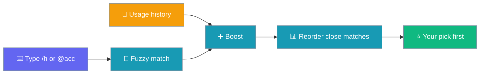
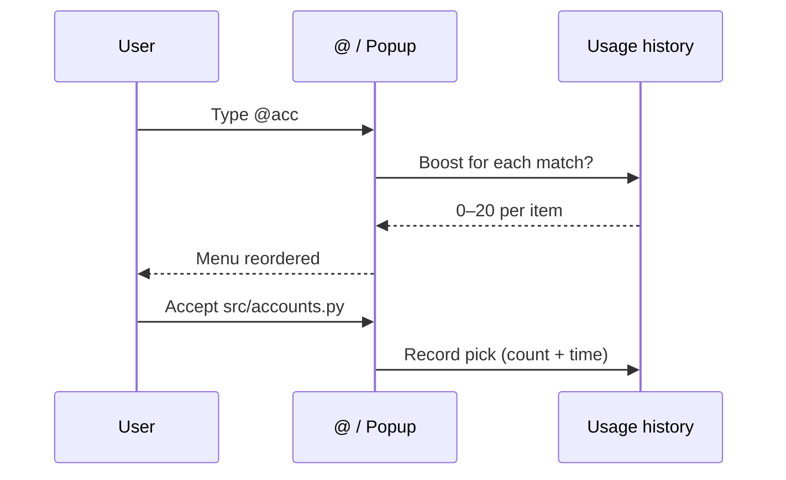
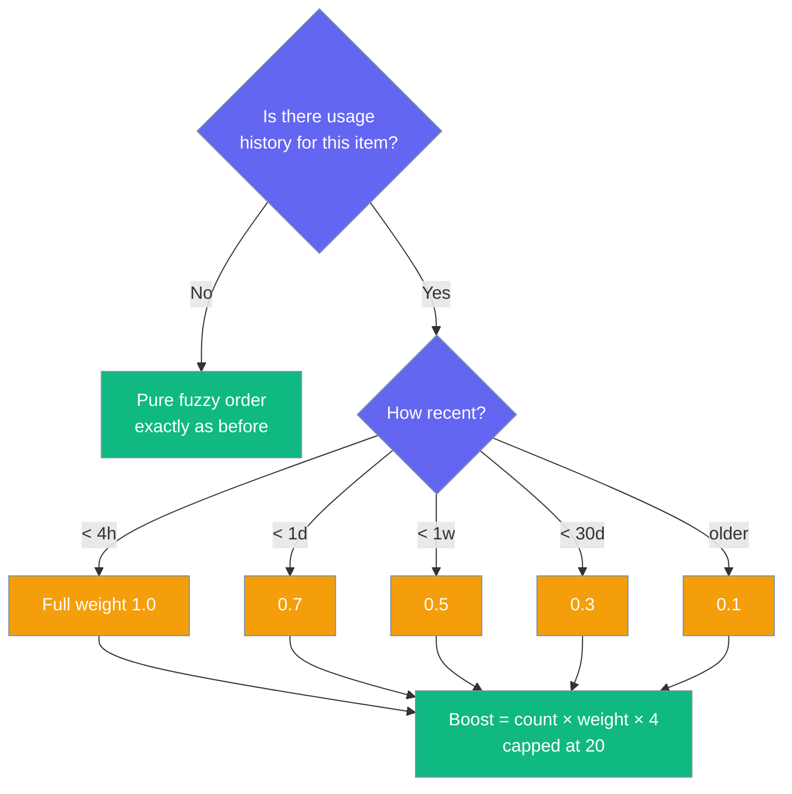

The interactive `@` and `/` menus float the files and commands you pick most into the top slots — no setup, no config.



## Quick Start

<Steps>
<Step title="Pick a file once with @">
Start an interactive session, type `@acc` and accept `src/accounts.py` from the popup.

```text
❯ @acc
  src/account_service.py
  src/accounts.py        ← accept this one
```
</Step>

<Step title="Pick it again — it's first in the menu">
Next time you type `@acc`, the file you chose is ranked above the other close matches.

```text
❯ @acc
  src/accounts.py        ← now on top
  src/account_service.py
```
</Step>
</Steps>

## How It Works

Each pick is recorded, and the next menu uses a small usage boost (0–20) to reorder matches.



Recent picks count more than old ones:

| Age of last pick | Recency weight |
|------------------|----------------|
| < 4 hours        | 1.0 |
| < 1 day          | 0.7 |
| < 1 week         | 0.5 |
| < 30 days        | 0.3 |
| ≥ 30 days        | 0.1 |

The boost is `round(count × weight × 4)`, capped at **20**.

- **`@` files** — the boost is added to the 0–100 fuzzy score before sorting.
- **`/` commands** — matching commands are sorted by boost alone; ties keep their original order.

<Note>
For `@` files, the 20-point cap means usage only reorders close matches. A heavily used weak hit (about 59 + 20) still ranks below an unused "starts with" hit (90).
</Note>



## Which Surfaces Use It

Ranking applies wherever you accept an `@` file or a `/` command from a menu.

| Surface | What gets ranked |
|---------|------------------|
| `@` file popup (Textual TUI) | File paths you accept |
| `/` command popup (Textual TUI) | Commands you accept |
| `/` completer in `prompt_toolkit` REPL | Commands, using picks recorded in the TUI popup |

## Where History Is Stored

History lives in `~/.praisonai/sessions/projects/<project-id>/frecency.json` (under `PRAISONAI_HOME` if set).

Clones and worktrees of the same repo share one history. Delete the file to reset ranking.

## No Config Needed

There is no on/off switch — an empty history already gives the original fuzzy order.

<Tip>
A missing or corrupt `frecency.json` is ignored, so completion keeps working. Each kind keeps at most 200 entries; the least recently used are dropped first.
</Tip>

## Best Practices

<AccordionGroup>
<Accordion title="Reset ranking per project">
Delete `frecency.json` in the project's sessions folder to start fresh. The next pick creates a new file.
</Accordion>

<Accordion title="History is per-project, not global">
Clones and worktrees of the same repo share history; unrelated repos never see each other's picks.
</Accordion>

<Accordion title="Type more to reach any item">
For `@` files the 20-point cap keeps much better string matches on top. For `/` commands, used commands rise above unused ones — type more of the name to narrow the list.
</Accordion>

<Accordion title="No history leak between kinds">
Files and commands are tracked separately, so a busy `/help` never affects `@` file order.
</Accordion>
</AccordionGroup>

## Related

<CardGroup cols={2}>
  <Card title="@Mentions" icon="at" href="/cli/mentions">
    Include files, docs and URLs in your prompt
  </Card>
  <Card title="Slash Commands" icon="terminal" href="/cli/slash-commands">
    Every `/` command in one menu
  </Card>
</CardGroup>
