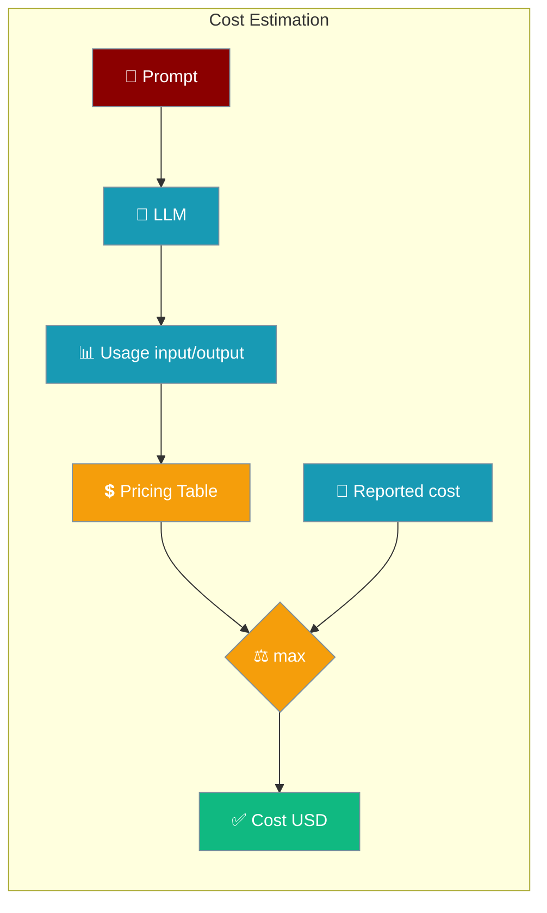
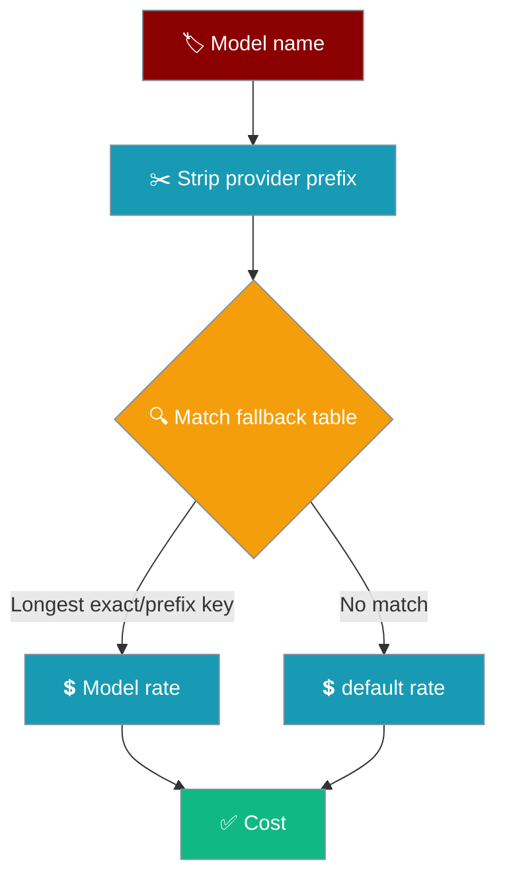
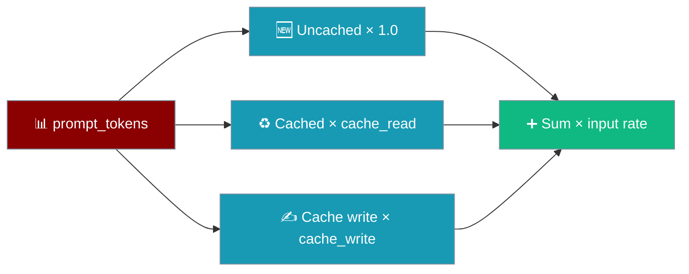
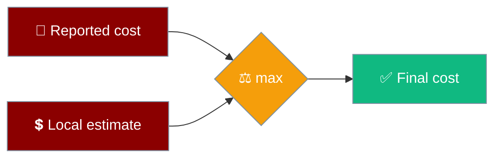

Every completion carries a cost estimate — PraisonAI derives it from the token counts your provider reports.



Cost is computed from the `input_tokens` and `output_tokens` your provider returns, multiplied by a per-model rate. When [litellm](https://github.com/BerriAI/litellm) is installed it covers 1000+ models; otherwise a built-in fallback table prices the most common models.

## Quick Start

<Steps>
<Step title="Run an agent and read its token counts">
A bare `Agent(llm="gpt-4o-mini")` records usage automatically. Read the counts back with the global collector:

```python
from praisonaiagents import Agent
from praisonaiagents.telemetry.token_collector import get_token_collector

agent = Agent(llm="gpt-4o-mini")
agent.start("Summarise the theory of relativity in one paragraph")

summary = get_token_collector().get_session_summary()
print(summary["total_metrics"]["input_tokens"], summary["total_metrics"]["output_tokens"])
# cost is derived from these counts via calculate_llm_cost()
```
</Step>

<Step title="Estimate the cost from those counts">
Pass the counts and the model name to `calculate_llm_cost()`:

```python
from praisonaiagents.utils.cost_utils import calculate_llm_cost

cost = calculate_llm_cost(
    prompt_tokens=1000,
    completion_tokens=500,
    model="gpt-4o-mini",
)
print(f"${cost}")  # $0.00045  →  (1000/1M × $0.15) + (500/1M × $0.60)
```
</Step>

<Step title="Price a call with prompt caching">
Cached input tokens are priced at a fraction of the input rate. The SDK reads the cache counts from the response for you:

```python
from praisonaiagents.utils.cost_utils import calculate_llm_cost

# Anthropic-style response from a cached run
response = {
    "usage": {
        "prompt_tokens": 1_000_000,
        "cache_read_input_tokens": 500_000,
        "cache_creation_input_tokens": 100_000,
    }
}
cost = calculate_llm_cost(1_000_000, 0, "claude-3-5-sonnet-20241022", response=response)
print(f"${cost}")  # $1.725
```

An agent does this on every call, so `agent.total_cost` already reflects cache pricing:

```python
from praisonaiagents import Agent

agent = Agent(
    instructions="You are a helpful assistant.",
    llm="anthropic/claude-3-5-sonnet-20241022",
)
agent.start("Summarise this long document ...")
print(agent.total_cost)  # cached tokens priced at the cache-read rate
```
</Step>

<Step title="Read cost from an async agent">
An async run reports the same telemetry as sync — every tool-loop iteration emits `llm_end` with tokens, cost, and latency.

```python
import asyncio
from praisonaiagents import Agent
from praisonaiagents.telemetry.token_collector import get_token_collector

agent = Agent(llm="gpt-4o-mini")

async def main():
    await agent.astart("Summarise the theory of relativity in one paragraph")

asyncio.run(main())

summary = get_token_collector().get_session_summary()
print(summary["total_metrics"]["input_tokens"], summary["total_metrics"]["output_tokens"])
# Same non-zero counts you would see from a sync agent.start(...)
```
</Step>
</Steps>

<Note>
**Prompt-cache pricing** ([PR #5996](https://github.com/MervinPraison/PraisonAI/pull/5996)). Cached input is no longer billed at the full input rate, and a higher provider-reported cost wins over the local estimate. Nothing to opt in to. The response rebuilt from a stream also carries `prompt_tokens_details.cached_tokens` and `usage.cost`, so `calculate_llm_cost(..., response=...)` prices streamed calls the same way.
</Note>

<Warning>
**Fixed in PraisonAI [PR #4887](https://github.com/MervinPraison/PraisonAI/pull/4887).** Prior to this release, async agent runs (`agent.achat()`, `agent.astart()`, any async tool-calling workflow) never emitted `llm_start` / `llm_end` callbacks, so cost dashboards and `--trace` / status output reported **zero LLM spans and zero cost for every async workload** — the identical run synchronously reported full per-call cost and latency. After this release, async cost tracking is at full parity with sync: per-iteration `llm_end` events fire with `tokens_in`, `tokens_out`, `cost`, and `latency_ms`. Latency is measured **per iteration** (each tool-loop step captures its own `iteration_start_time`), so every billed call reports its own latency rather than a cumulative total.
</Warning>

<Warning>
**Fixed in PraisonAI [PR #6062](https://github.com/MervinPraison/PraisonAI/pull/6062).** Prior to this release, `agent.total_cost` and `agent.cost_summary` read **zero** for agents built from a `provider/model` string (`anthropic/...`, `mistral/...`, `ollama/...`, `openrouter/...`), an `llm={...}` dict, a `base_url`, or a model object. These counters are now accurate for every way of building the agent, including turns answered by a `fallback_models` entry (priced as the model that answered). Streamed responses (`stream=True`) still record no usage.
</Warning>

---

## How It Works

Cost is `input_tokens × input_rate + output_tokens × output_rate`, with cached input priced at a discount (see below). The main question is which rate applies to a given model name.



### Prompt-cache aware pricing



- Cached and cache-write tokens are **part of** `prompt_tokens` (the OpenAI/litellm convention).
- Their sum is **capped** at `prompt_tokens`, so nothing is counted twice.
- A model with no `cache_read` / `cache_write` multiplier uses `1.0` — the flat input rate.

### Reported cost as a floor-raiser



- A reported cost **can raise** the figure above the estimate — for example when OpenRouter bills above list price.
- It **cannot lower** it — a misreporting proxy or `base_url` can't trick the budget guard.
- A reported `0.0` means "unknown" — the estimate is used.

### Supported cache fields

| Shape | Field read | Example provider |
|---|---|---|
| OpenAI-style | `usage.prompt_tokens_details.cached_tokens` | OpenAI, Azure OpenAI |
| Anthropic-style | `usage.cache_read_input_tokens` | Anthropic |
| Anthropic-style | `usage.cache_creation_input_tokens` | Anthropic (cache write) |
| OpenRouter-style | `usage.cost` (reported, raises floor) | OpenRouter |
| litellm-wrapped | `_hidden_params["response_cost"]` (raises floor) | litellm |

Dict-shaped (`{"usage": {...}}`) and attribute-shaped responses both work.

---

## How Pricing Is Resolved

The fallback matcher resolves a model name to a rate in three steps:

1. **Strip the provider prefix.** `openai/gpt-4o-mini` becomes `gpt-4o-mini`, so provider-qualified names resolve the same as bare names.
2. **Match longest-key-first, on exact match or prefix boundary.** The table is searched from the longest key down, and a key only matches when the model name is exactly that key or starts with `<key>-…`. So `gpt-4o-mini` is billed at `$0.15/1M`, not `gpt-4o`'s `$2.50/1M`, and `o1-mini` no longer matches `o1`.
3. **Fall back to `default`.** If no key matches, the `default` rate applies. `default` is never matched by name — it is only the last resort.

<Warning>
**Corrected in PraisonAI [PR #4200](https://github.com/MervinPraison/PraisonAI/pull/4200).** Prior to this release the fallback matcher used a substring search where the first hit won, which billed `gpt-4o-mini` at `gpt-4o` rates — a **16.7×** overcharge in the estimate — and let `o1-mini` match `o1`. Existing dashboards will show a step-change downward; the new numbers are the accurate ones.
</Warning>

---

## Fallback Pricing Table

These are the built-in rates the SDK ships in `_FALLBACK_PRICING` (USD per 1M tokens). They apply when litellm is not installed. Cache multipliers scale the input rate; blank = flat input rate.

| Model | Input ($/1M) | Output ($/1M) | Cache read × | Cache write × |
|-------|-------------|---------------|--------------|---------------|
| `gpt-4o` | 2.50 | 10.00 | 0.5 |  |
| `gpt-4o-mini` | 0.15 | 0.60 | 0.5 |  |
| `gpt-4-turbo` | 10.00 | 30.00 |  |  |
| `gpt-4` | 30.00 | 60.00 |  |  |
| `gpt-3.5-turbo` | 0.50 | 1.50 |  |  |
| `o1` | 15.00 | 60.00 | 0.5 |  |
| `o1-mini` | 1.10 | 4.40 | 0.5 |  |
| `o1-preview` | 15.00 | 60.00 |  |  |
| `o3-mini` | 1.10 | 4.40 | 0.5 |  |
| `claude-3-5-sonnet` | 3.00 | 15.00 | 0.1 | 1.25 |
| `claude-3-5-haiku` | 0.80 | 4.00 | 0.1 | 1.25 |
| `claude-3-opus` | 15.00 | 75.00 | 0.1 | 1.25 |
| `claude-3-sonnet` | 3.00 | 15.00 |  |  |
| `claude-3-haiku` | 0.25 | 1.25 | 0.1 | 1.25 |
| `gemini-1.5-pro` | 1.25 | 5.00 | 0.25 |  |
| `gemini-1.5-flash` | 0.075 | 0.30 | 0.25 |  |
| `gemini-2.0-flash` | 0.10 | 0.40 | 0.25 |  |
| `gemini-2.0-flash-exp` | 0.10 | 0.40 |  |  |
| `gemini-pro` | 0.50 | 1.50 |  |  |
| `deepseek-chat` | 0.14 | 0.28 | 0.1 |  |
| `deepseek-reasoner` | 0.55 | 2.19 | 0.25 |  |
| `default` | 1.00 | 3.00 |  |  |

<Note>
Install litellm for accurate pricing across 1000+ models. Pass `use_litellm=True` to `calculate_llm_cost()` to prefer it; without it, the fallback table above is used for speed.
</Note>

---

## Common Patterns

<AccordionGroup>
<Accordion title="Price a whole session">
Read the session totals, then price them once:

```python
from praisonaiagents import Agent
from praisonaiagents.telemetry.token_collector import get_token_collector
from praisonaiagents.utils.cost_utils import calculate_llm_cost

agent = Agent(llm="gpt-4o-mini")
agent.start("Draft a product announcement")

totals = get_token_collector().get_session_summary()["total_metrics"]
cost = calculate_llm_cost(totals["input_tokens"], totals["output_tokens"], model="gpt-4o-mini")
print(f"${cost}")
```
</Accordion>

<Accordion title="Read spend from a provider/model agent">
```python
from praisonaiagents import Agent

agent = Agent(llm="anthropic/claude-3-5-sonnet-20240620")
agent.start("Summarise the theory of relativity in one paragraph")

print(agent.total_cost)                 # non-zero
print(agent.cost_summary["llm_calls"])  # >= 1
```
</Accordion>

<Accordion title="Pass cache counts explicitly">
No response object? Pass the counts directly:

```python
from praisonaiagents.utils.cost_utils import calculate_llm_cost

cost = calculate_llm_cost(
    prompt_tokens=1_000_000,
    completion_tokens=200_000,
    model="claude-3-5-sonnet",
    cached_tokens=800_000,
    cache_write_tokens=0,
)
print(f"${cost}")  # $3.84
```
</Accordion>

<Accordion title="OpenRouter / litellm proxy">
A positive `usage.cost` or `_hidden_params["response_cost"]` is picked up automatically and wins when higher than the estimate:

```python
from praisonaiagents.utils.cost_utils import calculate_llm_cost

response = {"usage": {"cost": 0.01}}
print(calculate_llm_cost(1000, 500, "gpt-4o-mini", response=response))  # 0.01 — reported wins

response = {"usage": {"cost": 0.0001}}
print(calculate_llm_cost(1000, 500, "gpt-4o-mini", response=response))  # 0.00045 — estimate wins
```
</Accordion>

<Accordion title="Provider-prefixed model names resolve correctly">
`openai/gpt-4o-mini` is stripped to `gpt-4o-mini` before matching, so it prices at the mini rate:

```python
from praisonaiagents.utils.cost_utils import calculate_llm_cost

print(calculate_llm_cost(1000, 500, model="openai/gpt-4o-mini"))  # 0.00045
print(calculate_llm_cost(1000, 500, model="gpt-4o-mini"))         # 0.00045 — same
```
</Accordion>
</AccordionGroup>

---

## Best Practices

<AccordionGroup>
<Accordion title="Use realistic model names">
Pass the exact model string you run with (e.g. `gpt-4o-mini`, `claude-3-5-sonnet`). The longest-key-first matcher relies on the full name to avoid billing a `-mini` model at its larger sibling's rate.
</Accordion>

<Accordion title="Install litellm for uncommon models">
The fallback table covers common models only. For anything outside it, install litellm and call `calculate_llm_cost(..., use_litellm=True)` for accurate, up-to-date pricing.
</Accordion>

<Accordion title="Cost is an estimate, not a bill">
These numbers estimate spend from token counts and published rates. Use your provider's dashboard for authoritative billing.
</Accordion>
</AccordionGroup>

---

## Related

<CardGroup cols={2}>
<Card title="Token Tracking" icon="chart-line" href="/features/token-tracking">
Read real token spend from any agent.
</Card>
<Card title="Telemetry" icon="chart-line" href="/features/telemetry">
Anonymous usage metrics for agent runs.
</Card>
<Card title="Display Callbacks" icon="display" href="/features/display-callbacks">
`llm_start` / `llm_end` fire on the async tool-loop too.
</Card>
<Card title="SQLite Usage Sink" icon="database" href="/features/token-usage-sqlite-sink">
Durable, per-identity cost ledger for gateways.
</Card>
</CardGroup>
