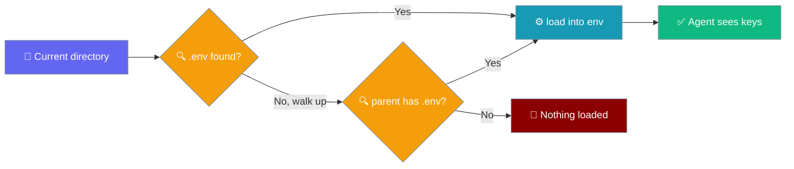
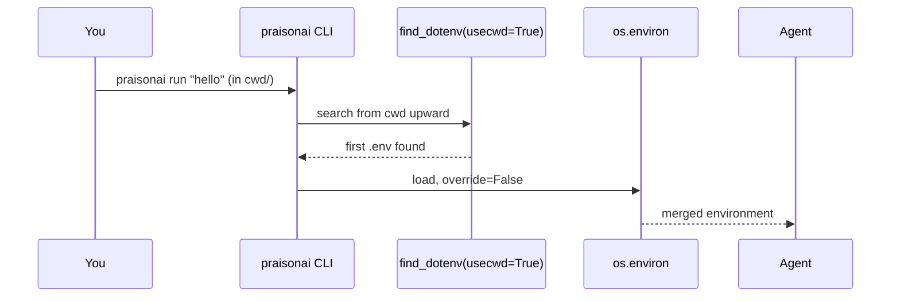
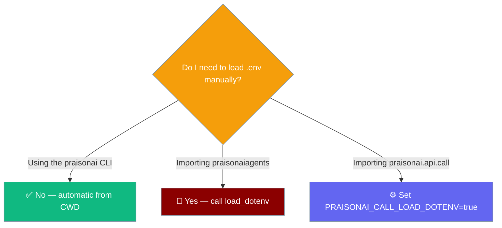

PraisonAI auto-loads a `.env` from your current working directory before running any CLI command.



## Quick Start

<Steps>
<Step title="Simple Usage">

Create a `.env` next to where you run PraisonAI:

```bash
# .env
OPENAI_API_KEY=sk-...
```

Run an agent file from that directory:

```python
from praisonaiagents import Agent

agent = Agent(name="Helper", instructions="You are a helpful assistant")
agent.start("hello")
```

```bash
praisonai run "hello"
```

</Step>
<Step title="With Configuration">

`praisonai.api.call` does not read `.env` on import. Opt in with an environment variable:

```bash
export PRAISONAI_CALL_LOAD_DOTENV=true
python -c "import praisonai.api.call"
```

The `praisonai call` CLI always loads `.env` from the current directory, no flag needed.

</Step>
</Steps>

---

## How It Works

The CLI searches upward from where you run it, never from where PraisonAI is installed.



---

## Which Entry Points Auto-Load `.env`

Each CLI entry point loads `.env` from the current directory; library imports never do.

| Entry point | Loads `.env` from CWD? | Notes |
|---|---|---|
| `praisonai run` / `praisonai chat` / `praisonai code` / direct prompt | Yes | via `_load_env_once()` on CLI startup |
| `praisonai call` CLI | Yes | explicit load in `main()` |
| `praisonai bot` | Yes | via `BotHandler._load_dotenv` |
| `import praisonai.api.call` (module import) | No | opt in with `PRAISONAI_CALL_LOAD_DOTENV=true` |
| `from praisonaiagents import Agent` (library import) | No | library imports never mutate `os.environ`; call `load_dotenv()` yourself |

---

## Do I Need to Load `.env` Manually?



For library use:

```python
from dotenv import load_dotenv
from praisonaiagents import Agent

load_dotenv()

agent = Agent(name="Helper", instructions="You are a helpful assistant")
agent.start("hello")
```

---

## Precedence

Loading never overrides a variable that is already set (`override=False`).

| Source | Wins over | Example |
|---|---|---|
| Already-exported shell env var | `.env` | `export OPENAI_API_KEY=sk-shell` beats a `.env` value |
| `.env` in CWD | `.env` higher up the tree | `./.env` is read; `../.env` is not |
| Any `.env` above the install prefix | — | Never loaded, by design |

<Warning>
Before this release, PraisonAI's CLIs could load a `.env` from a source checkout or any parent of `site-packages`. If an API key stops being set after upgrading, move the `.env` into the directory you run `praisonai` from, or export the variable in your shell.
</Warning>

---

## Best Practices

<AccordionGroup>
<Accordion title="Put .env in your project root">
Keep it in the directory you run `praisonai` from, so the CLI always finds it.
</Accordion>
<Accordion title="Never commit .env">
Add `.env` to `.gitignore` so keys stay out of version control.
</Accordion>
<Accordion title="Prefer shell exports for secrets in CI">
`.env` is a developer convenience, not a secrets manager. Export variables from your CI secret store instead.
</Accordion>
<Accordion title="Library imports do not touch os.environ">
When embedding `praisonaiagents` or importing `praisonai.api.call` directly, call `from dotenv import load_dotenv; load_dotenv()` yourself. See [Python Import Safety](/features/python-import-safety).
</Accordion>
</AccordionGroup>

---

## Related

<CardGroup cols={2}>
<Card title="Security Environment Variables" icon="shield" href="/features/security-environment-variables">
  Environment-variable gates and security advisories
</Card>
<Card title="PraisonAI Call" icon="phone" href="/call">
  Voice call server and its environment variables
</Card>
</CardGroup>
