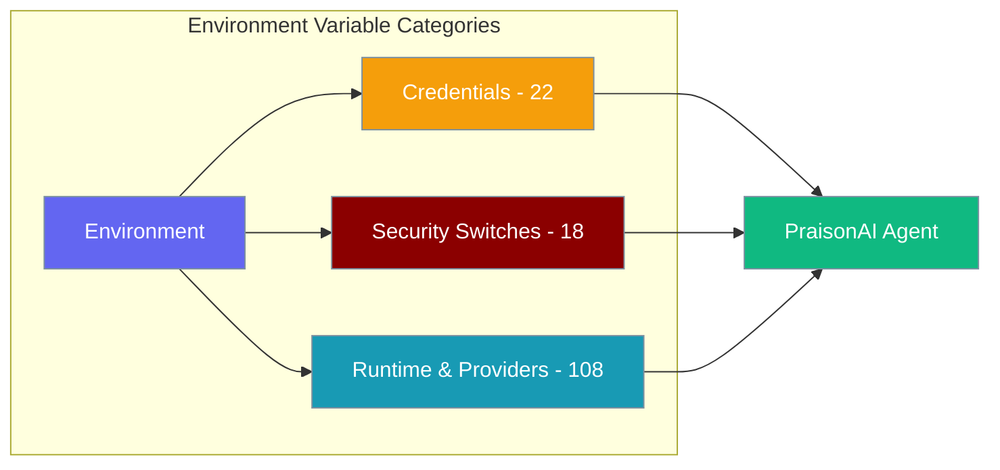

Configure PraisonAI agents, provider credentials, telemetry, local models, and security guardrails using environment variables without changing code.

```python
import os
from praisonaiagents import Agent

os.environ["OPENAI_MODEL_NAME"] = "gpt-4o-mini"
os.environ["PRAISONAI_DISABLE_TELEMETRY"] = "true"

agent = Agent(
    name="Assistant",
    instructions="Answer concisely using environment defaults.",
)
agent.start("Summarize today's priorities")
```



## Quick Start

<Steps>
<Step title="Set Provider Credentials">
Export your model provider API key (or place it in a `.env` file loaded before startup):

```bash
export OPENAI_API_KEY="sk-..."
export MODEL_NAME="gpt-4o-mini"
```

```python
from praisonaiagents import Agent

agent = Agent(instructions="You are a helpful assistant.")
agent.start("Hello!")
```
</Step>

<Step title="Configure Runtime and Security Defaults">
Opt in to stricter or looser behaviour explicitly with `PRAISONAI_*` environment variables:

```bash
export PRAISONAI_HOME="$HOME/.praisonai"
export PRAISONAI_DISABLE_TELEMETRY="true"
export PRAISONAI_TOOL_SAFETY="strict"
```

```python
from praisonaiagents import Agent

agent = Agent(
    name="Safe Assistant",
    instructions="Use only approved tools.",
)
agent.start("Check project status")
```
</Step>
</Steps>

---

## Variable Kinds

This page is derived from `src/praisonai-agents/docs/env-vars.md` (auto-checked in CI by `tests/unit/test_env_var_reference.py --write`). It lists **148 variables** read statically by `praisonaiagents` (**67** of them `PRAISONAI_*` / `PRAISON_*`). Names constructed dynamically at run time are not listed.

| Kind | Count | Meaning |
|------|-------|---------|
| **credential** | 22 | API keys, auth tokens, passwords, or connection strings — never commit these to source control. |
| **security switch** | 18 | Variables that tighten or loosen a safety check (tool safety, trust lists, auto-approval, insecure transport). See [Security Environment Variables](/features/security-environment-variables) for guidance. |
| *(unmarked)* | 108 | Model defaults, endpoints, storage paths, telemetry flags, timeouts, and standard OS/locale variables. |

<Note>
When both spellings exist (for example `PRAISONAI_DISABLE_TELEMETRY` and `PRAISONAI_TELEMETRY_DISABLED`, or `OPENAI_BASE_URL` and `OPENAI_API_BASE`), both names are listed below because `praisonaiagents` reads both for backward compatibility.
</Note>

---

## Complete Environment Variables Table

| Variable | Kind |
|---|---|
| `AGENTMAIL_API_KEY` | credential |
| `AGENTMAIL_INBOX_ID` |  |
| `ALLOW_LOCAL_CRAWL` | security switch |
| `ANONYMIZED_TELEMETRY` |  |
| `APPDATA` |  |
| `AZURE_STORAGE_CONNECTION_STRING` | credential |
| `BRAVE_API_KEY` | credential |
| `CODEX_HOME` |  |
| `COMSPEC` |  |
| `DAKERA_AGENT_ID` |  |
| `DAKERA_API_KEY` | credential |
| `DAKERA_API_URL` |  |
| `DAKERA_URL` |  |
| `DO_NOT_TRACK` |  |
| `EMAIL_ADDRESS` |  |
| `EMAIL_IMAP_PORT` |  |
| `EMAIL_IMAP_SERVER` |  |
| `EMAIL_PASSWORD` | credential |
| `EMAIL_SMTP_PORT` |  |
| `EMAIL_SMTP_SERVER` |  |
| `EXA_API_KEY` | credential |
| `GEMINI_API_KEY` | credential |
| `GITHUB_TOKEN` | credential |
| `GIT_DIR` |  |
| `GIT_WORK_TREE` |  |
| `GOOGLE_API_KEY` | credential |
| `HOME` |  |
| `JIRA_API_TOKEN` | credential |
| `JIRA_EMAIL` |  |
| `JIRA_URL` |  |
| `JIRA_USERNAME` |  |
| `LANG` |  |
| `LC_ALL` |  |
| `LITELLM_TELEMETRY` |  |
| `LOCALAPPDATA` |  |
| `LOGLEVEL` |  |
| `MCP_AUTH_TOKEN` | credential |
| `MCP_SSE_ALLOWED_ORIGINS` | security switch |
| `MCP_SSE_AUTH_TOKEN` | credential |
| `MEM0_API_KEY` | credential |
| `MODEL_NAME` |  |
| `NVIDIA_API_KEY` | credential |
| `NVIDIA_NIM_API_BASE` |  |
| `NVIDIA_NIM_API_KEY` | credential |
| `OLLAMA_API_KEY` | credential |
| `OLLAMA_DECISION_MODEL` |  |
| `OLLAMA_HOST` |  |
| `OLLAMA_SYSTEM_ONE_TIMEOUT` |  |
| `OPENAI_API_BASE` |  |
| `OPENAI_API_KEY` | credential |
| `OPENAI_BASE_URL` |  |
| `OPENAI_EMBEDDING_MODEL` |  |
| `OPENAI_MAX_RETRIES` |  |
| `OPENAI_MODEL_NAME` |  |
| `OPENAI_TIMEOUT` |  |
| `OPENROUTER_APP_TITLE` |  |
| `OPENROUTER_REFERER` |  |
| `PATH` |  |
| `PLAYWRIGHT_BROWSERS_PATH` |  |
| `PRAISONAI_ALLOW_INSECURE_WS` | security switch |
| `PRAISONAI_ALLOW_LOCAL_TOOLS` | security switch |
| `PRAISONAI_ALLOW_MODEL_REQUESTS` | security switch |
| `PRAISONAI_ALLOW_PLUGIN_DISCOVERY` | security switch |
| `PRAISONAI_ALLOW_PROJECT_PLUGINS` | security switch |
| `PRAISONAI_ALLOW_TEMPLATE_TOOLS` | security switch |
| `PRAISONAI_APPEND_SYSTEM_PROMPT` |  |
| `PRAISONAI_ATTACHMENTS_ON_MISSING` |  |
| `PRAISONAI_ATTACHMENTS_STRICT` | security switch |
| `PRAISONAI_AUTO_APPROVE` | security switch |
| `PRAISONAI_AUTO_INSTRUMENT` |  |
| `PRAISONAI_BACKGROUND_JOB_STORE` |  |
| `PRAISONAI_CONTEXT_MONITOR_FORMAT` |  |
| `PRAISONAI_CONTEXT_MONITOR_FREQUENCY` |  |
| `PRAISONAI_CONTEXT_MONITOR_PATH` |  |
| `PRAISONAI_CONTEXT_MONITOR_WRITE_MODE` |  |
| `PRAISONAI_CONTEXT_STRATEGY` |  |
| `PRAISONAI_DISABLE_TELEMETRY` |  |
| `PRAISONAI_EMBEDDING_MODEL` |  |
| `PRAISONAI_FLOW_ANALYSIS_ENABLED` |  |
| `PRAISONAI_FULL_TELEMETRY` |  |
| `PRAISONAI_GIT_ALLOW_UNSAFE_BRANCH` | security switch |
| `PRAISONAI_GIT_USER_EMAIL` |  |
| `PRAISONAI_GIT_USER_NAME` |  |
| `PRAISONAI_HOME` |  |
| `PRAISONAI_IDENTITY_PATH` |  |
| `PRAISONAI_LAUNCH_AUTH_TOKEN` | credential |
| `PRAISONAI_LOCAL_EMBED_MODEL` |  |
| `PRAISONAI_LOCAL_MODEL` |  |
| `PRAISONAI_LOCAL_NEG_TTL` |  |
| `PRAISONAI_LOCAL_TIMEOUT` |  |
| `PRAISONAI_LOCAL_TTL` |  |
| `PRAISONAI_MAX_BODY_BYTES` |  |
| `PRAISONAI_MAX_DOWNLOAD_BYTES` |  |
| `PRAISONAI_MCP_TRUST` | security switch |
| `PRAISONAI_NO_PLUGINS` |  |
| `PRAISONAI_OCR_MODEL` |  |
| `PRAISONAI_OUTPUT` |  |
| `PRAISONAI_PERFORMANCE_DISABLED` |  |
| `PRAISONAI_PERFORMANCE_ENABLED` |  |
| `PRAISONAI_PERFORMANCE_MODE` |  |
| `PRAISONAI_PLUGINS` |  |
| `PRAISONAI_PRE_COMPACTION_FLUSH` |  |
| `PRAISONAI_PRE_COMPACTION_FLUSH_TIMEOUT` |  |
| `PRAISONAI_PROFILE` |  |
| `PRAISONAI_PROJECT_ROOT` |  |
| `PRAISONAI_QWEN_BASE_URL` |  |
| `PRAISONAI_SAVE_OUTPUT` |  |
| `PRAISONAI_SCHEDULE_TIMEZONE` |  |
| `PRAISONAI_SERVER_READY_TIMEOUT` |  |
| `PRAISONAI_SESSION_ACTIVE_WINDOW` |  |
| `PRAISONAI_SESSION_LEGACY_AGENT_KEYS` |  |
| `PRAISONAI_SESSION_RETENTION` |  |
| `PRAISONAI_SHELL_ENV_ALLOWLIST` | security switch |
| `PRAISONAI_STRICT_TOOLS` | security switch |
| `PRAISONAI_STRUCTURED_LOGS` |  |
| `PRAISONAI_TELEMETRY_DISABLED` |  |
| `PRAISONAI_TELEMETRY_ENABLED` |  |
| `PRAISONAI_TELEMETRY_SHUTDOWN_TIMEOUT` |  |
| `PRAISONAI_TOOL_OUTPUT_DIR` |  |
| `PRAISONAI_TOOL_OUTPUT_RETENTION_HOURS` |  |
| `PRAISONAI_TOOL_SAFETY` | security switch |
| `PRAISONAI_TRACK_COST` |  |
| `PRAISONAI_VIDEO_MODEL` |  |
| `PRAISONAI_VISION_MODEL` |  |
| `PRAISON_HOME` |  |
| `PRAISON_MAX_FILE_CHARS` |  |
| `SEARXNG_URL` |  |
| `SEARXNG_URL_ALLOWLIST` | security switch |
| `SHELL` |  |
| `SKILL_CAPABILITY_ENFORCEMENT` | security switch |
| `SKILL_MAX_PENDING` |  |
| `SKILL_WRITE_APPROVAL` | security switch |
| `SPIDER_API_KEY` | credential |
| `SYSTEMROOT` |  |
| `SYSTEM_ONE_TIMEOUT` |  |
| `TAVILY_API_KEY` | credential |
| `TAVILY_SEARCH_DEPTH` |  |
| `TEMP` |  |
| `TMP` |  |
| `TMPDIR` |  |
| `TYPESAFE_API_KEY` | credential |
| `TYPESAFE_DEFAULT_MODEL` |  |
| `USER` |  |
| `USERNAME` |  |
| `USERPROFILE` |  |
| `WEB_SEARCH_PROVIDER` |  |
| `XDG_DATA_HOME` |  |
| `YDC_API_KEY` | credential |

---

## Best Practices

<AccordionGroup>
<Accordion title="Keep credentials out of code and version control">
Store `credential` variables in a local `.env` file (added to `.gitignore`) or your deployment secret manager rather than hardcoding them in scripts or YAML files.
</Accordion>

<Accordion title="Review security switches before enabling them">
Variables marked **security switch** default to safe behaviour when unset. Only enable options like `PRAISONAI_AUTO_APPROVE`, `PRAISONAI_ALLOW_LOCAL_TOOLS`, or `PRAISONAI_ALLOW_INSECURE_WS` in controlled environments.
</Accordion>

<Accordion title="Use explicit model and endpoint variables in CI">
Pin `OPENAI_BASE_URL` (or `OPENAI_API_BASE`) and `MODEL_NAME` in automated pipelines so runs remain deterministic across environments.
</Accordion>
</AccordionGroup>

---

## Related

<CardGroup cols={2}>
<Card title="Security Environment Variables" icon="shield-check" href="/features/security-environment-variables">
  Detailed guide to opt-in security switches and safe defaults
</Card>

<Card title="Env File Loading" icon="file-code" href="/features/env-file-loading">
  How PraisonAI discovers and loads `.env` files
</Card>

<Card title="LLM Configuration" icon="microchip" href="/configuration/llm-config">
  Model, endpoint, and provider key precedence order
</Card>

<Card title="Env Config Injection" icon="sliders" href="/features/env-config-injection">
  Injecting environment variables into YAML and runtime configs
</Card>
</CardGroup>
