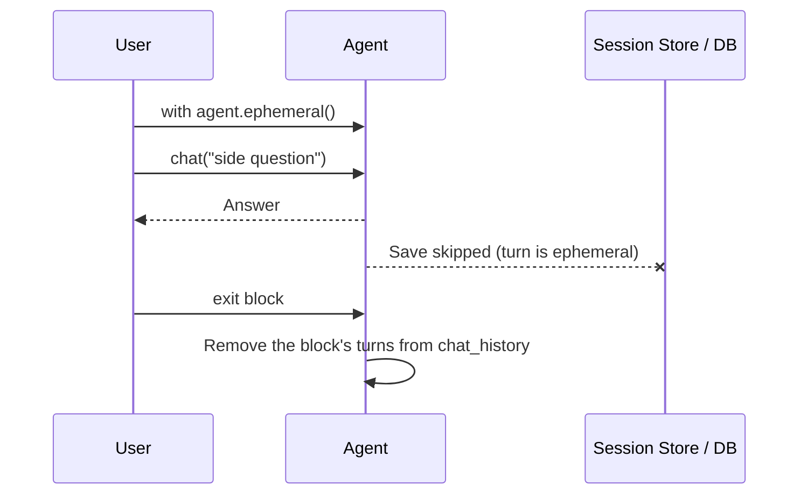

Wrap `agent.chat()` calls in `agent.ephemeral()` to run a one-off exchange that never reaches history, the session store, or the next request.

```python
from praisonaiagents import Agent

agent = Agent(name="Vision", instructions="Describe what you see.")

with agent.ephemeral():
    print(agent.chat("Describe this image", attachments=["photo.jpg"]))

# The next turn carries neither the image nor the answer.
```


<Note>
**Since [PraisonAI PR #6632](https://github.com/MervinPraison/PraisonAI/pull/6632):** ephemeral turns are also kept out of the session store, database adapters and `auto_save`. Earlier versions only rewound in-memory history, so the turn was still saved and came back on the next request or on resume.
</Note>

## Quick Start

<Steps>
<Step title="Analyse an image without bloating history">
```python
from praisonaiagents import Agent

agent = Agent(name="Vision", instructions="Describe what you see.")

with agent.ephemeral():
    answer = agent.chat("Describe this image", attachments=["photo.jpg"])

print(answer)
```
</Step>

<Step title="Ask a side question in a long session">
```python
from praisonaiagents import Agent, MemoryConfig

agent = Agent(
    name="Planner",
    instructions="Help plan the project.",
    memory=MemoryConfig(history=True, session_id="project-7"),
)

agent.chat("Let's plan the launch for March.")

with agent.ephemeral():
    agent.chat("Quick check — how many weeks until March?")  # never saved

agent.chat("Continue the launch plan.")  # history has no trace of the side question
```
</Step>
</Steps>

---

## How It Works



| Guarantee | Details |
|---|---|
| Not written to the JSON session store | User, assistant and tool messages are skipped |
| Not written to a database adapter | Same persistence path is skipped |
| Not written by `auto_save` | Auto-save is skipped while the block is active |
| Not sent on the next request | `chat_history` is rewound when the block exits |
| Streamed turns don't leak | Partial streamed answers are not saved either |
| Safe across threads and coroutines | Tracked per agent and per context; other agents and concurrent turns are unaffected |

---

## Common Patterns

- **Vision prompts** — image analysis you don't want repeated on every later request. See [Multimodal](/features/multimodal).
- **Sensitive one-offs** — a question containing a password, PII or a secret you don't want stored.
- **Probes and sanity checks** — test the agent mid-session without changing what it remembers.

---

## Best Practices

<AccordionGroup>
  <Accordion title="Scoped to one agent">
    The block only affects the agent you call it on. Other agents, and other turns running concurrently on the same agent, keep saving normally.
  </Accordion>
  <Accordion title="Prefer it over clearing history by hand">
    Clearing `chat_history` yourself is racy and leaves the session store and database untouched. `ephemeral()` handles all of them.
  </Accordion>
  <Accordion title="Pair it with long-lived sessions">
    Use a `session_id` for conversations that should persist, and wrap only the few turns that should not.
  </Accordion>
</AccordionGroup>

---

## Related

<CardGroup cols={2}>
  <Card title="History Injection" icon="clock-rotate-left" href="/features/history-injection">
    The opposite: persist and restore turns
  </Card>
  <Card title="Multimodal" icon="image" href="/features/multimodal">
    Image and audio input, a common use of ephemeral()
  </Card>
</CardGroup>
