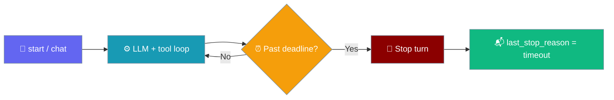
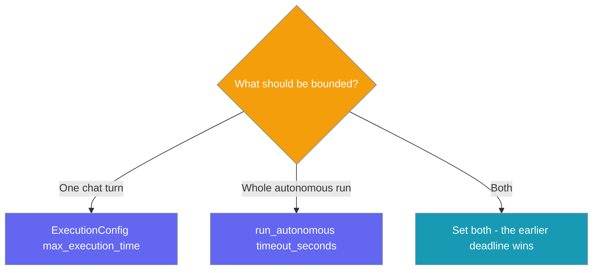

Cap how long one chat turn runs with `ExecutionConfig(max_execution_time=...)`, or how long a whole autonomous run takes with `run_autonomous(timeout_seconds=...)` — a timed-out turn stops at its next loop boundary and reports `last_stop_reason == "timeout"`.

```python
from praisonaiagents import Agent, ExecutionConfig

agent = Agent(
    name="Researcher",
    instructions="Research the topic within the time budget.",
    execution=ExecutionConfig(max_execution_time=30),  # 30s per turn
)

agent.start("Summarise today's AI news.")

if agent.last_stop_reason == "timeout":
    print("Turn cut by max_execution_time")
```



<Note>
Shipped in [PR #6062](https://github.com/MervinPraison/PraisonAI/pull/6062). Before it, `max_execution_time` only halted at tool calls, and a `run_autonomous` turn that overran `timeout_seconds` could still finish and be reported as `"goal"`. No new parameters, and no overhead when neither cap is set.
</Note>

## Quick Start

<Steps>
<Step title="Bound a single chat turn">

```python
from praisonaiagents import Agent, ExecutionConfig

agent = Agent(
    instructions="Answer briefly.",
    execution=ExecutionConfig(max_execution_time=30),
)
agent.start("Explain quantum computing.")
print(agent.last_stop_reason)  # "completed" or "timeout"
```

</Step>

<Step title="Bound a whole autonomous run">

```python
from praisonaiagents import Agent

agent = Agent(
    name="Worker",
    instructions="Complete the task autonomously.",
    autonomy=True,
)

result = agent.run_autonomous(
    "Clean up the repo and open a PR.",
    max_iterations=20,
    timeout_seconds=600,  # 10 minutes total
)

if result.completion_reason == "timeout":
    print("Run cut by the run deadline")
```

</Step>
</Steps>

---

## Which cap do I want?



| Cap | Scope | When it fires |
|---|---|---|
| `ExecutionConfig.max_execution_time` | Each chat turn (`chat()` / `start()` / `achat()` / `astart()`) | Turn stops; `agent.last_stop_reason == "timeout"` |
| `run_autonomous(timeout_seconds=...)` | The whole autonomous run (sync and async) | Returns `AutonomyResult(completion_reason="timeout", success=False)` |

They compose: with `timeout_seconds=600` and `max_execution_time=120`, any single turn stops after 2 minutes and the whole run after 10. In an autonomous run, a turn cut by `max_execution_time` is also reported as `completion_reason="timeout"`.

---

## What a timeout stops

| In flight when the deadline passes | Behaviour |
|---|---|
| An LLM request | Not interrupted mid-request — the turn stops at the next loop boundary after it returns |
| The step between tool calls | Stops at the next boundary |
| A Python tool that is running | **Not** interrupted — bound it with [`ToolConfig(timeout=...)`](/features/tool-timeout) |
| The autonomous loop between turns | The next turn only gets the time that remains |

<Note>
The deadline is checked at loop boundaries, not inside running code. Pair `max_execution_time` with `tool_config=ToolConfig(timeout=...)` on slow tools, and with an [LLM timeout](/features/llm-timeouts) on slow providers, to keep the overall cap tight.
</Note>

---

## Best Practices

<AccordionGroup>
<Accordion title="Branch on the stop reason, not the text">
Check `agent.last_stop_reason == "timeout"` or `result.completion_reason == "timeout"` instead of parsing the reply. See [Agent Run Outcomes](/features/agent-run-outcomes) for every stop reason.
</Accordion>

<Accordion title="Leave headroom for wrap-up">
A turn stops at the next boundary, so actual elapsed time can run past the cap by one LLM call or tool call. Set the cap a little below your hard limit.
</Accordion>
</AccordionGroup>

---

## Related

<CardGroup cols={2}>
<Card title="Execution" icon="play" href="/features/execution">
  Full `ExecutionConfig` overview
</Card>
<Card title="Loop Guard" icon="shield" href="/features/loop-guard">
  Tool-boundary halt that also reads `max_execution_time`
</Card>
<Card title="LLM Timeouts" icon="clock" href="/features/llm-timeouts">
  Per-request timeout on each LLM call
</Card>
<Card title="Autonomy Loop" icon="rotate" href="/features/autonomy-loop">
  `run_autonomous` iterations and completion reasons
</Card>
</CardGroup>
