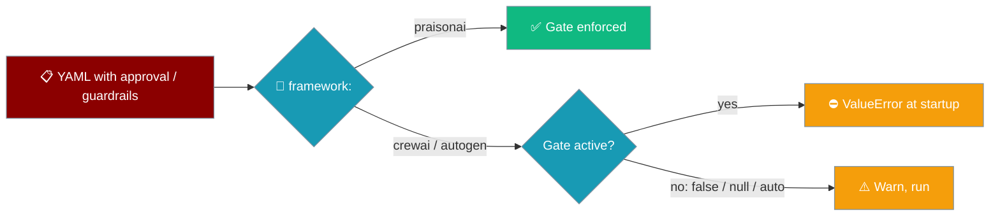
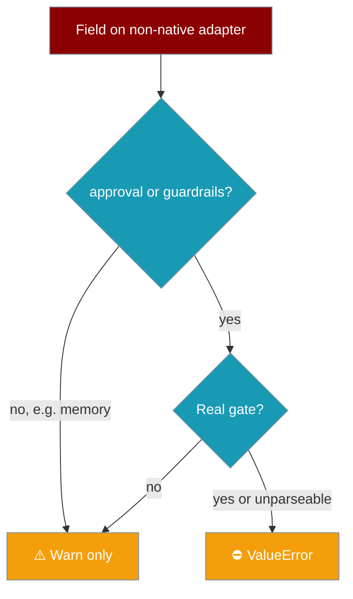

PraisonAI refuses to start a run that would silently drop a safety gate.



## Quick Start

<Steps>
<Step title="Gate on the native framework">
`framework: praisonai` honours `approval:` and `guardrails:` natively.

```yaml agents.yaml
framework: praisonai
topic: Compliance review
roles:
  compliance_agent:
    role: compliance-checker
    goal: Review the contract for policy issues
    backstory: You are a careful compliance reviewer.
    approval:
      backend: console
    guardrails: strict
    tasks:
      review:
        description: Review the contract and list policy issues.
        expected_output: A bullet list of issues.
```

```bash
praisonai agents.yaml
```
</Step>

<Step title="Same YAML on CrewAI refuses to start">
Change only `framework: crewai`. The CrewAI and AutoGen adapters cannot pass these fields through, so the run stops before any tool executes:

```
ValueError: framework='crewai' cannot enforce safety field(s) ['approval', 'guardrails']
for agent 'compliance-checker'. Use framework: praisonai, or remove the field(s) to run ungated.
```
</Step>

<Step title="Pick a fix">
Either switch back to `framework: praisonai` to keep the gate, or delete the `approval:` / `guardrails:` keys (or set `approval: false`) to run ungated on purpose.
</Step>
</Steps>

<Warning>
**Behaviour change.** Previously these fields were dropped with only a log `WARNING`, and tools ran ungated. Any YAML that combines `approval:` or `guardrails:` with `framework: crewai` or `framework: autogen` now fails at startup.
</Warning>

---

## When does the error fire?



| YAML value | Result on `crewai` / `autogen` |
|---|---|
| `approval: false` or `approval: null` | Warns, runs (gate disabled) |
| `approval: {enabled: true, backend: auto, approve_all_tools: false}` (the `--trust` shape) | Warns, runs (`auto` gates nothing) |
| `approval: {enabled: false, ...}` | Warns, runs (gate disabled) |
| `approval: true` | **ValueError** (defaults to the `console` backend) |
| `approval: {backend: console}` (or `slack`, `webhook`, …) | **ValueError** |
| `approval: {typo: 1}` (unparseable) | **ValueError** — invalid config fails closed |
| `guardrails: null` or `guardrails: ""` | Warns, runs (no gate) |
| `guardrails: strict` or any non-empty value | **ValueError** |

Non-safety fields an adapter does not read (for example `memory` on CrewAI) still only log a warning.

### Who is affected

| `framework:` | Honours `approval` / `guardrails` | On an active gate |
|---|---|---|
| `praisonai` | ✅ Yes | Gate enforced |
| `crewai` | ❌ No | `ValueError` |
| `autogen`, `autogen_v2`, `autogen_v4`, `ag2` | ❌ No (only `llm` is supported) | `ValueError` |

YAML files that never set `approval:` or `guardrails:` are unaffected.

---

## How to migrate

| Original YAML | Keep the gate | Remove the gate | Disable the gate |
|---|---|---|---|
| `framework: crewai` + `approval: {backend: console}` | Change to `framework: praisonai` | Delete the `approval:` key | Set `approval: false` |
| `framework: autogen` + `guardrails: strict` | Change to `framework: praisonai` | Delete the `guardrails:` key | Set `guardrails: null` |

---

## Best Practices

<AccordionGroup>
<Accordion title="Use framework: praisonai for gated tools">
Approval and guardrails are only enforced on the native framework. If a role touches shell, file, or network tools, run it on `praisonai`.
</Accordion>

<Accordion title="Disable explicitly, not by accident">
When you really want CrewAI or AutoGen to run ungated, write `approval: false` or remove the key so the intent is visible in review.
</Accordion>

<Accordion title="Treat the error as a config check">
The error fires at startup, before any agent runs. Add `praisonai agents.yaml` to CI to catch dropped gates early.
</Accordion>
</AccordionGroup>

---

## Related

<CardGroup cols={2}>
  <Card title="Approval" icon="user-check" href="/features/approval">
    Human-in-the-loop approval for tools
  </Card>
  <Card title="Guardrails" icon="shield" href="/features/guardrails">
    Validate agent output
  </Card>
</CardGroup>
