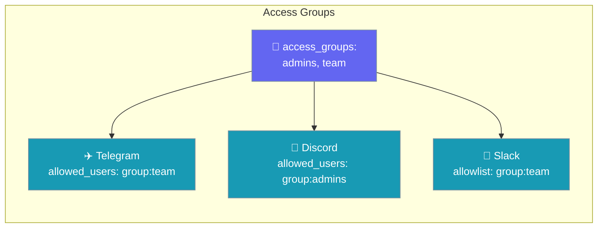
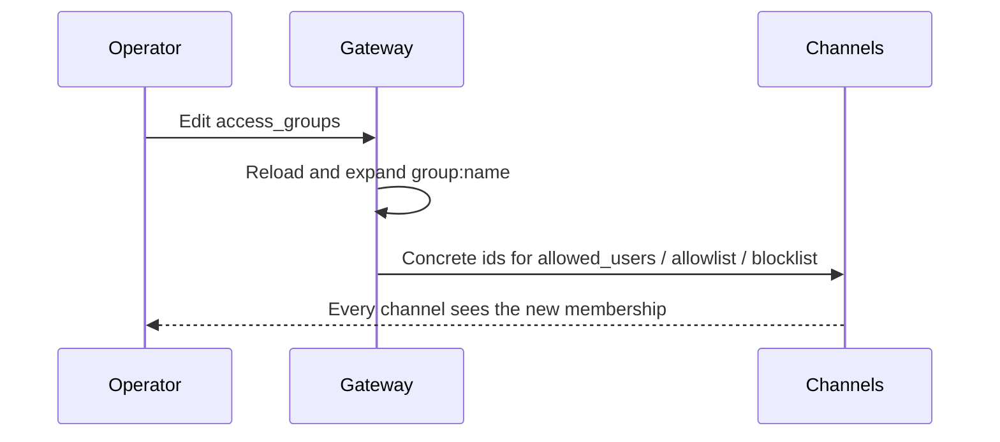

Access groups let you name a set of senders once and reference it from any channel — one definition, one revoke point.



## Quick Start

<Steps>
<Step title="Define a group, use it in a channel">

```yaml gateway.yaml
agents:
  assistant: { instructions: "Help the user." }

access_groups:
  admins: ["111", "222"]

channels:
  telegram:
    token: ${TELEGRAM_BOT_TOKEN}
    allowed_users: ["group:admins"]   # expands to ["111", "222"]
```

```bash
praisonai gateway start --config gateway.yaml
```
</Step>

<Step title="Nest groups and share across channels">

```yaml gateway.yaml
agents:
  assistant: { instructions: "Help the user." }

access_groups:
  admins: ["111", "222"]
  team:   ["group:admins", "333"]   # groups may nest

channels:
  telegram:
    token: ${TELEGRAM_BOT_TOKEN}
    allowed_users: ["group:team"]   # expands to ["111", "222", "333"]
  discord:
    token: ${DISCORD_BOT_TOKEN}
    allowed_users: ["group:admins"] # expands to ["111", "222"]
    blocklist:     ["999"]
```
</Step>
</Steps>

---

## How It Works

Expansion happens once at config load, before validation and admission, so every channel admits from the same definition.



| Rule | Behaviour |
|------|-----------|
| Reference | `group:<name>` inside `allowed_users`, `allowlist` or `blocklist` |
| Nesting | A group can contain `group:<other>` |
| Order | First-seen order kept, duplicates removed |
| Strings | Comma-separated values are split into ids |

---

## Configuration

Each group value can take three shapes.

<Tabs>
<Tab title="List">

```yaml
access_groups:
  admins: ["111", "222"]
```
</Tab>
<Tab title="Comma string">

```yaml
access_groups:
  admins: "111, 222"
```
</Tab>
<Tab title="Env-backed">

```yaml
# ADMINS=111,222
access_groups:
  admins: ["${ADMINS}"]

channels:
  discord:
    token: ${DISCORD_BOT_TOKEN}
    allowed_users: ["group:admins"]   # ["111", "222"]
```
</Tab>
</Tabs>

---

## Fail-Closed Behaviour

A bad reference stops the gateway instead of silently widening or narrowing access.

| Problem | Error |
|---------|-------|
| Unknown group | `Unknown access group: 'nope'` |
| Cycle (`a → b → a`) | `Access group cycle: a -> b -> a` |

```text
Gateway config validation failed (gateway.yaml):
  - channels.telegram.allowed_users: Unknown access group: 'nope'
```

On hot-reload, a bad reference keeps the last-known-good config.

<Warning>
Access groups control who can talk to your agent. Review the full posture in [Bot Security](/best-practices/bot-security).
</Warning>

---

## Common Patterns

<AccordionGroup>
<Accordion title="One team, three channels">
Reference `group:team` from Telegram, Discord and Slack. Remove a person from `team` once and they lose access everywhere.
</Accordion>
<Accordion title="Env-backed groups">
Keep ids out of the file with `admins: ["${ADMINS}"]` and set `ADMINS=111,222`.
</Accordion>
<Accordion title="Nested roles">
Put `group:admins` inside `team` so admins are automatically team members.
</Accordion>
</AccordionGroup>

---

## Scope

| Supported | Not available yet |
|-----------|-------------------|
| Gateway channels (`gateway.yaml` → `access_groups:`) | Route-level references on `RouteBinding` |
| `allowed_users`, `allowlist`, `blocklist` | Standalone `bot.yaml` |
| | An `access-group` CLI |

<Card title="expand_access_groups (Python)" icon="code" href="/docs/sdk/reference/praisonaiagents/functions/expand_access_groups">
  Pure, zero-dependency expansion used by the gateway loader.
</Card>

---

## Best Practices

<AccordionGroup>
<Accordion title="Define once, reference everywhere">
Never re-paste raw ids into each channel — they drift.
</Accordion>
<Accordion title="Use simple group names">
Lowercase names such as `admins` or `on_call` are easy to spot in reviews.
</Accordion>
<Accordion title="Model roles with nesting">
Build hierarchies like `admins` ⊂ `oncall` ⊂ `team`.
</Accordion>
<Accordion title="Keep the strict default">
Pair groups with `unknown_user_policy: "deny"`. See [Channel Security](/features/bot-gateway#channel-security).
</Accordion>
</AccordionGroup>

---

## Related

<CardGroup cols={2}>
  <Card title="Bot Gateway" icon="tower-broadcast" href="/features/bot-gateway#channel-security">
    Channel Security settings
  </Card>
  <Card title="Bot Security" icon="shield" href="/best-practices/bot-security">
    Broader security posture
  </Card>
  <Card title="Channels Gateway" icon="plug" href="/features/channels-gateway">
    Shared allowlist surface
  </Card>
  <Card title="Gateway Config Migration" icon="arrow-right-arrow-left" href="/features/gateway-config-migration">
    Gateway keys inventory
  </Card>
</CardGroup>
