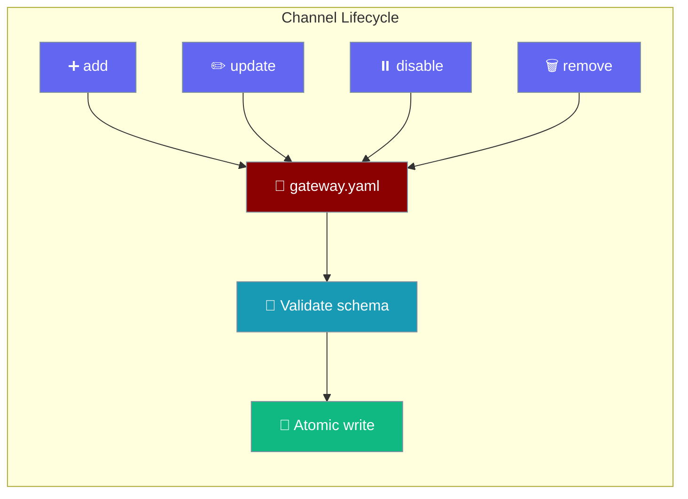
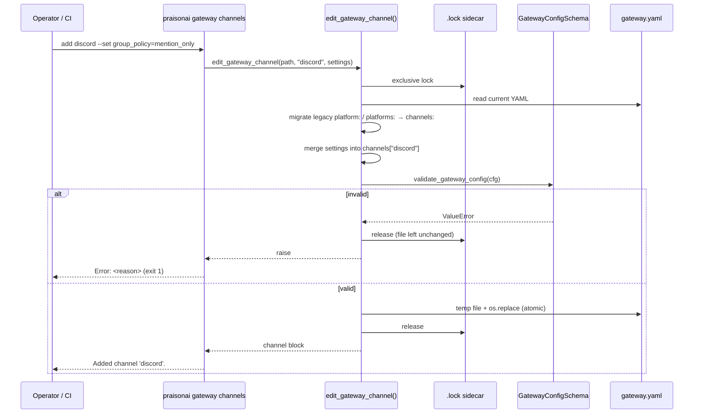

Edit one channel in `gateway.yaml` / `bot.yaml` with a single command — other channels and settings stay untouched, and invalid edits are never written.



## Quick Start

<Steps>
<Step title="Let an agent manage channels">
```python
from praisonaiagents import Agent
from praisonai_bot import edit_gateway_channel

def disable_channel(name: str) -> str:
    """Stop serving one gateway channel but keep its config."""
    edit_gateway_channel("gateway.yaml", name, {"enabled": False})
    return f"Disabled {name}"

agent = Agent(
    name="gateway-ops",
    instructions="Manage my chat channels — pause them when asked.",
    tools=[disable_channel],
)
agent.start("Pause the Slack channel.")
```
</Step>

<Step title="Or run the CLI directly">
```bash
# Add a channel (token defaults to the platform's ${VAR} reference)
praisonai gateway channels add telegram

# Add a channel with extra fields in one shot
praisonai gateway channels add discord --set group_policy=mention_only

# Rotate a token and change a policy
praisonai gateway channels update telegram --token '${NEW_TELEGRAM_TOKEN}' --set group_policy=mention_only

# Stop serving a channel but keep its config
praisonai gateway channels disable slack

# Delete the channel block entirely
praisonai gateway channels remove slack
```
</Step>

<Step title="Or call the Python helper">
```python
from praisonai_bot import edit_gateway_channel

edit_gateway_channel("gateway.yaml", "discord", {"token": "${DISCORD_BOT_TOKEN}"})   # add
edit_gateway_channel("gateway.yaml", "telegram", {"group_policy": "mention_only"})   # update
edit_gateway_channel("gateway.yaml", "telegram", {"enabled": False})                 # disable
edit_gateway_channel("gateway.yaml", "slack", remove=True)                           # remove
```
</Step>
</Steps>

---

## How It Works

Every edit is a locked read-modify-write: read the file, merge the change into `channels[name]`, validate the whole document, then atomically replace the file.



A failed validation leaves the file byte-for-byte unchanged, so a bad edit can never take a running gateway down on its next reload.

---

## Choosing a Subcommand

Pick the subcommand by what should happen to the channel block.

```mermaid
graph TB
    Start{What do you need?} -->|Create a channel block that is not there yet| A[channels add]
    Start -->|Change fields on an existing channel| B[channels update]
    Start -->|Stop serving but keep the config| C[channels disable]
    Start -->|Delete the block entirely| D[channels remove]
    Start -->|Just see what is configured| E[channels &#40;no subcommand&#41;]

    classDef decision fill:#F59E0B,stroke:#7C90A0,color:#fff
    classDef edit fill:#189AB4,stroke:#7C90A0,color:#fff
    classDef read fill:#10B981,stroke:#7C90A0,color:#fff

    class Start decision
    class A,B,C,D edit
    class E read
```



---

## CLI Reference

All four subcommands accept `--config` / `-c`; when omitted they use the parent `gateway channels --config` value, which falls back to `gateway.yaml` and the onboarded `~/.praisonai/bot.yaml` (see [Config Discovery](/features/gateway-config-discovery)).

<Tabs>
<Tab title="add">
| Argument / Option | Type | Default | Description |
|---|---|---|---|
| `name` | positional | — | Channel name, e.g. `telegram`. Must not already exist. |
| `--platform` | `str` | the channel `name` | Platform id, e.g. `--platform discord` for a channel named `support`. |
| `--token` | `str` | `${<PLATFORM>_BOT_TOKEN}`-style reference | Channel token or `${VAR}` reference. Defaults to the platform's documented credential env var. |
| `--set key=value` | repeatable | — | Extra fields merged into the block. Values are YAML-parsed (`enabled=false` writes a boolean). |
| `--config`, `-c` | `str` | parent `--config` | Config path. |

```bash
praisonai gateway channels add support --platform discord --set group_policy=mention_only
```
</Tab>

<Tab title="update">
| Argument / Option | Type | Default | Description |
|---|---|---|---|
| `name` | positional | — | Channel to update. Must exist. |
| `--token` | `str` | — | Replace the channel's `token`. |
| `--set key=value` | repeatable | — | Fields to update, YAML-typed values. |
| `--config`, `-c` | `str` | parent `--config` | Config path. |

Exits `1` with `nothing to update; pass --token and/or --set key=value` when neither `--token` nor `--set` is given.
</Tab>

<Tab title="disable">
| Argument / Option | Type | Default | Description |
|---|---|---|---|
| `name` | positional | — | Channel to disable. Must exist. |
| `--config`, `-c` | `str` | parent `--config` | Config path. |

Sets `enabled: false`. There is no separate `enable` command — re-enable with `praisonai gateway channels update <name> --set enabled=true`.
</Tab>

<Tab title="remove">
| Argument / Option | Type | Default | Description |
|---|---|---|---|
| `name` | positional | — | Channel block to delete. Must exist. |
| `--config`, `-c` | `str` | parent `--config` | Config path. |
</Tab>
</Tabs>

<Note>
The config file must already exist — create one first with `praisonai onboard` or [`provision_gateway_config`](/features/gateway-admin-api#provision_gateway_config).
</Note>

---

## Python API

```python
from praisonai_bot import edit_gateway_channel

edit_gateway_channel(config_path, name, settings=None, *, remove=False) -> dict
```

| Parameter | Type | Default | Description |
|---|---|---|---|
| `config_path` | `str` \| `os.PathLike[str]` | — | Path to `bot.yaml` / `gateway.yaml`. |
| `name` | `str` | — | Channel name to add, update, or remove. |
| `settings` | `dict \| None` | `None` | Fields merged into `channels[name]`. `platform` defaults to `name`. Pass `{"enabled": False}` to disable. Ignored when `remove=True`. |
| `remove` | `bool` (keyword-only) | `False` | Delete the channel block instead of upserting it. |

Returns the resulting channel block (`{}` when `remove=True`).

| Raises | When |
|---|---|
| `FileNotFoundError` | The config file does not exist (no `.lock` file is created). |
| `KeyError` | `remove=True` and the channel is not configured. |
| `ValueError` | The edited document fails validation — unknown platform, bad types, or no enabled channel left. |

<Note>
The Python helper upserts: it does not refuse to `add` over an existing channel. The CLI adds that check (`add` rejects an existing name, `update` / `disable` / `remove` reject a missing one).
</Note>

---

## Validation

The edited document is validated before the write; anything rejected leaves the file unchanged.

| Rule | Behaviour |
|---|---|
| `${VAR}` references | Kept verbatim in the saved file. Validation runs on an env-resolved copy, so unset placeholders pass. |
| Unknown platform | Rejected (`ValueError` / exit `1`). |
| Bad field types | Rejected (`ValueError` / exit `1`). |
| Removing or disabling the last enabled channel | Rejected: `at least one enabled channel must remain configured`. |
| CLI `add` of an existing channel | Rejected: `channel '<name>' already exists in <path>; use 'update'`. |
| CLI `update` / `disable` / `remove` of a missing channel | Rejected: `channel '<name>' is not configured in <path>`. |
| `--set` without `=` | Rejected: `--set expects key=value, got '<pair>'`. |
| `--set key=` (empty value) | Writes the empty string. |

---

## Legacy Config Migration

Older single-bot and BotOS files are converted to a `channels:` block on the first edit.

| Input shape | Behaviour |
|---|---|
| `channels:` already present | Edited in place; other channels untouched. |
| Single-bot: top-level `platform:` + `token:` | Becomes `channels.<platform>` with that `token` (or the platform's `${VAR}` reference). Slack's `app_token` moves into the block; `unknown_user_policy` / `owner_user_id` are copied in. A `${VAR}` platform is resolved first, as the loader does. |
| BotOS: top-level `platforms:` map | Each entry becomes `channels.<name>` with `platform: <name>`; the `platforms:` key is removed. |

---

## Concurrent-Edit Safety

Each edit holds an exclusive OS advisory lock on a sidecar `<config_path>.lock` file (`fcntl.flock` on POSIX, `msvcrt.locking` on Windows), so parallel edits of different channels never overwrite each other.

---

## Common Patterns

### Rotate a token from CI

```bash
praisonai gateway channels update telegram --token '${TELEGRAM_BOT_TOKEN_V2}'
```

### Add the same channel to many tenants

```python
from praisonai_bot import edit_gateway_channel

for tenant in ["acme", "globex"]:
    edit_gateway_channel(
        f"/etc/praisonai/{tenant}/bot.yaml",
        "discord",
        {"token": f"${{{tenant.upper()}_DISCORD_TOKEN}}"},
    )
```

### Add one channel to a running gateway

```bash
praisonai gateway channels add discord
```

A running gateway picks up the change through [Config Reload](/features/gateway-config-reload).

---

## Best Practices

<AccordionGroup>
<Accordion title="Prefer ${VAR} references over literal tokens">
Store `token: ${DISCORD_BOT_TOKEN}` rather than the secret itself. `add` writes a reference by default, and references survive every later edit verbatim. See [Secret References](/features/gateway-secret-references).
</Accordion>
<Accordion title="Re-enable with update, not a separate command">
`praisonai gateway channels update <name> --set enabled=true` is the re-enable path — there is intentionally no `enable` subcommand.
</Accordion>
<Accordion title="Disable before you remove">
`disable` keeps the block, so rolling back is one `update --set enabled=true`. Run `remove` once you are sure.
</Accordion>
<Accordion title="Let the schema reject bad values">
Skip pre-validation in scripts. A rejected edit exits `1` (or raises `ValueError`) and writes nothing.
</Accordion>
</AccordionGroup>

---

## Related

<CardGroup cols={2}>
<Card title="Gateway Admin API" icon="wrench" href="/features/gateway-admin-api">
Repair and provision configs from Python.
</Card>
<Card title="Gateway CLI" icon="terminal" href="/features/gateway-cli">
Every `praisonai gateway` command.
</Card>
<Card title="Channels Gateway" icon="tower-broadcast" href="/features/channels-gateway">
How channels are configured and served.
</Card>
<Card title="Secret References" icon="key" href="/features/gateway-secret-references">
`${VAR}` tokens in gateway config.
</Card>
</CardGroup>
