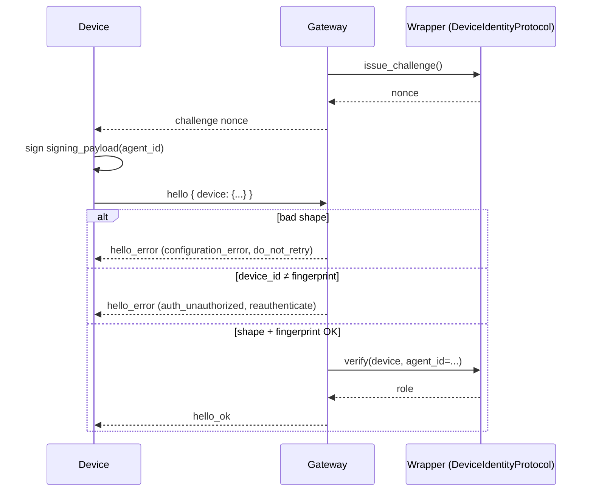

Give each device (phone, laptop, desktop app) its own keypair so the gateway can tell them apart, revoke one without rotating everyone, and reject anyone who claims another device's id.

```python
from praisonaiagents import Agent

agent = Agent(name="assistant", instructions="Reply from a trusted device only.")
agent.start("Hello from my phone")
```

<Warning>
Only the **core wire contract** has shipped ([PR #6001](https://github.com/MervinPraison/praisonai/pull/6001)). Ed25519 signature verification, the device store, per-device tokens and a `praisonai devices` CLI belong to the wrapper gateway and are **not yet shipped** — track [issue #5998](https://github.com/MervinPraison/praisonai/issues/5998) for the roadmap. Until then, core only fixes the wire shape, the fingerprint and the exact signed bytes.
</Warning>

## Quick Start

<Steps>

<Step title="Compute the device id">

The device id is the hex SHA-256 of the decoded public-key bytes — never a value the client picks.

```python
from praisonaiagents.gateway import device_id_from_public_key

public_key = "dGVzdC1wdWJsaWMta2V5"  # padded standard base64 of the raw key
device_id = device_id_from_public_key(public_key)
# "c88e80202a4d650841e48649b4c3f553e48131b415db680476fd0d65632ff2b0"
```

</Step>

<Step title="Sign the challenge">

Build a `DeviceAuth`, take its canonical `signing_payload(agent_id)` bytes, and sign them. Ed25519 is recommended; core does not pin a signature library.

```python
import base64, time
from cryptography.hazmat.primitives import serialization
from cryptography.hazmat.primitives.asymmetric.ed25519 import Ed25519PrivateKey
from praisonaiagents.gateway import DeviceAuth, device_id_from_public_key

key = Ed25519PrivateKey.generate()
raw = key.public_key().public_bytes(serialization.Encoding.Raw, serialization.PublicFormat.Raw)
public_key = base64.b64encode(raw).decode()

device = DeviceAuth(
    device_id=device_id_from_public_key(public_key),
    public_key=public_key,
    signature="",
    signed_at=int(time.time()),
    nonce="<nonce issued by the gateway>",
)
device.signature = base64.b64encode(key.sign(device.signing_payload("assistant"))).decode()
```

</Step>

<Step title="Send hello with the device block">

```json
{
  "type": "hello",
  "agent_id": "assistant",
  "protocol_min": 1,
  "protocol_max": 1,
  "device": {
    "device_id": "c88e80202a4d650841e48649b4c3f553e48131b415db680476fd0d65632ff2b0",
    "public_key": "dGVzdC1wdWJsaWMta2V5",
    "signature": "<base64 signature over DeviceAuth.signing_payload(agent_id)>",
    "signed_at": 1700000000,
    "nonce": "<nonce issued by the gateway>"
  }
}
```

</Step>

</Steps>

---

## How It Works




The shape and fingerprint checks live in the core frame codec; challenge issuance and `verify` are the wrapper seam that has not shipped yet.

---

## Wire Contract

### `DeviceAuth`

| Field | Type | Default | Description |
|-------|------|---------|-------------|
| `device_id` | `str` | — | Fingerprint of `public_key` (see `device_id_from_public_key`). |
| `public_key` | `str` | — | Standard base64 (padded) of the device's raw public key. |
| `signature` | `str` | — | Standard base64 (padded) signature over `signing_payload`. |
| `signed_at` | `int` | — | Integer Unix seconds at which the device signed the challenge (an integer so every client language renders identical signed bytes). |
| `nonce` | `str` | — | The server-issued challenge nonce being answered. |

### Signing payload

Clients in any language must render exactly these UTF-8 bytes, joined by `\n` with no trailing newline:

```text
praisonai-device-v1
<device_id>
<nonce>
<signed_at as integer, no fraction>
<agent_id>
```

Self-check against the pinned vectors from the SDK test suite:

```text
device_id_from_public_key("dGVzdC1wdWJsaWMta2V5")
  == "c88e80202a4d650841e48649b4c3f553e48131b415db680476fd0d65632ff2b0"

signing_payload for agent "a", nonce "n-1", signed_at 1700000000:
  b"praisonai-device-v1\n"
  b"c88e80202a4d650841e48649b4c3f553e48131b415db680476fd0d65632ff2b0\n"
  b"n-1\n1700000000\na"
```

### Rejection matrix

| Trigger | `code` | `next_step` |
|---------|--------|-------------|
| `device` is not an object; `device_id`/`signature`/`nonce` missing or empty; non-integer `signed_at`; `public_key` is not padded standard base64 | `configuration_error` | `do_not_retry` |
| `device.device_id` does not equal `device_id_from_public_key(device.public_key)` | `auth_unauthorized` | `reauthenticate` |

---

## `DeviceIdentityProtocol` seam

Core defines the seam; the wrapper gateway (`praisonai-bot`) implements it. It is `runtime_checkable`, so any object with these four methods counts — handy for tests and custom stores.

| Method | Description |
|--------|-------------|
| `issue_challenge() -> str` | Return a fresh single-use challenge nonce for a connecting client. |
| `verify(device, *, agent_id) -> Optional[str]` | Verify `device` against an issued nonce; return its role, or `None` if rejected. |
| `list_devices() -> List[Dict[str, Any]]` | List known devices (id, role, approval path, last seen). |
| `revoke(device_id) -> bool` | Revoke one device; return `False` if it was unknown. |

```python
from praisonaiagents.gateway import DeviceIdentityProtocol

class MemoryStore:
    def issue_challenge(self): return "n-1"
    def verify(self, device, *, agent_id): return None
    def list_devices(self): return []
    def revoke(self, device_id): return False

assert isinstance(MemoryStore(), DeviceIdentityProtocol)
```

<Note>
Implementations must approve only on an **exact device-key match** — never on network reachability alone.
</Note>

---

## Why this exists

- A shared `auth_token`, magic link or signed cookie leaks the whole gateway at once; a per-device key lets you revoke **one** lost phone.
- `device_id` is a cryptographic fingerprint of the public key, not something the client picks, so a client can never claim another device's id.
- The signing payload binds nonce + `device_id` + `signed_at` + `agent_id`, so a captured proof can't be replayed for another device or agent.

---

## Best Practices

<AccordionGroup>

<Accordion title="Use padded standard base64 (RFC 4648) for public_key and signature">
Unpadded, URL-safe, or whitespace-wrapped values are rejected as a shape error.
</Accordion>

<Accordion title="Keep signed_at an integer">
The signing payload uses `str(int(signed_at))`; a float or boolean renders different bytes in every client language and will not verify.
</Accordion>

<Accordion title="Never send a device_id the client picked itself">
Always compute it with `device_id_from_public_key(public_key)` or an equivalent SHA-256 of the raw key bytes.
</Accordion>

<Accordion title="Omitting device is fine until the wrapper rolls out">
The core handshake treats an absent `device` block exactly as before.
</Accordion>

</AccordionGroup>

---

## Related

<CardGroup cols={2}>
  <Card title="Gateway Handshake Protocol" icon="handshake" href="/features/gateway-handshake-protocol">
    The `hello` frame that carries the device block
  </Card>
  <Card title="Operator Scopes" icon="user-shield" href="/features/gateway-operator-scopes">
    Pairing / approvals scope
  </Card>
  <Card title="Bot Pairing" icon="link" href="/features/bot-pairing">
    Human-readable pairing codes — the complement to a device key
  </Card>
  <Card title="Error Handling" icon="shield-check" href="/features/gateway-error-handling">
    Structured connect errors
  </Card>
</CardGroup>
