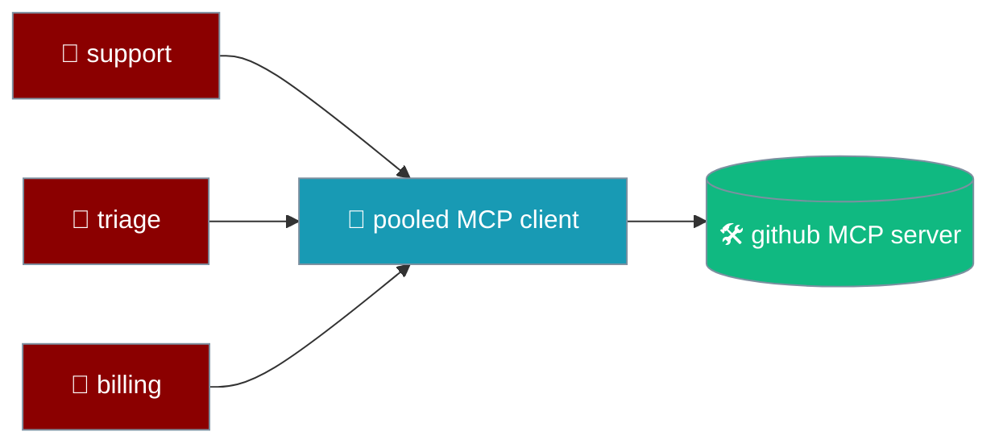
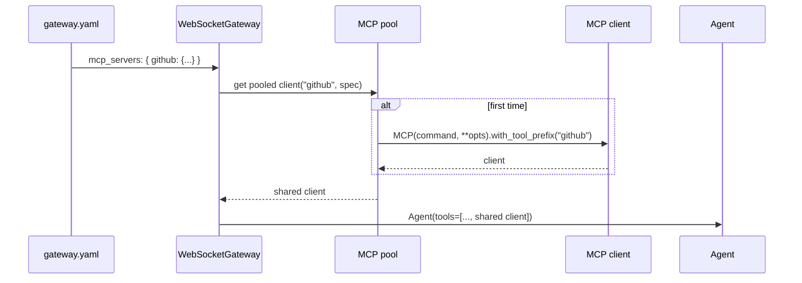

Declare downstream MCP servers once at the gateway and every agent that lists the server name gets the same pooled, shared client — not N connections per server.



## Quick Start

<Steps>
  <Step title="One stdio server, two agents">
    ```yaml
    # gateway.yaml
    mcp_servers:
      github:
        command: npx
        args: ["-y", "@modelcontextprotocol/server-github"]

    agents:
      support:
        instructions: "Help users file GitHub issues."
        model: gpt-4o-mini
        tools: [github]
      triage:
        instructions: "Label and route incoming issues."
        model: gpt-4o-mini
        tools: [github]
    ```

    One `npx` process serves both agents.
  </Step>

  <Step title="Mix stdio and HTTP servers">
    ```yaml
    mcp_servers:
      github:
        command: npx
        args: ["-y", "@modelcontextprotocol/server-github"]
      search:
        url: https://mcp.example.com/sse
        headers:
          Authorization: Bearer ${SEARCH_MCP_TOKEN}

    agents:
      support:
        instructions: "Answer questions using GitHub and web search."
        tools: [github, search]
    ```
  </Step>

  <Step title="String shorthand for a local binary">
    ```yaml
    mcp_servers:
      files: /usr/local/bin/filesystem-mcp

    agents:
      librarian:
        instructions: "Find and summarise local documents."
        tools: [files]
    ```
  </Step>
</Steps>

Start the gateway with your config:

```bash
praisonai gateway start --config gateway.yaml
```

---

## How It Works



Every agent that lists the server name walks the same path and lands on the same client.

---

## Configuration

Each key under `mcp_servers:` is the server's name (also its tool-name prefix), and the value is its spec.

| Shape | Required | Optional | Notes |
|---|---|---|---|
| stdio mapping | `command` | `args`, `env`, any other `praisonaiagents.MCP` keyword | Launches a stdio MCP server. |
| HTTP mapping | `url` | `headers`, any other `praisonaiagents.MCP` keyword | Opens an HTTP/SSE MCP connection. |
| String shorthand | the whole value | — | Treated as `{"command": "<string>"}`. |

<Warning>
An entry with neither `command` nor `url`, or one whose server fails to start, is logged and skipped — the gateway still boots. Check the gateway logs for `mcp_servers.github needs a 'command' or 'url'; skipping` or `Failed to start MCP server 'github': ...`.
</Warning>

### Referencing a server from an agent

List the server name in an agent's `tools:` to attach the pooled client.

```yaml
agents:
  support:
    tools: [github, internet_search]   # MCP server + built-in tool
```

Names that are not in `mcp_servers:` fall through to the normal tool resolver, so built-in tools work alongside MCP servers.

### Tool-name namespacing

Tools from a server named `github` are exposed as `github_<tool>`, so two servers that each offer a `search` tool never shadow each other.

---

## Hot Reload

The pool keys each client by name and spec, so a reload only reconnects what changed.

| Change in `gateway.yaml` | What happens |
|---|---|
| Spec unchanged | Pooled client reused — no reconnect. |
| Spec changed | New client opened; the old one is shut down on prune. |
| Entry removed | Client is shut down on the next reload prune. |
| Entry added | Client opened off the event loop, so serving is not blocked by the startup handshake. |

---

## Failure Modes

- **Bad spec** (no `command` and no `url`) — logged, skipped, gateway continues.
- **Server fails to start** — logged, skipped, gateway continues; the agent still registers without that server's tools.
- **stdio server dies mid-session** — the core `praisonaiagents.MCP` client restarts it on the next call.
- **Gateway stops** — every pooled client is shut down.

---

## Security

MCP tools from `mcp_servers:` run through the agent's normal tool path, so existing [tool policy](/features/gateway-tool-policy) and approval checks still apply.

---

## Configuration Options

<CardGroup cols={2}>
  <Card title="praisonaiagents.MCP" icon="code" href="/sdk/reference/praisonaiagents/classes/MCP">
    Underlying MCP client and its keyword options
  </Card>
  <Card title="Gateway YAML Configuration" icon="file-code" href="/gateway">
    Full `gateway.yaml` layout
  </Card>
</CardGroup>

---

## Best Practices

<AccordionGroup>
  <Accordion title="Declare each server once">
    Put every downstream server under `mcp_servers:` and reference it by name — never repeat the spec per agent.
  </Accordion>
  <Accordion title="Keep server names short and lowercase">
    The name becomes the tool prefix (`github_create_issue`), so short names keep tool names readable.
  </Accordion>
  <Accordion title="Keep secrets in environment variables">
    Use `${TOKEN}` in `env` and `headers` instead of pasting credentials into the YAML.
  </Accordion>
  <Accordion title="Watch the logs on boot">
    A failing server does not stop the gateway — look for `Failed to start MCP server` warnings.
  </Accordion>
</AccordionGroup>

---

## Related

<CardGroup cols={2}>
  <Card title="Gateway" icon="tower-broadcast" href="/gateway">
    Gateway setup and YAML configuration
  </Card>
  <Card title="MCP" icon="plug" href="/features/mcp">
    Use MCP tools with agents
  </Card>
  <Card title="Gateway API Endpoints" icon="plug" href="/features/gateway-api-endpoints">
    The inverse — serve gateway agents as MCP tools
  </Card>
  <Card title="Runtime MCP" icon="bolt" href="/features/runtime-mcp">
    Attach and detach MCP servers at runtime
  </Card>
</CardGroup>
