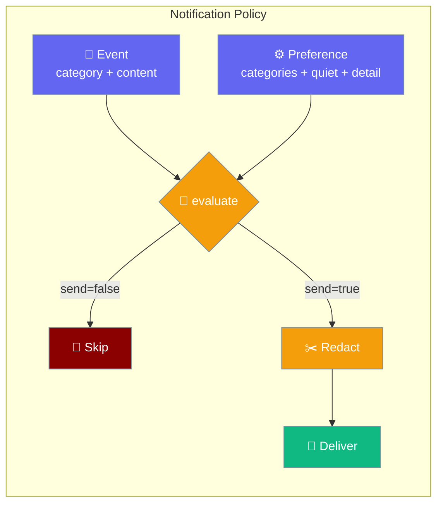
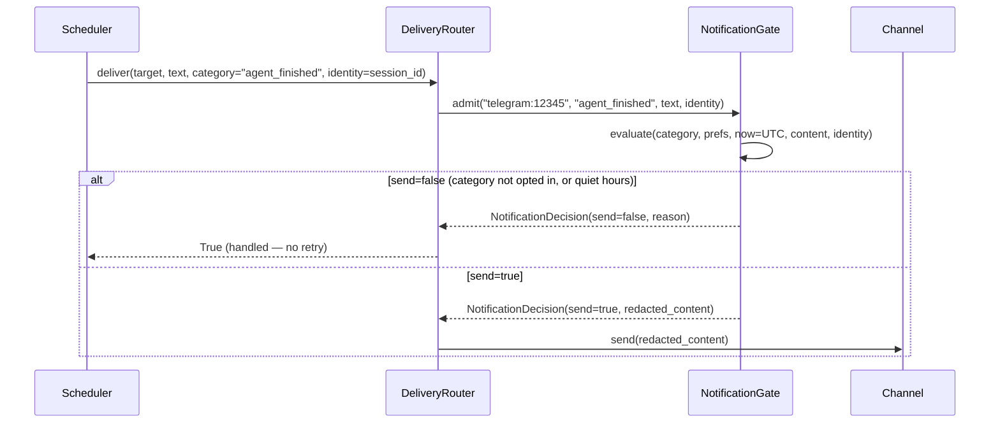
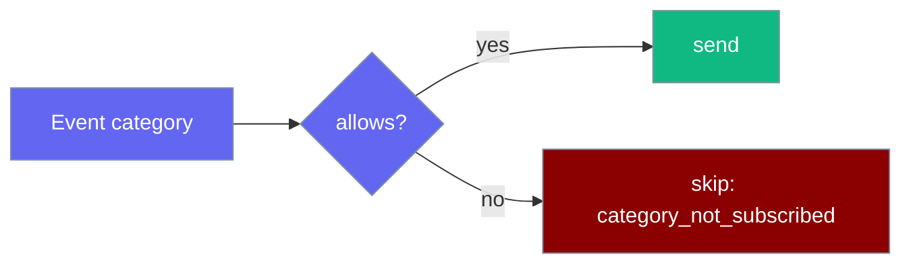
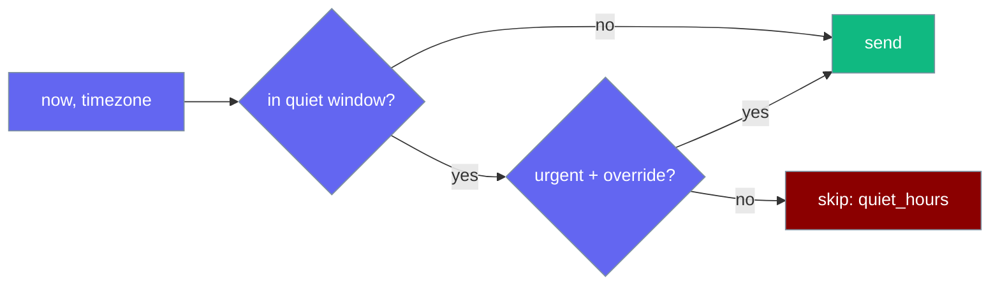
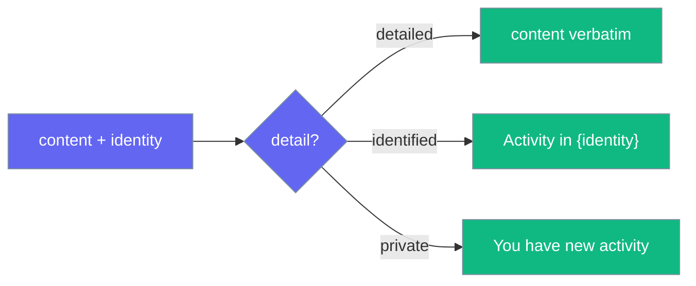
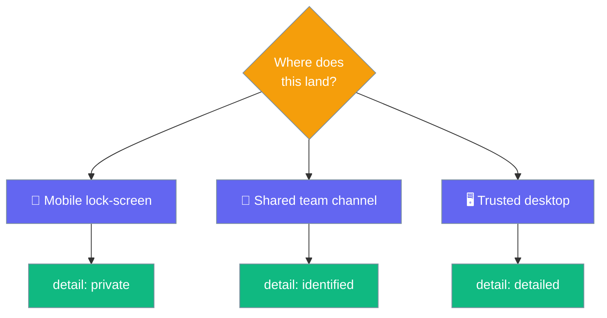
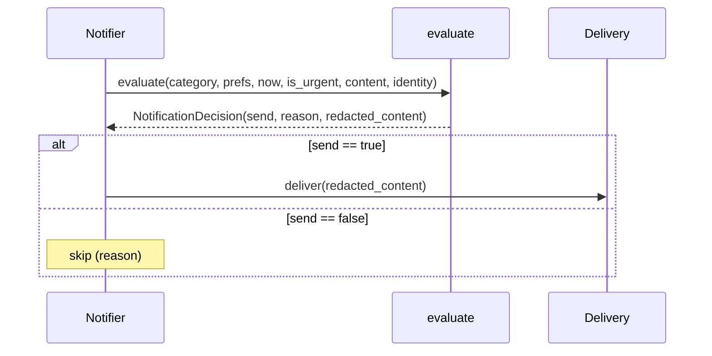
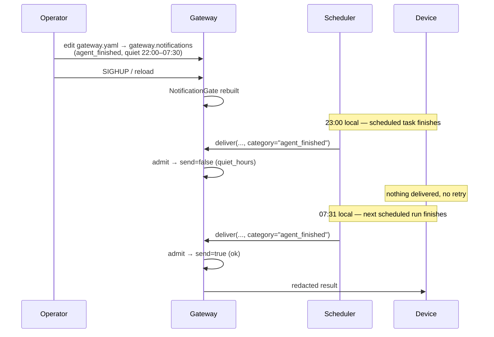

Notification policy lets you decide, per recipient, what the gateway may notify you about — filter by category, honour quiet hours in the recipient's own timezone, and redact content before it leaves the gateway. Set it once in `gateway.yaml` and every scheduled agent result is gated for you.



<Note>
This is the policy layer — the *whether* and *what* to notify. It sits above [Push Delivery Store](/features/gateway-push-delivery-store) (delivery guarantee) and before [Real-Time Push Notifications](/features/push-notifications) (transport).
</Note>

## Quick Start

<Steps>
<Step title="Turn it on with one YAML block">
Add `gateway.notifications` to your `gateway.yaml`. Scheduled agent results are now gated automatically.

```yaml
agents:
  ops-agent:
    instructions: "Run the overnight sales report."

gateway:
  notifications:
    defaults:
      detail: identified
      categories: [approval_requested]
```

With these defaults a scheduled `ops-agent` result (`agent_finished`) is not opted in, so it is suppressed.
</Step>

<Step title="Set a per-recipient preference">
Key a recipient by `platform:channel_id` and override any default.

```yaml
gateway:
  notifications:
    defaults:
      detail: identified
      categories: [approval_requested]
    recipients:
      "telegram:12345":
        categories: [approval_requested, agent_finished]
        quiet_hours: "22:00-07:30"
        timezone: "Europe/London"
        detail: detailed
```

`telegram:12345` now receives full scheduled results, except between 22:00 and 07:30 London time.
</Step>

<Step title="Validate and hot-reload">
A bad entry fails at startup, not at send time:

```yaml
gateway:
  notifications:
    recipients:
      "telegram:12345":
        timezone: "Europe/Londn"   # ValueError: unknown notification timezone: 'Europe/Londn'
```

Edit `gateway.yaml` and reload. The new policy applies without a restart:

```bash
kill -HUP $(pgrep -f "praisonai gateway")
# or
systemctl reload praisonai-gateway
```
</Step>
</Steps>

---

## How Categorised Sends Flow Through the Gateway

Every proactive send that carries a `category` passes through the gate before the idempotency check and the channel.



- **Suppressed sends count as handled** — `deliver()` returns `True`, so the scheduler and outbox do not retry, and no idempotency key is claimed.
- **Uncategorised sends are never gated** — direct replies, hook replies and restart notices pass straight through.
- **Quiet hours use the recipient's timezone** — the gate passes an aware UTC `now`, so the window is checked in the recipient's `timezone`, not the gateway host's clock.
- **No `notifications` block, no gating** — behaviour is unchanged when the block is absent.

### What Gets Categorised Automatically

| Send path | Category | Identity |
|-----------|----------|----------|
| Scheduled agent results | `agent_finished` | session id |
| Direct replies | not categorised — not gated | — |
| Hook replies | not categorised — not gated | — |
| Restart / recovery notices | not categorised — not gated | — |
| `send_message` tool | not categorised — not gated | — |

<Note>
Today only scheduled results (`agent_finished`) are wired. The gateway does not mark sends as urgent, so `urgent_overrides_quiet` has no effect on gateway sends yet — it applies when you call `evaluate(..., is_urgent=True)` yourself.
</Note>

### Where Recipients Come From

A recipient key is the resolved `platform:channel_id` of the delivery target — the same pair the gateway logs on each proactive send (`Delivered scheduled result to telegram:12345`, or `notification suppressed for telegram:12345` when gated). A recipient with no entry falls back to `defaults`, and anything missing from `defaults` falls back to `DEFAULT_PREFERENCE`.

---

## The Three Concerns

### Categories

A recipient opts into each event class independently; an un-opted category is suppressed with reason `category_not_subscribed`.

```yaml
gateway:
  notifications:
    recipients:
      "telegram:12345":
        categories: [approval_requested, agent_finished]
```



| YAML value | Python enum | Meaning |
|------------|-------------|---------|
| `approval_requested` | `APPROVAL_REQUESTED` | Agent awaits your approval to proceed |
| `agent_finished` | `AGENT_FINISHED` | Agent completed its run |
| `agent_question` | `AGENT_QUESTION` | Agent needs an answer to continue |
| `human_mentioned` | `HUMAN_MENTIONED` | You were mentioned in a session |
| `scheduled_task_failed` | `SCHEDULED_TASK_FAILED` | A scheduled task failed |
| `background_task_failed` | `BACKGROUND_TASK_FAILED` | A background job failed |

### Quiet Hours

A per-recipient local window suppresses non-urgent categories; urgent events override when `urgent_overrides_quiet` is true.

```yaml
gateway:
  notifications:
    recipients:
      "telegram:12345":
        quiet_hours: "22:00-07:30"
        timezone: "Europe/London"
```



The window is half-open `[start, end)`. When `start == end` the window is empty (never quiet). When `start > end` it wraps past midnight — `(22:00, 07:30)` means 22:00–24:00 ∪ 00:00–07:30. A naive `now` is treated as already local; an aware `now` is converted to `prefs.timezone` via stdlib `zoneinfo`. When calling `evaluate()` directly, an unknown timezone name is ignored silently and `now` is left unconverted (so an aware UTC `now` is checked in UTC); the gateway rejects it at config load instead.

### Detail Levels

Three levels control how much content leaves the gateway.

```yaml
gateway:
  notifications:
    recipients:
      "telegram:12345":
        detail: private
```



| Level | Output |
|-------|--------|
| `detailed` | `content` verbatim (or `"You have new activity"` when `content is None`) |
| `identified` | `"Activity in {identity}"` (or `"You have new activity"` when `identity is None`) |
| `private` | Always `"You have new activity"`; `content` and `identity` ignored |

---

## Which Detail Level Should I Pick?

Match the level to how trusted the destination surface is.



---

## YAML Reference

All keys live under `gateway.notifications`.

```yaml
gateway:
  notifications:
    defaults:
      detail: identified
      categories: [approval_requested]
    recipients:
      "telegram:12345":
        categories: [approval_requested, agent_finished]
        quiet_hours: "22:00-07:30"
        timezone: "Europe/London"
        detail: detailed
```

| Key | Type | Default | Description |
|-----|------|---------|-------------|
| `defaults` | object | `DEFAULT_PREFERENCE` | Preference applied to any recipient without its own entry |
| `recipients` | map | `{}` | Per-recipient preferences keyed by `platform:channel_id` (e.g. `"telegram:12345"`, `"slack:C01ABC"`) |
| `<entry>.categories` | list of strings | inherited | Opted-in categories: `approval_requested`, `agent_finished`, `agent_question`, `human_mentioned`, `scheduled_task_failed`, `background_task_failed`. Unknown name → startup error |
| `<entry>.quiet_hours` | `"HH:MM-HH:MM"` or `[start, end]` | inherited | Quiet window; wraps past midnight when `start > end`. `null` clears an inherited window |
| `<entry>.timezone` | string (IANA) | inherited | e.g. `"Europe/London"`. Unknown zone → startup error (no silent UTC fallback) |
| `<entry>.detail` | string | inherited | `private`, `identified` or `detailed` |
| `<entry>.urgent_overrides_quiet` | bool | inherited (`true`) | Let urgent events through quiet hours. Gateway sends are not marked urgent today |

`<entry>` is `defaults` or any `recipients` entry. A key missing from a recipient entry inherits from `defaults`; a key missing from `defaults` inherits from `DEFAULT_PREFERENCE`.

---

## Validation and Hot-Reload

- **Fails at startup** — loading `gateway.yaml` builds the gate, so an unknown category or detail, a malformed `quiet_hours`, or an unknown timezone raises before the gateway serves traffic.
- **Published schema** — `praisonai gateway schema` prints the JSON schema, including the `notifications` block, for editor validation.
- **Hot-reload** — on file change or `SIGHUP`, the gateway applies the new `notifications` block to the live delivery router. Removing the block clears gating. See [Gateway Hot Reload](/features/gateway-hot-reload).

---

## Under the Hood: `evaluate()`

The gate wraps one pure function, which you can also call from your own notifier before delivery; the decision carries the send flag and the already-redacted content.



`evaluate()` is pure and side-effect-free, so any process can call it at delivery-decision time without I/O. Pass `prefs=None` to fall back to `DEFAULT_PREFERENCE`; pass `now=None` to use the host's naive local clock (`prefs.timezone` is **not** applied). To honour the recipient's timezone, pass an aware `now` such as `datetime.now(timezone.utc)`, as the gateway does.

---

## Python Reference

### `NotificationPreference`

| Option | Type | Default | Description |
|--------|------|---------|-------------|
| `categories` | `Set[NotificationCategory]` | `set()` | Opted-in categories; a category not present is suppressed |
| `quiet_hours` | `Optional[Tuple[time, time]]` | `None` | Local `(start, end)` window suppressing non-urgent categories; `None` disables. Wraps past midnight when `start > end` |
| `timezone` | `str` | `"UTC"` | IANA name used to localise `now` for the quiet-hours test |
| `detail` | `DetailLevel` | `DetailLevel.IDENTIFIED` | Redaction level applied to notification content |
| `urgent_overrides_quiet` | `bool` | `True` | When True, an urgent event is delivered even inside quiet hours |

Also exposes `.allows(category)` → `bool`, whether this recipient opted into `category`.

### `NotificationDecision`

| Option | Type | Default | Description |
|--------|------|---------|-------------|
| `send` | `bool` | — | Whether the notification should be delivered |
| `reason` | `str` | — | One of `"ok"`, `"urgent_override"`, `"quiet_hours"`, `"category_not_subscribed"` |
| `redacted_content` | `Optional[str]` | `None` | Content to push per `prefs.detail`; `None` when `send` is False |

### `evaluate(...)`

| Argument | Type | Default | Description |
|----------|------|---------|-------------|
| `category` | `NotificationCategory` | — | The event class being considered |
| `prefs` | `Optional[NotificationPreference]` | `None` | Recipient preference; `DEFAULT_PREFERENCE` when `None` |
| `now` | `Optional[datetime]` | `None` | Evaluation moment. Aware → converted to `prefs.timezone`; naive → treated as already local; `None` → naive `datetime.now()` (host clock) |
| `is_urgent` | `bool` | `False` | Whether this event may override quiet hours |
| `content` | `Optional[str]` | `None` | Full message content, redacted per `prefs.detail` |
| `identity` | `Optional[str]` | `None` | Agent/session label used at the `identified` level |

### `DEFAULT_PREFERENCE`

Applied when a recipient has set nothing: the two interaction-blocking categories are on, at the `identified` (no-content) detail level, with no quiet hours.

```python
DEFAULT_PREFERENCE = NotificationPreference(
    categories={
        NotificationCategory.APPROVAL_REQUESTED,
        NotificationCategory.AGENT_QUESTION,
    },
    detail=DetailLevel.IDENTIFIED,
)
```

---

## Common Patterns

**Mute scheduled results overnight, keep approvals** — `agent_finished` is suppressed inside the window.

```yaml
gateway:
  notifications:
    recipients:
      "slack:C01ABC":
        categories: [approval_requested, agent_finished]
        quiet_hours: "22:00-07:00"
        timezone: "America/New_York"
```

**Privacy-first mobile recipient** — `detail: private` so the lock-screen never shows content.

```yaml
gateway:
  notifications:
    recipients:
      "telegram:12345":
        categories: [agent_finished]
        detail: private      # → "You have new activity"
```

The patterns below call `evaluate()` directly from your own notifier.

**Gate a scheduler completion notification** — the recipient opts into `AGENT_FINISHED`, and it is not urgent.

```python
from praisonaiagents.push import (
    NotificationCategory, NotificationPreference, evaluate,
)

prefs = NotificationPreference(categories={NotificationCategory.AGENT_FINISHED})

decision = evaluate(
    NotificationCategory.AGENT_FINISHED,
    prefs=prefs,
    content="Nightly ETL finished in 12m",
    identity="etl-agent",
)
if decision.send:
    print(decision.redacted_content)   # → "Activity in etl-agent"
```

**Approval request during quiet hours** — the recipient is inside their window, but the urgent flag overrides it.

```python
from datetime import datetime, time
from praisonaiagents.push import (
    NotificationCategory, NotificationPreference, evaluate,
)

prefs = NotificationPreference(
    categories={NotificationCategory.APPROVAL_REQUESTED},
    quiet_hours=(time(22, 0), time(7, 30)),
    timezone="Europe/London",
)

decision = evaluate(
    NotificationCategory.APPROVAL_REQUESTED,
    prefs=prefs,
    now=datetime(2026, 1, 1, 2, 15),   # 02:15 → inside quiet window
    is_urgent=True,
    identity="ops-agent",
)
print(decision.send, decision.reason)  # → True urgent_override
```

**Privacy-first mobile push** — `DetailLevel.PRIVATE` so the lock-screen never shows content.

```python
from praisonaiagents.push import (
    NotificationCategory, DetailLevel, NotificationPreference, evaluate,
)

prefs = NotificationPreference(
    categories={NotificationCategory.HUMAN_MENTIONED},
    detail=DetailLevel.PRIVATE,
)

decision = evaluate(
    NotificationCategory.HUMAN_MENTIONED,
    prefs=prefs,
    content="Secret: launch is Tuesday",
    identity="strategy-session",
)
print(decision.redacted_content)       # → "You have new activity"
```

---

## Best Practices

<AccordionGroup>
<Accordion title="Key recipients by platform:channel_id, not by display name">
The gateway looks up each send by the resolved `platform:channel_id` (e.g. `telegram:12345`). A key that does not match — a username, a channel name — silently falls back to `defaults`. Copy the pair from the gateway's delivery log line.
</Accordion>

<Accordion title="Reload instead of restart">
Edit `gateway.yaml` and save, or send `SIGHUP` / `systemctl reload praisonai-gateway`. The new policy is applied to the live delivery router without restarting the gateway.
</Accordion>

<Accordion title="Pick a sensible default per product surface">
Match the default `detail` to where notifications land. Use `PRIVATE` for mobile lock-screens where anyone nearby can read the preview, `IDENTIFIED` for shared team channels that route by agent, and `DETAILED` only for trusted single-user desktops. `DEFAULT_PREFERENCE` uses `IDENTIFIED` as a safe middle ground.
</Accordion>

<Accordion title="Reserve urgency for interaction-blocking events">
Treat `APPROVAL_REQUESTED` and `AGENT_QUESTION` as urgent by convention — they block an agent from continuing until you answer. Pass `is_urgent=True` for these so quiet hours never strand a paused agent. Keep failure alerts (`SCHEDULED_TASK_FAILED`, `BACKGROUND_TASK_FAILED`) non-urgent unless your operations demand overnight paging.
</Accordion>

<Accordion title="Get quiet-hours edge cases right">
The window is half-open `[start, end)`. A same-day window needs `start < end` (e.g. `(09:00, 17:00)`); an overnight window needs `start > end` (e.g. `(22:00, 07:30)`), which wraps across midnight. Setting `start == end` produces an empty window — never quiet. Always set `timezone` to the recipient's IANA zone and pass an aware `now` so it localises correctly; a naive (or `None`) `now` is assumed already local, and an unknown zone leaves `now` unconverted.
</Accordion>

<Accordion title="Balance lock-screen privacy against actionability">
Lower detail protects content but forces the recipient to open the app to act. If a notification only exists to prompt an approval, `IDENTIFIED` is usually enough — the recipient knows which agent to open. Reserve `DETAILED` for events where the content itself is the action (e.g. a failure stack trace) and the destination is trusted.
</Accordion>
</AccordionGroup>

---

## User Interaction Flow

An operator sets a preference once in `gateway.yaml`; later scheduled results are gated automatically.



---

## Related

<CardGroup cols={2}>
<Card title="Real-Time Push Notifications" icon="bell" href="/features/push-notifications">
The PushClient / WebSocket transport this policy sits above
</Card>
<Card title="Push Delivery Store" icon="database" href="/features/gateway-push-delivery-store">
The durable at-least-once delivery this policy composes with
</Card>
<Card title="Gateway Schedules" icon="clock" href="/features/gateway-schedules">
Scheduled jobs — the producer of `agent_finished` sends
</Card>
<Card title="Gateway Hot Reload" icon="rotate" href="/features/gateway-hot-reload">
How file-change and SIGHUP reloads apply a new policy
</Card>
</CardGroup>
