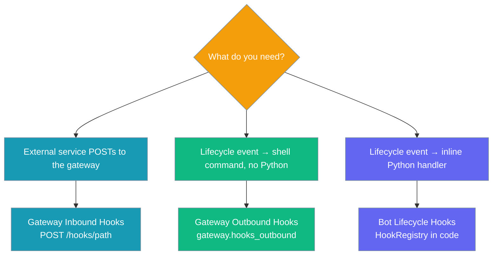
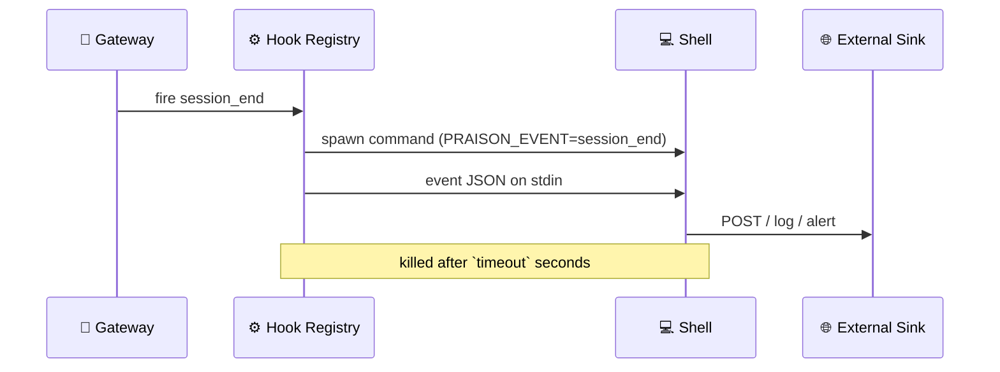

Outbound hooks send your agent's lifecycle events, such as `session_end` or `gateway_stop`, to any shell command. You configure them in YAML and write no Python.

```yaml
gateway:
  hooks_outbound:
    - command: /opt/praisonai/hooks/notify.sh
      events: [session_end, message_undelivered, job_completed, gateway_stop]
```

When one of these events fires, the gateway runs `notify.sh`. The script gets the event as JSON on stdin and the event name in `PRAISON_EVENT`.


## Quick Start

<Steps>
<Step title="Add a shell sink to gateway.yaml">
Append each ended session to a local log file.

```yaml
gateway:
  hooks_outbound:
    - command: "cat >> /tmp/praisonai-events.jsonl; echo >> /tmp/praisonai-events.jsonl"
      events: [session_end]
```

```bash
praisonai gateway start --config gateway.yaml
# When a user runs /new: one JSON line is appended to /tmp/praisonai-events.jsonl
```
</Step>

<Step title="Forward multiple events at once">
A single entry can listen to several events. Use `PRAISON_EVENT` in your script to tell them apart.

```yaml
gateway:
  hooks_outbound:
    - command: /opt/praisonai/hooks/notify.sh
      events: [session_end, message_undelivered, job_completed, gateway_stop]
      timeout: 10
```
</Step>

<Step title="HTTP sink without a script">
You can put `curl` straight into `command` to POST the event JSON from stdin.

```yaml
gateway:
  hooks_outbound:
    - command: >
        curl -sf -X POST
        -H 'Content-Type: application/json'
        --data-binary @-
        https://ops.example.com/events
      events: [gateway_stop, message_undelivered]
      timeout: 10
```
</Step>
</Steps>

---

## Which Hook Surface Should I Use?

PraisonAI has three hook surfaces. Pick the one that matches the direction of the event and how you want to handle it.



---

## How It Works

Each entry registers a command hook on the default hook registry, which is the same registry the agents use to fire lifecycle events.



| Option | Type | Default | What it does |
|---|---|---|---|
| `command` | `str` (required) | — | Shell command run once for each matching event. Pipes, `exec`, and env expansion all work. |
| `events` | `list[str]` (required, at least 1) | — | Events to forward. Each name is checked against `HookEvent` when the config loads. |
| `timeout` | `float` (> 0) | `30.0` | Number of seconds the command may run before it is killed. |

<Note>
Unknown keys are rejected when the config loads, so a typo like `timout` produces an error instead of being silently ignored. A misspelled event name such as `sesion_end` is also rejected (`Unknown hook event(s): sesion_end`). If an entry is invalid at runtime, the gateway logs a warning and skips only that entry.
</Note>

---

## Supported Events

You can list any `HookEvent` value in `events`. The table shows the lifecycle events that are most useful to forward.

| Event | When it fires | Key payload fields |
|---|---|---|
| `session_start` | A user sends their first message in a session | `session_id`, `agent_name` |
| `session_end` | A session is cleared (`/new`), reaped as stale, or reset by policy | `session_id`, `agent_name`, `reason` |
| `message_undelivered` | A reply failed permanently (the target is dead or retries ran out) | `platform`, `content`, `channel_id`, `error` |
| `job_completed` | A background job finished, whether it succeeded or failed | `job_id`, `status`, `result`, `error` |
| `schedule_trigger` | A scheduled job runs | job metadata |
| `gateway_stop` | The gateway shuts down gracefully | `platforms`, `bot_count`, `reason` |

<Warning>
`message_undelivered` only fires when `gateway.notify_on_undelivered: true` is set. See [Undelivered-Message Notice](/features/gateway-undelivered-notice).
</Warning>

For every event and its full input fields, see [Hook Events](/features/hook-events).

---

## What the Command Receives

The event is written to the command's stdin as a single line of JSON. Every payload has the same base fields (`session_id`, `cwd`, `event_name`, `timestamp`, `agent_name`), followed by the fields specific to that event.

```json
{"session_id": "s1", "cwd": "/srv", "event_name": "session_end", "timestamp": "1730285461.1", "agent_name": "bot", "reason": "clear", "total_turns": 4, "total_tokens": 812}
```

The command also gets these environment variables:

| Variable | Value |
|---|---|
| `PRAISON_EVENT` | Name of the event, such as `session_end` |
| `PRAISON_PROJECT_DIR` | Working directory of the hook runner |

### Signed HTTP sink

To sign requests, wrap the call in a short script that computes an HMAC with `openssl` and sends it as a header.

```bash
#!/usr/bin/env bash
# /opt/praisonai/hooks/signed-post.sh
body=$(cat)
sig=$(printf '%s' "$body" | openssl dgst -sha256 -hmac "$SINK_SECRET" | awk '{print $2}')
curl -sf -X POST -H 'Content-Type: application/json' \
  -H "X-Signature: sha256=$sig" -H "X-Event: $PRAISON_EVENT" \
  --data-binary "$body" https://ops.example.com/events
```

```yaml
gateway:
  hooks_outbound:
    - command: /opt/praisonai/hooks/signed-post.sh
      events: [message_undelivered, gateway_stop]
      timeout: 5
```

---

## User Interaction Flow

Here is one complete example: a user blocks your bot, and on-call finds out within seconds.

1. Your Telegram bot has been running for a week. A user messages it and the agent writes a reply.
2. The user has blocked the bot, so Telegram rejects the reply. Retries run out and the gateway fires `message_undelivered`.
3. Your `hooks_outbound` entry passes the event JSON to a three-line bash script that posts to Slack `#ops`: *"User 12345 blocked the bot"*.
4. On-call sees the alert about 2 seconds later, without anyone writing Python.

---

## Reload-Safe

When the config reloads, the gateway first removes the outbound hooks it registered earlier and then applies the new config. Deleted entries and changed endpoints take effect without a restart. See [Gateway Hot-Reload](/features/gateway-hot-reload).

## Safe Mode

`PRAISONAI_NO_PLUGINS=1` turns off outbound hook registration, the same as it does for inbound hooks. The gateway logs `SAFE MODE: N outbound hook(s) disabled (PRAISONAI_NO_PLUGINS)`. See [Gateway Safe Mode](/features/gateway-safe-mode).

## Shutdown Behaviour

`gateway_stop` hooks fire during graceful shutdown, including SIGINT and SIGTERM. When a shutdown watchdog is set, the hook must finish within the remaining drain and grace budget, so a slow sink cannot delay the exit. A child process whose hook is cancelled is killed rather than left running. After shutdown, the outbound hooks are unregistered.

---

## Common Patterns

- **Ops notifier**: post to a Slack or Teams webhook on `gateway_stop`.
- **Dead-letter alert**: send `message_undelivered` to a PagerDuty incident.
- **Metrics ingest**: send `session_end` (`total_turns`, `total_tokens`) to statsd or a Prometheus pushgateway.
- **Audit log**: append every event to `/var/log/praisonai/events.jsonl`.

## Best Practices

<AccordionGroup>
<Accordion title="Keep the command fast">
The default timeout is 30s. Most sinks should use `timeout: 5` or less. A slow sink only delays its own hook, but a `gateway_stop` sink runs as part of shutdown.
</Accordion>

<Accordion title="Sign your HTTP sink">
Anything else on the network can send a plain `curl` POST, so the receiver cannot trust it. Add an HMAC signature header with a small wrapper script, as shown in [Signed HTTP sink](#signed-http-sink).
</Accordion>

<Accordion title="Pick events narrowly">
List only the events you need to forward. Each matching event starts a new process.
</Accordion>

<Accordion title="Handle deduplication in the sink">
There are no built-in retries or dedup. If your downstream system must deduplicate, build its dedup key from the event's `timestamp` plus a stable id such as `session_id` or `job_id`.
</Accordion>
</AccordionGroup>

## Related

<CardGroup cols={2}>
<Card title="Gateway Inbound Hooks" icon="webhook" href="/features/gateway-inbound-hooks">
  POST /hooks/&lt;path&gt;: the inbound HTTP trigger counterpart
</Card>
<Card title="Bot Lifecycle Hooks" icon="webhook" href="/features/bot-lifecycle-hooks">
  In-process Python hooks on the same events, for when YAML isn't enough
</Card>
<Card title="Hook Events" icon="list" href="/features/hook-events">
  Full HookEvent reference with every input type's fields
</Card>
<Card title="Gateway Safe Mode" icon="shield" href="/features/gateway-safe-mode">
  How PRAISONAI_NO_PLUGINS suppresses outbound hooks
</Card>
<Card title="Gateway Hot-Reload" icon="rotate" href="/features/gateway-hot-reload">
  How outbound hook changes take effect without a restart
</Card>
<Card title="Undelivered-Message Notice" icon="bell" href="/features/gateway-undelivered-notice">
  Enable message_undelivered so it can be forwarded
</Card>
</CardGroup>
