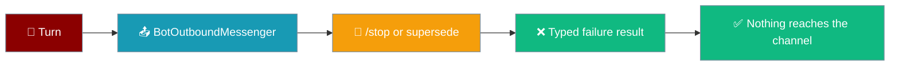
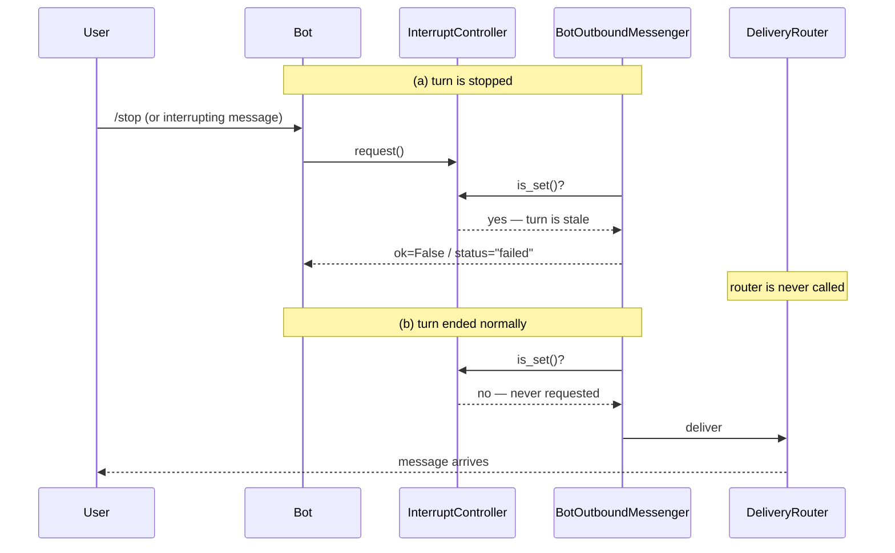

A stopped or superseded turn can no longer send, react, open a thread, edit or delete — the effect is dropped fail-closed with the detail `turn no longer live (stopped or superseded)`.



## Quick Start

<Steps>
<Step title="Run a bot with interrupt mode">
Set `busy_mode="interrupt"` and give the agent the `send_message` tool — the outbound liveness binding is automatic. No extra config.

```python
from praisonaiagents import Agent
from praisonaiagents.tools import send_message
from praisonai.bots import TelegramBot

agent = Agent(
    name="Reporter",
    instructions="Post progress updates with send_message.",
    tools=[send_message],
)

bot = TelegramBot(
    token="YOUR_TOKEN",
    agent=agent,
    busy_mode="interrupt",       # outbound turn-liveness wired automatically
)

import asyncio
asyncio.run(bot.start())
```
</Step>

<Step title="Scenario — /stop drops an in-flight outbound effect">
Send `/stop` while the agent is about to post a late reply. The send never reaches the chat; the tool call returns a fail-closed result instead.

```
User: build the weekly report and post it here
User: /stop
Bot:  ✅ Current task cancelled. Send a new message to start fresh.

# the stopped turn's late send_message("origin", ...) returns:
Not sent to origin: turn no longer live (stopped or superseded).
```
</Step>

<Step title="Scenario — mid-send attachment upload halts">
Send `/stop` while a 3-image upload is partway through. Files already uploaded stay; the remaining ones are skipped.

```
User: post the three charts here
Bot:  [chart 1 uploaded]
User: /stop

# the send result:
summary: Sent to telegram:123 (1 attachment(s) delivered, 2 skipped).
detail:  Stopped: 2 attachment(s) not sent, turn no longer live (stopped or superseded).
```
</Step>
</Steps>

---

## How It Works

Each turn's `BotOutboundMessenger` is bound to that turn's `InterruptController`. Every outbound verb checks the controller **before** touching the router.



| Verb | Typed failure when the turn is stale |
|------|--------------------------------------|
| `send` | `DeliveryResult(ok=False, summary="Not sent to <target>: turn no longer live (stopped or superseded).", detail=...)` |
| `react` | `ReactionResult(status="failed", detail=...)` |
| `create_thread` | `ThreadResult(status="failed", detail=...)` |
| `edit` | `MessageActionResult(status="failed", detail=...)` |
| `delete` | `MessageActionResult(status="failed", detail=...)` |

Every `detail` is the same string: `turn no longer live (stopped or superseded)`.

---

## What Triggers the Drop

| Trigger | Drops outbound effects? |
|---------|-------------------------|
| `/stop` command | ✅ Yes |
| Superseding message with `busy_mode="interrupt"` | ✅ Yes |
| Mid-run message with `busy_mode="steer"` | ❌ No — the same turn stays live |
| Mid-run message with `busy_mode="queue"` | ❌ No — the running turn is preserved |
| Turn completed normally | ❌ No — background workers keep delivering |

---

## Backward Compatibility

<Note>
No new user-facing config. The binding is automatic whenever a bot runs a turn with an `InterruptController` (any bot using `busy_mode`). Without a controller the messenger is unbound and behaves exactly as before. Code that constructs `BotOutboundMessenger` without `liveness=` is unchanged, and nothing in the gateway YAML schema moves.
</Note>

---

## Failure Semantics

<AccordionGroup>
<Accordion title="Raising probe is treated as live">
If the liveness check itself raises, the messenger treats the turn as live and delivers. A buggy probe can never wedge delivery — it fails open on the *probe*, never on the effect. This is the same rule as `ApprovalRegistry._reject_if_stale` on the approval path.
</Accordion>

<Accordion title="Mid-send attachment uploads re-check liveness">
`/stop` only sets a flag — it does not cancel the running send coroutine. So liveness is re-checked before **every** attachment upload, and the remaining files are counted as skipped once the turn goes stale.
</Accordion>

<Accordion title="Retained handles from a cancelled turn stay fail-closed forever">
The messenger reads the turn's controller flag, which `/stop` set and nothing clears. Any code still holding that turn's messenger can never deliver through it again.
</Accordion>

<Accordion title="Background workers after a normally-completed turn still deliver">
A turn that finishes normally never sets its controller flag. Background workers that kept a messenger reference — such as `deliver`-backed subagents — keep delivering after the turn ends.
</Accordion>

<Accordion title="Self-scheduling is unaffected">
Scheduler jobs are meant to outlive the turn that created them and already have principal scoping. They are **not** bound to turn liveness.
</Accordion>
</AccordionGroup>

---

## Best Practices

<AccordionGroup>
<Accordion title="Prefer busy_mode='interrupt' for the strongest benefit">
Turn liveness matters most when the latest message should win. In `busy_mode="interrupt"`, a superseding message (or `/stop`) drops the abandoned turn's outbound effects so a late reply never lands after the user moved on.
</Accordion>

<Accordion title="Custom integrators using BotSessionManager directly">
The binding wires itself when `agent.interrupt_controller` is an `InterruptController` at the time the turn's messenger is created:

```python
from praisonaiagents.agent.interrupt import InterruptController

agent.interrupt_controller = InterruptController()
# ... run the turn via BotSessionManager.chat(...)
agent.interrupt_controller.request("user_stop_command")  # outbound effects now fail closed
```

Without a controller, the messenger stays unbound.
</Accordion>

<Accordion title="Verifying locally">
Run a `send_message` tool call under a turn, issue `/stop` from another message, and check the returned `DeliveryResult`:

- `ok` is `False`
- `detail` is `"turn no longer live (stopped or superseded)"`
</Accordion>
</AccordionGroup>

---

## Related

<CardGroup cols={2}>
<Card title="Bot Run Control" icon="octagon-pause" href="/features/bot-run-control">
  The `busy_mode` + `/stop` side that fires the cancel
</Card>
<Card title="Approval Turn Liveness" icon="hourglass-end" href="/features/gateway-approval-turn-liveness">
  The sibling guarantee on the approval path
</Card>
<Card title="Send Message Tool" icon="paper-plane" href="/features/send-message-tool">
  The agent-callable tool that goes through this messenger
</Card>
<Card title="Send Policy" icon="shield" href="/features/send-policy">
  The destination guard that runs before this check
</Card>
<Card title="Outbound Media Delivery" icon="image" href="/features/outbound-media-delivery">
  The attachment path with the per-upload re-check
</Card>
<Card title="Turn Protection Window" icon="shield-halved" href="/features/turn-protection-window">
  Why `busy_mode="interrupt"` queues during subagents and compaction
</Card>
</CardGroup>
