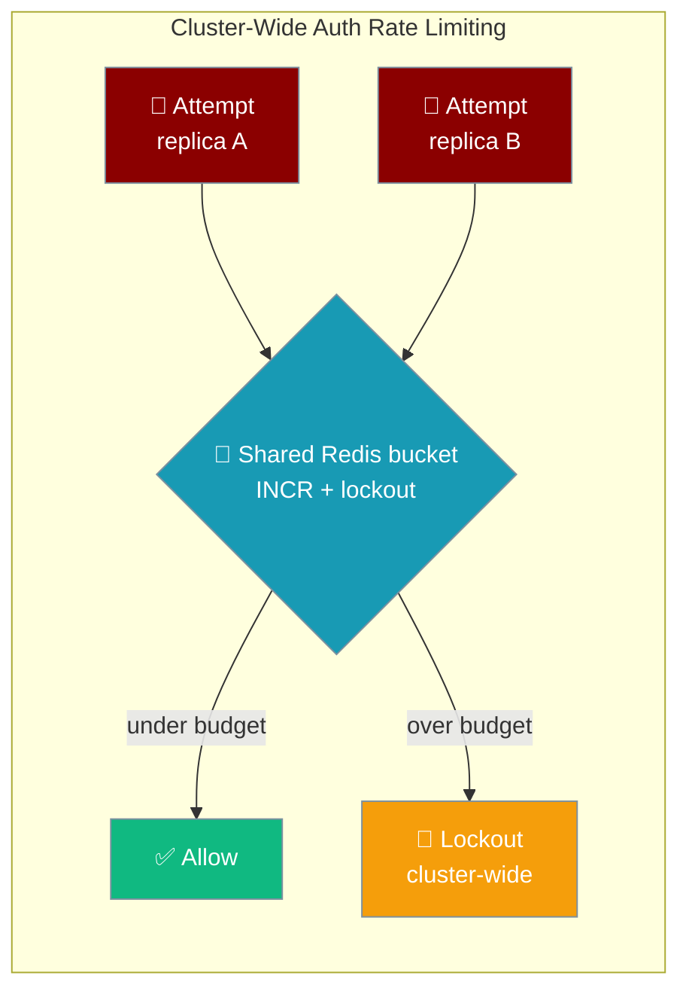
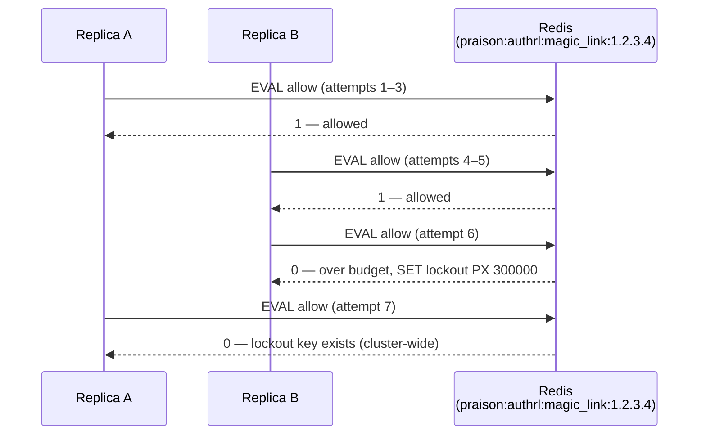
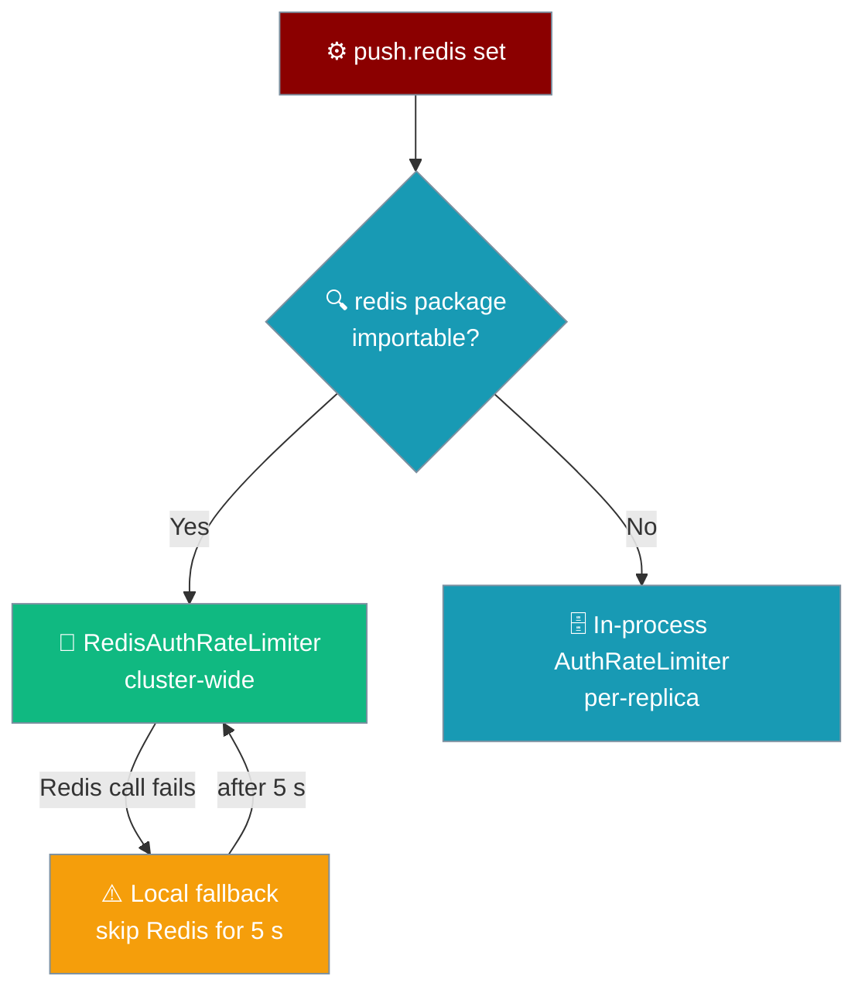

Set `gateway.push.redis` and every replica of your gateway shares one brute-force budget, so `max_attempts` on login and approval is a cluster-wide total — not a per-replica one.



## Quick Start

<Steps>
<Step title="Single replica — nothing to do">

One gateway process already enforces the limits correctly with the in-process `AuthRateLimiter`.

```python
from praisonaiagents import Agent
from praisonai_bot.gateway import WebSocketGateway

agent = Agent(name="Support", instructions="Help users")
WebSocketGateway(agent=agent).start()   # in-process auth limits
```

</Step>

<Step title="Multiple replicas — set gateway.push.redis">

The auth limiters pick up the gateway's push Redis automatically. There is no extra knob.

```yaml
gateway:
  push:
    redis:
      url: redis://localhost:6379   # reused for auth rate limiting
```

</Step>

<Step title="Or wire it in Python">

Pass the same `push.redis` block where you construct the gateway.

```python
from praisonaiagents import Agent
from praisonai_bot.gateway import WebSocketGateway

agent = Agent(name="Support", instructions="Help users")

gateway = WebSocketGateway(
    agent=agent,
    config={"push": {"redis": {"url": "redis://localhost:6379"}}},
)
gateway.start()
```

</Step>
</Steps>

<Note>
On a 3-replica gateway, the magic-link budget of 5 attempts is now 5 in total. Without Redis it is roughly 15 — 5 per replica.
</Note>

---

## How It Works

Every attempt runs one atomic Lua script on Redis: check the lockout key, `INCR` the bucket, set its window TTL, and set a lockout once the budget is exceeded. All replicas hit the same keys, so counts never race.



### Covered endpoints

| Limiter | Budget | What it protects |
|---------|--------|------------------|
| `_approval_rate` | 10 / 60 s window / 300 s lockout | Approval and pairing HTTP routes |
| `_ws_upgrade_rate` | 10 / 60 s window / 300 s lockout | WebSocket upgrade auth |
| `_magic_rate` | 5 / 60 s window / 300 s lockout | Magic-link login |

Keys are namespaced as `{prefix}authrl:{endpoint}:{identity}:b` (bucket) and `{prefix}authrl:{endpoint}:{identity}:l` (lockout). Both expire via Redis TTLs, so nothing needs pruning.

---

## Redis Outage Behaviour

The limiter **never fails open**. If Redis is unreachable it falls back to a local per-replica limiter, so per-replica limits still apply.



| Situation | Behaviour |
|-----------|-----------|
| `push.redis` unset | In-process `AuthRateLimiter`, exactly as before |
| `redis` package missing or client construction fails | Logs `gateway.push.redis set but Redis auth rate limiter unavailable (…); auth limits are per-process only. Install with: pip install redis` and uses the in-process limiter |
| Redis call fails at runtime | Logs `Redis auth rate limiter unavailable, using local: …`, uses the local limiter, and skips Redis for 5 s so an outage can't stall the event loop on every request |
| Lockout earned locally during an outage | Checked before every call, so it **outlives Redis recovery** |
| Unreachable Redis host | Client uses `socket_timeout=0.5` and `socket_connect_timeout=0.5`, so a call never blocks long |

---

## Configuration Options

The limiter reuses the gateway's push `RedisConfig` — no separate auth-limiter Redis knob.

| Option | Where | Purpose |
|--------|-------|---------|
| `url` | `push.redis.url` | Redis connection URL, reused by the auth limiter |
| `host` / `port` / `db` / `password` | `push.redis.*` | Field-wise connection when no `url` is given |
| `prefix` | `push.redis.prefix` | Namespaces keys as `{prefix}authrl:{endpoint}:{identity}:{b\|l}` (default `praison:`) so environments sharing one Redis do not collide |

<Note>
**Deliberately out of scope** — these stay per-replica by design:

- `UnauthorizedFloodGuard` — per-connection; a connection only lives on one replica.
- `PreauthConnectionBudget` — guards each replica's own socket resources.
- `PairingStore`'s in-chat lockout — built in many bot constructors without gateway config; gateway pairing HTTP routes are already covered through `_approval_rate`.
</Note>

<Warning>
This is not the agent-level `rate_limiter` on `ExecutionConfig`. That one paces LLM requests — see [Rate Limiter](/features/rate-limiter). This page covers brute-force protection on gateway auth endpoints.
</Warning>

---

## Best Practices

<AccordionGroup>
<Accordion title="Enable it with the turn lock and idempotency">
On a multi-replica gateway, the same `push.redis` block also backs the turn lock and the idempotency store. Configure all three together so every piece of shared state is cluster-wide.
</Accordion>

<Accordion title="Reuse the gateway's push RedisConfig">
The auth limiter auto-shares `push.redis`. Configure Redis once; do not duplicate the connection.
</Accordion>

<Accordion title="Remember local lockouts outlive outages">
A lockout earned against the local fallback stays in force after Redis comes back, so a locked-out IP stays locked out until its local lockout expires.
</Accordion>

<Accordion title="Grep for the unavailable log line">
If you installed without the `redis` package, the gateway still boots but logs `gateway.push.redis set but Redis auth rate limiter unavailable`. Install it with `pip install redis` to get cluster-wide limits.
</Accordion>
</AccordionGroup>

---

## Related

<CardGroup cols={2}>
<Card title="Gateway Turn Lock" icon="lock" href="/features/gateway-turn-lock">
  Sibling shared state — a distributed lease that serialises a session's turns.
</Card>
<Card title="Cross-Replica Idempotency" icon="shield-check" href="/features/gateway-redis-idempotency">
  Sibling shared state — exactly-once webhook admission on the same Redis.
</Card>
<Card title="Redis Pub/Sub Resilience" icon="heart-pulse" href="/features/gateway-redis-pubsub-resilience">
  Same Redis — reconnect and outage surfacing for cross-instance delivery.
</Card>
<Card title="Gateway Edge Protections" icon="shield-halved" href="/features/gateway-edge-protections">
  The per-replica guards that stay in-process by design.
</Card>
</CardGroup>
