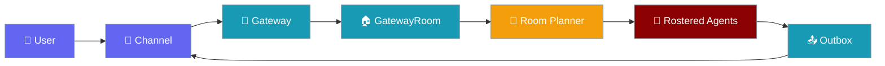
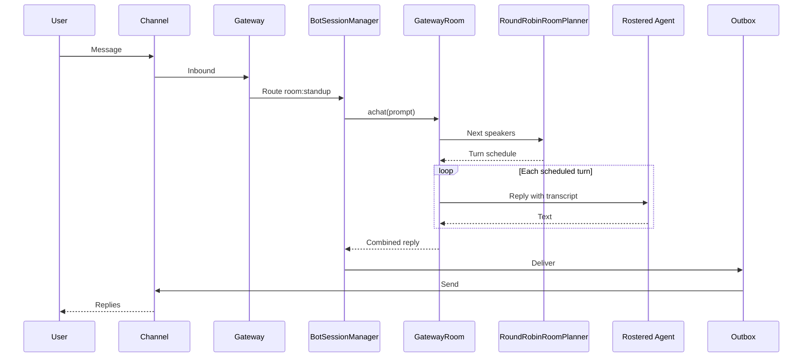
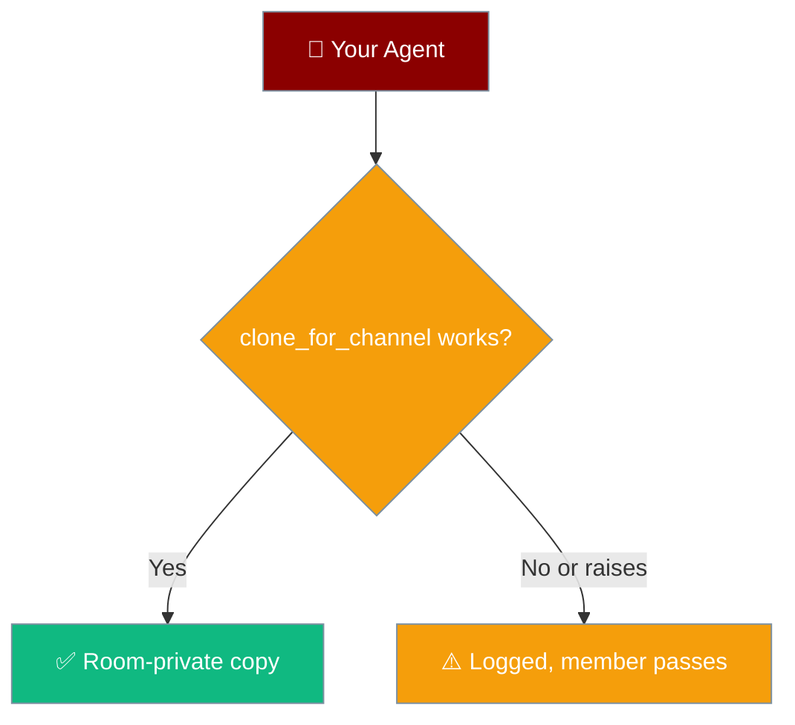
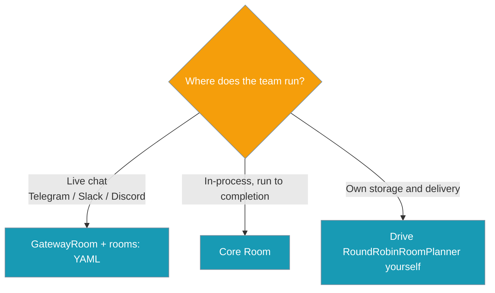

A gateway room puts a roster of agents into one live chat, where they take bounded, `@`-addressed turns and reply as a single assistant message.



## Quick Start

<Steps>

<Step title="Simplest: Python on one platform">

```python
from praisonai_bot.bots import Bot, GatewayRoom
from praisonaiagents import Agent
from praisonaiagents.rooms import RoomConfig

researcher = Agent(name="researcher", instructions="Research the topic.")
critic = Agent(name="critic", instructions="Critique proposals.")

room = GatewayRoom(
    RoomConfig(name="standup", roster=["researcher", "critic"]),
    {"researcher": researcher, "critic": critic},
)

Bot("telegram", agent=room).start()
```

</Step>

<Step title="With YAML">

Declare the room under `rooms:` and bind it with a `room:<name>` route.

```yaml
agents:
  researcher:
    instructions: Research the topic.
  critic:
    instructions: Critique proposals.
  writer:
    instructions: Write the final summary.

rooms:
  standup:
    agents: [researcher, critic, writer]
    max_rounds: 3
    max_messages: 20

channels:
  telegram:
    token: ${TELEGRAM_BOT_TOKEN}
    routes:
      group: room:standup
```

</Step>

<Step title="Several platforms at once">

```python
from praisonai_bot.bots import BotOS, GatewayRoom
from praisonaiagents import Agent
from praisonaiagents.rooms import RoomConfig

researcher = Agent(name="researcher", instructions="Research the topic.")
critic = Agent(name="critic", instructions="Critique proposals.")

room = GatewayRoom(
    RoomConfig(name="standup", roster=["researcher", "critic"]),
    {"researcher": researcher, "critic": critic},
)

BotOS(agent=room, platforms=["telegram", "slack"]).start()
```

</Step>

</Steps>

---

## User Interaction Flow

1. A user posts a message in a group chat.
2. The gateway resolves the route `room:standup` and calls `GatewayRoom.achat(prompt)`.
3. Every rostered agent speaks in round 0; later turns go to whoever is `@`-mentioned.
4. The combined reply (`**researcher**: …` then `**critic**: …`) returns through the outbox.
5. The group sees one assistant turn.
6. After a restart, the next message resumes the same schedule from the saved transcript.

---

## How a Gateway Room Runs



| Piece | Role |
|-------|------|
| `GatewayRoom` | Looks like one agent (`chat`, `achat`, `start`, `astart`, `chat_history`, `tools`) |
| Core `Room` | Runs the planner and collects turns |
| `BotSessionManager` | Saves and restores the transcript per user/chat |
| Outbox | Delivers the combined reply like any agent reply |

---

## Configuration Options

Each `rooms.<name>` YAML entry is one `RoomConfig`.

| Option | Type | Default | Description |
|--------|------|---------|-------------|
| `agents` (or `roster`) | `List[str]` | — (required) | Ordered agent ids that take turns |
| `max_rounds` | `int` | `3` | Hard cap on turn-taking rounds (`>= 1`) |
| `max_messages` | `int` | `20` | Hard cap on messages per human message (`>= 1`) |
| `planner` | `str` | `"round_robin"` | Only `"round_robin"` is valid |

<Note>
The top-level key is `rooms:` (plural). A room that cannot be built is rejected when the config loads, with an error like `rooms.standup: …`.
</Note>

<CardGroup cols={2}>
<Card title="Rooms SDK Reference" icon="code" href="/docs/sdk/reference/praisonaiagents/modules/rooms">
  Full `RoomConfig` surface.
</Card>
<Card title="Conversation Rooms" icon="users" href="/features/conversation-rooms">
  The core, in-memory `Room`.
</Card>
</CardGroup>

---

## Durable Transcript

The transcript lives in `GatewayRoom.chat_history`, so a restart loses nothing.


- `BotSessionManager` swaps the transcript in per user/chat and saves it to the configured session store.
- Member replies are stored as `{"role": "assistant", "content": "<id>: <text>"}`, because session stores keep only `role` and `content`.
- Ids containing `": "` still reload intact, since the longest id is matched first.
- The session's per-agent lock keeps one writer per room.

---

## Member Isolation

Each agent is cloned with `clone_for_channel()` when it joins a room, so history and tools never leak between rooms or routes.



The room swaps each member's `chat_history` and `tools` per turn, so a shared instance would corrupt other routes.

---

## Choosing a Surface



---

## Common Patterns

<AccordionGroup>

<Accordion title="Different rooms on different channels">

```yaml
routes:
  group: room:standup
  dm: support
```

A room is routed exactly like an agent id.

</Accordion>

<Accordion title="Missing roster member">

`build_rooms` logs `roster ids [...] are not defined under 'agents:' and will pass`, and the gateway keeps running.

</Accordion>

<Accordion title="Bad room config">

A bad roster is rejected at load time as `rooms.<name>: <reason>`, before any traffic arrives.

</Accordion>

<Accordion title="Narrow tools per route">

A route `tool_policy` narrows the room's `tools` (the union of its members' tools) for one turn, then restores them.

</Accordion>

<Accordion title="Attachments and cancel">

`attachments` go to each member whose `chat` / `achat` accepts them. A set `cancel_token` stops the roster between turns by raising `InterruptedError`.

</Accordion>

</AccordionGroup>

---

## Best Practices

<AccordionGroup>

<Accordion title="Keep the caps low">
The defaults (`max_rounds: 3`, `max_messages: 20`) already bound cost per human message. Raise them only when needed.
</Accordion>

<Accordion title="Use agents that can be cloned">
Members without `clone_for_channel()` pass instead of sharing state, so they never speak.
</Accordion>

<Accordion title="Avoid ': ' in agent ids">
Reload handles it, but plain ids keep the transcript readable.
</Accordion>

<Accordion title="Order the roster on purpose">
Round-0 fan-out and multi-mention turns both follow roster order.
</Accordion>

<Accordion title="Pair with a turn lock across replicas">
Use [Gateway Turn Lock](/features/gateway-turn-lock) when several gateway replicas serve the same chat.
</Accordion>

</AccordionGroup>

---

## Related

<CardGroup cols={2}>

<Card title="Conversation Rooms" icon="users" href="/features/conversation-rooms">
  The core, in-memory room.
</Card>

<Card title="Bot Gateway" icon="plug" href="/features/bot-gateway">
  Channels, agents, and routes.
</Card>

<Card title="Rooms SDK Reference" icon="code" href="/docs/sdk/reference/praisonaiagents/modules/rooms">
  Full `Room` and `RoomConfig` API.
</Card>

<Card title="Gateway Turn Lock" icon="lock" href="/features/gateway-turn-lock">
  Serialise per-session turns across replicas.
</Card>

</CardGroup>
