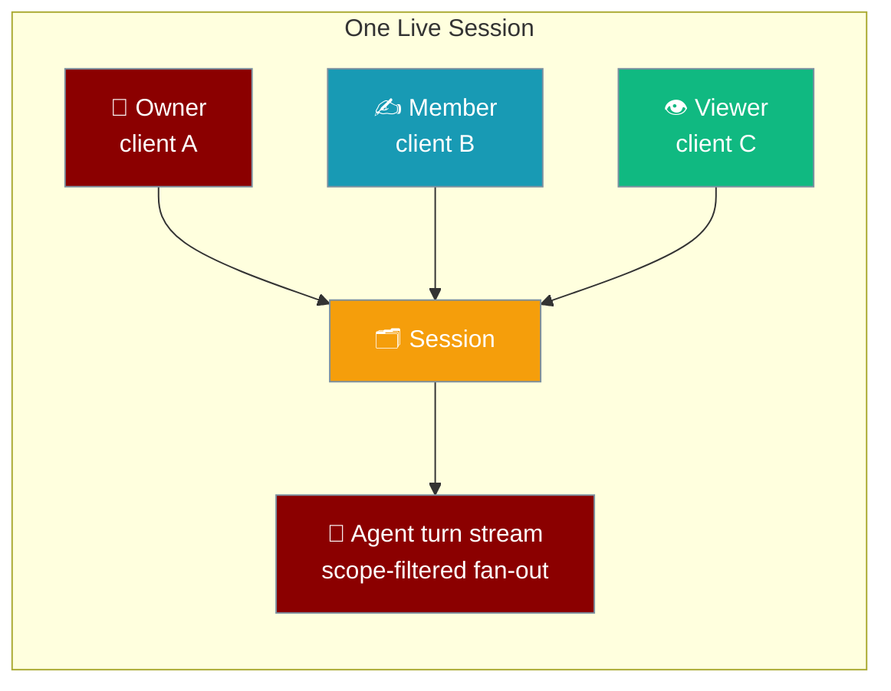
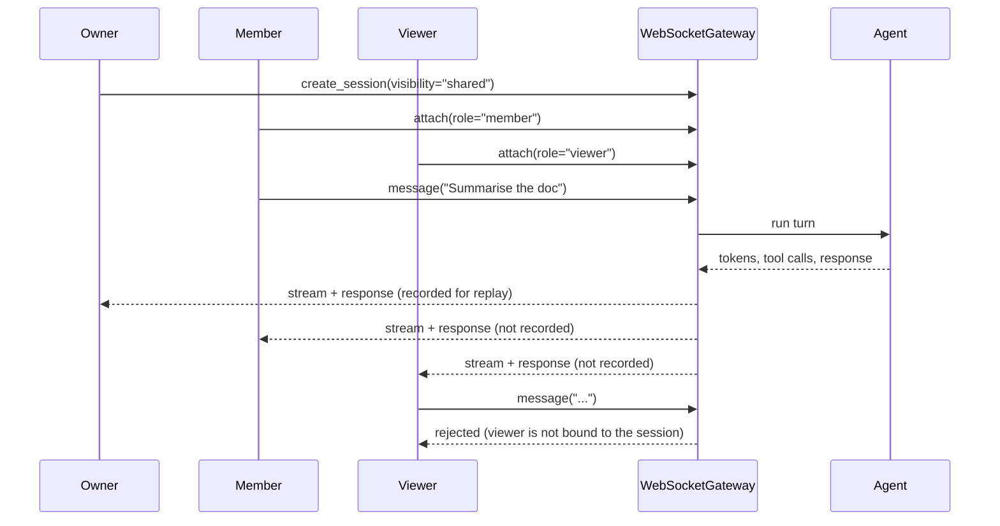
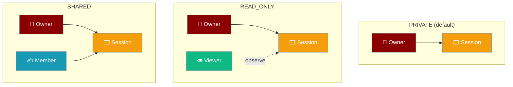
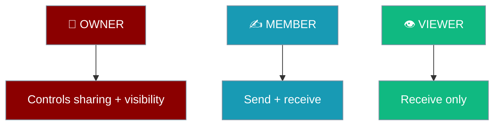
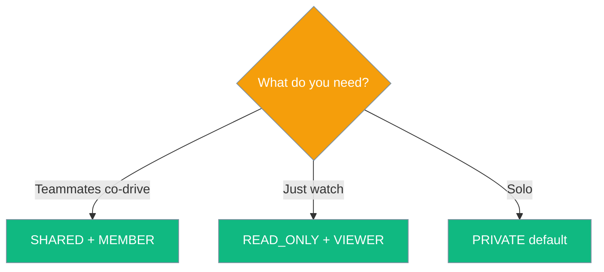
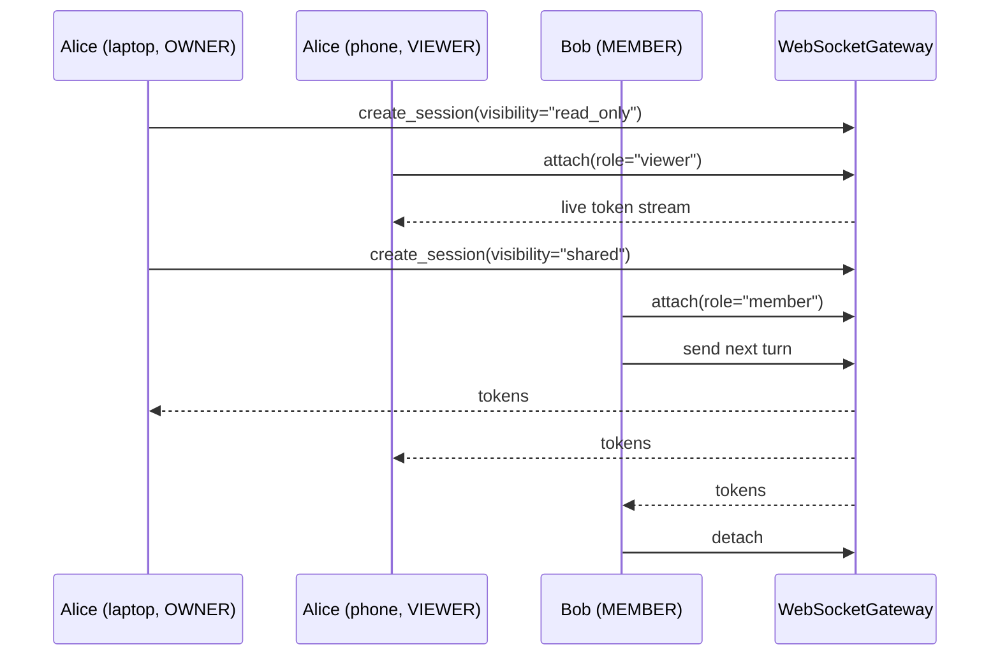

Session sharing lets more than one authorised client attach to the same live Gateway session — watching an agent work a task together, or opening the same conversation on desktop and mobile.

```python
from praisonaiagents import Agent
from praisonai_bot.gateway import WebSocketGateway

agent = Agent(name="assistant", instructions="Be helpful.")
gateway = WebSocketGateway()
gateway.register_agent(agent, agent_id="assistant")

# Open the session as shared — a teammate can now attach and co-drive.
session = gateway.create_session("assistant", client_id="alice", visibility="shared")

# A second authorised client attaches as a member and co-drives through
# the normal message path (still gated by the ``write`` scope).
gateway.attach(session.session_id, "bob", role="member")
```



`WebSocketGateway` enforces the fan-out, and each observer's `OperatorScope` decides which events it receives.

## Quick Start

<Steps>
<Step title="Default — private, 1:1 (nothing to configure)">

Today's behaviour is unchanged. A session is `private` and stays bound to its single owner.

```python
from praisonai_bot.gateway import WebSocketGateway

gateway = WebSocketGateway()
session = gateway.create_session("assistant", client_id="alice")

print(session.to_dict()["visibility"])  # "private"

try:
    gateway.attach(session.session_id, "bob")
except PermissionError as e:
    print(e)  # Session <id> is private
```

</Step>

<Step title="Share a session read-only">

Set `read_only` so an extra client may attach as a `viewer` to watch the stream, but not send.

```python
from praisonai_bot.gateway import WebSocketGateway

gateway = WebSocketGateway()
sid = gateway.create_session("assistant", client_id="alice", visibility="read_only").session_id

gateway.attach(sid, "bob", role="viewer")

try:
    gateway.attach(sid, "ann", role="member")
except PermissionError as e:
    print(e)  # Session <id> is read-only; attach as viewer
```

</Step>

<Step title="Share a session for co-driving">

Set `shared` so an extra client may attach as a `member` and send turns alongside the owner.

```python
from praisonai_bot.gateway import WebSocketGateway

gateway = WebSocketGateway()
sid = gateway.create_session("assistant", client_id="alice", visibility="shared").session_id

gateway.attach(sid, "ann", role="member")
gateway.attach(sid, "bob", role="viewer")

print(gateway.observers(sid))
# [('alice', OWNER), ('ann', MEMBER), ('bob', VIEWER)]
```

</Step>
</Steps>

<Note>
Sharing is **additive**. A session with no `visibility` stays `private` with a single owner — everything that worked before still works.
</Note>

---

## How It Works

A member drives a turn, and the stream reaches the owner and every scoped observer — but only the owner's copy is recorded for replay.



1. The owner creates the session — it is `private` unless `visibility` says otherwise.
2. Other clients `attach` as `member` or `viewer`, as the visibility allows.
3. A `member` is bound to the session, so its `message` frames co-drive it. A `viewer` is never bound, so it can never send.
4. Every stream event and the final `response` fan out to the owner plus each connected observer whose scope allows it.

---

## Visibility

Visibility decides *whether* a second authorised client may attach on top of scope authorisation.



## Roles

A role decides what an attached client may do inside a shared session.



## Which visibility should I pick?



---

## Visibility Enforcement (Dynamic Changes)

Call `create_session` again with the same `session_id` to change visibility on a live session — the gateway revokes any access the new setting no longer allows.

```python
from praisonai_bot.gateway import WebSocketGateway

gateway = WebSocketGateway()

# Start shared with a member and a viewer
gateway.create_session("assistant", client_id="alice", session_id="s1", visibility="shared")
gateway.attach("s1", "ann", role="member")
gateway.attach("s1", "bob", role="viewer")

# Tighten to read-only — ann is demoted to viewer and can no longer send
gateway.create_session("assistant", client_id="alice", session_id="s1", visibility="read_only")
print(gateway.observers("s1"))
# [('alice', OWNER), ('ann', VIEWER), ('bob', VIEWER)]

# Tighten to private — every observer is dropped
gateway.create_session("assistant", client_id="alice", session_id="s1", visibility="private")
print(gateway.observers("s1"))
# [('alice', OWNER)]
```

| New visibility | Effect on attached observers |
|---|---|
| `private` | Every observer is dropped and unbound. |
| `read_only` | Every `member` is demoted to `viewer` and unbound; existing viewers are unaffected. |
| `shared` | Nothing is revoked — relaxing is always safe. |

---

## Fan-out and Scopes

Visibility and role layer **on top of** `OperatorScope` — they are not authorisation.

- Streaming events (tokens, tool calls, tool results) and the final `response` frame fan out to the owner plus every attached observer whose `OperatorScope` allows that event.
- An observer without `READ` receives nothing, whatever its role.
- A `member` still needs `WRITE` to send a `message` frame — attaching alone does not grant it.
- The owner always receives its own session's stream, even when a `member` drives the turn.
- Only the owner's copy is written to the session's replay buffer — observer copies are never recorded a second time.

<Card title="Gateway Operator Scopes" icon="shield-check" href="/features/gateway-operator-scopes">
  Role-based access control that visibility and roles build on top of
</Card>

---

## Owner Leaving vs. Observer Leaving

An observer leaving only detaches it — the owner's session stays open and the roster shrinks. This holds for every exit path: a `leave` frame, disconnect, the idle reaper, slow-consumer eviction, and credential rotation.

The owner leaving closes the session (persisted for resumption) and drops the whole observer roster. On a `leave` frame only the owner gets a `{"type": "left", ...}` reply; an observer's `leave` just detaches it.

---

## Observers Cannot Rebind as Owner

A client attached as an observer cannot take over the session by sending `hello` or `join` with that session's id.

```python
# bob is attached to "s1" as a viewer and sends:
{"type": "join", "agent_id": "assistant", "session_id": "s1"}

# The gateway replies:
{"type": "error", "code": "unauthorized", "message": "Attached observers cannot take over the session"}
```

On `hello` the gateway sends a `HelloError` with `code=AUTH_UNAUTHORIZED`, `next_step=DO_NOT_RETRY` and `next_action="start_new_session"`.

---

## Rules & Errors

| Call | Condition | Result |
|---|---|---|
| `attach(sid, cid, role)` | unknown `sid` | `KeyError` |
| `attach(sid, cid, role="owner")` | or `cid` is the owner | `ValueError` |
| `attach(sid, cid, role)` | session is `private` | `PermissionError` |
| `attach(sid, cid, role)` | session is `read_only` and `role` is not `viewer` | `PermissionError` |
| `attach(sid, cid, role)` | `cid` already bound to a different session | `ValueError` |
| `detach(sid, cid)` | `cid` not attached | No-op |
| `hello` / `join` | client is attached to that session as an observer | `AUTH_UNAUTHORIZED` / `unauthorized` error |
| `create_session(..., visibility="bogus")` | invalid value | `ValueError` — nothing created, nothing persisted |

---

## Configuration

Every value maps to a wire string used on the protocol.

### `SessionVisibility`

| Value | Wire value | Meaning |
|---|---|---|
| `SessionVisibility.PRIVATE` | `"private"` | **Default.** Owner only — today's 1:1 behaviour. |
| `SessionVisibility.SHARED` | `"shared"` | Additional authorised clients may attach as `member` or `viewer`. |
| `SessionVisibility.READ_ONLY` | `"read_only"` | Additional clients may attach as viewers to observe, but not send. |

### `SessionSharingRole`

| Value | Wire value | Meaning |
|---|---|---|
| `SessionSharingRole.OWNER` | `"owner"` | Controls sharing/visibility; the session's original driver. |
| `SessionSharingRole.MEMBER` | `"member"` | May co-drive (send) when the session is `SHARED`. |
| `SessionSharingRole.VIEWER` | `"viewer"` | Observes the live turn stream but cannot send. |

Both accept the enum or its wire string. All imports use the friendly top-level path:

```python
from praisonaiagents.gateway import (
    SessionVisibility,
    SessionSharingRole,
    SessionObserverProtocol,
)
```

### Server API

`WebSocketGateway` implements `SessionObserverProtocol`.

| Method | Purpose |
|---|---|
| `create_session(agent_id, client_id=None, session_id=None, visibility=None) -> GatewaySession` | Create or resume a session; `visibility` sets or tightens sharing. |
| `attach(session_id, client_id, role="viewer") -> None` | Attach a `member` or `viewer`. |
| `detach(session_id, client_id) -> None` | Stop observing; a no-op if not attached. |
| `observers(session_id) -> List[Tuple[str, SessionSharingRole]]` | The owner first, then observers in attach order. |

`visibility` is saved with the session and round-trips through `to_dict` / `from_dict`; older snapshots without it load as `private`.

<Card title="Gateway SDK Reference" icon="code" href="/sdk/reference/praisonaiagents/modules/gateway">
  Full definitions of `SessionVisibility`, `SessionSharingRole`, and `SessionObserverProtocol`
</Card>

---

## User Interaction Flow

Alice starts a research session on her laptop, watches it read-only from her phone, then opens it up so Bob can help steer the next turn.

```python
from praisonaiagents import Agent
from praisonai_bot.gateway import WebSocketGateway

agent = Agent(name="researcher", instructions="Research topics thoroughly.")
gateway = WebSocketGateway()
gateway.register_agent(agent, agent_id="researcher")

# Alice owns the session on her laptop and opens it read-only
gateway.create_session("researcher", client_id="alice-laptop", session_id="research", visibility="read_only")

# Alice's phone watches the live token stream
gateway.attach("research", "alice-phone", role="viewer")

# Alice opens it up so Bob can co-drive
gateway.create_session("researcher", client_id="alice-laptop", session_id="research", visibility="shared")
gateway.attach("research", "bob", role="member")

print(gateway.observers("research"))
# [('alice-laptop', OWNER), ('alice-phone', VIEWER), ('bob', MEMBER)]

# Bob is done — the session keeps running for Alice
gateway.detach("research", "bob")
```



---

## Best Practices

<AccordionGroup>
<Accordion title="Default to PRIVATE">
Keep sessions `private` unless a real collaboration case exists. Sharing is opt-in and additive.
</Accordion>

<Accordion title="Use READ_ONLY for watching, SHARED for co-driving">
Pick `read_only` for supervisor, audit, or multi-device watching. Reserve `shared` for teammates who truly co-drive.
</Accordion>

<Accordion title="Detach observers when done">
Call `detach` when a client no longer needs the stream so the roster stays clean and fan-out stays cheap. Disconnects detach automatically.
</Accordion>

<Accordion title="Combine with OperatorScope">
Visibility is not authorisation. Pair sharing with scopes so an observer without `READ` receives nothing and a member without `WRITE` cannot send.
</Accordion>

<Accordion title="Tighten visibility to revoke access live">
Call `create_session(..., session_id=sid, visibility="read_only")` or `"private"` on a live session — the gateway demotes or drops observers for you.
</Accordion>

<Accordion title="Observers never block the owner">
An observer leaving by any path — disconnect, `leave`, reaper — never closes the owner's session. Only the owner leaving does.
</Accordion>
</AccordionGroup>

---

## Related

<CardGroup cols={2}>
<Card title="Operator Scopes" icon="shield-check" href="/features/gateway-operator-scopes">
  Scopes gate which shared events each observer receives
</Card>
<Card title="Session Continuity" icon="link" href="/features/gateway-session-continuity">
  One owner reconnecting to one session
</Card>
<Card title="Session Persistence" icon="database" href="/features/gateway-session-persistence">
  Durable session state — `visibility` round-trips through `to_dict` / `from_dict`
</Card>
<Card title="Handshake Protocol" icon="handshake" href="/features/gateway-handshake-protocol">
  Attached observers cannot rebind through `hello` / `join`
</Card>
</CardGroup>
