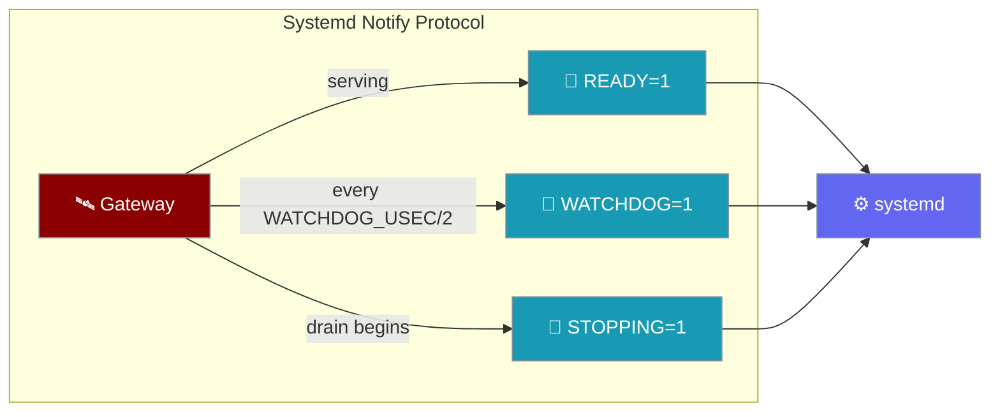
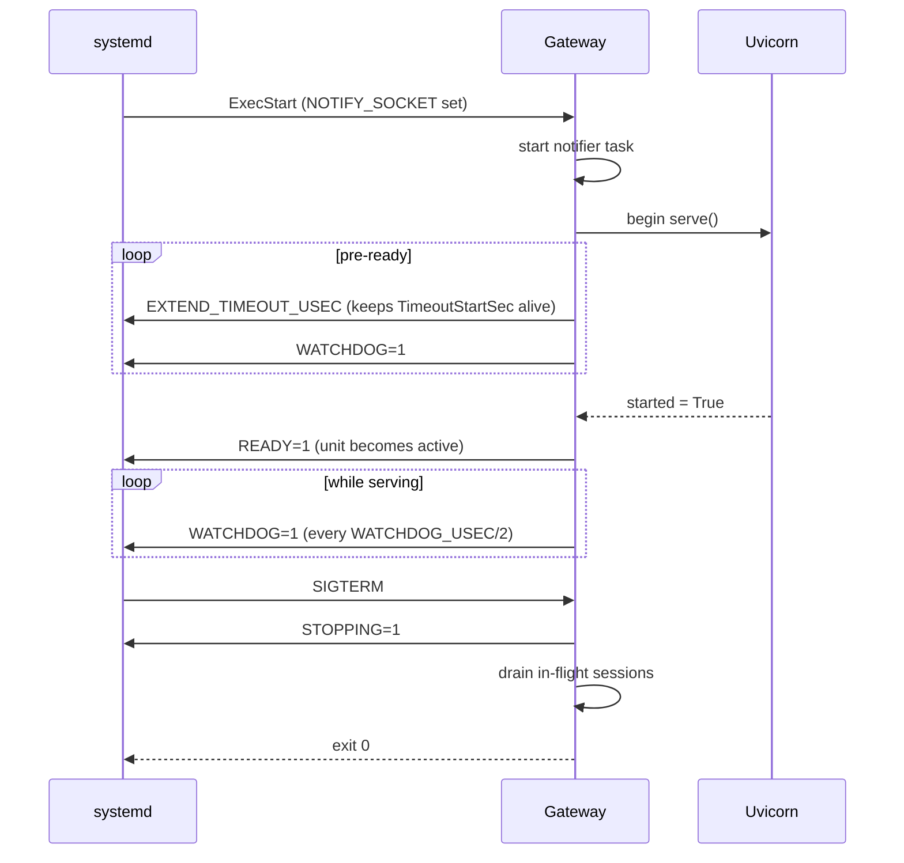

Run your agents under a `Type=notify` systemd unit and the gateway tells systemd when it is really serving, proves its event loop is alive, and announces clean drains — with no new config.



<Note>
There is no new config key, CLI flag, env var, or Python export. systemd sets `$NOTIFY_SOCKET` for `Type=notify` units, and that alone switches the notifier on. Without it, the notifier task is never created.
</Note>

## Quick Start

<Steps>

<Step title="Define your agent as usual">

```yaml
# bot.yaml
agents:
  support:
    instructions: "Answer customer questions politely."
```

Nothing systemd-specific goes in the agent config.

</Step>

<Step title="Install the generated unit">

```bash
praisonai-bot gateway install --config bot.yaml
systemctl --user status praisonai-bot   # Active: active (running) since …
```

The generated unit now contains `Type=notify`, `NotifyAccess=main`, and `WatchdogSec=30`, so `systemctl start` returns only once the gateway is accepting connections.

</Step>

<Step title="Or hand-write the unit">

```ini
[Unit]
Description=PraisonAI Bot Gateway
After=network.target

[Service]
Type=notify
NotifyAccess=main
WatchdogSec=30
ExecStart=/usr/local/bin/python -m praisonai_bot gateway start --config /etc/praisonai/bot.yaml
Restart=on-failure
RestartSec=5
SuccessExitStatus=0
# Keep the exit-78 contract from gateway-exit-codes
RestartPreventExitStatus=78

[Install]
WantedBy=multi-user.target
```

</Step>

</Steps>

Running the gateway anywhere else — plain CLI, Docker without the socket, launchd, Windows — behaves exactly as before.

## How It Works

The notifier runs as a task on the gateway's own event loop, so a wedged loop stops the pings.



| Stage | Behaviour |
|---|---|
| Readiness | `READY=1` is sent once, after uvicorn reports `started=True` — unlike `Type=simple`, which marks the service ready as soon as the binary execs |
| Watchdog | `WATCHDOG=1` every `WATCHDOG_USEC / 2`; if the loop wedges, systemd restarts the process after `WatchdogSec` |
| Slow boot | Pings start before boot-time recovery, and `EXTEND_TIMEOUT_USEC` keeps a long resume from hitting `TimeoutStartSec` |
| Shutdown | `STOPPING=1` when the graceful drain begins, and again when `serve()` unwinds; pings continue during the drain |

## What the gateway sends

| systemd notification | Triggered by | Effect |
|---|---|---|
| `READY=1` | `uvicorn.Server.started` becomes `True` | `systemctl start` returns; unit is `active (running)` |
| `EXTEND_TIMEOUT_USEC=<N>` | Pre-ready pings while boot-time recovery is still running | Keeps `TimeoutStartSec` from killing a slow start |
| `WATCHDOG=1` | Every `WATCHDOG_USEC / 2` from the gateway event loop | Resets the systemd watchdog; a wedged loop stops the pings and systemd restarts the process after `WatchdogSec` |
| `STOPPING=1` | Graceful drain starts, and again when `serve()` unwinds | Tells systemd this is a clean drain, not a hang or crash |

All of this is a no-op when `$NOTIFY_SOCKET` is unset. Delivery is non-blocking and fail-open: a socket error never stalls or crashes the gateway. If the unit has no `WatchdogSec`, `WATCHDOG=1` is never sent; `READY=1`, the pre-ready `EXTEND_TIMEOUT_USEC`, and `STOPPING=1` still are.

## Generated vs hand-written unit

Both units use the same three notify settings.

<Tabs>
<Tab title="Generated">
`~/.config/systemd/user/praisonai-bot.service` (written by `praisonai-bot gateway install`):

```ini
[Service]
Type=notify
NotifyAccess=main
WatchdogSec=30
Restart=on-failure
RestartSec=5
SuccessExitStatus=0
RestartPreventExitStatus=78
```
</Tab>

<Tab title="Hand-written">
```ini
[Service]
Type=notify
NotifyAccess=main
WatchdogSec=30
ExecStart=/usr/local/bin/python -m praisonai_bot gateway start --config /etc/praisonai/bot.yaml
Restart=on-failure
RestartPreventExitStatus=78
```

`NotifyAccess=main` means `ExecStart` must run the Python process directly — a wrapper shell script that forks Python as a child would have its notifications dropped.
</Tab>
</Tabs>

Units installed before this change stay `Type=simple` and keep working. Re-run `praisonai-bot gateway install` to regenerate the unit with `Type=notify`.

## Interaction with existing features

The systemd watchdog is externally enforced and complements the in-process safety nets.

| Feature | How it fits |
|---|---|
| [Gateway Exit Codes](/features/gateway-exit-codes) | Exit `75` still applies when the gateway *decides* to exit; `WatchdogSec` makes systemd *force* a restart when the loop is too wedged to exit itself |
| [Event-Loop Watchdog](/features/gateway-loop-watchdog) | Self-raised and configured by the `gateway.watchdog` block or `--watchdog`; the systemd notifier runs independently of it |
| [Startup Watchdog](/features/gateway-startup-watchdog) | Still runs locally; pre-ready `EXTEND_TIMEOUT_USEC` keeps systemd from timing out the same boot window |
| [24/7 Production Minimal](/guides/deployment/production-minimal) | Its `Type=exec` example targets `praisonai claw`, not the bot gateway, and is unchanged |

## Troubleshooting

<AccordionGroup>

<Accordion title="systemctl status stays at 'activating (start)'">
systemd has not received `READY=1`. Check that `ExecStart` runs Python directly (required by `NotifyAccess=main`) and that the gateway actually reaches serving — a port bind failure or crash before uvicorn starts means readiness is never sent. After editing the unit, run `systemctl --user daemon-reload`.
</Accordion>

<Accordion title="Service is killed after exactly WatchdogSec">
The gateway event loop is wedged and stopped sending `WATCHDOG=1`. The journal shows a `Watchdog timeout` entry; enable the in-process [Event-Loop Watchdog](/features/gateway-loop-watchdog) to get stack dumps that show where the loop is blocked.
</Accordion>

<Accordion title="Running in a container">
The container must receive `$NOTIFY_SOCKET` and the socket itself — for example `podman run --sdnotify=container`, or an sd-notify-aware init in place of tini/dumb-init. Abstract-namespace sockets (`NOTIFY_SOCKET=@name`) are supported.
</Accordion>

</AccordionGroup>

## Best Practices

<AccordionGroup>

<Accordion title="No opt-out needed">
Outside systemd the notifier never starts, so there is nothing to disable. Use `Type=simple` in a hand-written unit only if you do not want readiness gating.
</Accordion>

<Accordion title="Keep WatchdogSec at 30s or more">
Shorter deadlines can trip on long first-boot pauses and cause flaky restarts.
</Accordion>

<Accordion title="Pair Type=notify with RestartPreventExitStatus=78">
The watchdog pulls you out of wedges; the exit-code contract keeps you out of config-error crash loops.
</Accordion>

<Accordion title="Re-install the unit after upgrading">
An existing unit is not changed by upgrading the package. Run `praisonai-bot gateway install` again to rewrite it with `Type=notify`.
</Accordion>

</AccordionGroup>

## Related

<CardGroup cols={2}>
  <Card title="Gateway Exit Codes" icon="door-open" href="/features/gateway-exit-codes">
    Exit 0 / 75 / 78 contract for supervisors
  </Card>
  <Card title="Event-Loop Watchdog" icon="heart-pulse" href="/features/gateway-loop-watchdog">
    In-process wedge detection with stack dumps
  </Card>
  <Card title="Startup Watchdog" icon="hourglass-start" href="/features/gateway-startup-watchdog">
    Guard the pre-loop startup window
  </Card>
  <Card title="24/7 Production Minimal" icon="server" href="/guides/deployment/production-minimal">
    Minimal always-on deployment guide
  </Card>
</CardGroup>
