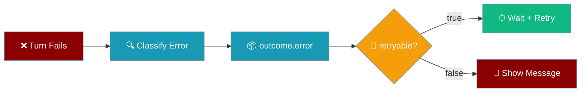
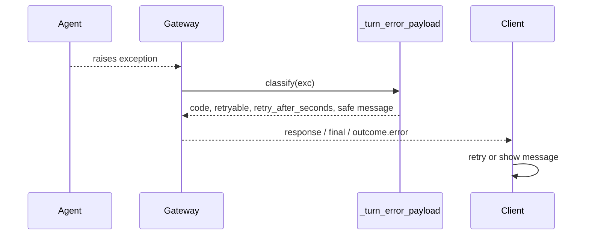
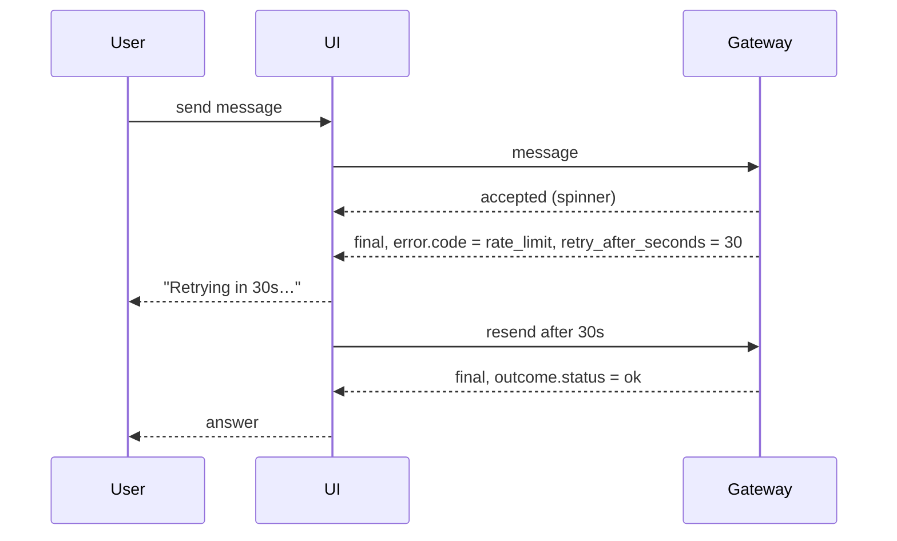

When a turn fails, the final response frame carries a typed `outcome.error`, so a chat UI can show the right Retry or Stop button and a safe message instead of a raw provider traceback.



## Quick Start

<Steps>
<Step title="Read outcome.error on a final response">

```python
import asyncio
from praisonai_bot.gateway.client import GatewayClient

async def main():
    client = GatewayClient(url="ws://localhost:8765", agent_id="my-agent")
    await client.connect()
    await client.send("Summarise today's news")

    async for event in client.events():
        frame = event.data
        if event.type == "response" and frame.get("status") == "final":
            outcome = frame["outcome"]
            if outcome["status"] == "error":
                err = outcome.get("error", {})
                print(err.get("code"), "-", err.get("message"))
            break

asyncio.run(main())
```

</Step>
<Step title="Retry only when retryable">

```python
import asyncio
from praisonai_bot.gateway.client import GatewayClient

async def ask(client, text):
    await client.send(text)
    async for event in client.events():
        frame = event.data
        if event.type == "response" and frame.get("status") == "final":
            return frame

async def main():
    client = GatewayClient(url="ws://localhost:8765", agent_id="my-agent")
    await client.connect()

    for attempt in range(3):
        frame = await ask(client, "Summarise today's news")
        outcome = frame["outcome"]
        err = outcome.get("error")
        if outcome["status"] != "error" or not err or not err["retryable"]:
            break
        await asyncio.sleep(err["retry_after_seconds"] or 2 ** attempt)

    print(frame["content"])

asyncio.run(main())
```

</Step>
</Steps>

---

## How It Works

The gateway classifies the exception, picks a fixed safe message for its code, and attaches the result to the final frame.



```json
{
  "type": "response",
  "status": "final",
  "content": "Error: ...",
  "outcome": {
    "status": "error",
    "error": {
      "code": "rate_limit",
      "retryable": true,
      "retry_after_seconds": 30,
      "message": "Rate limited by the model provider. Please retry shortly."
    }
  },
  "session_id": "..."
}
```

| Field | Type | Meaning |
|-------|------|---------|
| `code` | `string` | Machine-readable error code (see table below) |
| `retryable` | `bool` | `true` when resending the same message can succeed |
| `retry_after_seconds` | `int \| null` | Provider's `Retry-After`, rounded up; `null` when unknown |
| `message` | `string` | Fixed safe text per code, never raw `str(e)` |

<Note>
`retry_after_seconds` is not capped. It reflects the provider's full wait, so retrying sooner would hit the provider again.
</Note>

---

## Error Codes

| `code` | `retryable` | Typical cause | `message` | Client action |
|--------|-------------|---------------|-----------|---------------|
| `rate_limit` | `true` | Provider 429 / rate limit | "Rate limited by the model provider. Please retry shortly." | Wait `retry_after_seconds`, then retry |
| `overloaded` | `true` | Provider temporarily overloaded | "The model provider is overloaded. Please retry shortly." | Back off, then retry |
| `transient` | `true` | Timeout or network blip | "A temporary error occurred. Please retry." | Retry |
| `idle_timeout` | `true` | Provider stopped streaming | "The model provider stopped responding. Please retry." | Retry |
| `context_overflow` | `false` | Prompt exceeds model context | "The conversation is too long for the model. Start a new chat." | Offer "Start a new chat" |
| `billing` | `false` | Account out of credit | "The model provider account is out of credit." | Show top-up link |
| `auth` | `false` | Credentials rejected (recoverable) | "The model provider rejected the credentials." | Ask the operator to re-authenticate |
| `auth_permanent` | `false` | Credentials rejected (permanent) | "The model provider rejected the credentials." | Ask the operator to replace the key |
| `model_not_found` | `false` | Configured model unavailable | "The configured model is not available." | Ask the operator to fix the model |
| `invalid_request` | `false` | 400-class request error | "The agent failed to complete this turn." | Show message, do not retry |
| `internal` | `false` | Anything unrecognised | "The agent failed to complete this turn." | Show message, do not retry |

<Info>
A wedged worker torn down by the turn executor also emits this object: `{"code": "transient", "retryable": true, "retry_after_seconds": null, "message": "A temporary error occurred. Please retry."}`. Retrying is safe — the session is re-placed.
</Info>

---

## Common Patterns

<Tabs>
<Tab title="Retry or stop">

```python
import asyncio

async def handle(frame):
    err = frame["outcome"].get("error")
    if err and err["retryable"]:
        await asyncio.sleep(err["retry_after_seconds"] or 2)
        return "retry"
    return "stop"
```

</Tab>
<Tab title="Branch by code">

```python
def next_step(err):
    code = err["code"]
    if code == "context_overflow":
        return "Start a new chat"
    if code == "billing":
        return "Top up your credit"
    if code in ("auth", "auth_permanent"):
        return "Re-authenticate"
    return err["message"]
```

</Tab>
<Tab title="JavaScript">

```javascript
const ws = new WebSocket("ws://localhost:8765");

ws.onmessage = (msg) => {
  const frame = JSON.parse(msg.data);
  if (frame.type !== "response" || frame.status !== "final") return;

  const err = frame.outcome.error;
  if (frame.outcome.status === "error" && err?.retryable) {
    setTimeout(() => resend(), (err.retry_after_seconds ?? 2) * 1000);
  }
};
```

</Tab>
</Tabs>

---

## User Interaction Flow

The user sees a spinner, a short "Retrying" notice, then the answer.



<Note>
The `error` key is additive and only present on failed turns. Clients that ignore it behave exactly as before; `outcome.status` and `content` are unchanged.
</Note>

---

## Best Practices

<AccordionGroup>
<Accordion title="Show message, not content">
`content` on a failed turn still starts with `Error:`. Show `outcome.error.message` to end users — it is a fixed safe string.
</Accordion>
<Accordion title="Honour retry_after_seconds">
Wait the full `retry_after_seconds` before resending. Fall back to exponential backoff only when it is `null`.
</Accordion>
<Accordion title="Cap your retries">
Retry a few times at most, then surface the message. `retryable` means a retry can succeed, not that it will.
</Accordion>
<Accordion title="Don't confuse with connect errors">
Turn errors leave the socket open and you decide whether to resend. Connect errors close the socket and drive the reconnect loop.
</Accordion>
</AccordionGroup>

---

## Related

<CardGroup cols={2}>
  <Card title="Gateway Stream Events" icon="waveform-lines" href="/features/gateway-stream-events">
    Response frame states and live progress events
  </Card>
  <Card title="Gateway Error Handling" icon="triangle-exclamation" href="/features/gateway-error-handling">
    Clean, Unicode-safe errors in bot replies
  </Card>
  <Card title="Gateway Client" icon="plug" href="/features/gateway-client#terminal-vs-transient-connect-errors">
    The connect-level mirror of turn errors
  </Card>
  <Card title="Gateway" icon="tower-broadcast" href="/gateway">
    Gateway overview
  </Card>
</CardGroup>
