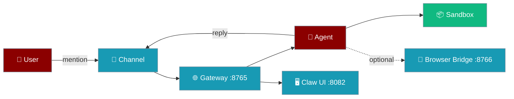

Go from `pip install` to an agent that replies on a messaging channel and runs code in a sandbox — with a health check that proves every piece is up.

```python
from praisonaiagents import Agent

agent = Agent(
    name="assistant",
    instructions="You are a helpful operations assistant.",
    sandbox=True,  # explicit agent.execute_code() API, isolated from the host
)

print(agent.start("Say hello in one sentence."))
print(agent.execute_code_sync("print('golden-path')").stdout)
```



The user mentions the bot in a chat; the gateway routes the message to the agent, the agent replies on the same channel, and any code it runs stays inside the sandbox.

---

## Quick Start

<Steps>

<Step title="Install">
```bash
pip install praisonai "praisonai-sandbox[docker]"
```

`praisonai` brings the gateway, channels, and Claw UI. The sandbox extra adds the Docker backend.
</Step>

<Step title="Export secrets (shell only)">
```bash
export OPENAI_API_KEY=...          # LLM provider key
export TELEGRAM_BOT_TOKEN=...      # or SLACK_BOT_TOKEN / DISCORD_BOT_TOKEN
export GATEWAY_AUTH_TOKEN=$(openssl rand -hex 32)   # required when binding beyond loopback
```

<Warning>
Never paste a token into `gateway.yaml`, a notebook, or a commit. Reference it with `${VAR}` — see [Secret References](/features/gateway-secret-references).
</Warning>
</Step>

<Step title="Write gateway.yaml">
```yaml
# gateway.yaml — placeholders only, safe to commit
agents:
  assistant:
    instructions: "You are a helpful operations assistant."
    model: gpt-4o-mini

channels:
  telegram:
    platform: telegram
    token: "${TELEGRAM_BOT_TOKEN}"
```
</Step>

<Step title="Start the gateway">
```bash
praisonai gateway start --config gateway.yaml
```

Preflight validates your model key and channel token before binding the port.
</Step>

<Step title="Send a message">
Mention the bot in your chat. You should get a reply within a few seconds.
</Step>

<Step title="Run a sandboxed command">
```python
from praisonaiagents import Agent, SandboxConfig

agent = Agent(name="runner", sandbox=SandboxConfig.docker("python:3.12-slim"))
result = agent.execute_code_sync("print('golden-path')")
print(result.stdout)  # golden-path
```
</Step>

<Step title="Verify everything">
```bash
praisonai gateway status --deep
```
</Step>

</Steps>

---

## Step Matrix

| Step | Action | Expected | If it fails |
|------|--------|----------|-------------|
| 1 | Install | `praisonai --version` prints | Check Python ≥ 3.10 |
| 2 | Export secrets | `env` shows the vars (never print values) | Re-export in the same shell |
| 3 | Agent | `agent.start(...)` returns text | Check the LLM key env var |
| 4 | Gateway | `GET :8765/health` → 200 | Port in use — see [Troubleshoot Gateway](/guides/troubleshoot-gateway) |
| 5 | Channel | Mention → reply | Token scopes / one poller per token |
| 6 | Sandbox | `stdout` is `golden-path` | Start the Docker daemon |
| 7 | Bridge (optional) | `connections ≥ 1` | Open the extension side panel |
| 8 | Claw UI (optional) | `GET :8082/` → 200 | Run `praisonai claw` |

---

## Health Check

Existing commands already probe each service:

| Service | Command | Default port |
|---------|---------|--------------|
| Gateway | `praisonai gateway status --deep` | 8765 |
| Gateway (full) | `praisonai gateway doctor --config gateway.yaml` | 8765 |
| Browser bridge | `praisonai browser doctor server --port 8766` | 8765 |
| Claw UI | `praisonai claw` | 8082 |

<Note>
The gateway and the browser bridge **both default to port 8765**. When running both, start the bridge on another port: `praisonai browser start --port 8766`.
</Note>

For CI or a single pass/fail signal, this snippet probes all three endpoints without reading any secret:

```bash
#!/usr/bin/env bash
# golden_path_check.sh — exit 0 only when every probe returns HTTP 200
GATEWAY_PORT=${GATEWAY_PORT:-8765}
BRIDGE_PORT=${BRIDGE_PORT:-8766}
CLAW_PORT=${CLAW_PORT:-8082}
ok=0
probe() {
  code=$(curl -s -o /dev/null -w '%{http_code}' --max-time 5 "$2")
  if [ "$code" = "200" ]; then echo "$1 ... OK (200)"; else echo "$1 ... FAIL ($2 → ${code:-no response})"; ok=1; fi
}
probe gateway        "http://127.0.0.1:$GATEWAY_PORT/health"
[ -z "$SKIP_BRIDGE" ] && probe browser_bridge "http://127.0.0.1:$BRIDGE_PORT/health"
[ -z "$SKIP_CLAW" ]   && probe claw_ui        "http://127.0.0.1:$CLAW_PORT/"
echo "exit=$ok"; exit $ok
```

```powershell
# golden_path_check.ps1
param([int]$GatewayPort = 8765, [int]$BridgePort = 8766, [int]$ClawPort = 8082)
$ok = $true
foreach ($p in @(@("gateway", "http://127.0.0.1:$GatewayPort/health"),
                 @("browser_bridge", "http://127.0.0.1:$BridgePort/health"),
                 @("claw_ui", "http://127.0.0.1:$ClawPort/"))) {
  try {
    $r = Invoke-WebRequest -Uri $p[1] -UseBasicParsing -TimeoutSec 5
    Write-Host "$($p[0]) ... OK ($($r.StatusCode))"
  } catch { Write-Host "$($p[0]) ... FAIL ($($p[1]))"; $ok = $false }
}
if ($ok) { exit 0 } else { exit 1 }
```

Expected output:

```
gateway ... OK (200)
browser_bridge ... OK (200)
claw_ui ... OK (200)
exit=0
```

---

## Environment Variables

| Variable | Purpose | Required |
|----------|---------|----------|
| `OPENAI_API_KEY` (or another provider key) | Model calls | Yes |
| `GATEWAY_AUTH_TOKEN` | Gateway admin API auth | When bound beyond loopback |
| `TELEGRAM_BOT_TOKEN` / `SLACK_BOT_TOKEN` / `DISCORD_BOT_TOKEN` | Channel credentials | Per enabled channel |
| `DATABASE_URL` | Postgres memory | Optional — SQLite is the default |

---

## Troubleshooting

<AccordionGroup>
  <Accordion title="Gateway: connection refused">
    The gateway is not running or is bound to another port. Run `praisonai gateway status` and check the PID lock and port lines.
  </Accordion>
  <Accordion title="Gateway healthy, channel silent">
    `/health` shows the channel running but no reply arrives. Check the token's scopes / event subscriptions and make sure only **one** process polls the token. See [Troubleshoot Gateway](/guides/troubleshoot-gateway).
  </Accordion>
  <Accordion title="Sandbox: cannot connect to Docker daemon">
    The sandbox step is blocked even though the gateway is green. Start Docker, or pick another backend from [Sandbox Backends](/features/sandbox-backends). Never mark the step as passed when the sandbox failed.
  </Accordion>
  <Accordion title="Bridge: 0 connections">
    The bridge is up but no extension is attached. Open the extension side panel and re-run `praisonai browser doctor server --port 8766`.
  </Accordion>
</AccordionGroup>

---

## Best Practices

<AccordionGroup>
  <Accordion title="Keep secrets in the environment">
    Commit `gateway.yaml` with `${VAR}` placeholders only. For production, move to `file` or `exec` secret sources — see [Secret References](/features/gateway-secret-references).
  </Accordion>
  <Accordion title="Bind to loopback while testing">
    `127.0.0.1` keeps the admin API local. Set `GATEWAY_AUTH_TOKEN` before binding to `0.0.0.0`.
  </Accordion>
  <Accordion title="Re-run the health check after upgrades">
    Run the check after every gateway upgrade or token rotation so regressions show up immediately.
  </Accordion>
  <Accordion title="Use Helm for clusters">
    For Kubernetes, pass the auth token through chart values — see [Helm Chart](/features/helm-chart-gateway).
  </Accordion>
</AccordionGroup>

---

## Related

<CardGroup cols={2}>
  <Card title="Gateway CLI" icon="terminal" href="/features/gateway-cli">
    Start, stop, and inspect the gateway
  </Card>
  <Card title="Sandbox" icon="shield-halved" href="/features/sandbox">
    Isolated code execution for agents
  </Card>
  <Card title="Secret References" icon="key" href="/features/gateway-secret-references">
    Keep tokens out of config files
  </Card>
  <Card title="Troubleshoot Gateway" icon="wrench" href="/guides/troubleshoot-gateway">
    Fix common gateway issues
  </Card>
</CardGroup>
