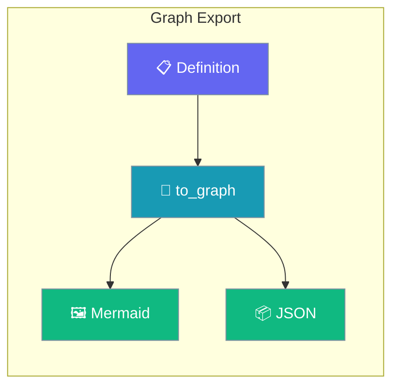
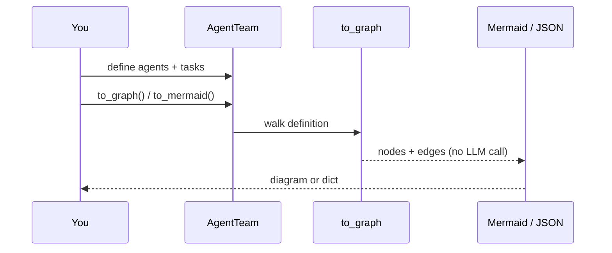

Graph Export draws the shape of your agents before anything runs, so you can review it without paying for an LLM call.

```python
from praisonaiagents import Agent
from praisonaiagents.workflows.diagram import to_graph, graph_to_mermaid

agent = Agent(name="Writer", instructions="Write a short poem.")
print(graph_to_mermaid(to_graph(agent)))
```



## Quick Start

<Steps>
<Step title="Team to Mermaid">

Print a team's diagram with `team.to_mermaid()`.

```python
from praisonaiagents import Agent, Task, AgentTeam

researcher = Agent(name="Researcher", instructions="Find facts.")
writer = Agent(name="Writer", instructions="Draft a blog post.")

team = AgentTeam(
    agents=[researcher, writer],
    tasks=[
        Task(name="research", description="Research AI agents", agent=researcher, expected_output="Notes"),
        Task(name="write", description="Write a blog post", agent=writer, expected_output="Post"),
    ],
)

print(team.to_mermaid())
```

</Step>

<Step title="Flow to Mermaid">

Print a flow's diagram with `flow.to_mermaid()` — the output is unchanged from earlier versions (see [Workflow Diagram](/features/workflow-diagram)).

```python
from praisonaiagents import Agent, AgentFlow

researcher = Agent(name="Researcher", instructions="Find facts.")
writer = Agent(name="Writer", instructions="Draft a blog post.")

flow = AgentFlow(name="blog", steps=[researcher, writer])
print(flow.to_mermaid())
```

</Step>

<Step title="Graph data (JSON)">

Get the same structure as a plain dict with `.to_graph()`.

```python
import json
from praisonaiagents import Agent, AgentFlow

flow = AgentFlow(name="blog", steps=[Agent(name="Writer", instructions="Draft a blog post.")])
graph = flow.to_graph()

print(graph["schema"])                 # praisonai.graph/1
print(json.dumps(graph, indent=2))
```

</Step>
</Steps>

---

## How It Works

The builder walks your definition and emits nodes and edges with stable ids.



The graph dict has six keys: `schema`, `kind` (`agent`, `team` or `flow`), `name`, `process`, `nodes` and `edges`.

| Node kind | Id form | Example |
|---|---|---|
| Agent | `agent:<name>` | `agent:Researcher` |
| Task | `task:<name or index>` | `task:research` |
| Step | `step:<name>` | `step:draft` |
| Tool | `tool:<agent>/<tool>` | `tool:Researcher/search_web` |
| Human review | `human:you` | fixed |
| Manager | `manager:Manager` | fixed (hierarchical process) |
| Start / End | `start:begin` / `end:done` | fixed |
| Duplicate names | `<base>#2`, `<base>#3` | `step:draft#2` |

Ids come from names and positions only, so they are identical across processes and runs. Flow patterns `Route`, `Parallel`, `Loop`, `Repeat`, `If`, `Include` and `Discussion` are drawn as groups.

---

## Reference

| Function / Method | Returns | Notes |
|---|---|---|
| `to_graph(obj)` | `dict` | Works on `Agent`, `AgentTeam`, `AgentFlow` |
| `graph_to_mermaid(graph)` | `str` | Renders a graph dict as Mermaid `graph TD` |
| `GRAPH_SCHEMA` | `"praisonai.graph/1"` | Schema version constant |
| `AgentTeam.to_graph()` | `dict` | Team graph data |
| `AgentTeam.to_mermaid()` | `str` | Team diagram |
| `AgentFlow.to_graph()` | `dict` | Flow graph data |
| `AgentFlow.to_mermaid()` | `str` | Flow diagram, same output as before |

`to_graph`, `graph_to_mermaid` and `GRAPH_SCHEMA` import from `praisonaiagents.workflows.diagram`.

---

## Common Patterns

### Review before a run

Check the shape of a team before the first LLM call.

```python
from praisonaiagents import Agent, Task, AgentTeam

writer = Agent(name="Writer", instructions="Draft a blog post.")
team = AgentTeam(agents=[writer], tasks=[Task(description="Write a post", agent=writer, expected_output="Post")])

print(team.to_mermaid())   # review, then team.start()
```

### Embed in a README

GitHub renders Mermaid inline, so wrap the output in a `mermaid` code fence.

```python
from praisonaiagents import Agent, AgentFlow

flow = AgentFlow(name="blog", steps=[Agent(name="Writer", instructions="Draft a blog post.")])

fence = "`" * 3

with open("FLOW.md", "w") as f:
    f.write(f"{fence}mermaid\n{flow.to_mermaid()}\n{fence}\n")
```

### Line up replay events with graph nodes

Replay events carry a `node_id` that matches a graph node id.

```python
from praisonaiagents import Agent, Task, AgentTeam
from praisonai.replay import ContextTraceReader

writer = Agent(name="Writer", instructions="Draft a blog post.")
team = AgentTeam(agents=[writer], tasks=[Task(name="write", description="Write a post", agent=writer, expected_output="Post")])

by_id = {node["id"]: node for node in team.to_graph()["nodes"]}

for event in ContextTraceReader("my-session"):
    if event.node_id in by_id:
        print(event.event_type.value, "→", by_id[event.node_id]["label"])
```

### Feed another renderer

Export JSON and draw it with any graph tool.

```python
import json
from praisonaiagents import Agent
from praisonaiagents.workflows.diagram import to_graph

agent = Agent(name="Writer", instructions="Write a short poem.")

with open("graph.json", "w") as f:
    json.dump(to_graph(agent), f, indent=2)
```

---

## Best Practices

<AccordionGroup>

<Accordion title="Preview before you pay">

Call `.to_mermaid()` to check a team or flow before the first LLM call.

</Accordion>

<Accordion title="Persist node ids freely">

Node ids are stable across runs, so your own tooling can store and reuse them.

</Accordion>

<Accordion title="Start custom rendering from the dict">

Use `.to_graph()` for custom views — it carries agents, tools and pattern groups the Mermaid string may not show.

</Accordion>

<Accordion title="Name your tasks and steps">

Named tasks give readable ids like `task:research`; unnamed ones fall back to their position.

</Accordion>

</AccordionGroup>

---

## Related

<CardGroup cols={2}>
<Card title="Replay" icon="rotate-left" href="/features/replay">
  Replay events carry the same ids as `node_id`
</Card>
<Card title="Workflow Diagram" icon="diagram-project" href="/features/workflow-diagram">
  Flow-only diagrams in depth — patterns, routes and loops
</Card>
</CardGroup>
