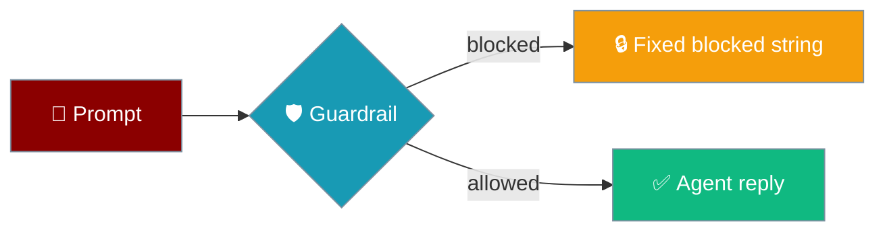
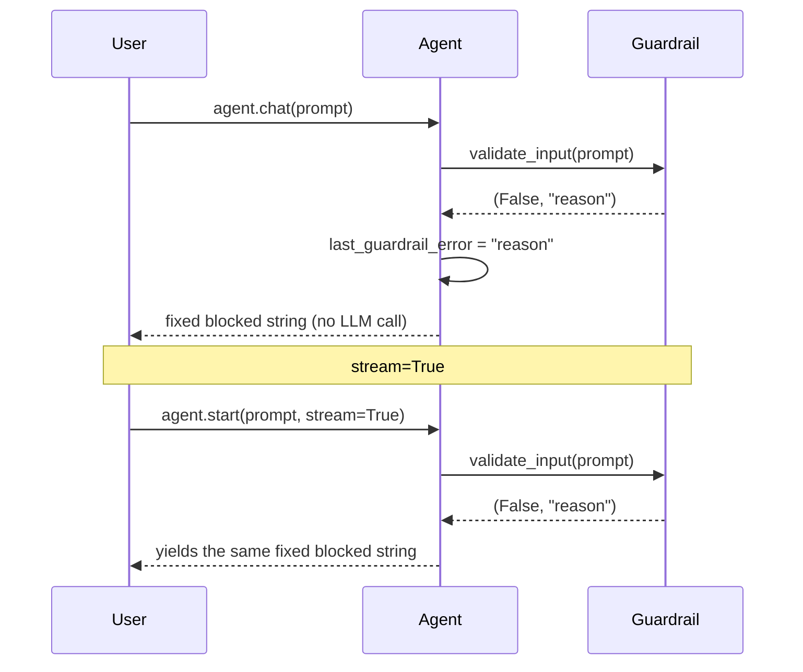

When a guardrail blocks a run, PraisonAI returns a safe fixed string — never `None`, never the validator's reason.



## Quick Start

<Steps>
<Step title="Add an input guardrail">
```python
from praisonaiagents import Agent

class NoSecrets:
    def validate_input(self, content, **kwargs):
        if "password" in content.lower():
            return False, "contains secret: password"
        return True, content

    def validate_output(self, content, **kwargs):
        return True, content

agent = Agent(name="Helper", instructions="Be helpful.", guardrails=NoSecrets())
```
</Step>

<Step title="Get the fixed string back">
```python
reply = agent.chat("My password is hunter2, store it")

print(reply)
# I'm sorry, but I can't share that response because it did not pass the safety guardrail.
```

`reply` is always a `str`, so `reply.strip()` never crashes.
</Step>

<Step title="Read the reason for your logs">
```python
print(agent.last_guardrail_error)
# contains secret: password
```
</Step>
</Steps>

---

## How It Works

The agent checks the prompt first; a rejected prompt never reaches the LLM.



The same fixed string is returned when an **output** guardrail exhausts its retries, so callers handle one shape for every block.

### Before / after PR #6104

| Call site | Before [PR #6104](https://github.com/MervinPraison/PraisonAI/pull/6104) | After PR #6104 |
|---|---|---|
| `agent.chat(prompt)` on input block | returned `None` → `.strip()` crashed | returns the fixed blocked string |
| `await agent.achat(prompt)` on input block | returned `None` | returns the fixed blocked string |
| `agent.start(prompt, stream=True)` on input block | yielded `"[Input blocked by guardrail: <reason>]"` (reason leaked) | yields the fixed blocked string |
| `agent.last_guardrail_error` after an input block | not set | holds the validator's reason |

---

## Telling a block from a normal reply

The blocked string is identical for input and output blocks, so compare against it rather than parsing it.

```python
from praisonaiagents import Agent

agent = Agent(name="Helper", instructions="Be helpful.", guardrails=NoSecrets())
BLOCKED = agent._guardrail_blocked_message()  # compute once, at startup

reply = agent.chat("My password is hunter2")
if reply == BLOCKED:
    print("Blocked:", agent.last_guardrail_error)
else:
    print(reply)
```

<Warning>
`last_guardrail_error` is **not** cleared on the next successful turn. Use the `reply == BLOCKED` comparison to decide *whether* a turn was blocked, and `last_guardrail_error` only to read *why*.
</Warning>

---

## Common Patterns

### Pattern A — friendly message in a chat UI

```python
def handle(user_text):
    reply = agent.chat(user_text)
    if reply == BLOCKED:
        return "I can't help with that one. Try rephrasing without personal data."
    return reply
```

### Pattern B — log the reason, keep the reply opaque

```python
import logging

reply = agent.chat(user_text)
if reply == BLOCKED:
    logging.warning("guardrail block: %s", agent.last_guardrail_error)
send_to_user(reply)  # never includes the reason
```

PraisonAI keeps the reason out of the reply because LLM validators often quote the rejected content back.

### Pattern C — async parity

```python
import asyncio

async def main():
    reply = await agent.achat("My password is hunter2")
    assert reply == BLOCKED

asyncio.run(main())
```

### Pattern D — streaming

```python
reply = "".join(agent.start("My password is hunter2", stream=True))
if reply == BLOCKED:
    print("Blocked")
```

Join the chunks and compare — don't search for `"[Input blocked"`, which is no longer emitted.

---

## Best Practices

<AccordionGroup>
<Accordion title="Never surface the raw reason to end users">
The reason can echo the rejected prompt back and defeat the guardrail. Show your own message instead.
</Accordion>

<Accordion title="Use last_guardrail_error for ops and telemetry only">
Log it, alert on it, count it — don't display it.
</Accordion>

<Accordion title="Treat the blocked string as opaque">
Compare it to `agent._guardrail_blocked_message()`; don't parse or translate it.
</Accordion>

<Accordion title="Keep input validators fast and pure">
A sync `validate_input` that does blocking I/O delays every turn. See [Per-Tool Guardrails](/features/per-tool-guardrails) for the async offload story on tool and output guardrails.
</Accordion>
</AccordionGroup>

---

## Learned "always allow" rules survive concurrent writes

**Concurrency-safe since PR #6104.** `PolicyConfig.save_learned_rule` now reads, dedupes and appends under a per-path lock using `utils.atomic_io.update_json`. Multiple processes or threads saving "always allow" decisions no longer drop each other's rules; dedupe behaviour is preserved (saving the same `resource` twice is a no-op, and the first `action` wins).

---

## Related

<CardGroup cols={2}>
  <Card title="Guardrails" icon="shield" href="/features/guardrails">
    Input and output validation for agents
  </Card>
  <Card title="Apply Guardrail" icon="shield-check" href="/features/apply-guardrail">
    Run a guardrail on any text directly
  </Card>
  <Card title="Per-Tool Guardrails" icon="wrench" href="/features/per-tool-guardrails">
    Validate individual tool calls
  </Card>
  <Card title="last_guardrail_error" icon="code" href="/sdk/reference/praisonaiagents/functions/Agent-last_guardrail_error">
    SDK reference
  </Card>
</CardGroup>
