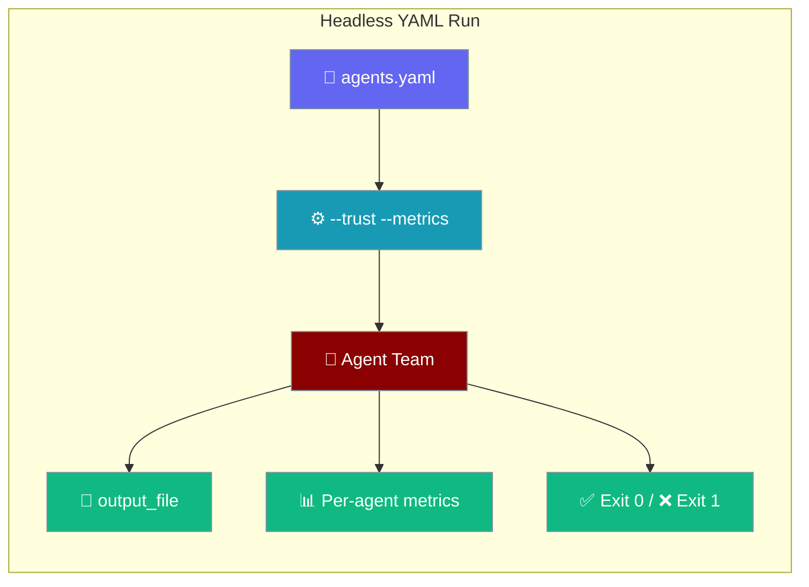
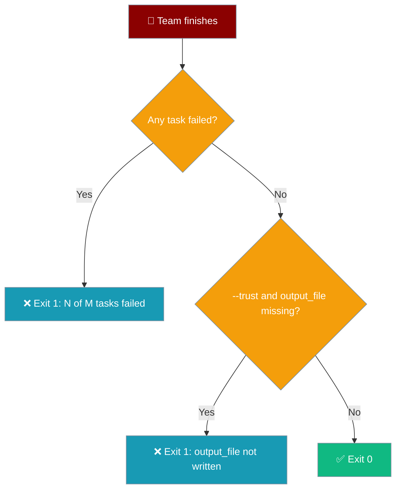

Headless YAML runs execute an agent team from `agents.yaml` with no prompts, then report usage, write files, and exit with a code your CI can trust.



## Quick Start

<Steps>
<Step title="Create agents.yaml">

```yaml
framework: praisonai
topic: risk
roles:
  analyst:
    role: Analyst
    goal: Analyse the risk
    backstory: Expert analyst
    llm: openai/gpt-4o-mini
    tasks:
      analyst_task:
        description: Analyse the risk
        expected_output: Markdown summary
  writer:
    role: Writer
    goal: Write the report
    backstory: Technical writer
    llm: openai/gpt-4o-mini
    tasks:
      writer_task:
        description: Write the report
        expected_output: Markdown
        output_file: out/risk_report.md
```

</Step>
<Step title="Run it">

```bash
export OPENAI_API_KEY=your-openai-key
praisonai agents.yaml --trust --metrics
```

You get `out/risk_report.md` and a per-agent usage table.

</Step>
</Steps>

---

## Flags

Three flags make a YAML run suitable for scripts.

| Flag | What it does |
|------|--------------|
| `--trust` | Auto-approves every tool execution (no prompts) |
| `--metrics` | Prints a per-agent usage table |
| `--metrics-json` | Prints the same data as JSON to stdout |

Equivalent approval switches for other entry points: `praisonai run --approval bypass`, `--autonomy full_auto`, or `PRAISONAI_AUTO_APPROVE=true`. There is no `--no-approve` flag; use `--trust`.

---

## Per-Agent Metrics

`--metrics` prints one row per agent, a TOTAL row, and the model name.

```text
          Agent Metrics (model: openai/gpt-4o-mini)
┌──────────┬───────┬────────┬───────┬───────┬──────────┐
│ Agent    │ Input │ Output │ Total │ Calls │ Time (s) │
├──────────┼───────┼────────┼───────┼───────┼──────────┤
│ Analyst  │    10 │      5 │    15 │     1 │     0.12 │
│ Writer   │    10 │      5 │    15 │     1 │     0.11 │
│ TOTAL    │    20 │     10 │    30 │     2 │     0.23 │
└──────────┴───────┴────────┴───────┴───────┴──────────┘
```

`--metrics-json` prints JSON to stdout only. It takes no path; redirect to save a file.

```bash
praisonai agents.yaml --trust --metrics-json > metrics.json
```

```json
{
  "agents": [
    {
      "name": "Analyst",
      "input_tokens": 10,
      "output_tokens": 5,
      "total_tokens": 15,
      "calls": 1,
      "latency_s": 0.123
    }
  ],
  "total": {
    "input_tokens": 10,
    "output_tokens": 5,
    "total_tokens": 15,
    "calls": 1,
    "latency_s": 0.123
  },
  "model": "openai/gpt-4o-mini"
}
```

| Key | Type | Description |
|-----|------|-------------|
| `agents[].name` | `str` | Agent name |
| `agents[].input_tokens` | `int` | Prompt tokens consumed |
| `agents[].output_tokens` | `int` | Completion tokens generated |
| `agents[].total_tokens` | `int` | Input plus output tokens |
| `agents[].calls` | `int` | LLM calls made by this agent |
| `agents[].latency_s` | `float` | Wall time in seconds (3 decimals) |
| `total` | `object` | Column sums, same keys as `agents[]` |
| `model` | `str` | Comma-joined models used |

---

## Task `output_file`

`framework: praisonai` writes a task's result to `output_file` and creates missing parent folders.

```yaml
tasks:
  writer_task:
    description: Write the report
    expected_output: Markdown
    output_file: out/risk_report.md   # out/ is created automatically
```

A bare filename such as `flat.md` writes to the working directory. See [Save Output](/features/save-output) for every output option.

---

## Exit Codes

Failed runs exit non-zero so CI can detect them.

| Code | Meaning |
|------|---------|
| `0` | All tasks completed, and every declared `output_file` was written (under `--trust`) |
| `1` | One or more tasks failed, or a declared `output_file` was not written during this run (under `--trust`) |



Stale files from a previous run do not count as written. Tasks that never ran (skipped workflow branches) are not counted as missing files.

<Note>
With `--output stream-json`, a failed run emits `run.error` instead of a successful `run.result`.
</Note>

---

## Sandbox Environment Variables

Set these to run inside a locked-down container with one OpenAI-compatible endpoint and no outbound access.

| Variable | Purpose |
|----------|---------|
| `OPENAI_BASE_URL` / `OPENAI_API_BASE` | Point PraisonAI at the sandbox's OpenAI-compatible route |
| `OPENAI_API_KEY` | Any non-empty placeholder works if the endpoint needs no key |
| `OPENAI_MODEL_NAME` | Pin the model the endpoint serves |
| `PRAISONAI_NO_UPDATE_CHECK=1` | Skip the PyPI update check |
| `PRAISONAI_TELEMETRY_DISABLED=true` (or `DO_NOT_TRACK=true`) | Disable anonymous telemetry |
| `LITELLM_LOCAL_MODEL_COST_MAP=True` | Stop LiteLLM fetching its cost map from GitHub at import |
| `PRAISONAI_ALLOW_LOCAL_TOOLS=true` | Load `./tools.py` from the working directory |

---

## Full Example

```bash
export OPENAI_BASE_URL=http://sandbox-llm:8000/v1
export OPENAI_API_KEY=placeholder
export OPENAI_MODEL_NAME=gpt-4o-mini
export PRAISONAI_NO_UPDATE_CHECK=1
export PRAISONAI_TELEMETRY_DISABLED=true
export LITELLM_LOCAL_MODEL_COST_MAP=True

praisonai agents.yaml --trust --metrics-json > metrics.json
if [ $? -eq 0 ]; then
  echo "Run succeeded"; cat out/risk_report.md
else
  echo "Run failed"
fi
```

---

## Common Pitfalls

| Pitfall | Fix |
|---------|-----|
| `OPENAI_API_KEY=""` fails with "Missing credentials" | Use any non-empty placeholder |
| Import fails fetching the LiteLLM cost map | Set `LITELLM_LOCAL_MODEL_COST_MAP=True` |
| `--metrics-json out.json` | Use shell redirection: `--metrics-json > out.json` |
| `--no-approve` is not recognised | Use `--trust` |

---

## Best Practices

<AccordionGroup>
<Accordion title="Always pass --trust in CI">
Without it, tool approvals wait for a human and the run hangs. `--trust` also turns on the `output_file` write check.
</Accordion>
<Accordion title="Check the exit code, not the output">
A failed task prints its status, but only the exit code is reliable for scripts.
</Accordion>
<Accordion title="Use --metrics-json for budgets">
Parse `total.total_tokens` from the JSON to fail builds that exceed a token budget.
</Accordion>
<Accordion title="Use a placeholder key for mock endpoints">
Pin `OPENAI_BASE_URL` and `OPENAI_MODEL_NAME` so runs stay on your sandbox endpoint.
</Accordion>
</AccordionGroup>

---

## Related

<CardGroup cols={2}>
  <Card title="Metrics CLI" icon="chart-bar" href="/cli/metrics">
    Token and cost reporting
  </Card>
  <Card title="Save Output" icon="floppy-disk" href="/features/save-output">
    Write results to files
  </Card>
  <Card title="Tool Approval" icon="shield-check" href="/cli/tool-approval">
    Control tool execution
  </Card>
  <Card title="YAML Configuration Reference" icon="file-code" href="/features/yaml-configuration-reference">
    All YAML fields
  </Card>
</CardGroup>
