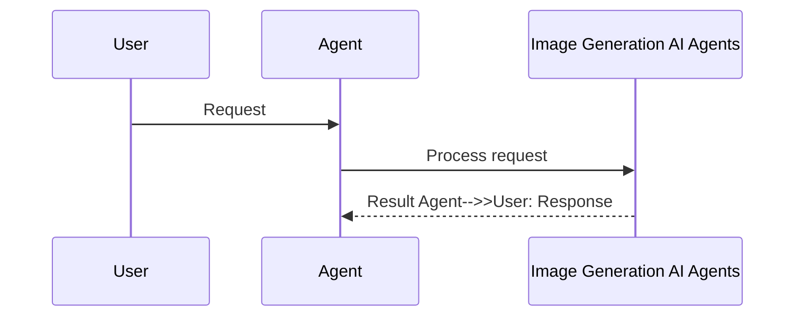

Generate images from natural language descriptions with PraisonAI Image Agents — sync or async, with OpenAI GPT image models out of the box.


```python
from praisonaiagents import ImageAgent

agent = ImageAgent()  # defaults to gpt-image-2.5-flare
agent.chat("A minimalist logo for a coffee shop")
```

The user describes an image; the image agent calls the generation API and returns the image (base64 for GPT image models).


## Default models

`ImageAgent` picks an image-capable default when you don't pass `llm=`. Pass `llm=` to override.

| Method | Default model | Why |
|---|---|---|
| `generate()` / `chat()` | `gpt-image-2.5-flare` | Current OpenAI image model |
| `edit()` | `gpt-image-2.5-flare` | Current OpenAI image model |
| `variation()` | `dall-e-2` | Only model with a variations endpoint — no GPT image replacement |

OpenAI retired `dall-e-2`/`dall-e-3` on 2026-05-12 and `gpt-image-1` on 2026-10-23. `gpt-image-2.6-flare` and `gpt-image-2.6-sunburst` exist but are not yet available on every OpenAI project — use them via `llm=` once rolled out to yours.

References: [PR #6262](https://github.com/MervinPraison/PraisonAI/pull/6262), fixes [#6259](https://github.com/MervinPraison/PraisonAI/issues/6259). Earlier: [PR #5948](https://github.com/MervinPraison/PraisonAI/pull/5948), fixes [#5944](https://github.com/MervinPraison/PraisonAI/issues/5944).

## How It Works




## Quick Start

<Steps>

<Step title="Simplest Usage">

```python
from praisonaiagents import ImageAgent

agent = ImageAgent()
result = agent.chat("A cute baby sea otter playing with a laptop")
print(result)
```

Set `OPENAI_API_KEY` in your environment before running. Uses `gpt-image-2.5-flare` by default.

</Step>

<Step title="With Explicit Model">

```python
from praisonaiagents import ImageAgent

agent = ImageAgent(llm="openai/gpt-image-2.5-flare")
result = agent.chat("A cute baby sea otter playing with a laptop")
print(result)
```

Swap in any image model, e.g. `llm="openai/gpt-image-2.5-sunburst"`.

</Step>

<Step title="With Configuration">

```python
import os
from praisonaiagents import ImageAgent

agent = ImageAgent(
    name="ImageCreator",
    llm="openai/gpt-image-2.5-flare",
)

result = agent.chat("A minimalist logo for a coffee shop", quality="high")
print(result)
```

</Step>

<Step title="Async">

```python
import asyncio
import os
from praisonaiagents import ImageAgent

async def main():
    agent = ImageAgent(name="ImageCreator")
    result = await agent.achat("A cute baby sea otter playing with a laptop")
    print(result)

asyncio.run(main())
```

<Note>
`achat()` is genuinely non-blocking as of [PR #5219](https://github.com/MervinPraison/PraisonAI/pull/5219) — the image round-trip runs on a worker thread, not the event loop. See [Non-blocking async](#non-blocking-async-pr-5219) below.
</Note>

</Step>

</Steps>

Install with LLM support: `pip install "praisonaiagents[llm]"`

## Non-blocking async (PR #5219)

`ImageAgent.agenerate_image`, `agenerate`, `aedit`, `avariation`, and (transitively) `achat` now offload the synchronous image call via `asyncio.to_thread`, so awaiting one no longer freezes the event loop for the 10–60 second image round-trip.

Reference: [PR #5219](https://github.com/MervinPraison/PraisonAI/pull/5219), fixes [#5162](https://github.com/MervinPraison/PraisonAI/issues/5162).

Run an `ImageAgent` and a text-only `Agent` side by side — the text agent keeps streaming while the image generates:

```python
import asyncio
from praisonaiagents import Agent, ImageAgent

img_agent = ImageAgent(name="ImageCreator")
text_agent = Agent(name="Writer", instructions="Write a short product blurb.")

async def main():
    # Before PR #5219 the image call ran inline on the loop thread and
    # silently starved the text agent for the whole 10–60s round-trip.
    # Now both run concurrently.
    image, blurb = await asyncio.gather(
        img_agent.achat("A minimalist logo for a coffee shop"),
        text_agent.achat("Describe a cozy neighbourhood coffee shop"),
    )
    print(image)
    print(blurb)

asyncio.run(main())
```

<Warning>
This fix landed for `ImageAgent` **only**. `VideoAgent` (`astart`, `adownload`) and `AudioAgent` (`atranscribe`) still run their synchronous call inline on the event loop as of PR #5219 and will block a concurrent `gather`. If a follow-up PR offloads them, this warning will be updated.
</Warning>

## Supported image models

`ImageAgent` works with any image model exposed through LiteLLM. The capability layer (`image_generate` / `image_edit`) automatically drops parameters the target model rejects — notably `response_format` on `dall-e-3` and `gpt-image-*` — so you do not have to special-case them yourself.

`ImageAgent` also drops `style` on OpenAI image models other than `dall-e-3` (such as the `gpt-image-*` family), which reject it. Put style cues in the prompt instead.

Extra keyword arguments — `quality` (`"low"`, `"medium"`, `"high"`, `"xhigh"`, `"max"`, `"auto"`) and Images 2.5/2.6 params such as `frame_count`, `frame_duration_ms`, `complexity`, `output_format` — pass straight through to the request:

```python
from praisonaiagents import ImageAgent

agent = ImageAgent(llm="openai/gpt-image-2.6-flare")
agent.generate("A bouncing ball", quality="low", frame_count=4, frame_duration_ms=100, output_format="gif")
```

**Default `style` on `dall-e-3`** — `ImageAgent` no longer sends `style="natural"` by default. If you do not pass `style=`, the provider picks its own default. To keep the previous output, pass `style="natural"` explicitly. This also lets `ImageAgent` work with newer image endpoints that reject `style` outright with HTTP 400 `unknown_parameter: style`.

References: [PR #5346](https://github.com/MervinPraison/PraisonAI/pull/5346) (`response_format`), [PR #6077](https://github.com/MervinPraison/PraisonAI/pull/6077) (`style` dropped on non-dall-e-3), [PR #6097](https://github.com/MervinPraison/PraisonAI/pull/6097) (`style` only sent when explicitly set), fixes [#5339](https://github.com/MervinPraison/PraisonAI/issues/5339), [#6076](https://github.com/MervinPraison/PraisonAI/issues/6076), and [#6096](https://github.com/MervinPraison/PraisonAI/issues/6096).

## Editing with `markup=` is rejected

`edit()` accepts `mask=` but not `markup=`. LiteLLM only uploads `image` and `mask` as files, so a `markup` image would be silently ignored — `ImageAgent.edit` now raises instead:

```python
from praisonaiagents import ImageAgent

agent = ImageAgent()
agent.edit("photo.png", "Make the circled cup blue", markup="markup.png")
# ValueError: 'markup' is not supported through LiteLLM's image_edit yet (it is not
# uploaded as a file). Use 'mask' or call the OpenAI SDK's images.edit directly.
```

Use a mask instead (transparent areas are edited):

```python
agent.edit("photo.png", "Make the cup blue", mask="mask.png")
```

If you need `markup`, call the OpenAI SDK's `images.edit` directly.

Reference: [PR #6262](https://github.com/MervinPraison/PraisonAI/pull/6262), fixes [#6259](https://github.com/MervinPraison/PraisonAI/issues/6259).

## Features

<CardGroup cols={2}>
  <Card title="GPT Image Models" icon="image">
    Defaults to `gpt-image-2.5-flare`; any LiteLLM image model works via `llm=`.
  </Card>
  <Card title="Async Support" icon="bolt">
    Asynchronous operations for better performance in concurrent environments.
  </Card>
  <Card title="Natural Style" icon="paintbrush">
    On `dall-e-3`, pass `style="natural"` or `style="vivid"` to pick a style — otherwise the provider chooses. On other OpenAI image models, style is set via the prompt (`ImageAgent` drops the parameter automatically so the call does not 400).
  </Card>
  <Card title="Verbose Mode" icon="message">
    Detailed output logging for better debugging and monitoring.
  </Card>
</CardGroup>

## Best Practices

<AccordionGroup>

<Accordion title="Use environment variables for API keys">
Read `OPENAI_API_KEY` from the environment — never hardcode keys in source files.
</Accordion>

<Accordion title="Pick the right model">
Omit `llm=` to use the built-in default (`gpt-image-2.5-flare` for generate/edit, `dall-e-2` for variation). Tune cost vs. detail with `quality=` (`"low"` … `"max"`), or switch models via `llm=`.
</Accordion>

<Accordion title="Prefer async in web apps">
Use `achat()` when serving multiple concurrent image requests from a FastAPI or gateway handler.
</Accordion>

<Accordion title="Describe style explicitly">
Pass `style="natural"` or `style="vivid"` on `dall-e-3` for consistent visual output across runs. For other OpenAI image models (`gpt-image-*`), put style cues in the prompt instead — `style` is not supported there and `ImageAgent` drops it automatically.

If you don't pass `style=`, `ImageAgent` sends nothing and the provider picks the default.
</Accordion>

</AccordionGroup>

## Related

<CardGroup cols={2}>
  <Card title="Multimodal" icon="images" href="/features/multimodal">
    Text, image, and audio processing with agents
  </Card>
  <Card title="Outbound Media Delivery" icon="photo-film" href="/features/outbound-media-delivery">
    Deliver generated images to users via messaging bots
  </Card>
  <Card title="Async Safety" icon="shield-check" href="/features/async-safety">
    How blocking calls are offloaded to keep the event loop responsive
  </Card>
</CardGroup>
