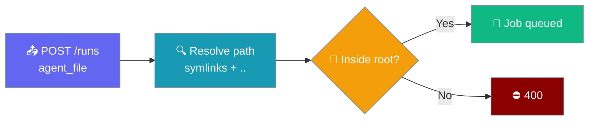

```yaml
# ./agents.yaml — lives in the directory you start the jobs server from
framework: praisonai
topic: Research
roles:
  researcher:
    role: Researcher
    goal: Summarise {topic}
    backstory: You write short, clear summaries.
    tasks:
      summarise:
        description: Summarise the latest news about {topic}
        expected_output: Three bullet points
```

```bash
praisonai serve jobs --port 8005

# ✅ Accepted — resolves under the server's working directory
curl -X POST http://127.0.0.1:8005/api/v1/runs \
  -H "Content-Type: application/json" \
  -d '{"prompt": "AI agents", "agent_file": "agents.yaml"}'

# ❌ 400 — outside the root
curl -X POST http://127.0.0.1:8005/api/v1/runs \
  -H "Content-Type: application/json" \
  -d '{"prompt": "x", "agent_file": "/etc/passwd"}'
```

The Jobs API only loads `agent_file` paths under a trusted root — the server's working directory by default.



## Quick Start

<Steps>
<Step title="Start the server next to your YAML">

```bash
cd /srv/praisonai/agents
praisonai serve jobs --port 8005
```

Any `agent_file` under `/srv/praisonai/agents` is accepted.

</Step>
<Step title="Or set an explicit root">

```bash
export PRAISONAI_JOBS_AGENT_ROOT=/srv/praisonai/agents
praisonai serve jobs --port 8005
```

</Step>
</Steps>

---

## How It Works

| Step | What happens |
|------|--------------|
| **Resolve** | `agent_file` is made absolute and symlinks are resolved |
| **Confine** | The resolved path must equal the root or sit below it |
| **Accept / reject** | Inside → job is queued. Outside → `400` with `agent_file must be within PRAISONAI_JOBS_AGENT_ROOT (<root>)` |

---

## Configuration

| Env var | Default | Effect |
|---------|---------|--------|
| `PRAISONAI_JOBS_AGENT_ROOT` | server's current working directory | Directory every submitted `agent_file` must resolve under. Set it to widen or narrow the scope. |

### What returns 400

- Absolute paths outside the root, e.g. `/etc/passwd`
- Relative escapes, e.g. `../outside.yaml`
- Symlinks inside the root that point outside it

<Note>
Requests without `agent_file` (for example inline `agent_yaml` or a `recipe_name`) are not affected.
</Note>

<Warning>
Before this default, an unset `PRAISONAI_JOBS_AGENT_ROOT` meant **no sandbox** — any path was accepted. If you relied on that, set `PRAISONAI_JOBS_AGENT_ROOT` explicitly to the directory you need.
</Warning>

---

## Best Practices

<AccordionGroup>
  <Accordion title="Use a dedicated agents directory">
    Keep YAML files in one folder and point `PRAISONAI_JOBS_AGENT_ROOT` at it, rather than widening the root to `/`.
  </Accordion>
  <Accordion title="Set an API key on shared hosts">
    Without `PRAISONAI_JOBS_API_KEY`, the server logs a startup warning that any local process can submit jobs. Set the key whenever other users or services share the host.
  </Accordion>
  <Accordion title="Start the server from a known directory">
    The default root is the working directory at request time, so launch the server from your agents folder (or set the env var) in systemd units and containers.
  </Accordion>
</AccordionGroup>

---

## Related

<CardGroup cols={2}>
<Card title="Async Jobs" icon="rocket" href="/features/async-jobs">
  Submit and manage long-running jobs
</Card>
<Card title="Headless YAML Runs" icon="terminal" href="/features/headless-yaml-runs">
  Run YAML agents without a UI
</Card>
<Card title="Protected Paths" icon="shield" href="/features/protected-paths">
  Block tools from sensitive files
</Card>
<Card title="Security Environment Variables" icon="key" href="/features/security-environment-variables">
  All security-related env vars
</Card>
</CardGroup>
