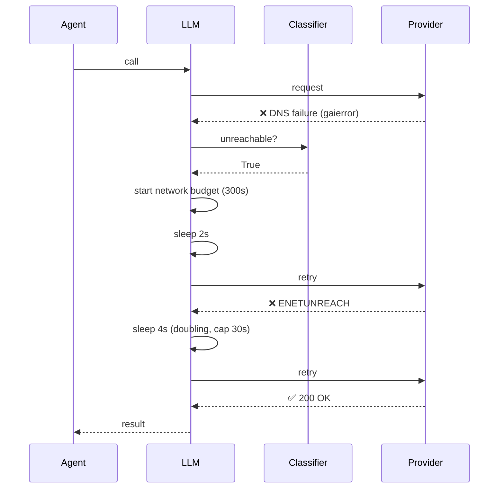
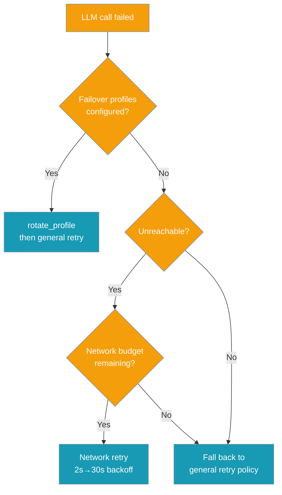

Short network outages such as VPN reconnects, Wi-Fi drops, or a laptop waking from sleep no longer abort your run. DNS failures and "no route to host" errors get their own retry budget, separate from `max_retries`.

```python
from praisonaiagents import Agent

# Default is 300s; nothing to configure for most users.
agent = Agent(
    name="Researcher",
    instructions="Research topics on the web",
    llm="openai/gpt-4o-mini",
)
agent.start("Find recent papers on diffusion models")
# A 2-minute Wi-Fi drop no longer aborts the run.
```

The user runs an agent during a flaky network. The LLM call waits out the outage and continues when connectivity returns.

```mermaid
graph LR
    Call[📞 LLM Call] --> Try{🔄 Attempt}
    Try -->|Success| Done[✅ Return]
    Try -->|Server error 5xx / 429| General[📊 General budget<br/>max_retries=3]
    Try -->|DNS / no route / unreachable| Network[🌐 Network budget<br/>network_retry_budget=300s]
    Network -->|Budget left| Wait[⏱️ 2s → 4s → … → 30s]
    Wait --> Try
    Network -->|Budget exhausted| General
    General -->|Attempts left| Back[⏱️ General backoff]
    Back --> Try
    General -->|Exhausted| Fail[🛑 Raise]

    classDef call fill:#8B0000,stroke:#7C90A0,color:#fff
    classDef gate fill:#F59E0B,stroke:#7C90A0,color:#fff
    classDef proc fill:#189AB4,stroke:#7C90A0,color:#fff
    classDef cfg fill:#6366F1,stroke:#7C90A0,color:#fff
    classDef ok fill:#10B981,stroke:#7C90A0,color:#fff
    classDef err fill:#8B0000,stroke:#7C90A0,color:#fff

    class Call call
    class Try gate
    class General,Network cfg
    class Wait,Back proc
    class Done ok
    class Fail err
```

<Note>
The network budget lives in PraisonAI's `LLM` class. It applies when the agent uses that class: a `provider/model` string (`llm="openai/gpt-4o-mini"`), a dict config (`llm={"model": "gpt-4o"}`), a `base_url`, or `auth=`. A bare model name such as `llm="gpt-4o-mini"` uses the native OpenAI client, which has its own retries. See [OpenAI Client Retries](/features/openai-client-retries).
</Note>

---

## Quick Start

<Steps>
<Step title="Do nothing — you already have 300s of network retries">
```python
from praisonaiagents import Agent

agent = Agent(
    name="Assistant",
    instructions="Answer carefully",
    llm="openai/gpt-4o-mini",
)
agent.start("Summarise the attached report.")
# DNS blips / unreachable errors retry for up to 5 minutes.
```
</Step>

<Step title="Raise the budget for an unattended CI run">
```python
from praisonaiagents import Agent

agent = Agent(
    name="CI Agent",
    instructions="Triage failing tests",
    llm={"model": "gpt-4o", "network_retry_budget": 1800},  # 30 minutes
)
agent.start("Summarise today's failing tests")
```
</Step>

<Step title="Turn it off and restore the old behaviour">
```python
from praisonaiagents import Agent

agent = Agent(
    name="Strict Agent",
    instructions="Fail fast",
    llm={"model": "gpt-4o", "network_retry_budget": 0},
)
agent.start("Hello")
```
</Step>
</Steps>

---

## How It Works



- **Backoff schedule:** `2s, 4s, 8s, 16s, 30s, 30s, …` until the deadline.
- **Clamped final wait:** the last sleep is cut to the time left, so it never overshoots the budget.
- **`max_retries` is not consumed** while on this path.
- **Budget exhausted:** once the deadline passes, further errors fall back to the general retry policy.
- **Failover profiles first:** when an auth-profile failover manager is configured, this path is skipped so profile rotation can run first.
- **Sync and async** calls behave the same.

### What counts as "unreachable"

| Detection source | Examples |
|------------------|----------|
| Exception class | `socket.gaierror` |
| `errno` on `OSError` | `ENETUNREACH`, `EHOSTUNREACH`, `ENETDOWN` |
| Message text (only when there is no HTTP status, or for `APIConnectionError`) | `Temporary failure in name resolution`, `name or service not known`, `nodename nor servname`, `getaddrinfo failed`, `ENOTFOUND`, `EAI_AGAIN`, `network is unreachable`, `no route to host`, `ENETUNREACH`, `EHOSTUNREACH` |
| Exception chain | Up to 8 links via `__cause__` / `__context__`; for grouped exceptions, every child must be unreachable |

**Deliberately excluded:** `ConnectionRefusedError`, `ConnectionResetError` (mid-response resets), and any error carrying an HTTP status code. The one exception is litellm's `APIConnectionError`, which carries a synthetic 500 but is still a pre-send failure. These keep their current behaviour because they can mean the request reached a server.

### Which budget handles an error?



---

## Configuration Options

| Option | Where to set | Type | Default | Description |
|--------|--------------|------|---------|-------------|
| `network_retry_budget` | `llm={...}` dict / `LLM(...)` kwarg | `int` seconds | `300` | Total wall-clock seconds to keep retrying an unreachable-class error. `0` disables it. |
| `max_retries` | `llm={...}` dict / `LLM(...)` kwarg | `int` | `3` | Unchanged. Used only for other retryable errors and after the network budget expires. |
| `retry_delay` | `llm={...}` dict / `LLM(...)` kwarg | `int` | `60` | Unchanged. Fixed general retry delay, used only when set explicitly. |

<Note>
`network_retry_budget` is a PraisonAI-internal setting and is **not** sent to the provider. It never appears in the HTTP request body.
</Note>

---

## Common Patterns

- **CI / unattended runs:** raise `network_retry_budget` to `1800` (30 min) to ride out a gateway or VPN blip.
- **Local LLMs (LM Studio, vLLM, Ollama):** keep the default. An endpoint that can't be resolved is still a real failure, and the budget caps the wait at 300 s.
- **Strict fail-fast pipelines:** set `network_retry_budget=0` to surface DNS failures immediately.
- **Monitoring:** the `retry` callback fires on every network retry with `attempt=<n>`, `max_attempts=None` (the path is time-budgeted, not counted), and `retry_in_seconds=<delay>`.

---

## Best Practices

<AccordionGroup>
<Accordion title="Keep the default unless you need another value">
300 s covers most VPN and Wi-Fi outages without leaving a run hanging for long.
</Accordion>
<Accordion title="Pair it with a per-attempt timeout">
Each attempt is still bounded by the LLM `timeout` (default 600 s). See [LLM Timeouts](/features/llm-timeouts).
</Accordion>
<Accordion title="With failover profiles, this path is skipped">
If auth-profile failover is configured, the retry loop rotates to another profile instead of waiting for the network.
</Accordion>
<Accordion title="Setting 0 is a strict opt-out">
With `network_retry_budget=0`, a DNS blip counts against `max_retries` again and can abort the run.
</Accordion>
</AccordionGroup>

---

## Related

<CardGroup cols={2}>
<Card title="Agent Retry" icon="clock-rotate-left" href="/features/agent-retry">
  General retry with jittered exponential backoff
</Card>
<Card title="LLM Error Classification" icon="tags" href="/features/llm-error-classification">
  How failures are categorised and routed
</Card>
<Card title="LLM Timeouts" icon="stopwatch" href="/features/llm-timeouts">
  Per-attempt time limits
</Card>
<Card title="Model Failover" icon="arrows-rotate" href="/features/failover">
  Rotate auth profiles and models on failure
</Card>
</CardGroup>
