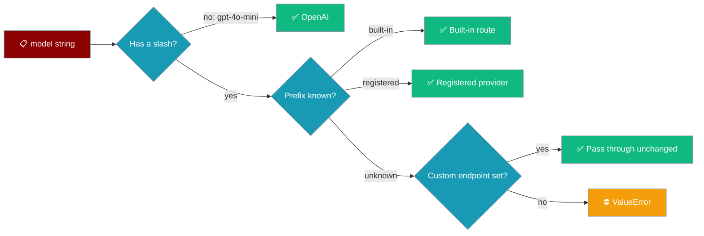

Point a CrewAI or AutoGen YAML at `mistral/mistral-small` without registering the provider, and PraisonAI tells you at startup instead of returning a confusing 404 from OpenAI.



## Quick Start

<Steps>
<Step title="Built-in prefix works">
```yaml agents.yaml
framework: crewai
topic: Research
roles:
  researcher:
    role: Researcher
    goal: Summarise a topic
    backstory: You are a concise researcher.
    llm:
      model: groq/llama-3.3-70b-versatile
    tasks:
      summary:
        description: Summarise the history of the transistor.
        expected_output: Three sentences.
```
</Step>

<Step title="Unknown prefix without an endpoint fails loudly">
Change the model to `mistral/mistral-small` with no endpoint configured:

```
ValueError: Unknown LLM provider prefix 'mistral' in model 'mistral/mistral-small'.
Use one of ['anthropic', 'cohere', 'google', 'groq', 'ollama', 'openai', 'openrouter'],
set base_url/OPENAI_API_BASE for an OpenAI-compatible endpoint, or register it via
praisonai.llm.register_llm_provider().
```
</Step>

<Step title="Send it to an OpenAI-compatible endpoint">
Setting a custom endpoint passes slashed ids through unchanged — ideal for LiteLLM proxies, vLLM, and gateways.

```bash
export OPENAI_API_BASE=http://localhost:4000/v1
praisonai agents.yaml
```

Or per role in YAML:

```yaml
    llm:
      model: meta-llama/Llama-3.1-8B
      base_url: http://localhost:8000/v1
```
</Step>

<Step title="Or register the provider">
```python
from praisonai.llm import register_llm_provider

class MistralProvider:
    provider_id = "mistral"

    def __init__(self, model_id, config=None):
        self.model_id = model_id
        self.config = config or {}

register_llm_provider("mistral", MistralProvider)
```

See [Custom Provider Registry](/models/custom-provider) for a full provider implementation.
</Step>
</Steps>

---

## When does the error fire?

All three must be true:

1. The model string contains `/` — plain OpenAI ids such as `gpt-4o-mini` still default to OpenAI.
2. No custom endpoint is set — `base_url`, `OPENAI_API_BASE`, and `OPENAI_BASE_URL` are all unset.
3. The prefix is not built-in and not registered with `register_llm_provider(...)`.

### Built-in prefixes

| Prefix | Example |
|---|---|
| `openai` | `openai/gpt-4o-mini` |
| `groq` | `groq/llama-3.3-70b-versatile` |
| `cohere` | `cohere/command-r` |
| `ollama` | `ollama/llama3.2` |
| `anthropic` | `anthropic/claude-3-5-sonnet` |
| `google` | `google/gemini-2.0-flash` |
| `openrouter` | `openrouter/meta-llama/llama-3.1-8b-instruct` |

Prefixes already in the `praisonai.llm` registry (for example `vllm` or `lm_studio`) count as registered.

---

## Who this affects

| Entry point | Affected |
|---|---|
| `framework: crewai` YAML `llm.model` | ✅ Yes |
| `framework: autogen` YAML `llm.model` | ✅ Yes |
| Direct `PraisonAIModel(model=...)` in Python | ✅ Yes |
| `praisonaiagents.Agent(llm="mistral/...")` | ❌ No — routed through LiteLLM directly |

---

## Best Practices

<AccordionGroup>
<Accordion title="Gateways: set the endpoint once">
If every model goes through one LiteLLM proxy, export `OPENAI_API_BASE` and keep the slashed ids as-is.
</Accordion>

<Accordion title="Native providers: register them">
For a provider with its own SDK (Bedrock, Mistral, Cloudflare), call `register_llm_provider` before running the YAML.
</Accordion>
</AccordionGroup>

---

## Related

<CardGroup cols={2}>
  <Card title="Custom Provider Registry" icon="plug" href="/models/custom-provider">
    Register your own LLM providers
  </Card>
  <Card title="CrewAI" icon="users" href="/framework/crewai">
    Run CrewAI from PraisonAI YAML
  </Card>
</CardGroup>
