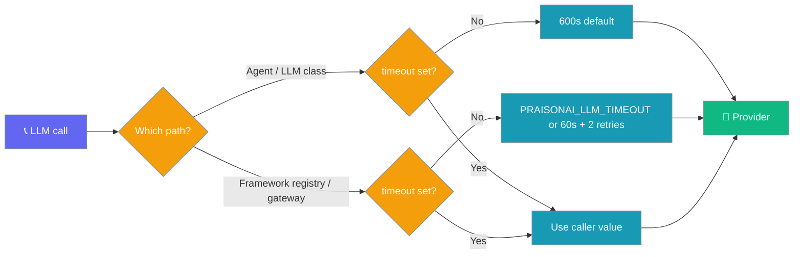

Every agent gets a bounded LLM timeout for free — no setting needed. Override it per agent when you need more or less.



## Quick Start

<Steps>
<Step title="Do nothing — you get a 600s bound">
No timeout set → each request is bounded to 600 seconds (10 minutes). A black-holed provider stops the turn after 10 minutes instead of litellm's 100-minute ceiling.

```python
from praisonaiagents import Agent

agent = Agent(
    name="Assistant",
    llm="gpt-4o-mini",
    instructions="Answer carefully",
)
agent.start("Summarise the attached report.")
```
</Step>

<Step title="Set your own timeout">
An explicit `timeout` always wins over the default.

```python
from praisonaiagents import Agent

agent = Agent(
    name="Fast",
    instructions="Answer briefly",
    llm={"model": "gpt-4o", "timeout": 30},  # 30s wins over the 600s default
)
agent.start("What is 2 + 2?")
```
</Step>
</Steps>

---

## How It Works

There are two timeout layers. Agents built with `praisonaiagents` use the first one.

| Layer | Default | When it applies | Drop the default |
|-------|---------|-----------------|---------|
| `Agent(llm=...)` / `LLM` class | **600 s** | Whenever `timeout` is not set on the agent's `llm` | `timeout=None` or `timeout=0` |
| Framework registry / gateway (`praisonai`) | **60 s** + 2 retries | Framework-wrapped calls that go through the provider registry or a gateway (OpenRouter, LiteLLM-Proxy, Custom) | Set `timeout` per call |

| You write | Resolved timeout | Sent to provider |
|-----------|------------------|------------------|
| `llm="gpt-4o"` or `llm={"model": "gpt-4o"}` | `600` | `timeout=600` |
| `llm={"model": "gpt-4o", "timeout": 30}` | `30` | `timeout=30` |
| `llm={"model": "gpt-4o", "timeout": None}` | `None` | Not sent — litellm's ~100 min ceiling applies |
| `llm={"model": "gpt-4o", "timeout": 0}` | `0` | Not sent — litellm's ~100 min ceiling applies |

<Note>
**Why 600 s?** It matches the OpenAI SDK default already used for bare model names, so every route has the same bound. It is long enough for non-streaming reasoning-model calls that legitimately exceed 2 minutes, while cutting a stuck call from 100 minutes to 10.
</Note>

<Note>
**Streaming:** for streaming calls the 600 s is a *read-gap* bound (max gap between chunks), not the total duration — a slow stream that keeps sending data is not cut off.
</Note>

---

## Configuration Options

| Setting | Layer | Default | How to override |
|---------|-------|---------|-----------------|
| `timeout` | Agent / `LLM` class | `600` | `Agent(llm={"model": "...", "timeout": N})` |
| `PRAISONAI_LLM_TIMEOUT` | Framework registry / gateway | `60` | Env var, float seconds. Applies only where the call didn't set `timeout` |
| `num_retries` | Framework registry / gateway | `2` | Per-call `num_retries=` |

<Note>
An invalid `PRAISONAI_LLM_TIMEOUT` (e.g. `abc`) safely falls back to `60` seconds and logs a warning — a bad value never breaks a run.
</Note>

---

## Opting Out

Rarely needed. Passing `timeout=None` (or `0`) drops the 600 s default and falls back to litellm's own ~100 minute ceiling (the old behaviour).

```python
from praisonaiagents import Agent

agent = Agent(
    name="LongRunner",
    instructions="Work through the long task",
    llm={"model": "gpt-4o", "timeout": None},  # opt out of the 600s default
)
```

<Warning>
Without the 600 s bound, a stuck provider can hang the agent for up to ~100 minutes per attempt. Prefer a large explicit value like `1800` instead.
</Warning>

---

## Best Practices

<AccordionGroup>
<Accordion title="Raise the timeout, don't remove it">
A large explicit `timeout` still bounds a stuck provider. Prefer `1200` or `1800` for very slow local models over an unbounded wait.
</Accordion>

<Accordion title="Override per agent for one slow model">
Keep the default and raise `timeout` only for the specific agent that needs it.

```python
from praisonaiagents import Agent

agent = Agent(name="LocalLLM", llm={"model": "ollama/llama3", "timeout": 900})
```
</Accordion>

<Accordion title="Know which layer you're on">
`PRAISONAI_LLM_TIMEOUT` only affects the framework registry / gateway layer. To change the timeout for a `praisonaiagents` agent, set `timeout` in its `llm` dict.
</Accordion>

<Accordion title="Registry retries are bounded on purpose">
The registry default `num_retries=2` recovers from transient blips without amplifying a real outage into a retry storm. Raise it only when a provider is known-flaky.
</Accordion>
</AccordionGroup>

---

## Related

<CardGroup cols={2}>
<Card title="LLM Configuration" icon="sliders" href="/configuration/llm-config">
  Full reference for timeouts, retries, and headers
</Card>
<Card title="Model Fallback" icon="shuffle" href="/features/model-fallback">
  Switch models when a provider fails
</Card>
<Card title="Tool Timeout" icon="stopwatch" href="/features/tool-timeout">
  Bound tool execution the same way
</Card>
<Card title="Models" icon="microchip" href="/models">
  Configure providers and model names
</Card>
</CardGroup>
